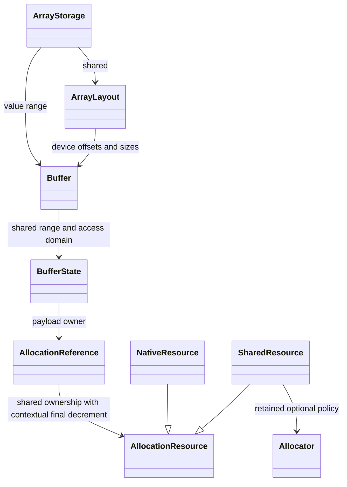
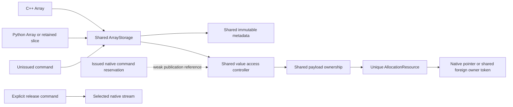

# Allocation providers and ordered ownership release

Status: native ordered release and async allocation passed the focused CPU
and CUDA checks in [the memory validation snapshot](../dev/array_async_memory_validation_2026-10-21/).
Seven CUDA engine cases passed 3890 assertions, including Compute Sanitizer
with zero errors. The [final phase report](../dev/array_runtime_phase_2026-10-21.md)
also records the completed Python and full MPI matrices. The earlier eager
snapshot predates this slice.

The public handle graph stays shared: C++ Arrays, Python Arrays and retained
views own ArrayStorage; storage owns its value Buffer and shared ArrayLayout.
Each Buffer range retains the same allocation-wide access controller.
The physical payload now has context-aware shared ownership beneath that
controller. This is an ordinary ownership reference count, replacing the
previous payload shared_ptr control block. There is no count separating
public handles from kernel pins and no second registry of pending uses.



AllocationResource is the backend boundary: Data, Bytes, GetDevice,
CanReleaseOrdered and Release. The resource object itself has one owner in
the shared payload control block. NativeResource owns the native pointer.
SharedResource retains a shared external owner, such as an aliasing owner
token for a tensor, plus an optional existing Allocator policy. External
owners remain shared with their provider; importing does not take exclusive
ownership of their memory. Import once and derive Buffer aliases from the
same allocation/access domain.



## Explicit final release

```cpp
auto a = R::AllocateArrayAsync<double, R::FixedRows<6>>(
    engine, compute, R::RowLayout::Dense(nCells, 6, 8));
auto alias = a;
R::SubmitArrays(engine, compute, updateKernel, R::ReadWrite(a));
engine.ReleaseOn(std::move(a), compute); // One reference; alias survives.
comm.WaitFor(compute.Record());
R::SubmitArrays(engine, comm, consumeKernel, R::Read(alias));
engine.ReleaseOn(std::move(alias), comm);
engine.Synchronize();
```

The final shared payload decrement receives the explicit release context.
Non-final decrements only drop ownership. A release on one stream does not
install that stream as an allocation's mutable last-use stream. If another
alias survives and is later released elsewhere, its eventual final decrement
uses its own context. No use_count snapshot, thread-local stream or destructor
thread identity decides whether freeing is safe.

The Array/metadata release helpers first retain payload-bearing Buffer handles,
then drop the higher-level owners, then release those retained handles with
the context. Buffer does the same between its access controller and physical
payload. The last decrement is atomic; this preserves exactly-once release
even when distinct aliases are destroyed concurrently.

For native CUDA resources, ordered release emits cudaFreeAsync on the selected
compatible stream. It may differ from the allocation stream. The caller must
join independent users before a potentially final release; unchecked eager
mode supplies no missing dependency proof or automatic join. A future final
Synchronize cannot repair an incorrectly placed free.

Successful native operator submission hands off eligible CUDA operand owners
to this ordered release mechanism. Its scheduled access keeps a weak
publication reference until actual completion. If an Array/Buffer alias still
exists, completion updates that controller and rejects stale immediate access
while writes are pending. If no owner survives, the controller can disappear;
the CUDA stream still orders the already submitted accesses before its free.
Metadata device buffers follow the same ownership rules. There are no shared
ownership operations inside kernel element loops.

CPU operators keep their operands through actual execution. Host DMA buffers
and external resources without an ordered-release capability are also retained
through actual completion. The frontend ReleaseOn call stays the same; the
launcher and resource capability determine whether release happens at native
issue or after completion. AllocationResource implementations must provide a
safe ordinary-RAII fallback and cleanup for unpublished construction failures.

## Async allocation and initialization

AllocateBuffer(stream, bytes) returns a CPU buffer already initialized, or a
CUDA buffer whose cudaMallocAsync and zero initialization are queued in the
chosen stream. The CUDA initialization has a pending write reservation, so
immediate access fails until its completion is observed. Same-stream kernels
use queue order; cross-stream consumers use an explicit Record/Wait boundary.
Allocation does not create a native event of its own.

AllocateArrayAsync creates new tables (or any CPU row layout). AllocateLikeAsync
supports table, padded and CSR Arrays by sharing an existing prepared layout,
including device offsets/sizes, and asynchronously allocating only new values.
Prepare/upload new variable GPU metadata during setup. The API explicitly
rejects creating an unprepared variable GPU layout in AllocateArrayAsync; it
does not conceal a synchronous metadata upload inside that call.

```cpp
R::Array<double> prepared(R::RowLayout::Padded(rowSizes, capacity), gpu);
auto coefficients = R::AllocateLikeAsync(engine, compute, prepared);
// Identical shared metadata; separate values, access controller and versions.
```

Ordinary destruction outside an explicit release context remains conservative.
For a cudaMallocAsync allocation, the native provider synchronizes before an
unplaced free because cudaFree alone does not establish completion for that
allocation kind. Use ReleaseOn for the normal asynchronous solver path. This
fallback is deliberately outside ordinary kernel submission and does not
introduce an event per allocation or kernel.

The native allocation/free ordering follows
[CUDA's stream-ordered allocator contract](https://docs.nvidia.com/cuda/cuda-runtime-api/cuda_runtime_api/group__CUDART__MEMORY__POOLS.html).
Foreign tensor/provider adapters can extend AllocationResource; the existing
shared-owner import remains conservative and requires no Torch dependency.

Graph capture, native provider failure recovery, automatic dependency checking,
and dynamic variable-metadata construction within a captured region are not
implemented by this slice. Its API keeps native allocation/free and readiness
on explicit streams so a future compatible capture backend can lower them.
