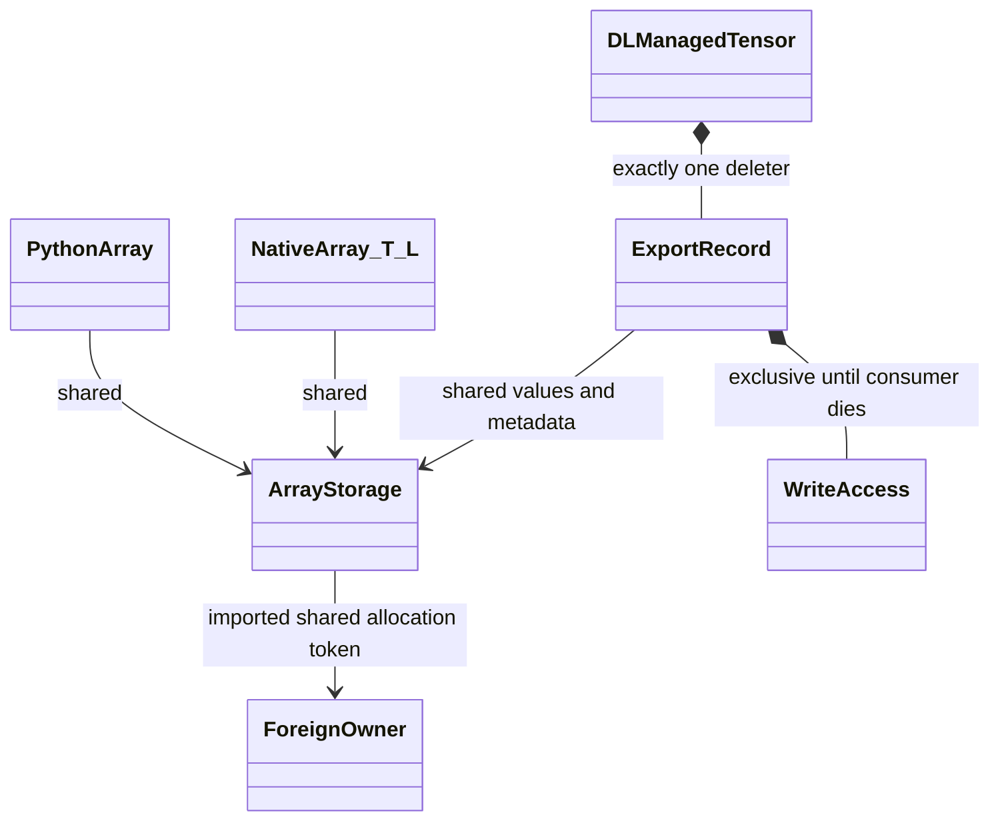

# DLPack and Torch sharing

The Python adapter shares numeric Array storage with DLPack consumers without
linking LibTorch. The vendored DLPack v1.0 header is header-only; the adapter uses
the legacy `DLManagedTensor` capsule ABI, supported by the tested consumers.
`max_version` is an upper bound, not a demand to return a versioned capsule.
This is forward data interoperability, with no autograd or adjoint contract.

```python
from DNDSR.DNDS import Runtime as R
import numpy as np
import torch

a = R.Array(R.RowLayout.dense(100, 5, 8), np.dtype("float64"))
a[:] = 2
t = torch.from_dlpack(a)   # same address, shape (100, 5), strides (8, 1)
t.mul_(3)
del t                     # last tensor alias releases the DNDS write lease
assert a[0, 0] == 6

t = torch.zeros((100, 5), dtype=torch.float64)
b = R.from_dlpack(t)       # retains the producer's allocation, not a copy
b[2, 3] = 7
assert t[2, 3] == 7
```

## Supported representations

| Direction | Supported | Explicit rejection |
|---|---|---|
| DNDS export | Table with arbitrary row stride and contiguous columns; float32/64 and signed/unsigned 8/16/32/64-bit integers; CPU or CUDA | CSR, variable padded rows, registered POD codecs, object/complex/unsupported scalar dtypes, requested copies or device changes |
| DNDS import | Writable contiguous 1D or 2D numeric producer, CPU or CUDA, including empty arrays and offset slices | Noncontiguous rows/columns, negative strides, unsupported devices/dtypes/dimensions, consumed or versioned capsules |

A vector is represented as an N-by-1 table. DNDS export preserves table padding
in the row stride; it does not expose padding as logical columns. Import requires
contiguous storage because a general DLPack strided slice does not guarantee the
trailing row capacity required by `RowLayout::Elements()`. Materialize the producer
explicitly when necessary. Ragged values and offsets are not implicitly flattened;
a future component adapter can expose them separately with their own contracts.
Readonly producers must reject the writable legacy capsule export (NumPy does).

## Ownership and access



Concrete export: C++ Array and Python Array retain storage S; a Torch tensor and
its slices share one managed export E; E retains S and its write lease. Deleting
or resetting either Array handle leaves E valid. Only the last foreign alias
invokes E's deleter and releases the lease. An unconsumed capsule invokes the same
deleter. The capsule can be consumed only once. Exporting to readonly NumPy still
holds an exclusive lease because this ABI cannot constrain future consumers to
read-only access. Normal `a.numpy()` remains an independent snapshot.

Concrete import: ArrayStorage S owns a Buffer whose shared allocation token owns
the producer's managed tensor. C++ aliases and Python debug views retain S after
the producer's Python handle is deleted. The producer deleter runs exactly once
after DNDS's last actual use. Deleters that may touch Python acquire the GIL;
Python engine destruction releases the GIL while draining worker tasks.

## Caller responsibilities and asynchronous use

1. Finish DNDS producers before exporting. Pending accesses are rejected rather
   than inferred or silently synchronized. A foreign tensor holds an exclusive
   lease: native/Python DNDS reads, writes, MPI bindings that begin using it, and
   a second export must wait until all foreign aliases are released.
2. A CUDA consumer passes its stream to `__dlpack__`. The export lease retains
   storage through actual use and fences that stream on final deletion. Keep the
   stream alive until then. Work on other foreign streams must be joined into
   that stream **before** the last alias is released. A final unrelated global
   synchronization does not repair an earlier unsafe release.
3. `from_dlpack` asks a CUDA producer to establish readiness on the legacy stream,
   then observes that stream before publishing ready storage. Later foreign work
   is not covered by that initial handshake. Explicitly synchronize foreign
   producers before DNDS reads and DNDS work before foreign consumers.
4. Import each foreign allocation once, then use DNDS aliases and views. Repeated
   imports of foreign aliases create independent access controllers. DLPack has no
   universal allocation identity or callback for subsequent foreign mutations;
   it cannot discover aliases, intercept Torch writes, or enforce those writes
   against a DNDS lease. The external owner must participate in the access and
   ordering contract. The supplied pointer, capacity and placement are trusted.
5. Explicit `engine.synchronize()` remains the error-observation boundary.
   Destructor draining is a lifetime fallback, not error reporting. No graph
   capture, cross-device copy, or stream-ordered foreign allocator release is
   promised by this conservative adapter. Native engine allocation/release retains
   its existing asynchronous behavior.

For a non-default Torch stream:

```python
consumer, side = torch.cuda.Stream(), torch.cuda.Stream()
with torch.cuda.stream(consumer):
    t = torch.from_dlpack(a)  # a is a ready CUDA Array
    t.add_(1)
side.wait_stream(consumer)
with torch.cuda.stream(side):
    t.mul_(2)
consumer.wait_stream(side)
del t                       # fences consumer, which now covers both uses
```

Protocol references: [DLPack Python specification](https://dmlc.github.io/dlpack/latest/python_spec.html),
[DLPack v1.0 header](https://github.com/dmlc/dlpack/blob/v1.0/include/dlpack/dlpack.h),
[PyTorch DLPack API](https://docs.pytorch.org/docs/2.14/dlpack.html).
The implementation's stricter lease/lifetime policy is a DNDS design choice.
