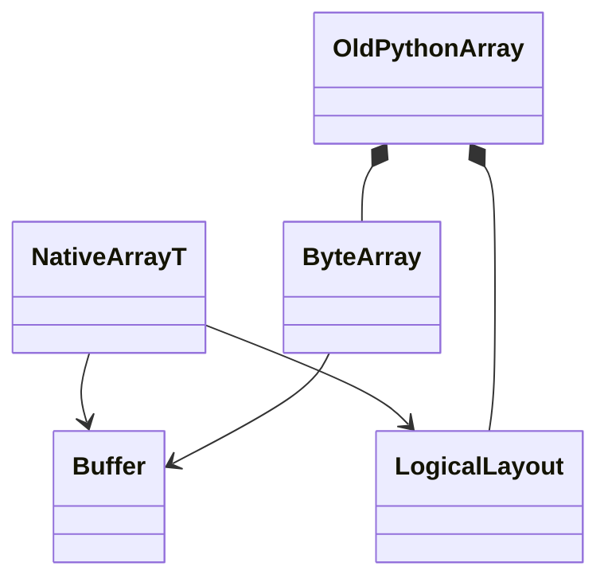
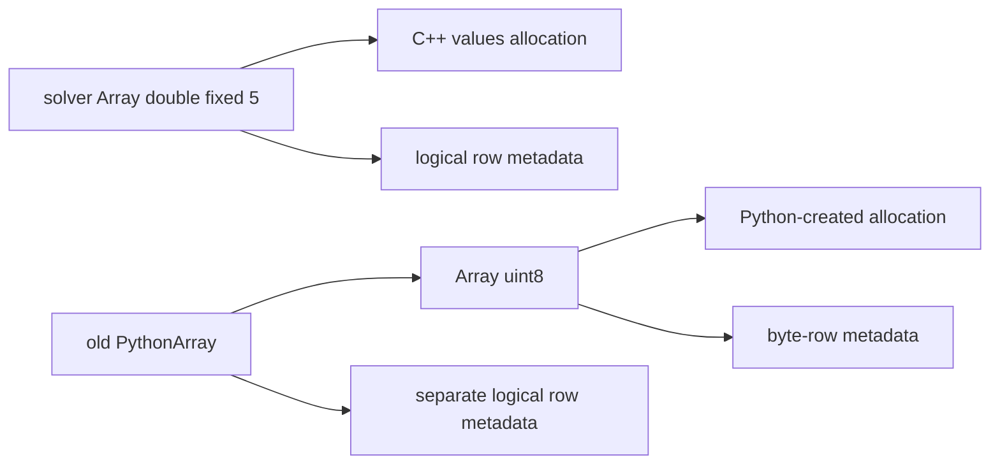
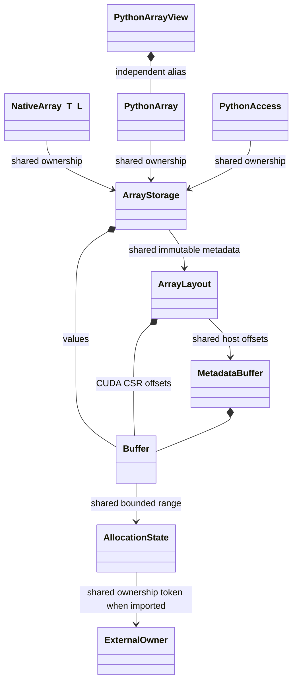
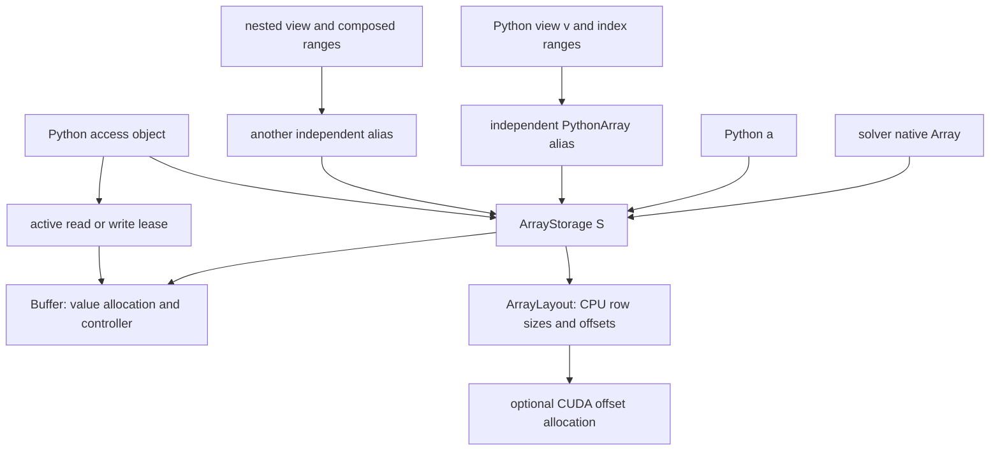
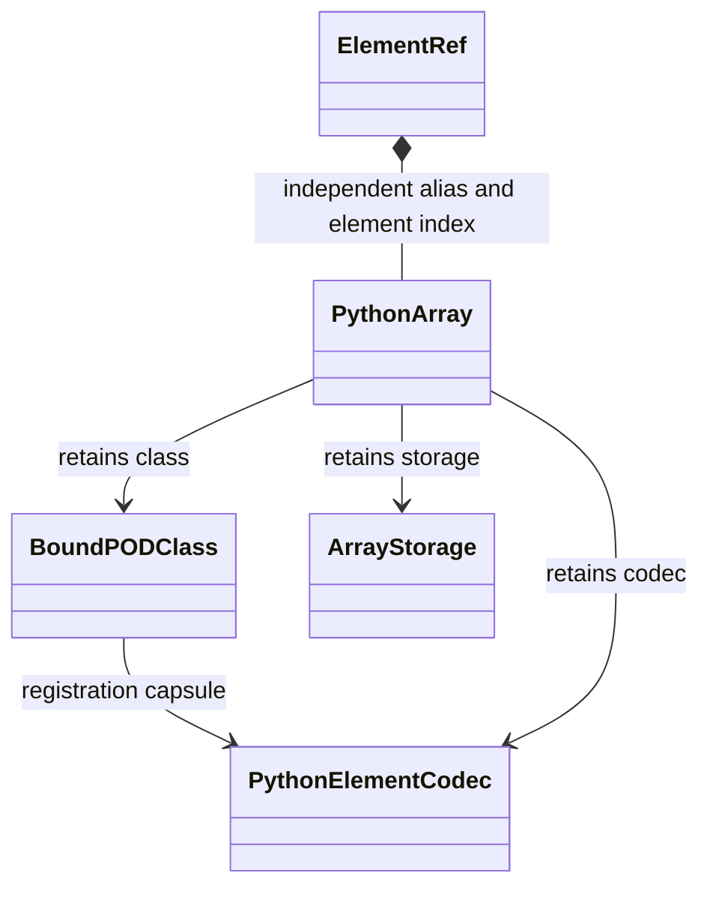
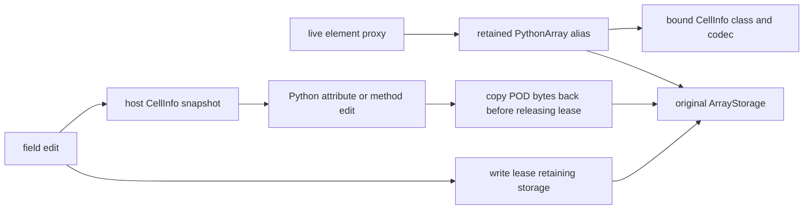

# C++ / Python Array ownership and POD access

Optional numeric tensor sharing is described in [DLPack and Torch sharing](ArrayDLPack.md),
including the managed export lease, imported allocation ownership, and foreign
stream/alias responsibilities. It adds no LibTorch dependency to native DNDS.

The Python `Runtime.Array` and C++ `Runtime::Array<T,L>` share one
`shared_ptr<const ArrayStorage>`. Exporting or accepting a native Array copies
only a handle. It does not copy values, translate row offsets to bytes, or
instantiate Python Array methods for every `T,L`. Allocation and immutable
metadata live together; mutable values remain controlled by leases. A unique
storage can now enter an exclusive row-edit state and publish a replacement
layout on Commit. [Row editing](ArrayRowEditing.md) defines that protocol;
retained views force explicit detachment rather than being silently changed.

## Previous byte-Array wrapper (superseded)

The first runtime Python implementation allocated its own `Array<uint8_t>`
and kept a separate logical layout. That supported Python-created Arrays, but
lacked a generic bridge to a solver's typed native Array and duplicated shape
representations. This describes the earlier runtime wrapper, not legacy
`DNDS::Array` bindings, which remain available unchanged.

Simplified classes:



Example objects and ownership:



## Shared storage and dynamic Python facade (implemented)

`ArrayStorage` is non-templated. `Buffer` retains a bounded range in a shared
allocation/access state. `ArrayLayout` owns the CPU row shape, whose offsets
are now a shared `MetadataBuffer<size_t>`, and optional CUDA CSR-offset Buffer.
Both language handles retain the **same
record and layout**, not just equal metadata. Python additionally retains its
dtype and, when applicable, its bound POD class and codec. The C++ runtime
record has no Python dependency.

The follow-up allocation interface can import an aliasing `shared_ptr<void>`
whose control block retains a foreign tensor or provider. Import an allocation
once, then derive ranges from that `Allocation` handle; independent imports
cannot discover hidden external aliases. `ArrayStorage::WithValues` creates
another field sharing the complete metadata (including device offsets), with
independent value allocation/access. Copying `RowLayout` also shares its host
offset Buffer. See [the follow-up implementation record](../dev/array_runtime_followup_2026-10-21.md)
for the implementation checkpoints and validation limits. The completed shape
and eager contracts are described in [row editing](ArrayRowEditing.md),
[allocation lifetime](ArrayAllocationLifetime.md), and [eager execution](EagerExecution.md).

Simplified classes:



Example objects after `v = a[2, ::-1]` and a nested slice:



All ownership arrows are strong. Nested slices compose row/column ranges and
retain a flat alias; they do not depend on the intermediate view's lifetime.
Deleting the original solver, Array wrapper or intermediate slice cannot
invalidate a retained view. CUDA offset storage lives as long as its layout.
Holding an idle view grants no permanent read/write access; each operation
acquires a lease. The view therefore does not block MPI or native computation
between accesses.

`Reset` rebinds only the handle on which it is called. Old aliases, slices,
POD proxies and access objects continue to reference S with S's original
metadata. Resizing cannot silently reinterpret their indices. The replacement
handle references a new record. Existing transfer bindings likewise continue
to target their retained allocations and compiled layouts.

Python access objects retain S even after `wait()` or leaving `with`; their
lease is inactive and further indexing fails. Destroying the access object
releases that ownership. Native `ArrayAccess` retains the allocation through
its lease and the shared layout directly; the enclosing ArrayStorage record
need not survive a native lease. Kernel `ArrayView<T>` is a borrowed pointer
view: its access object must outlive all kernel use, including CUDA completion.

The record is destroyed after its last strong owner disappears. Its buffers
release their allocations after the last buffer owner/lease/operation also
disappears or completes. `unsafe_address()` is only a borrowed address; keeping
the integer does not keep storage or access alive. NumPy outputs own independent
host snapshots and need no original Array lifetime.

### Binding typed Arrays without an instantiation list

Include `DNDS/Runtime/Array_bind.hpp` in binding translation units. The generic
type caster connects native signatures to the one registered Python Array
class. Import `DNDSR.DNDS.Runtime` before using a separate extension.

```cpp
using State = DNDS::Runtime::Array<double, DNDS::Runtime::FixedRows<5>>;
m.def("state", [&solver] { return solver.state; }); // shallow native export
m.def("update", [](State a) { /* leased element updates */ });
m.def("replace_state", [&solver](State a) { solver.state = std::move(a); });
```

Template conversion glue compiles for native signatures actually used by the
application. There is no binding/instantiation list for widths 1, 2, 3, etc.,
nor a separate suite of Python Array methods per width. The converter checks
dtype, element size/alignment and the C++ layout constraint. It never silently
casts values or transfers devices. Runtime operators still validate placement.

Converted arguments are shallow handles, including reference signatures.
Element writes propagate through shared storage; `Reset` on such a temporary
does not rebind the caller's handle. Explicit owner setters replace a solver
field. Exporting a `const Array&` does not imply a permanently read-only
allocation: read/write authorization is controlled by leases.

## Bound POD classes and tracked editing (implemented)

Register each class once, independently of Array widths and layouts:

```cpp
struct CellInfo { int64_t id; double volume; };
namespace R = DNDS::Runtime;
auto schema = R::ElementSchema::Register<CellInfo>(R::ElementSchema::Record(
    "app.CellInfo.v1", sizeof(CellInfo),
    {{"id", offsetof(CellInfo, id), R::ElementScalar::I64},
     {"volume", offsetof(CellInfo, volume), R::ElementScalar::F64}},
    "app::CellInfo", alignof(CellInfo)));
auto cls = pybind11::class_<CellInfo>(m, "CellInfo")
    .def(pybind11::init<>())
    .def_readwrite("id", &CellInfo::id)
    .def_readwrite("volume", &CellInfo::volume);
R::RegisterArrayElement(cls, schema);
```

Types must satisfy the runtime POD constraints. This binding codec copies
class values; the registered type must also support value construction/copy
for pybind11. A structured NumPy dtype can optionally be passed as the third
argument after registering it with pybind11. Otherwise the element schema
generates its structured dtype, preserving numeric words and opaque byte fields.
Neither case stores Python objects inside the native allocation.

Simplified classes:



Example objects during a field edit:



```python
a = R.Array(R.RowLayout.dense(8, 1), CellInfo, device)
value = CellInfo()
value.id, value.volume = 17, 0.5
a[2, 0] = value                 # checked class-value write
snapshot = a[2, 0]              # actual bound CellInfo class, independent value
snapshot.id = 18
a[2, 0] = snapshot              # explicit writeback

live = a.element(2, 0)          # proxy retains storage, metadata, class and codec
live.id = 19                   # one leased read/edit/write operation
del a                          # live remains valid
assert live.id == 19
```

The proxy itself is `ElementRef`, not a forged instance of CellInfo. Attribute
reads are snapshots; field writes and method calls edit a host class snapshot
under a write lease and then copy it back. For nested mutable properties or
several edits use `live.edit(callback)`. A saved proxy method retains the proxy.
All proxy methods conservatively acquire write access; use `live.snapshot()`
for read-only class operations. CPU and CUDA obey the same semantics, with
explicit synchronized device copies on CUDA.

No raw mutable C++ element reference escapes a lease. A failed snapshot edit
is cancelled without publishing a generation or poisoning unchanged storage.
A failure during actual copyback uses the normal failed-write behavior.
Resetting a wrapper inside an edit callback cannot redirect copyback to its
new storage: the access object captures the original record and metadata.

Class values and NumPy snapshots survive Array destruction independently.
Class registration owns a codec capsule; the codec does not own the Python
class, avoiding a class/codec ownership cycle. Live aliases, slices, proxies
and access objects retain the class and codec as well as storage.

MPI, Python and checkpoint APIs share one registered ElementSchema descriptor.
Its word fields generate the MPI type and NumPy record representation; class
load/store functions remain binding-side adapters. Native checkpoints require
matching object ABI, with file-wide endian detection and in-place declared-word
swapping. They do not relocate arbitrary members across unrelated C++ layouts.
Device I/O is rejected until a direct backend exists; explicit host copies
belong to the caller. Class slice assignment is a debugging loop
of individual writes, not an atomic multi-element transaction.

## Executable ownership checks

`test/cpp/DNDS/RuntimeArrayBridge_bind.cpp` is a separate extension exercising
the public converter, including fixed widths 5, 37 and 113, numeric and POD
arrays, native owners and a real CUDA kernel. Its test-only weak pointers
observe record/layout lifetime without retaining either.

`test/DNDS/test_runtime_array_bridge.py` checks bidirectional updates, shared
controllers, dtype/width rejection, CSR metadata retention, nested slices,
proxy/saved-method lifetime, parent resets, last-owner release, class MPI and
parallel HDF5 I/O. Reproduction and measured results are recorded in
[the bridge validation report](../dev/array_python_bridge_2026-10-21.md).
