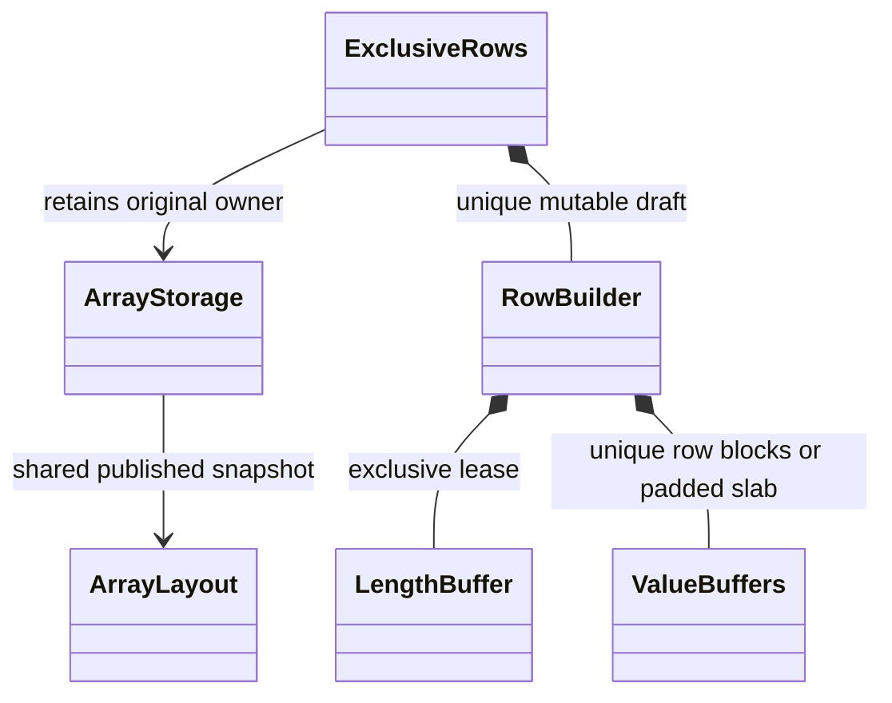
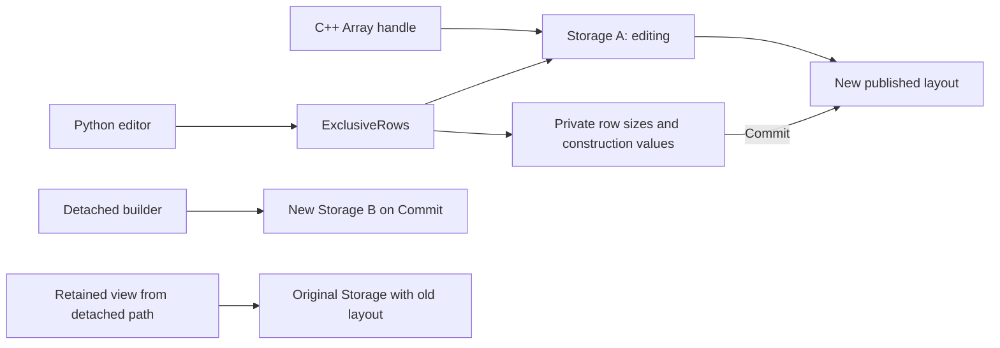

# Runtime row construction and exclusive edits

Include `DNDS/Runtime/RowBuilder.hpp`. Legacy `DNDS::Array` and its Compress
methods keep their existing behavior. This API is for native Runtime Arrays.

Published layouts distinguish three representations:

| Kind | Row start | Logical row size | Allocation |
|---|---|---|---|
| Table | `row * stride` | fixed runtime width | `rows * stride` elements |
| Padded | `row * capacity` | published size Buffer entry | `rows * capacity` elements |
| CSR | published offset Buffer entry | adjacent offset difference | final prefix sum |

`FixedRows<N>` accepts tables of width N. The Python Array class remains
independent of width. `IsVariable()` covers both padded and CSR layouts;
`IsRagged()` specifically means CSR. CUDA views contain a sizes pointer for
padded rows and an offsets pointer for CSR. Only logical entries are visited
by a kernel using `RowSize`; unused capacity is not part of a logical row.

## Exclusive private construction

```cpp
namespace R = DNDS::Runtime;
R::RowBuilder draft(nCells, sizeof(double), R::RowLayoutKind::CSR);
#pragma omp parallel for
for (DNDS::index i = 0; i < nCells; ++i)
{
    draft.ResizeRow(i, ComputeLength(i));
    auto row = draft.Row<double>(i); // Bare pointer available as row.data.
    FillRow(i, row.data, row.size);
}
auto array = R::Array<double>::FromSharedStorage(draft.Commit());
```

The builder is move-only and unpublished. The outer row count is fixed;
different workers may resize/fill distinct rows. Join workers before Commit.
CSR rows have independent allocations while being constructed, so extending
one row cannot relocate another row. Commit calculates prefix sums and packs
once. Padded construction writes directly into one capacity-sized allocation.
The mutable length table itself is an ordinary Buffer held under an exclusive
write lease. No draft alias or view may escape publication.

Resize preserves existing logical entries by default and zero-initializes
newly exposed entries. `preserve=false` discards that row's previous values.
Shrinking then regrowing does not expose old truncated values. Padded overflow,
invalid indices and size overflow throw before publishing a new size. Row
pointers are borrowed and must be reacquired after resizing that row.

Commit consumes the builder only on successful publication. Destruction does
not implicitly commit. The returned CPU Array retains complete immutable
metadata and values; use its explicit `To(device)` for CUDA placement.

## Editing published Arrays

An exclusive edit is the operation that requires uniqueness:

```cpp
auto edit = array.EditRows();
edit.Draft().ResizeRow(i, newLength);
edit.Draft().Row<double>(i)[0] = value;
edit.Commit();
```

ArrayStorage serializes exclusive acquisition and all normal handle-sharing
entry points with its shape mutex. Acquisition requires unique storage,
metadata and values and no outstanding access/layout pins. An already shared
layout or Buffer therefore causes an explicit failure. A reference count is
used as a uniqueness condition within that protocol, not as permission to
modify a concurrently copied shared object. Borrowed raw pointers are still
subject to the caller's lifetime contract.

While editing, alias creation, reads, writes, normal metadata queries and
MPI payload binding through the Array fail. Padded/table values stay in place;
CSR values use a private row construction form. Commit installs a new
immutable layout, updates values when needed and advances `ShapeVersion`
once. Published size/offset snapshots are never silently rewritten. This
version currently replaces the published metadata allocation at Commit;
recycling its physical allocation is a later optimization. The construction
length Buffer can be updated in place throughout the edit.

Abandoning an exclusive edit marks the shape invalid; it promises no rollback.
Reset can replace that handle with valid storage. An editor retains its
original storage even if the caller resets/destroys the Array handle while
editing. It cannot silently commit into a replacement handle.

Use an explicitly detached snapshot when old views must remain usable:

```cpp
auto draft = R::RowBuilder::FromStorage(*array.SharedStorage());
draft.ResizeRow(i, newLength);
auto replacement = R::Array<double>::FromSharedStorage(draft.Commit());
array = std::move(replacement);
```

The source is read under one lease during snapshot creation. Pending writes
are rejected. Later changes are private; abandonment leaves the original
unchanged. Old views retain old values and layout. This path also snapshots
CUDA arrays into a CPU builder. Existing table padding need not be preserved
by a detached edit; logical values and table width are preserved.

`Layout()` on an Array returns a lightweight owning snapshot, sharing the
metadata buffers. Keeping it pins those buffers and can make exclusive edit
acquisition fail. Access objects retain their layout even after their value
lease retires. Kernel ArrayViews remain borrowed and add no per-element
tracking or ownership operations.





## Python

```python
from DNDSR.DNDS import Runtime as R
import numpy as np

draft = R.RowBuilder(20, np.dtype("float64"), R.RowLayoutKind.Padded, 40)
draft.resize_row(3, 7)
draft.assign_row(3, np.arange(7, dtype="float64"))
a = draft.commit()

edit = a.edit_rows(exclusive=True)
edit.resize_row(3, 9)
edit[3, 8] = 42
edit.commit()                  # Returns None; publishes into original storage.

copy_edit = a.edit_rows()      # Explicit detached draft by default.
copy_edit.resize_row(3, 5)
b = copy_edit.commit()         # Returns a new CPU Array; a is unchanged.
```

Python row snapshots and `layout.offsets`/`layout.sizes` are independent copies.
Registered POD codecs are reused for scalar builder access. Builder instances
own their state; no writable NumPy alias bypasses publication. Python retains
the original ArrayStorage through an exclusive editor, without retaining its
replaceable Python Array handle. CPU construction is the initial supported
backend; worker-side Python callbacks are not part of the interface.

MPI payloads and checkpoints use logical rows for all three layouts. The
current checkpoint representation restores variable rows as packed CSR;
capacity padding is an execution choice and is not serialized as values.
