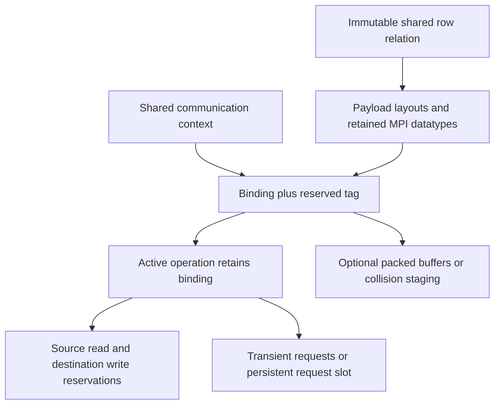

# Transient transfers and eager MPI progress

This extends RowTransferPlan / PayloadPlan / TransferBinding / TransferOperation.
Request lifetime is independent of the transport. Persistent bindings reuse
Send_init/Recv_init requests. Transient bindings post Isend/Irecv at each Begin.
Both default to direct MPI datatypes; HostPacked remains an explicit option.
Neither mode physically permutes the source. Sender reordering is an upstream
mesh/data operation, after which adjacent typemap sections coalesce as before.

```cpp
auto channel = std::make_shared<R::CommunicationContext>(mpi.comm);
R::RowTransferPlan route(channel, owned.Rows(), ghost.Rows(), requests);
R::PayloadPlan payload(route, owned.Layout(), ghost.Layout(),
                       R::ElementSchema::Arithmetic<double>());
auto binding = payload.Bind(owned, ghost, R::TransferTransport::Direct,
                            {R::TransferMode::Transient, channel, 37});
auto operation = binding.Begin();
// Core reads owned, never ghost; output is a separate allocation.
operation.WaitDestinationReady();
// Ring kernels may now read ghost. The send-side lease is still retained.
operation.Wait();
```

CommunicationContext collectively duplicates a communicator once. Reusing it
for routes/bindings avoids per-binding duplication. Tags are explicit matched
protocol IDs, reserved until a binding and its active operation retire. Two
live bindings cannot reserve the same tag in one context. There is no automatic
rank-local tag sequence. All collective preparation and Begin preflights must
occur in matching participant order, including for independent fields.
Default options preserve an isolated communicator and persistent requests.

Known(context, sources, destinations, sendRowsByPeer, receiveRowsByPeer)
accepts pre-established matching per-peer row order. It skips owner and row-ID
discovery but still checks peer counts with an all-to-all. General request
discovery and length exchange currently have O(number of ranks) tables. A
sparse discovery implementation remains replaceable; this is not a claim of
scalable sparse rendezvous at arbitrary rank counts.



Only one operation may be active per binding. Separate bindings/tags support
independent fields sharing the route. Copy rejects receive collisions before
posting. Explicit reducers retain the existing CPU/CUDA/vendor dispatch and
receive staging. POD MPI extent is the physical element stride, including holes.
HostPacked uses MPI pack/unpack, preserving the provided datatype signature.

## Dynamic receive shapes

DynamicRowTransfer pins a source storage/shape/value snapshot, discovers row
lengths, allocates a private CSR destination, then begins the payload. Test/Wait
advance payload completion. Commit collectively verifies success and returns
the completed storage exactly once. Until then no destination handle escapes.
Zero-length rows and unrequested destinations remain valid empty rows. A
reduction failure on any rank prevents publication on all ranks at Commit.

Preparation is currently synchronous and collective. Payload progression is
nonblocking; the class does not promise asynchronous control-plane discovery
or failed-rank recovery. Resetting a source handle creates unrelated storage;
the transaction retains the original snapshot. Independent outputs need fresh
tags while previous bindings still exist.

## Eager bridge

Begin uses immediate leases. BeginScheduled instead uses eager reservations,
so dependent kernels may be submitted before communication completes. The
caller must provide the dependency. It must finish CPU producers before Begin;
CUDA producers are ordered/observed on the supplied context before portable
MPI posting. No schedule proof or implicit cross-stream join is inferred.

```cpp
R::MPIProgress progress; // Created and drained on the MPI-calling thread.
auto transferred = progress.Import(binding.BeginScheduled());
R::SubmitArrays(engine, core, coreKernel, R::Read(owned), R::Write(rhs));
ring.WaitFor(transferred);
ring.WaitFor(core.Record());
R::SubmitArrays(engine, ring, ringKernel, R::Read(ghost), R::ReadWrite(rhs));
progress.Drain();
engine.Synchronize();
```

MPIProgress owns outstanding operations until retirement on its creating thread.
CPU worker polling does not call MPI. Use MPI_Init_thread with at least FUNNELED
for a worker-thread application, and keep MPI on the main thread at that level.
Explicitly drain progress before synchronizing dependent worker streams.
The context must be destroyed on its creating thread before MPI_Finalize.

A CUDA stream cannot wait natively on an unfinished portable-MPI event. Observe
the transfer on the host first, then submit its CUDA consumer. HostPacked GPU
transfers use explicit staging. Direct device datatypes additionally require a
working CUDA-aware MPI installation. These APIs do not claim stream-ordered
MPI, graph capture, GPU-direct transport or autonomous background progress.

Python exposes CommunicationContext, TransferOptions, DynamicRowTransfer and
MPIProgress with the same ownership and collective rules. Custom Python
reducers acquire the GIL only at the explicit host combine step. Python
callbacks are not dispatched inside device kernels or compute worker loops.
