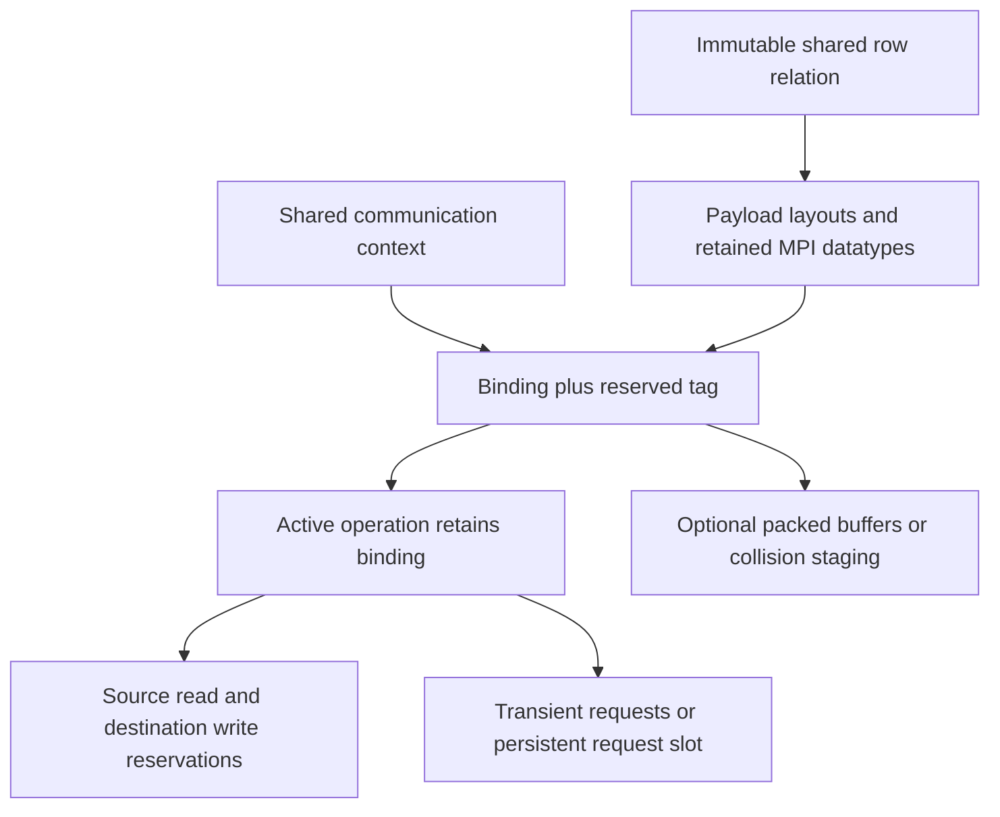

# Transient transfers and eager MPI progress

The [caller contract](RuntimeCallerContract.md) states MPI participation, producer
readiness, destination completion, schema and migration publication obligations.

This extends RowTransferPlan / PayloadPlan / TransferBinding / TransferOperation.
Request lifetime is independent of the transport. Persistent bindings reuse
Send_init/Recv_init requests. Transient bindings post Isend/Irecv at each Begin.
Both default to direct MPI datatypes; HostPacked remains an explicit option.
Completion exceptions propagate locally to the fail-fast boundary specified in
the caller contract. `DynamicRowTransfer::Commit` waits and publishes locally;
it does not attempt an error Allreduce after transport progression. Success on
one rank is not evidence of distributed success. Active transfer destruction
during exception unwinding aborts, avoiding unmatched waits before the fatal
handler. Ordinary explicit/RAII completion still drains its requests.
Neither mode physically permutes the source. Sender reordering is an upstream
mesh/data operation, after which adjacent typemap sections coalesce as before.

Geom's `EntityGhostMapping::{TransferRows,BeginRows}` capture published Array
storage inside their collective preflight. An active or abandoned shape edit,
consumed handle, stale entity order or wrong row extent on one rank rejects the
call on all ranks before payload setup. The captured storage pins shape through
binding; ordinary transfer leases then protect values through completion.

```cpp
auto channel = std::make_shared<R::CommunicationContext>(mpi.comm);
R::RowTransferPlan route(channel, owned.RowCount(), ghost.RowCount(), requests);
R::PayloadPlan payload(route, owned.Layout(), ghost.Layout(),
                       R::ElementSchema::Arithmetic<double>());
auto binding = payload.Bind(owned, ghost, R::TransferTransport::Direct,
                            {R::TransferMode::Transient, channel, 37});
auto operation = binding.Begin();
// Core reads owned, never ghost; output is a separate allocation.
operation.WaitDestinationReady();
// Ring kernels may now read ghost. The send-side lease is still retained.
operation.Wait();
```

CommunicationContext explicitly adopts or duplicates a communicator once.
Default bindings inherit the route's actual context and persistent requests.
During setup they agree `TransferOptions::channel`, then reserve a tag unused on
every participating rank. This handles differences in old-binding retirement
timing without a rank-local counter deciding matching. The tag stays fixed through
binding/request retirement. Callers must still construct named protocol instances
in matching order; repeated names are legal and get separate live reservations.
Explicit `context`/`tag` retains the fixed-tag API. `isolatedNamespace=true`
deliberately duplicates at setup and cannot also select a shared context.
No tag negotiation or new collective is added to Begin or steady halo exchange.

Launch validation is independent of persistent/transient request lifetime.
`TransferOptions::preflight` defaults to `TransferPreflight::Inherit`, which
uses the immutable binding or route context policy. `Collective` adds an
agreed launch rejection before posting; `AbortOnFailure` omits the agreement
and aborts on a local launch failure. Both validate access, routing and stream
ordering. Binding setup still agrees the effective policy across ranks. Both
modes require the same participant order and producer/consumer discipline. See [the exception contract](RuntimeCallerContract.md#distributed-exceptions).

For an unknown receive shape, compile and infer once:

```cpp
R::PayloadPlan payload(route, owned.Layout(), R::ElementSchema::For<double>());
R::Array<double> ghost(payload.DestinationLayout());
auto binding = payload.Bind(owned, ghost, R::TransferTransport::Direct,
                            {R::TransferMode::Transient, route.Context(), 37});
binding.Begin().Wait();
```

This uses at most one row-length exchange. When all sources are tables of the
same width, the existing schema agreement also proves that width and no
per-edge length exchange is needed. Mixed layouts or unequal widths use the
ordinary exchange; unrequested destination rows still have zero length.
The older two-step
`route.DestinationLayout(...)` followed by an explicitly shaped payload remains
supported, but can exchange lengths twice for variable layouts. Explicit and inferred
destination shapes may differ between ranks; both use the same collective
schedule and validate every received width. `route.Context()` shares the route's
matching namespace. Keep distinct tags for overlapping bindings, and destroy
the binding as well as its operation before reusing a tag. Blocking Geom ghost
transfers reuse this namespace; independently started `BeginRows` transfers
retain separate namespaces so existing overlap remains valid.

Typed `payload.Bind(array, array, ...)` pins published storage before comparing
its shape and capturing buffers. An unpublished or abandoned shape edit,
moved-from handle, incompatible element schema, or changed physical stride on
one rank rejects the binding collectively before requests are created. Commit
the shape edit (or reset an abandoned array), then compile/reuse a payload that
matches the published shape. This protection covers arguments inspected inside
`Bind`; callers must still coordinate any rank-local exception while preparing
arguments before entering a collective API.

Known(context, sources, destinations, sendRowsByPeer, receiveRowsByPeer)
accepts pre-established matching per-peer row order. It skips owner and row-ID
discovery but still checks peer counts with an all-to-all. General request
discovery and length exchange currently have O(number of ranks) tables. A
sparse discovery implementation remains replaceable; this is not a claim of
scalable sparse rendezvous at arbitrary rank counts.

`route.ReorderSourceByPeer()` derives a route plus an old-to-new source-row
permutation when every source row is sent exactly once. It uses the route's
already-validated bounds and collision information, preserving receive slots,
peer correspondence, context and epoch dependencies. This needs collective
admission/allocation checks, but no count/row-ID exchange or repeated sorting.
The caller must physically permute its ordinary arrays before compiling a
payload against the new route. A halo that sends one source to several peers,
or leaves source rows unused, is rejected. The original route is unchanged.
Python exposes the same pair as `route.reorder_source_by_peer()`.



Only one operation may be active per binding. Separate bindings/tags support
independent fields sharing the route. Copy rejects receive collisions before
posting. Explicit reducers retain the existing CPU/CUDA/vendor dispatch and
receive staging. POD MPI extent is the physical element stride, including holes.
HostPacked uses MPI pack/unpack, preserving the provided datatype signature.

Factory-generated element schemas also retain a binding type tag. C++ typed
Bind checks it against the arithmetic element type; Python Bind checks the
dtype, including structured fields. Equal byte widths alone do not establish
compatibility. Custom reducer factories check the same constraint. Explicit
MPI/POD schemas without a type tag and raw Buffer bindings remain application
contracts: callers supply the correct typemap, field meaning and ordering.

A failure while completing the MPI payload or applying its reducer is terminal:
peers may still be in transport or may already be entering their next phase.
Abort without another agreement or a request drain. Normal completion publishes
the output and retires its leases. Generic local execution errors can still be
reported by an event; the production controller must not continue into MPI
after a distributed failure.

## Dynamic receive shapes

DynamicRowTransfer pins a source storage/shape/value snapshot, discovers row
lengths, allocates a private destination preserving table stride, padded capacity
or CSR storage by default, then begins the payload. `TransferLayout::Compact()`
explicitly requests CSR (`TransferLayout.compact()` in Python). Test/Wait
advance payload completion. Commit waits successfully and returns
the completed storage exactly once. Until then no destination handle escapes.
Zero-length rows remain valid. Unrequested padded/CSR rows are empty; unrequested
table rows retain their declared width with untouched values. A local reduction
failure prevents that destination's publication; the distributed run must abort.
There is no cross-rank rollback after arbitrary transport/completion errors.

Preparation is currently synchronous and collective. Payload progression is
nonblocking; the class does not promise asynchronous control-plane discovery
or failed-rank recovery. Resetting a source handle creates unrelated storage;
the transaction retains the original snapshot. Independent outputs need fresh
tags while previous bindings still exist.

## Eager bridge

Begin uses immediate leases. BeginScheduled instead uses eager reservations,
so dependent kernels may be submitted before communication completes. The
caller must provide the dependency. It must finish CPU producers before Begin;
CUDA producers are ordered/observed on the supplied context before portable
MPI posting. No schedule proof or implicit cross-stream join is inferred.
An omitted join can therefore produce a valid allocation containing stale
values. Immediate leases reject pending conflicting accesses; scheduled
reservations deliberately do not diagnose missing caller dependencies. Unit
tests exercise this outcome with a gated writer and a completed early reader,
without creating a simultaneous memory race.

```cpp
R::MPIProgress progress; // Created and drained on the MPI-calling thread.
auto transferred = progress.Import(binding.BeginScheduled());
R::SubmitArrays(engine, core, coreKernel, R::Read(owned), R::Write(rhs));
ring.WaitFor(transferred);
ring.WaitFor(core.Record());
R::SubmitArrays(engine, ring, ringKernel, R::Read(ghost), R::ReadWrite(rhs));
progress.Drain();
engine.Synchronize();
```

MPIProgress owns outstanding operations until retirement on its creating thread.
MPI completion signals the event waking dependent CPU streams; compute workers
do not poll MPI or periodically probe an unfinished event. Use MPI_Init_thread with at least FUNNELED
for a worker-thread application, and keep MPI on the main thread at that level.
Explicitly drain progress before synchronizing dependent worker streams.
The context must be destroyed on its creating thread before MPI_Finalize.

A CUDA stream cannot wait natively on an unfinished portable-MPI event. Observe
the transfer on the host first, then submit its CUDA consumer. HostPacked GPU
transfers use explicit staging. Direct device datatypes additionally require a
working CUDA-aware MPI installation. These APIs do not claim stream-ordered
MPI, graph capture, GPU-direct transport or autonomous background progress.

Python exposes CommunicationContext, TransferOptions, DynamicRowTransfer and
MPIProgress with the same ownership and collective rules. Custom Python
reducers acquire the GIL only at the explicit host combine step. Python
callbacks are not dispatched inside device kernels or compute worker loops.
Repeatable callback failures retain Python exception type/arguments with
GIL-safe ownership. Each observation creates a Python error; live callback
tracebacks are not retained, avoiding cycles through transfer objects in frame
locals. C++ diagnostics retain the original formatted traceback. Custom error
constructors must accept their saved `args`; extra instance attributes are not
replayed.

## Optional communication worker

Native callers may share a `CommunicationWorker` through
`TransferOptions::communicationWorker`. Null preserves caller execution with
no worker or queue. The first implementation supports CPU Direct and HostPacked
payloads, persistent or transient requests; GPU, native providers and grouped
starts are rejected. It requires actual `MPI_THREAD_MULTIPLE`. SERIALIZED is
not sufficient because unrelated controller MPI calls have no process-wide
serialization guard. DNDS's initializer requests MULTIPLE by default.

Begin reserves source/destination accesses and performs the configured preflight
on the controller. The worker packs, posts, waits and unpacks; no payload work is
hidden in compute kernels. Destination readiness and full send completion remain
separate observations. The operation retains requests, buffers and the worker;
its normal destruction waits. MPI resources are released by the controller-side
operation owner, not the task. Destroy operations and bindings on the controller
before finalization. Exceptions during active worker MPI execution abort.

The queue executes transfers in submission order. All participating ranks must
submit matching work in compatible order, including when sharing one worker
across communication contexts. Do not queue a task that waits for a later task
on the same worker. This is optional background MPI execution, not stream-native
MPI, GPU graph capture or a promise of a speedup. Native custom reducers run on
the worker and must be thread-safe; Python callback dispatch is not exposed here.
