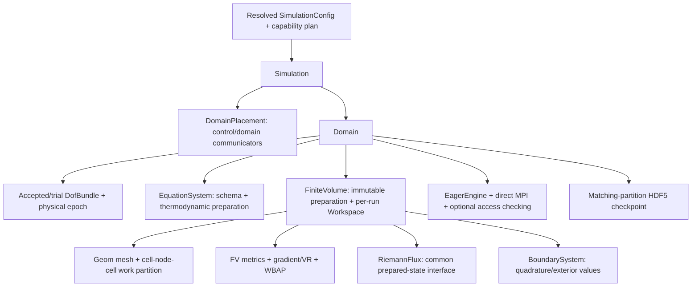

# Cauchy solver: module contracts and implementation ledger

Status2026-11-01: foundation, optional checked eager execution and the initial
single-domain CPU flow solver are implemented and validated in focused tests.
Do not treat mocks, flux parity or short smooth-flow tests as broad
production acceptance. The independent plan repo's document37 defines the full
C1/C2/C3 work order; document45 records execution status.

`Cauchy/Core/DomainPlacement` owns immutable simulation/domain communicator
namespaces. Descriptor construction is collective and checked for exact agreement.
Ranks retain only metadata for domains they do not own. Rank lists retain their
declared order, including noncontiguous/reversed groups. Domain iterators use the
domain communicator, and simulation acceptance uses control boundaries. Release
the final placement/context owner on an MPI-permitted thread before finalization.

`CoordinatedSchedule` is a scalar mock of the frozen-trace contract, not a fluid
integrator. All domains read the same old trace snapshot for a round. Only each
domain root publishes its candidate to the control communicator. Failure leaves
accepted time and traces unchanged; retry uses a fresh trial identity. Domain
callbacks must coordinate their internal collective phases before returning or
throwing. MPI process failure recovery is not promised.

`DNDS/Algebra/DofBundle` composes named numerical blocks on one row space. It
contains no equation/BC/mesh policy. Blocks retain their individual physical
layouts and use native DOF algebra. Norms ignore ghosts and padding, with one
domain reduction across all selected blocks. An empty selection means all blocks;
unknown/duplicate names and incompatible schemas fail before numerical changes.
Cloning creates independent values on the same row-space identity; ordinary C++
copies share handles. Ghost values are refreshed by the caller after owned state
updates, including a rollback or deep clone. Rebinding blocks must preserve
space/shape and non-aliasing requirements, validated at algebra boundaries.

The foundation tests run at np1/2/4/8. They use an independent two-variable
recurrence to compare shared and disjoint execution, reversed rank namespaces,
rank-local rejection and retry epochs, empty local ownership, mixed physical
field formats, subset updates and numerically poisoned ghosts. These foundation
mocks do not establish physical inter-domain coupling. Real single-domain
`Domain`, residuals, SSPRK3, basic IO and Python stepping are implemented
separately below. Physical multi-domain advancement rejects until the coupling/
transaction package is implemented.

`Config/SimulationConfig` expands immutable domain profiles, solver defaults,
domain overrides and CLI pointers, retaining leaf provenance. Domain rank groups
are explicit. Production calls `ResolveCollective` before mesh work, coordinating
parse/capability failures and exact root/provenance agreement. A process-local
`Resolve` is available for inspection and noncollective tooling. Missing Cauchy
backend/model/BC kernels fail rather than falling back to an available device.
Independent CFV settings remain a separate mathematical configuration section.

`Riemann/` owns numerical flux algorithms independently of the EOS/energy model.
`EquationSystem::PrepareFluxState` supplies pressure and physical sound speed;
Riemann kernels only project velocities, combine supplied signal data and form
the numerical flux. They do not recover pressure, acoustics or enthalpy from
conservative energy and never accept an effective-gamma substitution.
Rusanov uses typed pressure/acoustic inputs; other solvers declare additional
enthalpy/derivative/averaged-state requirements explicitly. Missing inputs or
unsupported EOS/flux algorithms must fail at preparation. Physical energy flux
preserves the equation model's conservative energy origin. The plan repository's
document46 records the accepted redesign and independent-input validation gates.
The common `FluxInput`/`FluxResult` interface covers Rusanov and all16 Euler
selections: Roe/Roe_M1..M9, HLLC, HLLEP/HLLEP_V1 and AUSMPWPlus/PlusUp/PlusUp2.
Face and mean thermodynamic inputs remain distinct. Equation preparation also
supplies the Roe contact projection/right-mode energy data, HLLC shock bounds
and AUSM interface acoustic scale. `Validate` checks required optional inputs at
an operator boundary; `Evaluate` consumes prepared inputs without EOS calls.
The scalar CPU implementation is established; CUDA production dispatch remains
unsupported. HLLC retains the legacy mean/face and moving-grid formula, including
its documented accuracy limits; parity does not prove general-EOS stability.

| Flux selection | Additional equation-prepared data |
| --- | --- |
| `rusanov` | Facial pressure and sound speed |
| `Roe_M2` | Facial states and mean acoustic states |
| `Roe`, `Roe_M1`, `Roe_M3`..`Roe_M9` | Mean acoustic states and Roe velocity/acoustics, total enthalpy, contact-mode energy and inverse contact projection |
| `HLLEP`, `HLLEP_V1` | Same linearization, with their own numerical wave/dissipation formulas |
| `HLLC` | Supplied outer shock bounds and mean acoustic/linearization data for legacy signal diagnostics |
| `AUSMPWPlus`, `AUSMPlusUp`, `AUSMPlusUp2` | Supplied face acoustic scale and mean acoustic states for diagnostics |

Pressure/acoustics are independent of conservative energy in the input contract.
The perfect-gas provider is the initial implemented thermodynamic adapter; a new
EOS must provide mathematically appropriate averages/bounds for each flux it
advertises. Numerical correction controls are `numerics.riemann` settings.
`Validate` is the checked outer interface; direct callers of `Evaluate` must
already satisfy its preconditions and retain all optional input records.

`Discretization/FiniteVolume` prepares immutable geometry, incidence quadratures,
cached basis data and conservative core/halo cell sets. Its per-run `Workspace`
owns reconstruction/primitive-gradient fields and persistent direct MPI bindings.
The CPU residual integrates inviscid flux minus Newtonian/Fourier flux. Viscous
gradients use primitive `[rho,u,v,w,T]`, including periodic vector transforms;
they are not recovered by a facewise conservative-gradient linearization.
Second-order LS/GG/GGMP or Jacobi VR and WBAP use explicit boundary quadrature
values. High-order inadmissible face values fall back to their valid mean, with
a global diagnostic count. Inadmissible means/stages reject; no mean clipping.
Final coefficient exchange overlaps the owned-only core residual; dependent cells
run after exchange. The synchronous wrapper observes its own submitted prefix.

`Core/Domain` holds accepted and trial state separately and supplies autonomous,
stationary-grid SSPRK3. All stage means are checked collectively. A rejected trial
does not replace accepted values/time; a commit preflights destination leases
collectively, cancelling unused accesses if a peer rejects. Residual inspection
overwrites workspace and invalidates any prepared candidate. First-stage tests
cover planar/3D geometry, all three table layouts, inline/worker execution, empty
owners, periodic constants, spatial order, smooth transport, shear and retry.
`Simulation::Advance` coordinates the single-domain candidate and accepted clock;
the executable uses this entry. `Simulation::ReadCheckpoint` restores both
simulation and domain epochs. Directly advancing its contained Domain creates a
clock mismatch that is rejected at the next coordinated advancement. Standalone
Python Domain stepping remains a supported debugging/tuning frontend.

`cauchy_solver` builds `app/cauchy.exe`; it reads a Cauchy JSON and optional
`--restart path.h5`. Paths are relative to its invocation directory. The current
executable requires one domain spanning all simulation ranks. Mesh input uses
`mesh.boundaryIds` for explicit CGNS name/zone mapping; physical BCs are keyed by
those zone integers. Python `DNDSR.Cauchy.Domain` accepts an already prepared native
mesh and the same config JSON; `flow` is the same shared Runtime Array allocation.
No per-element Python loop or duplicate Python state participates in stepping.

Checkpoint format2 stores the resolved config, domain name, accepted time/step,
persistent cell IDs, exact per-cell primary geometry/connectivity/boundary-zone
metadata, periodic transforms and owned flow. Flow I/O uses retained native Array
storage directly, including SoA/AoSoA; only mesh-validation metadata is assembled.
Loading validates all metadata before replacing accepted state and preserves the
existing field allocations/bindings. Same partition/order/config is required;
changed-rank remapping and broader observation/visualization/statistics are C6.

Caller responsibilities: invoke domain collectives in matching order on its
communicator; serialize each Domain/Workspace, mesh publication and debug edits;
release retained writable/debug views before stepping or loading. Read-only flow
views may coexist with candidate evaluation but intentionally block commit.
Release residual views before the next evaluation. Do not rebind domain-owned
fields, alias residual output to an input, or use escaped raw pointers. Keep MPI
contexts and solver objects alive until operations finish and destroy them before
MPI finalization on an MPI-permitted thread. This is coordinated error handling,
not process-failure recovery. GPU flow kernels, real-gas adapters, species/RANS,
motion, implicit stepping, p-FAS and physical multi-domain coupling remain later
capability packages and fail explicitly when requested now.

See [checked execution](CheckedExecution.md) for the shared optional submission
checker, alias/free fan-in, checked/unchecked policy boundaries and portable MPI.
