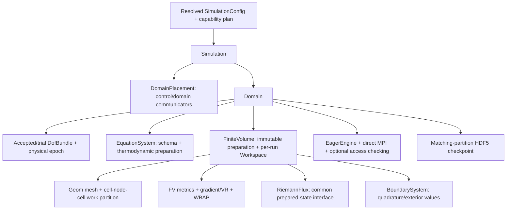
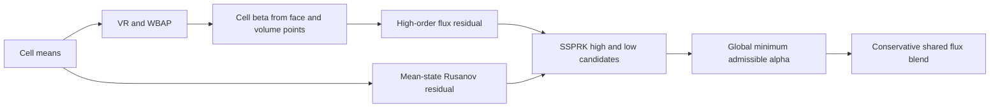

# Cauchy solver: module contracts and implementation ledger

Status2026-11-01: foundation, optional checked eager execution and the initial
single-domain CPU flow solver are implemented and validated in focused tests.
Do not treat mocks, flux parity or short smooth-flow tests as broad
production acceptance. The independent plan repo's document37 defines the full
C1/C2/C3 work order; document45 records execution status.

`Cauchy/Core/DomainPlacement` owns immutable simulation/domain communicator
namespaces. Descriptor construction is collective and checked for exact agreement.
Ranks retain only metadata for domains they do not own. Rank lists retain their
declared order, including noncontiguous/reversed groups. Domain iterators use the
domain communicator, and simulation acceptance uses control boundaries. Release
the final placement/context owner on an MPI-permitted thread before finalization.

`CoordinatedSchedule` is a scalar mock of the frozen-trace contract, not a fluid
integrator. All domains read the same old trace snapshot for a round. Only each
domain root publishes its candidate to the control communicator. Failure leaves
accepted time and traces unchanged; retry uses a fresh trial identity. Domain
callbacks must coordinate their internal collective phases before returning or
throwing. MPI process failure recovery is not promised.

`DNDS/Algebra/DofBundle` composes named numerical blocks on one row space. It
contains no equation/BC/mesh policy. Blocks retain their individual physical
layouts and use native DOF algebra. Norms ignore ghosts and padding, with one
domain reduction across all selected blocks. An empty selection means all blocks;
unknown/duplicate names and incompatible schemas fail before numerical changes.
Cloning creates independent values on the same row-space identity; ordinary C++
copies share handles. Ghost values are refreshed by the caller after owned state
updates, including a rollback or deep clone. Rebinding blocks must preserve
space/shape and non-aliasing requirements, validated at algebra boundaries.

The foundation tests run at np1/2/4/8. They use an independent two-variable
recurrence to compare shared and disjoint execution, reversed rank namespaces,
rank-local rejection and retry epochs, empty local ownership, mixed physical
field formats, subset updates and numerically poisoned ghosts. These foundation
mocks do not establish physical inter-domain coupling. Real single-domain
`Domain`, residuals, SSPRK3, basic IO and Python stepping are implemented
separately below. Physical multi-domain advancement rejects until the coupling/
transaction package is implemented.

`Config/SimulationConfig` expands immutable domain profiles, solver defaults,
domain overrides and CLI pointers, retaining leaf provenance. Domain rank groups
are explicit. Production calls `ResolveCollective` before mesh work, coordinating
parse/capability failures and exact root/provenance agreement. A process-local
`Resolve` is available for inspection and noncollective tooling. Missing Cauchy
backend/model/BC kernels fail rather than falling back to an available device.
Independent CFV settings remain a separate mathematical configuration section.

`Riemann/` owns numerical flux algorithms independently of the EOS/energy model.
`EquationSystem::PrepareFluxState` supplies pressure and physical sound speed;
Riemann kernels only project velocities, combine supplied signal data and form
the numerical flux. They do not recover pressure, acoustics or enthalpy from
conservative energy and never accept an effective-gamma substitution.
Rusanov uses typed pressure/acoustic inputs; other solvers declare additional
enthalpy/derivative/averaged-state requirements explicitly. Missing inputs or
unsupported EOS/flux algorithms must fail at preparation. Physical energy flux
preserves the equation model's conservative energy origin. The plan repository's
document46 records the accepted redesign and independent-input validation gates.
The common `FluxInput`/`FluxResult` interface covers Rusanov and all16 Euler
selections: Roe/Roe_M1..M9, HLLC, HLLEP/HLLEP_V1 and AUSMPWPlus/PlusUp/PlusUp2.
Face and mean thermodynamic inputs remain distinct. Equation preparation also
supplies the Roe contact projection/right-mode energy data, HLLC shock bounds
and AUSM interface acoustic scale. `Validate` checks required optional inputs at
an operator boundary; `Evaluate` consumes prepared inputs without EOS calls.
The scalar CPU implementation is established; CUDA production dispatch remains
unsupported. HLLC retains the legacy mean/face and moving-grid formula, including
its documented accuracy limits; parity does not prove general-EOS stability.

| Flux selection | Additional equation-prepared data |
| --- | --- |
| `rusanov` | Facial pressure and sound speed |
| `Roe_M2` | Facial states and mean acoustic states |
| `Roe`, `Roe_M1`, `Roe_M3`..`Roe_M9` | Mean acoustic states and Roe velocity/acoustics, total enthalpy, contact-mode energy and inverse contact projection |
| `HLLEP`, `HLLEP_V1` | Same linearization, with their own numerical wave/dissipation formulas |
| `HLLC` | Supplied outer shock bounds and mean acoustic/linearization data for legacy signal diagnostics |
| `AUSMPWPlus`, `AUSMPlusUp`, `AUSMPlusUp2` | Supplied face acoustic scale and mean acoustic states for diagnostics |

Pressure/acoustics are independent of conservative energy in the input contract.
The perfect-gas provider is the initial implemented thermodynamic adapter; a new
EOS must provide mathematically appropriate averages/bounds for each flux it
advertises. Numerical correction controls are `numerics.riemann` settings.
`Validate` is the checked outer interface; direct callers of `Evaluate` must
already satisfy its preconditions and retain all optional input records.

`Discretization/FiniteVolume` prepares immutable geometry, incidence quadratures,
cached basis data and conservative core/halo cell sets. Its per-run `Workspace`
owns reconstruction/primitive-gradient fields and persistent direct MPI bindings.
The CPU residual integrates inviscid flux minus Newtonian/Fourier flux. Viscous
gradients use primitive `[rho,u,v,w,T]`, including periodic vector transforms;
they are not recovered by a facewise conservative-gradient linearization.
Second-order LS/GG/GGMP or Jacobi VR and descending 3WBAP use explicit boundary
quadrature values. P3 is a cubic polynomial with nominal fourth-order spatial
accuracy. Each limiter order refreshes neighbor coefficients before the next.
The perfect-gas equation provides cell-mean characteristic transforms over all
five flow components. Reconstruction retains its initial guess between stages;
`reconstructionIterations` is a cap and positive `reconstructionTolerance`
enables relative Jacobi-update stopping. The last sweep count/update is reported.
Each sweep projects the current boundary polynomial through the physical BC;
this preserves its unconstrained components instead of pinning them to the cell
mean. `reconstructionBoundaryFromPolynomial:false` retains mean-based input
for a controlled comparison. Boundary kernels still receive explicit values.
High-order inadmissible face values fall back to their valid mean, with a global
diagnostic count; `faceFallback:false` rejects any such event for non-PP accuracy
studies. Inadmissible means/stages reject; no mean clipping.
Final coefficient exchange overlaps the owned-only core residual; dependent cells
run after exchange. The synchronous wrapper observes its own submitted prefix.

`Core/Domain` holds accepted and trial state separately and supplies stationary-grid
SSPRK3 with physical boundary stage times `t,t+dt,t+dt/2`. All stage means are
checked collectively. A rejected trial
does not replace accepted values/time; a commit preflights destination leases
collectively, cancelling unused accesses if a peer rejects. Residual inspection
overwrites workspace and invalidates any prepared candidate. First-stage tests
cover planar/3D geometry, all three table layouts, inline/worker execution, empty
owners, periodic constants, spatial order, smooth transport, shear and retry.
`Simulation::Advance` coordinates the single-domain candidate and accepted clock;
the executable uses this entry. `Simulation::ReadCheckpoint` restores both
simulation and domain epochs. Directly advancing its contained Domain creates a
clock mismatch that is rejected at the next coordinated advancement. Standalone
Python Domain stepping remains a supported debugging/tuning frontend.

`cauchy_solver` builds `app/cauchy.exe`; it reads a Cauchy JSON and optional
`--restart path.h5`. Paths are relative to its invocation directory. The current
executable requires one domain spanning all simulation ranks. Mesh input uses
`mesh.boundaryIds` for explicit CGNS name/zone mapping; physical BCs are keyed by
those zone integers. Python `DNDSR.Cauchy.Domain` accepts an already prepared native
mesh and the same config JSON; `flow` is the same shared Runtime Array allocation.
No per-element Python loop or duplicate Python state participates in stepping.
CGNS zone IDs retain Geom's reserved meanings: `0` interior, `1` invalid/null,
and `-1..-6` periodic frames. Cauchy validates the boundary-name map before mesh
collectives; ordinary physical IDs must be at least2.

`initialProfile` supplies quadrature-integrated conservative cell averages;
`initialPrimitive` remains the constant/background physical input. Standard
beta-five isentropic-vortex and canonical Mach-ten DMR profiles share one provider
with analytic time-dependent boundary conditions. Periodic CGNS import uses
explicit `mesh.periodicLengths` translations and periodic boundary IDs. Initial
and exact vortex errors use physical-volume-weighted cell averages, not centroid
point values. There is no positivity limiter in the non-PP vortex cases.

The executable supports fixed dt or a global CFL capped by dt, physical end
time, bounded timestep-halving retries, steady residual stopping and a collective
wall stop, measured from startup including mesh setup. A wall stop writes final
evidence and returns status 2, rather than
claiming convergence. `--check-config` resolves capabilities without mesh or
solver execution. Maintained cases are in `cases/cauchy/`, with paths relative
to the invocation directory (run these from the source root).

Diagnostics and output use independent reconstruction scratch, so changing
history/output cadence cannot change a fixed-sweep solution. CSV history records
conservation, minima, accepted-state residual, body force, reconstruction update,
analytic error and stage fallback counts. Force is the integrated numerical wall
momentum flux (pressure minus Newtonian traction), with outward fluid normal.
Final output includes matching-partition restart, native parallel VTKHDF cell
means and per-rank boundary quadrature CSVs keyed by persistent cell IDs.
`output.hdfDeflateLevel` selects VTKHDF compression from0to9; the new frontend
defaults to0. Per-call Geom output settings leave the shared mesh's defaults
unchanged and must agree across ranks. The initial cs compressed-output campaign
exposed intermittent unreadable offset chunks. This is an open MPI/HDF5 I/O
investigation, not proof of a numerical-array mismatch; preserve the affected
files and validate stored datasets independently before using them as evidence.

Optional `numerics.positivity` prepares an equation-owned internal-energy-density
bound at `temperatureFloor`. The common policy tests density and total energy
minus kinetic energy against that bound, including shifted energy references;
no equivalent-gamma substitution or temperature inversion occurs in CFV/Riemann.
The initial affine bound is convex; a future EOS must certify an appropriate
admissible set and supply its own bound, with additional species/RANS constraints.

The thermal margin is `rhoE - |momentum|²/(2*rho) - E_min(U,Tmin)`, where the
equation owns `E_min`, including the energy reference and composition. A
negative reference internal energy is therefore valid when the bound allows it.

After WBAP, one beta scales every nonconstant coefficient of a cell, retaining
its mean. Both face and volume quadrature states are re-evaluated and verified
after scaling. SSPRK constructs high-order and mean-state Rusanov candidates.
If correction is needed and the low candidate is admissible, a globally shared
alpha blends their fluxes; equal alpha on both sides preserves conservation.
Invalid low endpoints reject the step for dt reduction; nonfinite inputs are
errors. This conservative baseline can be more diffusive than localized flux
correction and differs from legacy cellwise increment scaling. The method does
not independently clip density, energy or pressure or change physical RK times.
The no-PP vortex keeps this path disabled. Counts are cell-stage activations,
with min beta/alpha and accepted temperature minimum in the history.
The beta cutoff defaults to1e-3, matching Euler's zero-slope treatment of tiny
factors. Energy-scaled roundoff protection handles high-Mach subtraction near
Tmin; the physical admissibility predicate stays unchanged. Characteristic
bases that cannot retain finite verified inverses use explicitly counted
componentwise transforms. Physical EOS and Riemann wave speeds are untouched.
Characteristic preparation/finalization agrees failures across ranks before
any following halo operation. Counts describe local face-stage transform work,
including partition copies, rather than unique physical faces.
Reported instantaneous wall force/residual uses the high-order reconstructed
accepted-state operator; the step alpha additionally describes the applied
flux correction. Do not infer stage-integrated momentum balance from that
instantaneous force column alone.

Focused PP tests cover shifted negative energy references, a supplied nonlinear
thermal bound, a composition-dependent affine bound, high-kinetic-energy
roundoff, reconstruction/stage activation, periodic global conservation,
collective rejection/retry, and exact inactive-PP trajectories. These are
current-flow and policy tests; species/RANS/source-term constraints still
require equation-specific implementation before those profiles are advertised.

Checkpoint format3 stores the resolved config, domain name, accepted time/step,
persistent cell IDs, exact per-cell primary geometry/connectivity/boundary-zone
metadata, periodic transforms, owned flow and the owned reconstruction initial
guess. A fixed VR sweep cap makes that guess part of the numerical continuation
state, even though it remains separate from physical cell averages. Ghosts and
Jacobi output scratch are regenerated on the next evaluation. Flow and guess
I/O use retained native Array storage directly, including SoA/AoSoA; only
mesh-validation metadata is assembled.
Loading validates all metadata before replacing accepted state and preserves the
existing field allocations/bindings. Same partition/order/config is required;
changed-rank remapping and broader observation/visualization/statistics are C6.
Format2 remains readable with a cold reconstruction guess; its physical means
are preserved but finite-sweep continuation cannot be promised bitwise identical.
Format3 has a nonconstant P3 exact-continuation test across all three layouts.

Caller responsibilities: invoke domain collectives in matching order on its
communicator; serialize each Domain/Workspace, mesh publication and debug edits;
release retained writable/debug views before stepping or loading. Read-only flow
views may coexist with candidate evaluation but intentionally block commit.
Release residual views before the next evaluation. Do not rebind domain-owned
fields, alias residual output to an input, or use escaped raw pointers. Keep MPI
contexts and solver objects alive until operations finish and destroy them before
MPI finalization on an MPI-permitted thread. This is coordinated error handling,
not process-failure recovery. GPU flow kernels, real-gas adapters, species/RANS,
motion, implicit stepping, p-FAS and physical multi-domain coupling remain later
capability packages and fail explicitly when requested now.

See [checked execution](CheckedExecution.md) for the shared optional submission
checker, alias/free fan-in, checked/unchecked policy boundaries and portable MPI.

Riemann spatial corrections belong to the FV preparation layer. By default,
`numerics.riemann.useStencil` builds the incident-face maximum wave jump for
Roe_M6/M8/M9 and HLLEP variants, and the pressure minimum for AUSMPWPlus.
An owned cell uses its complete incident-face means; the two scalar values
are exchanged on the ordinary cell field's ghost mapping. A ghost cell's
stencil is supplied by its owner, never inferred from partial local closure.
The face combines its parents' maxima/minima. The pointwise Riemann module
still receives equation-prepared pressure and sound speeds, without EOS calls.
This restores the H-correction input that legacy Euler supplies to Roe_M9.

With spatial preparation enabled, `dLambda` is a signal floor and
`pressureStencilMin` a pressure upper bound. Set `useStencil=false` for exact
manual scalar inputs and reproduction of the earlier no-stencil Cauchy path.
Only consuming fluxes allocate their optional cell-wave or cell-pressure
buffers; they do not require both statistics. `PreparedAuxValues` exposes
the explicit outputs after evaluation. Retained debug leases obey the same
synchronous workspace contract as other fields.
Archives predating `useStencil` are interpreted as manual mode when validating
their resolved configuration. Restore them with `useStencil=false`; automatic
mode rejects the mismatch rather than silently changing continuation behavior.

`FiniteVolume::PrepareAuxValues(state, output, time)` is the stateless local
preparation operator. `AuxiliaryValues` is an extensible struct of optional
native arrays: mean thermodynamics, face convective/diffusive signal bounds,
face wave jumps/pressure minima, and their owned-cell reductions. An absent
member is neither allocated nor written. Face rows follow `AuxiliaryFaces()`
(required local mesh face IDs in sorted order). Each face is evaluated once
locally, including physical boundary states at the supplied stage time and
periodic transformations into its incidence frame. Thermodynamics/transport
remain equation-owned, BC values boundary-owned, and fluxes gas-agnostic.

The caller allocates outputs once, completes the mean halo, then calls this
operator. It writes only supplied outputs and performs no MPI, global timestep
selection, input mutation or hidden cache update. Cell outputs write owned
rows only: the caller exchanges wave/pressure reductions from their owners
before a ghost-dependent flux consumes them. A local face subset is not a
complete stencil for a ghost cell. The Domain/residual wrappers own these
communication steps; preparation itself has no execution-engine policy.

`ValidateAuxValues` checks source allocation/value/shape generations, the
prepared geometry plan, boundary time, and output presence/owned generations.
Active writers also reject reuse before their generation is published. An
output's ghost exchange does not invalidate its owned preparation; the caller
is responsible for that exchange's completeness. Validation is synchronous
at the operator boundary, with no row-loop lookup. No automatic cache reuse
is implied. Different RK stages prepare from their own current state/time.

`StableStep(state, prepared, cfl, time)` consumes a requested cell spectral sum
and performs the domain minimum reduction. The production Domain retains its
allocation and binding separately from the trial residual workspace. The
convenience two-argument wrapper prepares temporary outputs synchronously.
The prepared spectral estimate uses both mean-state convective bounds and a
symmetric face-area/cell-volume diffusion bound, including thermal diffusion;
this intentionally changes the earlier owned-state-only CFL estimate. Fixed
dt flux/reconstruction mathematics do not depend on this global selection.
