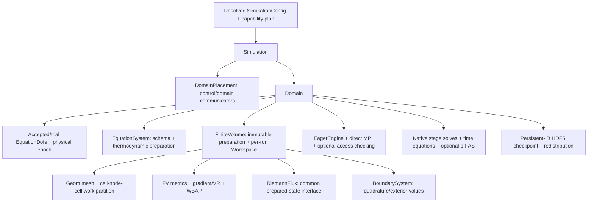
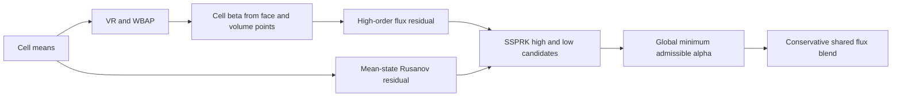

# Cauchy solver: module contracts and implementation ledger

Status2026-11-03: foundation, optional checked eager execution and the
single-domain CPU flow solver include native implicit linear/nonlinear solves,
BDF/Trapz/ESDIRK/DITR, full/subset polynomial FAS and persistent-ID restart in focused tests.
Euler-derived PP and native LVR have focused distributed coverage; qualified
physical studies and performance limits are recorded in the plan repo. The
Mach20+3WBAP nonconvergence is expected and is not pursued as a solver defect;
full DMR qualification remains separate. See [implicit contracts](CauchyImplicit.md) and
[coupled DITR](DITR.md) for the current boundaries.
Do not treat mocks, flux parity or short smooth-flow tests as broad
production acceptance. The independent plan repo's document37 defines the full
C1/C2/C3 work order; document45 records execution status.



`Cauchy/Core/DomainPlacement` owns immutable simulation/domain communicator
namespaces. Descriptor construction is collective and checked for exact agreement.
Ranks retain only metadata for domains they do not own. Rank lists retain their
declared order, including noncontiguous/reversed groups. Domain iterators use the
domain communicator, and simulation acceptance uses control boundaries. Release
the final placement/context owner on an MPI-permitted thread before finalization.

`CoordinatedSchedule` is a scalar mock of the frozen-trace contract, not a fluid
integrator. All domains read the same old trace snapshot for a round. Only each
domain root publishes its candidate to the control communicator. Failure leaves
accepted time and traces unchanged; retry uses a fresh trial identity. Domain
callbacks must coordinate their internal collective phases before returning or
throwing. MPI process failure recovery is not promised.

The [equation-state contract](CauchyState.md) describes semantic `EquationDofs`
bindings, physical ownership, layout-aware block views and explicit kernel
dispatch. `Domain` now holds accepted/trial bindings while preserving the
physical `State()` and flow5 `Flow()` accessors.

`DNDS/Algebra/DofBundle` composes named numerical blocks on one row space. It
contains no equation/BC/mesh policy. Blocks retain their individual physical
layouts and use native DOF algebra. Norms ignore ghosts and padding, with one
domain reduction across all selected blocks. An empty selection means all blocks;
unknown/duplicate names and incompatible schemas fail before numerical changes.
Cloning creates independent values on the same row-space identity; ordinary C++
copies share handles. Ghost values are refreshed by the caller after owned state
updates, including a rollback or deep clone. Rebinding blocks must preserve
space/shape and non-aliasing requirements, validated at algebra boundaries.

The extension contract is a bundle of logical equation blocks, not one mandatory
physical array. Keep flow5 together; RANS and species may occupy separate arrays
with their own uniform layouts. Kernel wrappers resolve block/schema choices
once and pass stride-aware row views; numerical loops must not infer a species
pointer from the end of a flow row. Coupled equations remain coupled regardless
of physical block separation. A future coupled matrix/vector adapter must map
the equation's component ordering across blocks without requiring a persistent
flattened state. Current Cauchy kernels, implicit matrices, stage callbacks and
checkpoint sections implement **flow5 only**; the existing bundle container is
not evidence that multi-block implicit stepping is already implemented.

Checkpoint writing calls native `Runtime::WriteArray` on the owned field;
there is no normalization buffer to AoS. Contiguous-row arrays use format3
row-ordered values. Column/tiled arrays use format4 component datasets and
physical-layout descriptors, omitting unused padding. Runtime reads may restore
matching-rank placement or select another physical layout through direct HDF5
memory/file selections. Cauchy explicitly reads file row shards and transfers
by persistent cell ID into the configured target arrays, so writer layout/rank
count is not a restart requirement. This may involve shard allocations and the
redistribution transfer, not an application payload copy to normalize writing.
The present HDF5 backend accepts host buffers only; device-resident direct I/O
still rejects. See `RuntimeArrayIO` and `Cauchy/Checkpoint` distributed tests.

For explicit in-memory conversion, `Runtime::ConvertLayout(array, layout)`
allocates a destination and copies logical entries between AoS, SoA and AoSoA;
CPU and CUDA placements are supported. The generic CUDA conversion is a
setup/interop path, not a tuned bulk transpose. `Algebra::Copy(engine, stream,
output, input)` instead fills a preallocated compatible DOF field using
stride-aware CPU/CUDA kernels; only owned rows are copied, and callers refresh
ghosts separately. Neither operation permutes an allocation in place.
`array = ConvertLayout(array, layout)` rebinds the handle; retained views keep
the former allocation alive. Ordinary `Array::CopyFrom` requires matching
physical layouts.

The foundation tests run at np1/2/4/8. They use an independent two-variable
recurrence to compare shared and disjoint execution, reversed rank namespaces,
rank-local rejection and retry epochs, empty local ownership, mixed physical
field formats, subset updates and numerically poisoned ghosts. These foundation
mocks do not establish physical inter-domain coupling. Real single-domain
`Domain`, residuals, SSPRK3, basic IO and Python stepping are implemented
separately below. Physical multi-domain advancement rejects until the coupling/
transaction package is implemented.

`Config/SimulationConfig` expands immutable domain profiles, solver defaults,
domain overrides and CLI pointers, retaining leaf provenance. Domain rank groups
are explicit. Production calls `ResolveCollective` before mesh work, coordinating
parse/capability failures and exact root/provenance agreement. A process-local
`Resolve` is available for inspection and noncollective tooling. Missing Cauchy
backend/model/BC kernels fail rather than falling back to an available device.
Independent CFV settings remain a separate mathematical configuration section.

`Riemann/` owns numerical flux algorithms independently of the EOS/energy model.
`EquationSystem::PrepareFluxState` supplies pressure and physical sound speed;
Riemann kernels only project velocities, combine supplied signal data and form
the numerical flux. They do not recover pressure, acoustics or enthalpy from
conservative energy and never accept an effective-gamma substitution.
Rusanov uses typed pressure/acoustic inputs; other solvers declare additional
enthalpy/derivative/averaged-state requirements explicitly. Missing inputs or
unsupported EOS/flux algorithms must fail at preparation. Physical energy flux
preserves the equation model's conservative energy origin. The plan repository's
document46 records the accepted redesign and independent-input validation gates.
The common `FluxInput`/`FluxResult` interface covers Rusanov and all16 Euler
selections: Roe/Roe_M1..M9, HLLC, HLLEP/HLLEP_V1 and AUSMPWPlus/PlusUp/PlusUp2.
Face and mean thermodynamic inputs remain distinct. Equation preparation also
supplies the Roe contact projection/right-mode energy data, HLLC shock bounds
and AUSM interface acoustic scale. `Validate` checks required optional inputs at
an operator boundary; `Evaluate` consumes prepared inputs without EOS calls.
The scalar CPU implementation is established; CUDA production dispatch remains
unsupported. HLLC retains the legacy mean/face and moving-grid formula, including
its documented accuracy limits; parity does not prove general-EOS stability.

| Flux selection | Additional equation-prepared data |
| --- | --- |
| `rusanov` | Facial pressure and sound speed |
| `Roe_M2` | Facial states and mean acoustic states |
| `Roe`, `Roe_M1`, `Roe_M3`..`Roe_M9` | Mean acoustic states and Roe velocity/acoustics, total enthalpy, contact-mode energy and inverse contact projection |
| `HLLEP`, `HLLEP_V1` | Same linearization, with their own numerical wave/dissipation formulas |
| `HLLC` | Supplied outer shock bounds and mean acoustic/linearization data for legacy signal diagnostics |
| `AUSMPWPlus`, `AUSMPlusUp`, `AUSMPlusUp2` | Supplied face acoustic scale and mean acoustic states for diagnostics |

Pressure/acoustics are independent of conservative energy in the input contract.
The perfect-gas provider is the initial implemented thermodynamic adapter; a new
EOS must provide mathematically appropriate averages/bounds for each flux it
advertises. Numerical correction controls are `numerics.riemann` settings.
`Validate` is the checked outer interface; direct callers of `Evaluate` must
already satisfy its preconditions and retain all optional input records.

`Discretization/FiniteVolume` prepares immutable geometry, incidence quadratures,
cached basis data and conservative core/halo cell sets. Its per-run `Workspace`
owns reconstruction/primitive-gradient fields and persistent direct MPI bindings.
The CPU residual integrates inviscid flux minus Newtonian/Fourier flux. The
existing `numerics.viscousGradient="primitive"` default uses cell gradients
of `[rho,u,v,w,T]` and the center-displacement correction. The explicit
`"polynomial"` mode uses cached conservative polynomial derivatives and
Euler's normal jump penalty, then the equation-owned chain rule to `[rho,u,v,w,T]`.
Both transform gradients and vector components across periodic frames. See the
[polynomial viscous contract](CauchyImplicit.md#polynomial-viscous-operator).
Second-order LS/GG/GGMP or Jacobi/ordered-SOR VR and descending 3WBAP use explicit boundary
quadrature values. P3 is a cubic polynomial with nominal fourth-order spatial
accuracy. Each limiter order refreshes neighbor coefficients before the next.
CPU SOR uses separate immutable input and output buffers. A visited local
predecessor comes from the output; other neighbors come from the old input.
The split driver automatically selects logical core-before-dependent ordering,
prepared once outside the cell loop, while MPI reads the frozen old coefficients.
Both phases finish before publishing the output. The unsplit CFV API retains
natural order or explicit core-first order; comparisons must use the same order.
The perfect-gas equation provides cell-mean characteristic transforms over all
five flow components. Reconstruction retains its initial guess between stages;
`reconstructionIterations` is a cap and positive `reconstructionTolerance`
enables relative Jacobi-update stopping. The last sweep count/update is reported.
Each sweep projects the current boundary polynomial through the physical BC;
this preserves its unconstrained components instead of pinning them to the cell
mean. `reconstructionBoundaryFromPolynomial:false` retains mean-based input
for a controlled comparison. Boundary kernels still receive explicit values.
High-order inadmissible face values fall back to their valid mean, with a global
diagnostic count; `faceFallback:false` rejects any such event for non-PP accuracy
studies. Inadmissible means/stages reject; no mean clipping.
Final coefficient exchange overlaps the owned-only core residual; dependent cells
run after exchange. The synchronous wrapper observes its own submitted prefix.

`Core/Domain` holds accepted and trial state separately and supplies stationary-grid
SSPRK3 with physical boundary stage times `t,t+dt,t+dt/2`. All stage means are
checked collectively. A rejected trial
does not replace accepted values/time; a commit preflights destination leases
collectively, cancelling unused accesses if a peer rejects. Residual inspection
overwrites workspace and invalidates any prepared candidate. First-stage tests
cover planar/3D geometry, all three table layouts, inline/worker execution, empty
owners, periodic constants, spatial order, smooth transport, shear and retry.
`Simulation::Advance` coordinates the single-domain candidate and accepted clock;
the executable uses this entry. `Simulation::ReadCheckpoint` restores both
simulation and domain epochs. Directly advancing its contained Domain creates a
clock mismatch that is rejected at the next coordinated advancement. Standalone
Python Domain stepping remains a supported debugging/tuning frontend.

`cauchy_solver` builds `app/cauchy.exe`; it reads a Cauchy JSON and optional
`--restart path.h5`. Paths are relative to its invocation directory. The current
executable requires one domain spanning all simulation ranks. Mesh input uses
`mesh.boundaryIds` for explicit CGNS name/zone mapping; physical BCs are keyed by
those zone integers. Python `DNDSR.Cauchy.Domain` accepts an already prepared native
mesh and the same config JSON; `flow` is the same shared Runtime Array allocation.
No per-element Python loop or duplicate Python state participates in stepping.
CGNS zone IDs retain Geom's reserved meanings: `0` interior, `1` invalid/null,
and `-1..-6` periodic frames. Cauchy validates the boundary-name map before mesh
collectives; ordinary physical IDs must be at least2.

`initialProfile` supplies quadrature-integrated conservative cell averages;
`initialPrimitive` remains the constant/background physical input. Standard
beta-five isentropic-vortex and canonical Mach-ten DMR profiles share one provider
with analytic time-dependent boundary conditions. Periodic CGNS import uses
explicit `mesh.periodicLengths` translations and periodic boundary IDs. Initial
and exact vortex errors use physical-volume-weighted cell averages, not centroid
point values. There is no positivity limiter in the non-PP vortex cases.

The executable supports fixed dt or a global CFL capped by dt, physical end
time, bounded timestep-halving retries, an analytic BDF1 steady limit
(`time.steady=true`; see [implicit contracts](CauchyImplicit.md)), residual
stopping and a collective
wall stop, measured from startup including mesh setup. A wall stop writes final
evidence and returns status 2, rather than
claiming convergence. `--check-config` resolves capabilities without mesh or
solver execution. Maintained cases are in `cases/cauchy/`, with paths relative
to the invocation directory (run these from the source root).

Build the physical executable with target `cauchy_solver` (`cauchy` is the C++
library). Python changes additionally require rebuilding `cauchy_pybind11` and
installing the `py` component; rebuilding the DNDS/Geom/CFV/EulerP bindings alone
does not refresh Cauchy's shared library or its configuration parser.

Diagnostics and output use independent reconstruction scratch, so changing
history/output cadence cannot change a fixed-sweep solution. CSV history records
conservation, minima, accepted-state residual, body force, reconstruction update,
analytic error and stage fallback counts. Force is the integrated numerical wall
momentum flux (pressure minus Newtonian traction), with outward fluid normal.
Final output includes matching-partition restart, native parallel VTKHDF cell
means and per-rank boundary quadrature CSVs keyed by persistent cell IDs.
`output.hdfDeflateLevel` selects VTKHDF compression from0to9; the new frontend
defaults to0. Per-call Geom output settings leave the shared mesh's defaults
unchanged and must agree across ranks. The initial cs compressed-output campaign
exposed intermittent unreadable offset chunks. This is an open MPI/HDF5 I/O
investigation, not proof of a numerical-array mismatch; preserve the affected
files and validate stored datasets independently before using them as evidence.

Optional `numerics.positivity` prepares an equation-owned internal-energy-density
bound at `temperatureFloor`. The common policy tests density and total energy
minus kinetic energy against that bound, including shifted energy references;
no equivalent-gamma substitution or temperature inversion occurs in CFV/Riemann.
The initial affine bound is convex; a future EOS must certify an appropriate
admissible set and supply its own bound, with additional species/RANS constraints.

The thermal margin is `rhoE - |momentum|²/(2*rho) - E_min(U,Tmin)`, where the
equation owns `E_min`, including the energy reference and composition. A
negative reference internal energy is therefore valid when the bound allows it.



After WBAP, one beta scales every nonconstant coefficient of a cell, retaining
its mean. Both face and volume quadrature states are re-evaluated and verified
after scaling. SSPRK constructs high-order and mean-state Rusanov candidates.
If correction is needed and the low candidate is admissible, a globally shared
alpha blends their fluxes; equal alpha on both sides preserves conservation.
Invalid low endpoints reject the step for dt reduction; nonfinite inputs are
errors. This conservative baseline can be more diffusive than localized flux
correction and differs from legacy cellwise increment scaling. The method does
not independently clip density, energy or pressure or change physical RK times.
The no-PP vortex keeps this path disabled. Counts are cell-stage activations,
with min beta/alpha and accepted temperature minimum in the history.
The beta cutoff defaults to1e-3, matching Euler's zero-slope treatment of tiny
factors. Energy-scaled roundoff protection handles high-Mach subtraction near
Tmin; the physical admissibility predicate stays unchanged. Characteristic
bases that cannot retain finite verified inverses use explicitly counted
componentwise transforms. Physical EOS and Riemann wave speeds are untouched.
Characteristic preparation/finalization agrees failures across ranks before
any following halo operation. Counts describe local face-stage transform work,
including partition copies, rather than unique physical faces.
Reported instantaneous wall force/residual uses the high-order reconstructed
accepted-state operator; the step alpha additionally describes the applied
flux correction. Do not infer stage-integrated momentum balance from that
instantaneous force column alone.

Focused PP tests cover shifted negative energy references, a supplied nonlinear
thermal bound, a composition-dependent affine bound, high-kinetic-energy
roundoff, reconstruction/stage activation, periodic global conservation,
collective rejection/retry, and exact inactive-PP trajectories. These are
current-flow and policy tests; species/RANS/source-term constraints still
require equation-specific implementation before those profiles are advertised.

Checkpoint format4 records structured numerical/physical metadata, canonical
`cell_ids`, owned means and physical time history. Reconstruction coefficients
are omitted by default; an explicit option saves a compatible warm guess.
Missing or incompatible polynomial caches cold-start at zero. A cold restart
does not promise bit-identical finite-sweep continuation. Formats2/3 remain
readable under their documented compatibility checks. Ghosts and iteration
scratch are regenerated.

Native I/O writes retained Array storage directly, including SoA/AoSoA, without
an AoS normalization buffer. Reading uses parallel file shards and canonical
row transfers keyed by persistent cell IDs, supporting changed rank counts,
ownership, local order and physical layout on the same physical mesh/schema.
Validation precedes accepted-state replacement and preserves existing field
allocations/bindings. See [the checkpoint contract](CauchyImplicit.md) for cache,
history, geometry and legacy-format details. Broader visualization/statistics
and user-defined outputs remain later composition work.

Caller responsibilities: invoke domain collectives in matching order on its
communicator; serialize each Domain/Workspace, mesh publication and debug edits;
release retained writable/debug views before stepping or loading. Read-only flow
views may coexist with candidate evaluation but intentionally block commit.
Release residual views before the next evaluation. Do not rebind domain-owned
fields, alias residual output to an input, or use escaped raw pointers. Keep MPI
contexts and solver objects alive until operations finish and destroy them before
MPI finalization on an MPI-permitted thread. This is coordinated error handling,
not process-failure recovery. GPU flow kernels, real-gas adapters, species/RANS,
motion and physical multi-domain coupling remain later
capability packages and fail explicitly when requested now.

See [checked execution](CheckedExecution.md) for the shared optional submission
checker, alias/free fan-in, checked/unchecked policy boundaries and portable MPI.

Riemann spatial corrections belong to the FV preparation layer. By default,
`numerics.riemann.useStencil` builds the incident-face maximum wave jump for
Roe_M6/M8/M9 and HLLEP variants, and the pressure minimum for AUSMPWPlus.
An owned cell uses its complete incident-face means; the two scalar values
are exchanged on the ordinary cell field's ghost mapping. A ghost cell's
stencil is supplied by its owner, never inferred from partial local closure.
The face combines its parents' maxima/minima. The pointwise Riemann module
still receives equation-prepared pressure and sound speeds, without EOS calls.
This restores the H-correction input that legacy Euler supplies to Roe_M9.

With spatial preparation enabled, `dLambda` is a signal floor and
`pressureStencilMin` a pressure upper bound. Set `useStencil=false` for exact
manual scalar inputs and reproduction of the earlier no-stencil Cauchy path.
Only consuming fluxes allocate their optional cell-wave or cell-pressure
buffers; they do not require both statistics. `PreparedAuxValues` exposes
the explicit outputs after evaluation. Retained debug leases obey the same
synchronous workspace contract as other fields.
Archives predating `useStencil` are interpreted as manual mode when validating
their resolved configuration. Restore them with `useStencil=false`; automatic
mode rejects the mismatch rather than silently changing continuation behavior.

`FiniteVolume::PrepareAuxValues(state, output, time)` is the stateless local
preparation operator. `AuxiliaryValues` is an extensible struct of optional
native arrays: mean thermodynamics, face convective/diffusive signal bounds,
face wave jumps/pressure minima, and their owned-cell reductions. An absent
member is neither allocated nor written. Face rows follow `AuxiliaryFaces()`
(required local mesh face IDs in sorted order). Each face is evaluated once
locally, including physical boundary states at the supplied stage time and
periodic transformations into its incidence frame. Thermodynamics/transport
remain equation-owned, BC values boundary-owned, and fluxes gas-agnostic.

The unsplit convenience completes preparation with current host-visible mean
halos. For overlap, `BeginAuxValues` returns a move-only `AuxiliaryPreparation`:

```text
begin mean exchange -> Apply(Core): owned thermodynamics + local faces + core cells
join mean exchange  -> Apply(HaloDependent): ghost thermodynamics + other faces/cells
                    -> Finish(output): release leases, publish full provenance
```

The input relation is `Adj::Cell2CellFace`; the cell split remains the conservative
cell-node-cell split used elsewhere. Setup derives face work lists and sorted
cell-to-auxiliary-face rows from the canonical incidences. Repeated self-periodic
incidences are retained. Every face is evaluated once; each cell reduces in the
same sorted face order under split and unsplit execution. No row membership check
or lease lookup enters numerical element access.

The transaction retains copied input/output array handles, an owned input read
lease and output writers. It acquires the ghost input read lease only in the
dependent phase. Duplicate/out-of-order phases, unfinished publication and
replaced output buffers fail. An abandoned result has no complete provenance.
Requested cell reductions without their corresponding public face outputs use
private three-column face scratch retained by `AuxiliaryValues`; the factory
allocates it once. Caller-supplied outputs create missing scratch lazily at the
first begin. Unused retained scratch is neither leased nor written. Absent public
outputs stay absent, including when buffers are strided AoS/SoA/AoSoA tables.

The operator posts no MPI, global timestep selection or input mutation. Cell
outputs write owned rows only: the caller exchanges wave/pressure reductions
from their owners before a ghost-dependent flux consumes them. A local face
subset is not a complete stencil for a ghost cell. The Domain/residual wrappers
own communication and engine scheduling; phase kernels have no such policy.

The CPU wrapper posts mean and first-coefficient exchanges before queueing the
auxiliary core. This order matters: checked MPI observes a producer stream prefix
and would prematurely join a core task queued before the coefficient bridge.
A worker can execute auxiliary core while the controller executes the independent
VR core and progresses MPI. The dependent task follows on the same CPU lane after
the mean wait and publishes when that CPU phase finishes. The wrapper observes
the prefix before consuming or returning the packet.
Inline CPU uses the same ordering and phase APIs. These are CPU wrappers; CUDA
auxiliary kernels and stream-ordered device leases are not implied.

Direct callers serialize phase calls and retain a queued transaction through its
stream join. Host-side `Finish` follows the join; a queued CPU continuation may
finish directly after its dependent phase. Synchronous `Evaluate` also joins outstanding borrowed auxiliary/RHS
work before an exceptional controller unwind. Runtime deliberately marks partial
write allocations as failed during unwinding; replace failed outputs/workspace
before retrying, and preserve the accepted input. Do not clear failure state or
treat a failed partial packet as a valid cache. A controlled worker/rejection test
checks joining, explicit failed-buffer reuse rejection and recovery with fresh
scratch, without intentionally executing a dangling reference.

`ValidateAuxValues` checks source allocation/value/shape generations, the
prepared geometry plan, boundary time, and output presence/owned generations.
Cell outputs must also retain the plan's DOF row identity, even when their owned
and ghost buffers are unchanged. Identity checks are O(1) at publication/reuse.
Active writers also reject reuse before their generation is published. An
output's ghost exchange does not invalidate its owned preparation; the caller
is responsible for that exchange's completeness. Validation is synchronous
at the operator boundary, with no row-loop lookup. No automatic cache reuse
is implied. Different RK stages prepare from their own current state/time.

`StableStep(state, prepared, cfl, time)` consumes a requested cell spectral sum
and performs the domain minimum reduction. The production Domain retains its
allocation and binding separately from the trial residual workspace. The
convenience two-argument wrapper prepares temporary outputs synchronously.
The prepared spectral estimate uses both mean-state convective bounds and a
symmetric face-area/cell-volume diffusion bound, including thermal diffusion;
this intentionally changes the earlier owned-state-only CFL estimate. Fixed
dt flux/reconstruction mathematics do not depend on this global selection.

## Stateless spatial residual

`FiniteVolume::AcquireRHSOperator()` acquires an immutable geometry/basis read
scope. Its `Apply(RHSReadViews, RHSWriteViews, region, time)` performs only the
spatial residual calculation. It has no workspace, communication, reconstruction
update, auxiliary publication or implicit diagnostic storage. The `Evaluate`
convenience wrapper retains the orchestration of those operations.

`RHSReadViews` groups the mean, reconstruction coefficients, optional viscous
primitive gradients or a distinct optional `viscousCoefficients` field, and one
`RHSAuxiliaryViews` bundle. An absent viscous coefficient view uses the convective
coefficient view; the primitive scheme requires the primitive-gradient view.
These alternatives are checked once before the cell loop. The auxiliary bundle
currently contains optional mean thermodynamics `[pressure, sound speed,
diffusivity]`, the cell wave-jump signal used by the H correction, and cell
pressure minima used by AUSMPW+. New cached temperature, dissipation masks or
other cell/face fields belong in this bundle with an explicit indexing contract.
This is argument grouping; it does not pack or copy array payloads. Missing
optional thermodynamics are calculated from the supplied means. Missing signals
required by the configured stencil flux are rejected before the cell loop.

Residual, optional low-order residual, fallback count and boundary-force
accumulators are explicit outputs. Residual rows are overwritten; diagnostic
accumulators are added to, so the caller initializes them once before a complete
evaluation and performs any global reductions afterwards. Neither `Apply` nor
the packed input bundle owns the caller's numerical arrays.

The raw-view interface is the kernel boundary: callers retain the corresponding
Array leases, validate prepared auxiliary provenance, and ensure output storage
does not overlap input or other output storage. `Apply` checks required fields
and shapes; a raw pointer view alone cannot establish its producer's generation.
The checked `Evaluate` wrapper performs `ValidateAuxValues` and declares its
Array accesses before invoking the kernel. It passes owned-only paired views
to Core while coefficient ghost writes are active, then waits and supplies
complete paired views to HaloDependent. All is also supported. A future queued
wrapper must declare the same accesses to the execution context rather than
infer completion from a raw view.

Distributed tests compare the convenience wrapper, raw All, and Core followed
by HaloDependent with an active coefficient transfer. They check unchanged
owned input generations, equivalent optional thermodynamic caching, missing
required-field errors, and sensitivity to separately supplied wave/pressure
signals. Auxiliary preparation cannot be silently repeated inside this API.

`execution.overlap` selects the domain's split orchestration. It defaults to
true. Mean exchange can run while local physical boundary values are built;
each VR or descending WBAP sweep and the final RHS can compute owned-only core
rows while its coefficient halo is active. With false, the wrapper waits for
the same exchange, skips Core and invokes All once. It retains identical transfer
and publication contracts. Direct conservative gradients and primitive viscous
gradients use `GradientPlan::Evaluate(..., region)` with the same conservative
cell-node-cell partition. Their core calls acquire owned input only; dependent
calls follow observed mean-halo completion. Primitive and conservative gradients
have distinct output and boundary buffers so neither can overwrite the other.
The primitive-gradient halo starts after both gradient phases complete and can
run during VR/limiting and core RHS work. Its ghost read is acquired only after
the transfer completes, before the dependent RHS phase.

`FiniteVolumePlan::CellWorkPartition()` lazily shares one immutable partition
among FV, gradient and VR setup; it performs no MPI or remote fetch. Gradient
setup proves its prepared core stencils use owned input only. Direct callers
must complete both gradient phases before reading the full output, serialize
writes to that output, and complete the input transfer before dependent/All
calls. Checks and lease acquisition occur outside numerical row loops. The
standalone All path remains available for callers which do not overlap.

The first VR core sweep starts before waiting for the mean halo, with its
coefficient halo active too. It consumes owned means/coefficients and ready local
boundary values, so it does not depend on the auxiliary preparation running
concurrently. Its dependent sweep runs after both required halos are complete.
Later VR sweeps retain the same coefficient/core overlap. The disabled-overlap
path still runs one All call per sweep, with the same selected logical ordering.

Split SOR automatically visits core rows first. Cauchy resolves that same
logical ordering for its unsplit policy. Standalone CFV comparisons must also
select the same ordering: changing it changes the finite-sweep method. CPU inline and worker launchers
use the same orchestration. Tests compare two retained-guess residual evaluations
with viscosity, H-correction and WBAP enabled, for both Jacobi and SOR, including
the resulting reconstruction coefficients.

`BoundaryCondition::ExteriorJacobian` returns the conservative derivative of
the selected physical exterior-state branch. It covers extrapolation, prescribed
analytic states, slip reflection, moving-wall velocity reflection, all four
farfield characteristic-count branches, and either DMR-bottom branch. The
normal, prescribed data, point and time are frozen; derivatives of branch
switching decisions are not implied. It is separate from the Riemann flux and
from viscous wall-temperature treatment. Centered-difference tests use the
physical `Exterior` function as an independent oracle, away from switch points,
with oblique normals, two gases and four inward/outward speed regimes.

## Native linear problem foundation

The [implicit operator contracts](CauchyImplicit.md) describe native sparse
storage, the integrated approximate Jacobian, staged two-buffer SGS, ownership
and publication. Physical assembly and numerical linear operators are separate
from domain communication, nonlinear iteration and physical time/history policy.
