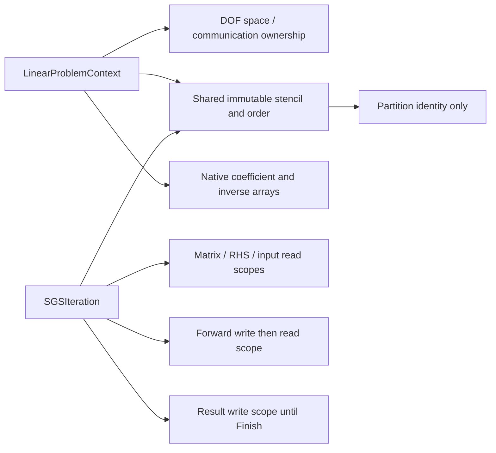

# Cauchy native implicit operator contracts


`Cauchy/Implicit/LinearProblemContext` owns the numerical matrix for one fixed
native DOF space. Its immutable sparse columns use the same owned-plus-ghost
local numbering as the input field. It stores rank-owned rows only, separate
diagonal-entry or full diagonal blocks, and full off-diagonal blocks. Blocks use
`DNDS::Algebra::BlockMatrixStorage`; diagonal values and inverses are native
Arrays. No legacy ArrayDOF or EulerJacobian adapter is involved.

The constructor checks the core set against actual matrix columns. Its logical
scan visits `[core][noncore]`, without permuting physical arrays or communication
mappings. `Apply(Core)` acquires only owned input; All and HaloDependent require
completed ghost input. Output buffers must be distinct from inputs and matrix
storage. Array allocation or shape replacement invalidates the fixed stencil.
Bindings retain the exact `ArrayStorage`, including its payload range and shape
metadata. Allocation identity alone is insufficient: two disjoint views can
share an allocation and its mutation epoch. Replacing a bound handle with such
a view also requires rebuilding the workspace. These O(1) checks run at wrapper
entry, outside numerical loops. Ordinary shallow handle copies retain the same
storage and remain valid. Auxiliary provenance uses the same storage pins plus
state/output versions and time; cell auxiliary halo writes may refresh values,
but may not replace the bound ghost storage.
Fill finite coefficients before use; the low-level action does not rescan every
coefficient or input value on each matrix-vector multiplication.

`InvertDiagonal` explicitly prepares scalar reciprocals or robust block inverses
using the shared active-Euler LU/SVD policy. Changed or actively written diagonal
values reject SGS until inversion is repeated. `ApplySGS` exposes an unsplit
convenience over the staged symmetric-GS kernel: RHS, old iterate, forward scratch and result are
separate buffers. Remote old values stay frozen through both scans. No MPI or
middle exchange is hidden in the numerical operator. ILU composition and
Krylov/nonlinear drivers remain separate phase items.

`FiniteVolume::BuildLinearProblem` allocates the cell-face-cell stencil on the
prototype's existing row space. `PrepareJacobian` fills its explicit numerical
arrays from frozen means, prepared face spectral radii and an owned scalar
inverse-pseudo-time array. For integrated residual `R=d(VU)/dt`, its convention
is `A = V/dTau + physicalMass*V - residualScale*J_R_approx`. No division by cell
volume is hidden in the action. Diagonal inversion/factorization is a later
explicit operation.

Scalar dissipation uses the Euler spectral diagonal and off-diagonal
`0.5*residualScale*weight*(A_normal(U_other)-lambda*I)`. Its boundary contribution
is the same scalar spectral diagonal, without a BC derivative. Full-block Roe
mode forms equation-owned characteristic dissipation from mean-state numerical
wave magnitudes and adds the physical exterior-state Jacobian on boundaries.
Viscosity enters the approximate spectral dissipation; this does not differentiate
the complete gradient reconstruction or viscous flux. Source Jacobians are not
part of the initial source-free profile. Off-rank columns remain in the operator.

Periodic neighbor states and increment columns are transformed into the current
cell's frame. Multiple incidences accumulate into one sparse block. A periodic
self-neighbor contributes to the diagonal block; diagonal-entry storage retains
only that block's diagonal entries. Core classification stays conservative with
the mesh's node-star halo. The producer performs no MPI, input/reconstruction
mutation or hidden inverse update. It rejects stale auxiliary provenance,
missing required signals, incompatible spaces and input/output aliases before
filling. Its caller coordinates rank-local errors before later MPI operations.

Distributed tests compare assembled action against independent centered
differences of a frozen-spectral first-order flux residual on a periodic torus
and a cube with physical slip boundaries. They include integrated time/pseudo-time
scaling, both diagonal representations where applicable, and stale-input errors.
These validate the approximate operator; convergence of the eventual nonlinear
solver and equivalence to a full high-order residual derivative are separate
questions. Linear/nonlinear drivers and pMG remain under implementation.

## Local ILU composition

`PrepareILUStructure(fill, coreFirst, localParts)` constructs an independent
rank-local template, then `FactorizeILU` copies current native coefficients and
factors them. Fill levels0..5 and complete LU(-1) match the generic Solver
facility. Local factors exclude off-rank columns, which remain in the full
matrix action. Explicit local parts additionally exclude cross-part columns
from the preconditioner, giving independent part solves. The Cauchy adapter
builds these induced graphs before symbolic fill: the generic symbolic routine
preserves every supplied edge and does not perform that partitioning itself.

Optional core-first ordering precedes fill and stays within each local part.
Incomplete templates publish dependency-safe forward and backward ready rows;
the latter account for the actually available forward rows. An upper ready core
can be empty. Complete LU has no bounded-core promise. No physical field/halo
mapping is reordered by this setup.

`ApplyILU(rhs, forward, result)` uses separate native fields and the guarded
local triangular solve. It acquires no RHS ghost lease and posts no MPI between
scans. Matrix coefficient generations are checked while source reads are pinned;
changed/active diagonal or off-diagonal values require numeric refactorization.
Symbolic preparation and numerical factorization are independent of SGS inverse
preparation. Dense-local reference tests check optional ordering, diagonal modes,
fill, independent local parts, held ghost writers, empty owners and stale factors.
The generic legacy factor algorithm and its first-build arithmetic stay intact.

## Staged symmetric GS and publication

`BeginSGS(rhs, old, forward, result, middleExchange=false)` creates a move-only
`SGSIteration`. Phase calls execute CPU numerical work synchronously. They do
not post MPI, choose streams or perform rank agreement. The caller serializes
phase calls and coordinates local failures before later distributed operations.

```cpp
auto halo = oldBinding.Begin();
auto iteration = matrix.BeginSGS(rhs, old, forward, result, refreshMiddle);
iteration.Lower(LinearRegion::Core);       // no ghost lease or ghost access
halo.Wait();
iteration.Lower(LinearRegion::HaloDependent);
if (refreshMiddle)
    forwardBinding.Begin().Wait();        // explicit, exposed inter-scan join
iteration.Upper(LinearRegion::HaloDependent);
iteration.Upper(LinearRegion::Core);
iteration.Finish();                      // publishes complete result
```

Either scan also accepts All. Lower Core precedes Lower HaloDependent; the
reverse scan requires Upper HaloDependent before Upper Core. Full and staged
calls use the same logical ordering, coefficients and arithmetic. The native
layout and transfer mapping are unchanged. Wrong, repeated or incomplete phase
sequences throw at the phase boundary, outside cell/block loops.

The iteration holds input/matrix reads and exclusive output access. Lower core
work cannot see the input ghost allocation. Dependent lower work acquires it
only after the caller observes the input exchange. The default upper scan
retains that same frozen remote input. The optional middle mode instead reads
the completed forward halo; it rejects both an active write and an unchanged
generation from an earlier iteration. Generation checks establish publication,
not semantic routing identity: the caller binds the intended shared mapping.

Forward scratch becomes readable when the complete lower scan finishes, so its
halo can be sent then. The result stays exclusively held even after a partial
upper scan and becomes readable only at Finish. Abandoning a started iteration
invalidates unfinished scratch/results. An unused iteration cancels its unused
writes without changing their values. Reinitialize failed buffers with a full
Array write or replace them before reuse; a failed partial result is not an old
valid iterate. A failed Finish leaves the scope available to complete its missing
phases. Calling it again after successful publication is an error.



Numeric scopes retain allocations, row metadata and partition identity after
original handles/context expire. They do not retain communicator ownership,
which avoids moving MPI resource destruction into a worker's numerical scope.
Read/write views and dense adapters are constructed once per phase; the hot
loop uses bare views, with a stack flow5 vector and a general-component fallback.
No row-mask, shared-pointer copy or lease lookup occurs in block arithmetic.

Focused distributed tests run active direct-MPI input exchanges with core lower
work, compare staged/full default results exactly, and compare the refreshed
middle option with an independent global forward-scratch oracle. They exercise
phase/readiness errors, retained lifetimes, output publication, unused scopes and
abandonment for AoS/SoA/AoSoA. The eventual engine wrapper must declare scheduled
accesses/events for queued execution. These synchronous CPU entry points do not
claim CUDA submission or graph support.

## CPU linear orchestration

`Implicit/LinearSolver` owns reusable native vectors and persistent input halo
bindings, while `LinearProblemContext` owns coefficients and numerical kernels.
It supports standalone SGS and restarted left-GMRES with a fixed SGS or local
ILU preconditioner. Every SGS preconditioner application starts from zero and
uses the configured fixed number of sweeps. ILU never inserts a middle exchange;
the optional SGS middle exchange is explicitly exposed. Matrix read scopes pin
coefficients throughout a solve. Both overlapping core/dependent and unsplit
wait-then-All execution use the same numerical order.

All domain ranks construct/call the solver together with agreed controls.
Callers serialize access, release conflicting debug/Python views, and bind each
input to the intended entity ghost mapping. Checked execution coordinates local
kernel errors before more MPI; disabling those checks is caller-ordered eager
execution and transfers distributed failure handling to the caller. Control and
solve-entry checks remain collective. A preflight rejection is reusable; a
failure after iteration starts invalidates that workspace for reuse. Reports
distinguish convergence, finite iteration limits and unusable breakdowns. The
borrowed solution changes at the next solve; it cannot serve as that solve's RHS.

Distributed tests solve an independently assembled global block matrix, using
real persistent ring transfers, both overlap policies, both SGS middle modes,
SGS/GMRES+SGS/GMRES+ILU and AoS/SoA/AoSoA. They check warm/repeated solves,
unchanged RHS generations, rank-inconsistent controls and rank-local conflicting
accesses. These gates validate linear orchestration, not nonlinear CFD acceptance.

## Implicit PP and physical time building blocks

`Physics/ImplicitPositivity.hpp` ports Euler's active scheme-one internal-energy
compression, relaxed increment fraction and flow5 increment repair as pure
functions. Density is handled before energy; the legacy safety, compression
powers and repair factors are retained. Temperature and pressure constraints are
an intersection of two affine energy bounds for the initial perfect-gas model.
The same concave rule applies to both. A future EOS must supply valid energy
reference/bound information, rather than substituting gamma in numerical code.
Callers supply finite admissible old states, valid relaxation/power controls,
check the resulting state, and perform the field/global reductions themselves.
An exhausted energy repair returns NaN; it must be rejected, never applied.
These functions do not yet replace the existing explicit flux-blend path.

`Solver/FieldTimeStepper.hpp` owns native-field time scratch and accepted BDF
history. The supported tableaus BDF1/2, Trapz and ESDIRK2/3/4 retain Euler's
coefficients. A callback solves `mass*U-rhsScale*F(U,t)=source`; nonlinear/PP,
physical accumulation and MPI orchestration remain its caller's responsibility.
This initial profile uses identity accumulation in the semidiscrete time
equations. Different physical mass maps need an explicit adapter. Preparation
changes only trial state/scratch. Commit history only after accepted-state
publication succeeds; discard/retry never changes accepted history. Variable
BDF2 uses the last accepted timestep, with BDF1 startup or an explicit reset.
Independent nonautonomous exact-stage tests verify orders and retry semantics.
Domain now connects these time equations to the nonlinear stage solver below.
DITR and physical qualification remain outstanding.

## Nonlinear stage and physical transaction

`Implicit/NonlinearSolver` solves the explicit stage equation by pseudo-time
continuation. Each iteration evaluates the uncompressed physical defect,
checks per-component volume-weighted norms, prepares local pseudo-time and
the approximate Jacobian, solves a distinct correction, and publishes a checked
candidate. Root `implicit` settings separate nonlinear, linear, SGS, ILU and PP
choices. CPU backend selection is explicit. Exact constructor control agreement
prevents rank-dependent iteration/PP branches from mismatching MPI calls.

For `numerics.positivity`, the implicit path uses Euler's RHS compression or
dTau compression, relaxed delta compression and final flow5 increment repair.
Convergence always uses the uncompressed defect. Reconstruction quadrature PP
still uses the earlier Cauchy rule; full Euler reconstruction/physical-dt PP and
its global alpha variants remain phase work. This is not yet the full PP suite.

Corrections are computed into separate candidate storage, then admissibility
is agreed before any trial-state write. This required safety agreement remains
enabled when optional per-kernel collective checks are disabled. A bad correction
therefore rejects without poisoning the bound state allocation. Optional-check
disablement still transfers handling of unexpected local kernel/access failures
to the caller; it is not an MPI exception-recovery mechanism.

`Domain` preserves the reconstruction warm guess before an implicit attempt.
Discarded/rejected attempts restore it before retry. Accepted state and clock
are published before committing BDF history. An external debug reader can reject
publication collectively without advancing history; releasing it allows the
same prepared candidate to commit. A stage correction cap rejects the physical
candidate, never labels the capped inner solve converged. CSV output records
stage count, nonlinear/linear iterations and residual-to-target ratio.

Distributed tests recover a manufactured constant solution from nonconstant
means, check unusable/bad correction handling, and exercise the connected
BDF1/2, Trapz and ESDIRK2/3/4 paths. The P3 transport test checks periodic
conservation and exact discard/retry versus fresh-run agreement. They are
focused implementation gates, not the final IV/cylinder qualification matrix.

Cauchy resolves ordered SOR to the same logical core-first scan for both
execution policies, including direct C++ FV construction. The resolved root
records the effective `cfv.coreFirst` and its ordering provenance. Merely
toggling overlap therefore preserves finite-sweep mathematics. The standalone
CFV plan still exposes natural-order unsplit SOR. The regression leaves the
requested coreFirst flag at its default false and was proven red before this
frontend resolution fix.

The Python Domain constructor honors the configured physical time method.
`implicit_stages` returns copied read-only report objects; `flow` remains a
shared native Array handle with normal lease/lifetime rules. Reports include
convergence, initial/final component residuals, nonlinear/linear iteration
counts and PP activations. Release array access scopes before conflicting
updates or publication. Focused MPI Python tests verify BDF2/ESDIRK4 dispatch,
shared state identity through stepping/restart and retained allocation lifetime.
They require rebuilding/installing bindings and pytest's `--with-mpi` flag;
a skipped collection is not validation.

## Restart correspondence and history

Cauchy checkpoint format4 adds `metadata_json` with the flow schema, energy
convention, EOS parameters, polynomial interpretation and time-history method.
Native Array archives still own their own element/row/physical-layout schemas;
the Cauchy envelope does not serialize C++ static row types. Formats2/3 remain
readable. Reads shard file rows across the current communicator, match exact
canonical `cell_ids`, and use one reusable ordinary transfer plan to redistribute
flow, mesh records, optional coefficients and history. No global ID-sized array
or VTK row correspondence is used. Numerical payloads follow native direct I/O
and canonical direct MPI transfers; the ID directory is separate cold metadata.

The default omits reconstruction. Set `output.checkpointReconstruction=true`,
pass `includeReconstruction=true` in C++, or `include_reconstruction=True` in
Python to preserve a compatible warm guess. Missing coefficients or changed
polynomial metadata cold-start at zero. Mean restoration permits changed MPI
ownership/local order, execution layout and P-degree. Actual per-cell topology,
coordinates, periodic frames, equation schema and other retained physical/
numerical configuration must still match. Time/output/execution choices and
polynomial setup are excluded from the compatible-config comparison; ordinary
Riemann/BC/physics changes are not silently accepted. Earlier archives missing
the Riemann stencil flag retain its explicit manual interpretation.

BDF2 records previous accepted means and dt. Compatible history is remapped;
absent/incompatible history uses BDF1 startup. A replacement time workspace and
its restored history are prepared before accepted publication, then swapped
only after publication succeeds. A failed load leaves accepted clock/history
unchanged. Caller serializes checkpoint access and releases conflicting views
before publication. Only ready CPU arrays are supported by the current direct
I/O backend; device serialization does not silently stage through host memory.

Focused tests change writer/reader rank counts, perform a real mesh RCM
permutation, change P2 to P3 and AoS to SoA, and inspect the reserialized actual
coefficients to prove cold-start behavior. They also verify optional nonzero
warm-guess storage, exact variable-step BDF2 continuation and reader-conflict
rejection/retry. The legacy matching-partition exact-continuation tests now
explicitly opt into coefficient storage, preserving their original purpose.

Mesh envelope2 stores a periodic face's canonical axis tag and the intrinsic
frame of its nodes in the owning cell's reference coordinates. Runtime
`faceInfo.zone` main/donor choice and `cell2facePbi` instead refer to the selected
stored face image, which can change when a fresh partition chooses the other
ordered parent. They are not persistent physical mesh identifiers. Older
envelopes compare exact cell/node IDs, cell-node bits and coordinates, neighbor
IDs, periodic axis and global transforms; their valid face-image gauge bits
are not compared to a different partition's gauge. Physical boundary zones
remain exact. This changes checkpoint interpretation only, not Geom's runtime
face representation or numerical kernels.

The original strict envelope passed generated-mesh tests but rejected a real
CGNS IV20 archive when read at np4 after writing at np8. Diagnostics identified
complementary periodic tags (-1/-4, -2/-5), while coordinates matched exactly.
A permanent CGNS repartition test was proven failing before this correction.
It now passes at np1/2/4/8. The actual old format3 archive also loads and takes
its next ESDIRK4 step after repartition, preserving loaded means and diagnostics.
