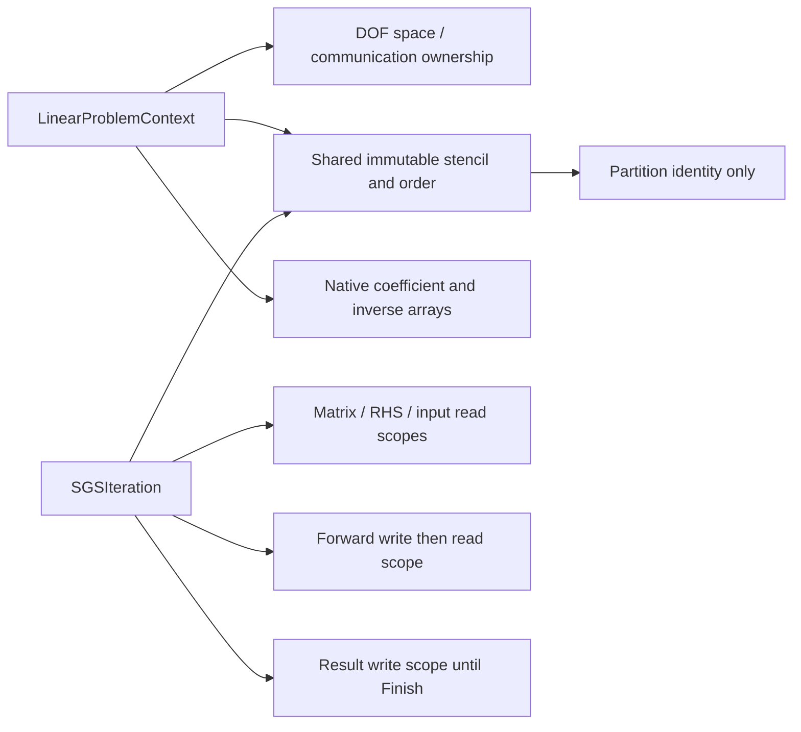

# Cauchy native implicit operator contracts


`Cauchy/Implicit/LinearProblemContext` owns the numerical matrix for one fixed
native DOF space. Its immutable sparse columns use the same owned-plus-ghost
local numbering as the input field. It stores rank-owned rows only, separate
diagonal-entry or full diagonal blocks, and full off-diagonal blocks. Blocks use
`DNDS::Algebra::BlockMatrixStorage`; diagonal values and inverses are native
Arrays. No legacy ArrayDOF or EulerJacobian adapter is involved.

The constructor checks the core set against actual matrix columns. Its logical
scan visits `[core][noncore]`, without permuting physical arrays or communication
mappings. `Apply(Core)` acquires only owned input; All and HaloDependent require
completed ghost input. Output buffers must be distinct from inputs and matrix
storage. Array allocation or shape replacement invalidates the fixed stencil.
Fill finite coefficients before use; the low-level action does not rescan every
coefficient or input value on each matrix-vector multiplication.

`InvertDiagonal` explicitly prepares scalar reciprocals or robust block inverses
using the shared active-Euler LU/SVD policy. Changed or actively written diagonal
values reject SGS until inversion is repeated. `ApplySGS` exposes an unsplit
convenience over the staged symmetric-GS kernel: RHS, old iterate, forward scratch and result are
separate buffers. Remote old values stay frozen through both scans. No MPI or
middle exchange is hidden in the numerical operator. ILU composition and
Krylov/nonlinear drivers remain separate phase items.

`FiniteVolume::BuildLinearProblem` allocates the cell-face-cell stencil on the
prototype's existing row space. `PrepareJacobian` fills its explicit numerical
arrays from frozen means, prepared face spectral radii and an owned scalar
inverse-pseudo-time array. For integrated residual `R=d(VU)/dt`, its convention
is `A = V/dTau + physicalMass*V - residualScale*J_R_approx`. No division by cell
volume is hidden in the action. Diagonal inversion/factorization is a later
explicit operation.

Scalar dissipation uses the Euler spectral diagonal and off-diagonal
`0.5*residualScale*weight*(A_normal(U_other)-lambda*I)`. Its boundary contribution
is the same scalar spectral diagonal, without a BC derivative. Full-block Roe
mode forms equation-owned characteristic dissipation from mean-state numerical
wave magnitudes and adds the physical exterior-state Jacobian on boundaries.
Viscosity enters the approximate spectral dissipation; this does not differentiate
the complete gradient reconstruction or viscous flux. Source Jacobians are not
part of the initial source-free profile. Off-rank columns remain in the operator.

Periodic neighbor states and increment columns are transformed into the current
cell's frame. Multiple incidences accumulate into one sparse block. A periodic
self-neighbor contributes to the diagonal block; diagonal-entry storage retains
only that block's diagonal entries. Core classification stays conservative with
the mesh's node-star halo. The producer performs no MPI, input/reconstruction
mutation or hidden inverse update. It rejects stale auxiliary provenance,
missing required signals, incompatible spaces and input/output aliases before
filling. Its caller coordinates rank-local errors before later MPI operations.

Distributed tests compare assembled action against independent centered
differences of a frozen-spectral first-order flux residual on a periodic torus
and a cube with physical slip boundaries. They include integrated time/pseudo-time
scaling, both diagonal representations where applicable, and stale-input errors.
These validate the approximate operator; convergence of the eventual nonlinear
solver and equivalence to a full high-order residual derivative are separate
questions. Linear/nonlinear drivers and pMG remain under implementation.

## Local ILU composition

`PrepareILUStructure(fill, coreFirst, localParts)` constructs an independent
rank-local template, then `FactorizeILU` copies current native coefficients and
factors them. Fill levels0..5 and complete LU(-1) match the generic Solver
facility. Local factors exclude off-rank columns, which remain in the full
matrix action. Explicit local parts additionally exclude cross-part columns
from the preconditioner, giving independent part solves. The Cauchy adapter
builds these induced graphs before symbolic fill: the generic symbolic routine
preserves every supplied edge and does not perform that partitioning itself.

Optional core-first ordering precedes fill and stays within each local part.
Incomplete templates publish dependency-safe forward and backward ready rows;
the latter account for the actually available forward rows. An upper ready core
can be empty. Complete LU has no bounded-core promise. No physical field/halo
mapping is reordered by this setup.

`ApplyILU(rhs, forward, result)` uses separate native fields and the guarded
local triangular solve. It acquires no RHS ghost lease and posts no MPI between
scans. Matrix coefficient generations are checked while source reads are pinned;
changed/active diagonal or off-diagonal values require numeric refactorization.
Symbolic preparation and numerical factorization are independent of SGS inverse
preparation. Dense-local reference tests check optional ordering, diagonal modes,
fill, independent local parts, held ghost writers, empty owners and stale factors.
The generic legacy factor algorithm and its first-build arithmetic stay intact.

## Staged symmetric GS and publication

`BeginSGS(rhs, old, forward, result, middleExchange=false)` creates a move-only
`SGSIteration`. Phase calls execute CPU numerical work synchronously. They do
not post MPI, choose streams or perform rank agreement. The caller serializes
phase calls and coordinates local failures before later distributed operations.

```cpp
auto halo = oldBinding.Begin();
auto iteration = matrix.BeginSGS(rhs, old, forward, result, refreshMiddle);
iteration.Lower(LinearRegion::Core);       // no ghost lease or ghost access
halo.Wait();
iteration.Lower(LinearRegion::HaloDependent);
if (refreshMiddle)
    forwardBinding.Begin().Wait();        // explicit, exposed inter-scan join
iteration.Upper(LinearRegion::HaloDependent);
iteration.Upper(LinearRegion::Core);
iteration.Finish();                      // publishes complete result
```

Either scan also accepts All. Lower Core precedes Lower HaloDependent; the
reverse scan requires Upper HaloDependent before Upper Core. Full and staged
calls use the same logical ordering, coefficients and arithmetic. The native
layout and transfer mapping are unchanged. Wrong, repeated or incomplete phase
sequences throw at the phase boundary, outside cell/block loops.

The iteration holds input/matrix reads and exclusive output access. Lower core
work cannot see the input ghost allocation. Dependent lower work acquires it
only after the caller observes the input exchange. The default upper scan
retains that same frozen remote input. The optional middle mode instead reads
the completed forward halo; it rejects both an active write and an unchanged
generation from an earlier iteration. Generation checks establish publication,
not semantic routing identity: the caller binds the intended shared mapping.

Forward scratch becomes readable when the complete lower scan finishes, so its
halo can be sent then. The result stays exclusively held even after a partial
upper scan and becomes readable only at Finish. Abandoning a started iteration
invalidates unfinished scratch/results. An unused iteration cancels its unused
writes without changing their values. Reinitialize failed buffers with a full
Array write or replace them before reuse; a failed partial result is not an old
valid iterate. A failed Finish leaves the scope available to complete its missing
phases. Calling it again after successful publication is an error.



Numeric scopes retain allocations, row metadata and partition identity after
original handles/context expire. They do not retain communicator ownership,
which avoids moving MPI resource destruction into a worker's numerical scope.
Read/write views and dense adapters are constructed once per phase; the hot
loop uses bare views, with a stack flow5 vector and a general-component fallback.
No row-mask, shared-pointer copy or lease lookup occurs in block arithmetic.

Focused distributed tests run active direct-MPI input exchanges with core lower
work, compare staged/full default results exactly, and compare the refreshed
middle option with an independent global forward-scratch oracle. They exercise
phase/readiness errors, retained lifetimes, output publication, unused scopes and
abandonment for AoS/SoA/AoSoA. The eventual engine wrapper must declare scheduled
accesses/events for queued execution. These synchronous CPU entry points do not
claim CUDA submission or graph support.
