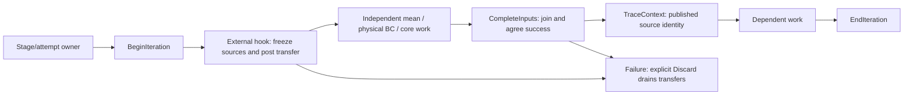
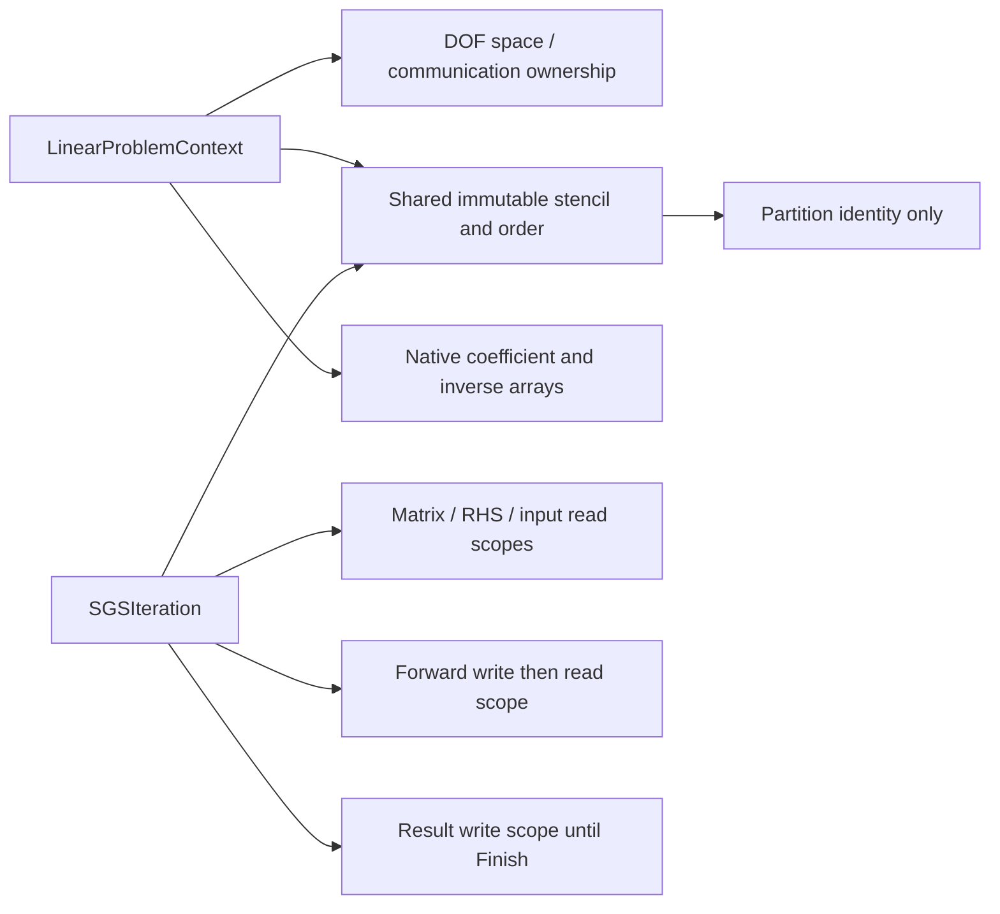
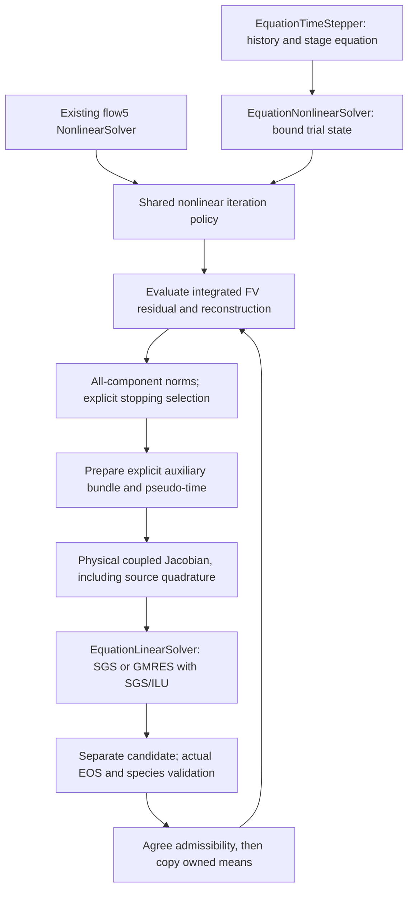

# Cauchy native implicit operator contracts

## Time-method revision in progress

`Solver/TimeIntegration` now exposes normalized `TimeEquationCoefficients`,
variable-step `BDFCoefficients`, Euler-compatible `DIRKTableau` and the
`DITRMethod<State, Operations>` workspace. These definitions have no Cauchy,
mesh, physical-model or nonlinear-solver dependencies. BDF/DIRK coefficient
definitions are shared with the time frontend. Production Domain now uses the
DITR method with one shared nonlinear loop. The old nested implementation is
removed; `StateDITR.hpp` only forwards the public method type.

The DITR method owns the initial snapshot, intermediate unknown and three RHS
caches. The caller owns the endpoint trial. `Begin` evaluates the initial RHS
and uses it for the two initial rate guesses. The external controller prepares
coupledStage 0 (intermediate), applies one correction or spatial V-cycle, and
completes it by refreshing that RHS. It then does the same for coupledStage 1
(endpoint). `AssembleStoppingResidual` produces `I+H` after both updates. It
does not test convergence or perform a solve. The controller owns stopping and
CFL progression; a prepared `resOther` and the other stage/rate must remain
unchanged throughout each correction, including its FAS recursion.
`NonlinearDetail::Iterate` accepts an explicit residual-observation order:
ordinary stage solves retain before-update observation, while a DITR problem
can request observation after its two coupled updates. Both use the same norm,
reference, CFL and cap policy; after-update mode has no iteration-zero stop.

`NonlinearSolver::CorrectOnce` and `EquationNonlinearSolver::CorrectOnce` share
the ordinary solve's evaluation, defect assembly, pseudo-time, approximate
Jacobian, linear solver and PP/update implementations. They do exactly one
update without a convergence loop or residual-norm Allreduce. Other required
agreement, physics and linear-solver collectives remain. Their reports never
claim convergence. Input halos may be stale; the physical evaluation handles
its exchanges. Output guarantees owned values only. Calls remain synchronous
and serialized against the bound state/workspace/engine.

`PolynomialMultigrid::ApplyCycle` is one finest update. Its bounded smoothers
call `CorrectOnce`; they do not restart convergence policy or pseudo-CFL growth.
The compatibility `Solve` frontend uses the same `NonlinearDetail::Iterate`
controller as direct solves. `iterations` counts finest V-cycles;
`levelCorrections` separately counts level smoothing work. `multigrid.cycles`
remains the cap for this compatibility frontend. Source coefficients and frozen
other-stage terms are unchanged throughout a cycle. Temporal-pMG is deferred.

Focused tests compare two incomplete DITR iterations against independently
written Euler-form scalar equations for both variants, compare a single CPU
correction byte-for-byte with the first ordinary-solve update, and exercise
distributed FAS with explicit finest/coarse work accounting. This does not yet
complete the remaining whole-phase qualification. BDF/DIRK history ownership
and the first tracked mean-halo integration are described below.

Optional CPU profiling uses caller-owned `NonlinearProfile` through
`NonlinearSolveControl::profile`. A null output performs no clock queries or
additional MPI operations. A provided output resets for each synchronous solve
and retains partial timings when it throws; retain it until return/unwinding
and do not share it between simultaneous solves. Timers surround operator and
controller phases, outside numerical row loops. Per-rank Total encloses Entry,
Residual, Convergence, PseudoTimePP, Jacobian, LinearSolve and Correction.
Residual includes reconstruction/auxiliary/communication; LinearSolve includes
required preconditioner work and exchanges. These are wall times, including
waits, rather than pure arithmetic costs. Calculate the unsectioned controller
remainder per rank before reduction: sums of independently maximized phases
are not the same as maximum-rank total. No timer output certifies convergence.

The coupled DITR method, its independent intermediate-stage workspace and
accepted/trial history contracts are documented in [DITR.md](DITR.md).

## Interface input refresh protocol

`Core/InterfaceIterationSchedule` supplies one stage/attempt's CPU control hooks.
It is independent of mesh matching, physical BC evaluation, equation width and
payload layout. `StateEpoch` now has its own small header; the existing
`CoordinatedSchedule` scalar clock mock retains its public type/API.



The owner constructs the schedule collectively on the coupling communication
context with one agreed stage identity, time, refresh policy and check mode.
Stage metadata agreement always runs at construction. Normal mode coordinates
local method/hook failures before publication; caller-ordered mode omits
per-iteration agreements and requires the caller to coordinate failures before
peers enter dependent collectives. Hooks coordinate their own internal
collective phases before throwing. Changing only one rank's stage, time,
refresh policy or check mode rejects during setup.

`PerStage` invokes begin/complete on iteration zero and reuses that packet through
the remaining nonlinear iterations. `TraceContext()` keeps source iteration zero
rather than relabelling cached data. `PerIteration` invokes the hooks for each
frozen round. Both follow Begin/independent/Complete/dependent/End. Ordinals start
at zero and are consecutive; invalid calls reject before another transfer posts.
Trace access before completion or after failure rejects. No exchange occurs
inside a linear or Krylov application.

Hooks retain actual packet allocations, source versions, plans and active
operations. The schedule owns logical context and publication state; an epoch
alone cannot prove array bytes match it. Native transfer/lease facilities keep
sources immutable during sends and prevent ghost reads during writes. Complete
prepares incoming CPU data and is agreed before the context becomes usable.
On failure/rejection call idempotent `Discard()` to drain operations; it permanently
invalidates that schedule and does no numerical rollback. Destruction issues
no implicit Discard; captured owners keep their ordinary cleanup behavior.
Construct/call/destroy on an MPI-permitted controller thread and release final
communication/transfer owners before MPI finalization.
Retry creates a fresh schedule with a fresh trial identity.
If the discard hook fails after partial cleanup, retain the owners and retry
cleanup; successful discard becomes idempotent only after its agreement returns.

Distributed mocks use canonical direct payload transfers from two domain roots,
including shared/reversed and disjoint rank groups and empty source ranks. An
independent two-variable recurrence checks both policies. Inline and worker
engines exercise overlap and unsplit order. A gated live worker retains owned
reads while the controller progresses real MPI requests; metadata remains
unpublished until CompleteInputs. Setup mismatches and rank-local begin/complete
failures reject; tests drain their requests and retry with a fresh identity.

This is the C4 control facility, **not physical multi-domain fluid integration**.
Domain still executes single-domain flow5. C5 must bind real packets to boundary
operators, compose interface readiness with MPI-core sets, coordinate domains
after local convergence, and implement stage/global acceptance and restart.
CUDA/capture needs scheduled readiness; CPU completion here does not certify
device stream completion.

## Steady BDF1 limit and physical endpoints

`time.steady=true` uses the analytic infinite-timestep limit of BDF1. The
existing stage solver receives physical mass zero, history source zero and
RHS scale one. Pseudo-time continuation, PP, SGS/ILU/GMRES and optional p-FAS
remain the same operators. Physical time stays frozen; no infinity enters
floating-point arithmetic or BDF history. This matches Euler's `steadyQuit`
behavior: its BDF2 driver takes only its first, BDF1 startup step at dt1e200.

Configuration resolution forces `method=bdf1`, at most one outer solve, no
physical final-time/CFL cap and no timestep-halving retries, recording each
override's provenance. `dt` remains a required positive finite placeholder
and is ignored by the steady equation. By default the final finite admissible
iterate is published even at the correction cap, retaining an unconverged
report; this is an iterate, not a converged steady result. Explicit
`implicit.rejectUnconvergedStages=true` rejects at the cap and leaves accepted
means, time and history unchanged. A finite-dt BDF1
transient with an outer residual stop is not this steady mode.

`implicit.consoleInterval` enables rank-zero progress at selected nonlinear
iterations; zero disables it. These norms are the uncompressed equation
residual. Defaults use volume-weighted L2 and density-only convergence, tested
against its running maximum within the solve and the absolute floor. The
running-maximum reference is Euler's default behavior; `initial` remains an
explicit alternative. Explicit controls are
`normOrder=1|2`, `residualReference="initial"|"runningMaximum"` and the distinct
component names in `residualComponents` (default `["rho"]`; `[]` selects every
resolved equation). Use names from the equation schema, e.g. `["rho", "rhou"]`
or `["rhoY:H2", "rhoY:H2O"]`. A `block.component` spelling such as `flow.rho`
disambiguates names. Unknown, ambiguous and duplicate selections fail at setup;
names resolve once outside residual evaluation and cell loops. L1 is
`sum(abs(integratedDefect))/sum(volume)`; L2 is
`sqrt(sum(integratedDefect^2/volume)/sum(volume))`. Selection only controls
acceptance: all component norms are still computed and reported. Reference
norms reset at solve entry and running maxima include the current evaluation.
Single-level and finest p-FAS acceptance use the same small policy after the
existing global norm reduction, with no additional collective.

Euler's optional transient `resBaseType=1` additionally seeds the reference
with the first spatial RHS norm, then still takes the running maximum of
equation residual norms. Cauchy's `runningMaximum` implements the default
unseeded behavior (`resBaseType=0`), not this extra RHS seed.

The [PP policy](CauchyPositivity.md) distinguishes Euler's whole-vector
increment/RHS compression from its flow/species reconstruction compression and
separate scalar repairs. Composition-dependent thermal compression remains
coupled; no independent species backoff is introduced.

Euler's density/L1/running-maximum criterion is selected with
`normOrder=1`, `residualReference="runningMaximum"`, `residualComponents=["rho"]`
and its relative tolerance (absoluteTolerance0 for a purely relative target).
This choice does not assert convergence of the other equations. Reports retain
both `initialResidual` and `referenceResidual`, plus the selected-component
`residualTargetRatio`; CSV and Python use that ratio rather than recomputing an
all-component initial-reference ratio. A zero requested target means exact
zero; an unmet zero target reports the largest finite ratio. DITR uses the same
controller and named component selection. DITR inherits each domain's
`implicit.iterations`, `minIterations`, `relativeTolerance` and
`absoluteTolerance`. Explicitly supplied `time.ditr` counterparts remain
deprecated compatibility overrides; missing/null fields inherit, including
after JSON round trips. Explicit zero tolerances/minimum are valid overrides.
The combined minimum/maximum is checked before stepping. These fields do not
introduce another loop. RANS/species never enter the default criterion;
a homogeneous reactor must explicitly select reacting components or all. Align
linear relaxation and VR warmup too before calling a baseline matched.

`implicit.requireConvergedReconstruction=true` additionally requires the
finest VR update to meet `numerics.reconstructionTolerance` before accepting
the equation, including p-FAS. Variational reconstruction then requires a
positive tolerance. The default false retains Euler-style fixed-sweep mean
acceptance; a soft VR early-exit threshold alone does not guarantee a settled
polynomial at the mean stop. Inspect the reported VR update and use the strict
guard for a settled-VR qualification. It uses the norm already reduced by CFV,
without another collective or a check inside a numerical kernel. Boundary
quadrature values are refreshed from the current polynomial on each VR sweep.

The physical frontend uses `FieldTimeStepper::ReachedTimeTarget` to avoid a
roundoff-sized extra step at a requested endpoint. The tolerance scales with
the actual times, preserving tiny nonzero physical horizons. Genuine positive
steps which cannot advance a floating-point clock are rejected explicitly.
The relative endpoint guard also covers addition error from the tested800-step
vortex and2500-step cylinder sequences, rather than only one rounded addition.

Restart compatibility allows reconstruction sweep-budget/early-exit changes.
They do not change stored means or a compatible polynomial coefficient schema;
physics, flux and active PP policies retain their existing compatibility checks.
Exact replay still requires compatible numerical controls and stored guesses.

## Polynomial multigrid

`Cauchy/Multigrid/PolynomialMultigrid` connects the generic
[FAS cycle](FAS.md) to same-cell spatial operators. `implicit.multigrid.levels=0`
disables it. Level1 is direct-gradient second order, level2 additionally uses
first-order convection; physical viscosity/gradient calculation, equation and
boundary conditions remain enabled. The finest operator requires variational
degree2 or3. This follows the supported Euler pMG fidelity hierarchy, without
copying its recursive orchestration lambda. No spatial coarsening or new mesh
partition is performed.

```text
Domain physical trial / time equation
  PolynomialMultigrid -> finest uncompressed convergence test
    Solver::FASCycle
      VR high-order   -> NonlinearSolver bounded PTC/SGS or GMRES smoothing
      direct O2      -> independent state, FV workspace and matrix/linear solver
      first-order    -> independent state, FV workspace and matrix/linear solver
      identity state/residual/correction maps on the same cell identity/order
```

Every operator uses `mass*U-rhsScale*R(U)/V`. Consequently all three same-cell
maps are identity in this normalized convention; an integrated-residual or
different-mesh hierarchy must supply its own transfer. Cell identity/order is
checked during setup. Means, fine/coarse matrices and mutable auxiliary/gradient
buffers are distinct. Cauchy defaults to the whole logical equation state.
`implicit.multigrid.updateComponents` optionally selects distinct logical indices
for every level's smoothing and correction; empty selects all. Other means stay
bit-identical. Generic FAS supports the same contract for arbitrary component
widths through explicit principal-system smoother callbacks.

The selected approximate Jacobian is `P*A*P + (I-P)`, with a zero RHS in
unselected equations. Both assembled and frozen evaluated blocks project after
periodic frame transforms. This solves the principal system; it is not a full
Newton solve followed by masking. The full residual is formed and measured
before its solve RHS is projected. Euler RHS/dTau PP uses that projected RHS,
and increment/final PP receives a projected increment. A physical repair that
would change a frozen component is rejected before publishing means.
The original finest equation and all component norms remain observable.
`implicit.residualComponents` remains the independent convergence selection:
its default selects density; explicitly selecting frozen equations may prevent
acceptance even if all updated equations have converged.

The field and `EquationDofs` overloads share one hierarchy implementation and
the generic `StateFASCycle` recursion. Coarse logical states preserve the exact
block-to-physical-field mapping and each parent's AoS/SoA/AoSoA pitch. Their
distinct row-space associations are constructed explicitly; only the validated
identity transfer crosses level spaces. Coarse means are initialized from the
admissible fine background before the level solver is constructed. Each level
retains the same equation, material/worker pool, RANS model, wall samples and
configured volume sources. There is no logical-state payload packing.

Identity tau edges evaluate the spatial part of the operator with zero direct
time coefficient, giving `resOther_c = resOther_f + alpha*(F_f-F_c)` directly.
The full time coefficient remains in every smoother and finest norm. The
separate DITR coupledStage cycles freeze their current resOther independently;
no temporal coarsening or nested stage-convergence loop is introduced.

`implicit.collectiveChecks` also controls the optional agreement around local
cycle algebra and identity copies. With it disabled, those operations perform
no collective; required stage-entry, transfer and numerical norm protocols are
unchanged. Callers then own coordinated failure handling, as for other eager
equation operators. Shape/binding checks remain local and outside cell loops.

Direct nonlinear users can select the same behavior with
`NonlinearSolveControl::updateComponents`. Selection is validated and agreed in
the existing stage-entry reductions, including in caller-ordered eager mode.
Standalone `ApplyCorrection` callers must agree its optional selection and
scale before entering. All public defaults retain full-state behavior.

`preSmooth`, `postSmooth` and `coarseSmooth` bound nonlinear corrections, and
`cycles` caps V-cycles. Each level carries its pseudo-CFL between smooth calls;
the next physical stage resets it. Coarse correction `damping` and physical PP
reuse the same candidate-before-publication policy as the fine smoother.
Convergence checks the original finest equation with its original source,
per-component norms and configured tolerances. A coarse forcing tolerance or
a V-cycle count never implies physical stage acceptance. Reports contain
cycle counts, corrections per level and total corrections/linear work across
levels. No acceleration claim follows from the correctness tests alone.

Physical discard/retry still restores the fine reconstruction guess. Coarse
levels have no persistent VR polynomial guesses and restriction overwrites
their state each cycle. A failed cycle drops its scratch hierarchy; the next
attempt constructs fresh scratch before reuse. The physical caller still owns
restoring any changed fine trial. Failed or explicitly rejected attempts never
publish accepted state/time history. Finite capped solves follow the configured
Euler-style advance/rejection policy. Same-cell pMG tests cover manufactured nonconstant P3
equations, mixed DOF layouts, active distributed halos, constant fixed points,
physical discard/retry and commit rejection by a retained debug reader.


`Cauchy/Implicit/LinearProblemContext` owns the numerical matrix for one fixed
native DOF space. Its immutable sparse columns use the same owned-plus-ghost
local numbering as the input field. It stores rank-owned rows only, separate
diagonal-entry or full diagonal blocks. By default full off-diagonal blocks use
`DNDS::Algebra::BlockMatrixStorage`; diagonal values and inverses are native
Arrays. No legacy ArrayDOF or EulerJacobian adapter is involved.

`implicit.jacobianAction="semiMatrixFree"` omits the assembled off-diagonal
Array and regenerates blocks from frozen physical data. This is the same
simplified approximate Jacobian as `"assembled"`, not a Frechet derivative of
the high-order residual. Both modes support scalar or block diagonals, scalar
or characteristic Roe dissipation, periodic momentum transforms and physical
BC/self-periodic diagonal terms. SGS, GMRES action and local ILU filling use
the same block-read interface. ILU still stores and factors its explicit local
template; this is not matrix-free factorization.

The physical evaluator owns mean values, face radii and (for Roe) prepared
characteristic magnitudes. EquationSystem regenerates physical derivatives and
characteristic matrices; EOS calculations remain outside Riemann. Quadrature
geometry is immutable and reused on subsequent preparation. A weak FV-owner
key identifies that geometry without retaining the mesh or communicator.
Changing live means/auxiliary after preparation cannot change the frozen
operator. Reprepare explicitly for a new nonlinear state; stale auxiliary
provenance rejects before matrix writes.

`ReadOffDiagonal().WithBlocks(callback)` selects a block accessor once outside
the numerical loop. Stored blocks retain their ordinary stable Eigen maps;
evaluated blocks return owning matrices, with flow5 on the stack. Holding the
result of one block query and evaluating another is safe. Other component
counts use a generic dynamic dense matrix. A raw callback/map still requires
the enclosing read scope to remain alive; custom evaluators must own immutable
inputs, match exact row identity/columns/components, perform no MPI or hidden
mutation, and obey the same controller serialization contract.

Publishing evaluated data validates its complete stencil and exact row identity
outside the hot loops. A short exclusive diagonal lease guards publication;
evaluated reads pin a shared diagonal lease. Active action/SGS/factor readers
therefore reject replacement. Publication does not change the diagonal values
or its generation, but advances a separate off-diagonal generation, invalidating
old ILU factors. A numeric read scope retains row metadata and allocations or
the immutable evaluator, without communicator ownership. Unprepared evaluated
data, explicit storage access in evaluated mode, and mismatched selection across
domain ranks all fail explicitly. No CUDA kernel/fallback is introduced.

The constructor checks the core set against actual matrix columns. Its logical
scan visits `[core][noncore]`, without permuting physical arrays or communication
mappings. `Apply(Core)` acquires only owned input; All and HaloDependent require
completed ghost input. Output buffers must be distinct from inputs and matrix
storage. Array allocation or shape replacement invalidates the fixed stencil.
Bindings retain the exact `ArrayStorage`, including its payload range and shape
metadata. Allocation identity alone is insufficient: two disjoint views can
share an allocation and its mutation epoch. Replacing a bound handle with such
a view also requires rebuilding the workspace. These O(1) checks run at wrapper
entry, outside numerical loops. Ordinary shallow handle copies retain the same
storage and remain valid. Auxiliary provenance uses the same storage pins plus
state/output versions and time; cell auxiliary halo writes may refresh values,
but may not replace the bound ghost storage.
Fill finite coefficients before use; the low-level action does not rescan every
coefficient or input value on each matrix-vector multiplication.

`InvertDiagonal` explicitly prepares scalar reciprocals or robust block inverses
using the shared active-Euler LU/SVD policy. Changed or actively written diagonal
values reject SGS until inversion is repeated. `ApplySGS` exposes an unsplit
convenience over the staged symmetric-GS kernel: RHS, old iterate, forward scratch and result are
separate buffers. Remote old values stay frozen through both scans. No MPI or
middle exchange is hidden in the numerical operator. ILU composition and
Krylov/nonlinear drivers remain separate phase items.

`FiniteVolume::BuildLinearProblem` allocates the cell-face-cell stencil on the
prototype's existing row space. `PrepareJacobian` fills its explicit numerical
arrays from frozen means, prepared face spectral radii and an owned scalar
inverse-pseudo-time array. For integrated residual `R=d(VU)/dt`, its convention
is `A = V/dTau + physicalMass*V - residualScale*J_R_approx`. No division by cell
volume is hidden in the action. Diagonal inversion/factorization is a later
explicit operation.

Scalar dissipation uses the Euler spectral diagonal and off-diagonal
`0.5*residualScale*weight*(A_normal(U_other)-lambda*I)`. Its boundary contribution
is the same scalar spectral diagonal, without a BC derivative. Full-block Roe
mode forms equation-owned characteristic dissipation from mean-state numerical
wave magnitudes and adds the physical exterior-state Jacobian on boundaries.
Viscosity enters the approximate spectral dissipation; this does not differentiate
the complete gradient reconstruction or viscous flux. Source Jacobians are not
part of the initial source-free profile. Off-rank columns remain in the operator.

Periodic neighbor states and increment columns are transformed into the current
cell's frame. Multiple incidences accumulate into one sparse block. A periodic
self-neighbor contributes to the diagonal block; diagonal-entry storage retains
only that block's diagonal entries. Core classification stays conservative with
the mesh's node-star halo. The producer performs no MPI, input/reconstruction
mutation or hidden inverse update. It rejects stale auxiliary provenance,
missing required signals, incompatible spaces and input/output aliases before
filling. Its caller coordinates rank-local errors before later MPI operations.

Distributed tests compare assembled action against independent centered
differences of a frozen-spectral first-order flux residual on a periodic torus
and a cube with physical slip boundaries. They include integrated time/pseudo-time
scaling, both diagonal representations where applicable, and stale-input errors.
These validate the approximate operator; convergence of the eventual nonlinear
solver and equivalence to a full high-order residual derivative are separate
questions. Linear/nonlinear drivers and native physical methods are connected;
the complete implicit-phase qualification remains in progress.

## Local ILU composition

`PrepareILUStructure(fill, coreFirst, localParts)` constructs an independent
rank-local template, then `FactorizeILU` copies current native coefficients and
factors them. Fill levels0..5 and complete LU(-1) match the generic Solver
facility. Local factors exclude off-rank columns, which remain in the full
matrix action. Explicit local parts additionally exclude cross-part columns
from the preconditioner, giving independent part solves. The Cauchy adapter
builds these induced graphs before symbolic fill: the generic symbolic routine
preserves every supplied edge and does not perform that partitioning itself.

Optional core-first ordering precedes fill and stays within each local part.
Incomplete templates publish dependency-safe forward and backward ready rows;
the latter account for the actually available forward rows. An upper ready core
can be empty. Complete LU has no bounded-core promise. No physical field/halo
mapping is reordered by this setup.

`ApplyILU(rhs, forward, result)` uses separate native fields and the guarded
local triangular solve. It acquires no RHS ghost lease and posts no MPI between
scans. Matrix coefficient generations are checked while source reads are pinned;
changed/active diagonal or off-diagonal values require numeric refactorization.
Symbolic preparation and numerical factorization are independent of SGS inverse
preparation. Dense-local reference tests check optional ordering, diagonal modes,
fill, independent local parts, held ghost writers, empty owners and stale factors.
The generic legacy factor algorithm and its first-build arithmetic stay intact.

## Staged symmetric GS and publication

`BeginSGS(rhs, old, forward, result, middleExchange=false)` creates a move-only
`SGSIteration`. Phase calls execute CPU numerical work synchronously. They do
not post MPI, choose streams or perform rank agreement. The caller serializes
phase calls and coordinates local failures before later distributed operations.

```cpp
auto halo = oldBinding.Begin();
auto iteration = matrix.BeginSGS(rhs, old, forward, result, refreshMiddle);
iteration.Lower(LinearRegion::Core);       // no ghost lease or ghost access
halo.Wait();
iteration.Lower(LinearRegion::HaloDependent);
if (refreshMiddle)
    forwardBinding.Begin().Wait();        // explicit, exposed inter-scan join
iteration.Upper(LinearRegion::HaloDependent);
iteration.Upper(LinearRegion::Core);
iteration.Finish();                      // publishes complete result
```

Either scan also accepts All. Lower Core precedes Lower HaloDependent; the
reverse scan requires Upper HaloDependent before Upper Core. Full and staged
calls use the same logical ordering, coefficients and arithmetic. The native
layout and transfer mapping are unchanged. Wrong, repeated or incomplete phase
sequences throw at the phase boundary, outside cell/block loops.

The iteration holds input/matrix reads and exclusive output access. Lower core
work cannot see the input ghost allocation. Dependent lower work acquires it
only after the caller observes the input exchange. The default upper scan
retains that same frozen remote input. The optional middle mode instead reads
the completed forward halo; it rejects both an active write and an unchanged
generation from an earlier iteration. Generation checks establish publication,
not semantic routing identity: the caller binds the intended shared mapping.

Forward scratch becomes readable when the complete lower scan finishes, so its
halo can be sent then. The result stays exclusively held even after a partial
upper scan and becomes readable only at Finish. Abandoning a started iteration
invalidates unfinished scratch/results. An unused iteration cancels its unused
writes without changing their values. Reinitialize failed buffers with a full
Array write or replace them before reuse; a failed partial result is not an old
valid iterate. A failed Finish leaves the scope available to complete its missing
phases. Calling it again after successful publication is an error.



Numeric scopes retain allocations, row metadata and partition identity after
original handles/context expire. They do not retain communicator ownership,
which avoids moving MPI resource destruction into a worker's numerical scope.
Read/write views and dense adapters are constructed once per phase; the hot
loop uses bare views, with a stack flow5 vector and a general-component fallback.
No row-mask, shared-pointer copy or lease lookup occurs in block arithmetic.

Focused distributed tests run active direct-MPI input exchanges with core lower
work, compare staged/full default results exactly, and compare the refreshed
middle option with an independent global forward-scratch oracle. They exercise
phase/readiness errors, retained lifetimes, output publication, unused scopes and
abandonment for AoS/SoA/AoSoA. The eventual engine wrapper must declare scheduled
accesses/events for queued execution. These synchronous CPU entry points do not
claim CUDA submission or graph support.

## CPU linear orchestration

`Implicit/LinearSolver` owns reusable native vectors and persistent input halo
bindings, while `LinearProblemContext` owns coefficients and numerical kernels.
It supports standalone SGS, stationary rank-local ILU defect correction, and
restarted left-GMRES with a fixed SGS or local ILU preconditioner. Select
`implicit.linear.method="ilu"` for `x_next=x+M_local^-1*(b-A*x)` with frozen
factors. The first zero-started correction solves the local RHS; later
corrections refresh `x`'s halo before forming its global defect. `preconditioner`
applies only to GMRES. Setting both linear tolerances to zero requests the fixed
iteration count, unless the true residual becomes exactly zero. The norm is
Euclidean on the cell-integrated defect, whereas nonlinear norms are volume
normalized; an absolute cutoff must be chosen for that scale. For the transient
flame comparison use standalone ILU, with no Krylov history. Every SGS
preconditioner application starts from zero and
uses the configured fixed number of sweeps. ILU never inserts a middle exchange;
the optional SGS middle exchange is explicitly exposed. Matrix read scopes pin
coefficients throughout a solve. Both overlapping core/dependent and unsplit
wait-then-All execution use the same numerical order.

All domain ranks construct/call the solver together with agreed controls.
Callers serialize access, release conflicting debug/Python views, and bind each
input to the intended entity ghost mapping. Checked execution coordinates local
kernel errors before more MPI; disabling those checks is caller-ordered eager
execution and transfers distributed failure handling to the caller. Control and
solve-entry checks remain collective. A preflight rejection is reusable; a
failure after iteration starts invalidates that workspace for reuse. Reports
distinguish convergence, finite iteration limits and unusable breakdowns. The
borrowed solution changes at the next solve; it cannot serve as that solve's RHS.

Distributed tests solve an independently assembled global block matrix, using
real persistent ring transfers, both overlap policies, both SGS middle modes,
SGS/ILU/GMRES+SGS/GMRES+ILU and AoS/SoA/AoSoA. They check warm/repeated solves,
unchanged RHS generations, rank-inconsistent controls and rank-local conflicting
accesses. These gates validate linear orchestration, not nonlinear CFD acceptance.

## Polynomial viscous operator

`numerics.viscousGradient="polynomial"` selects the high-order viscous path;
`"primitive"` retains the earlier cell-gradient method and remains the default
for archive compatibility. P3 inviscid accuracy alone does not qualify viscous
accuracy. Changing this option is a numerical-method change, not a restart-layout
conversion. Older archives missing it mean `"primitive"`; readers reject a
silent change to `"polynomial"`. Inactive viscous controls do not invalidate an
inviscid restart.

The polynomial path follows `EulerEvaluator_EvaluateRHS.hxx`'s default
`usePrimGradInVisFlux=0` construction. In a single physical frame,

```text
G_face = (G_left + G_right)/2 + n * (U_right_vis - U_left_vis)/d_GRP
primitive_gradient = equation.PreparePrimitiveGradient((U_left + U_right)/2, G_face)
```

Convective states set the linearization. `viscousLimited=true` selects the
filtered WBAP/PP polynomial; false selects the unlimited VR polynomial for
viscous values and derivatives. At boundaries the exterior is generated from
the convective interior, following Euler even with an unlimited viscous interior.
No EOS work enters Riemann. `PolynomialViscousFlux` is a pure local numerical
operator; `EquationSystem` owns the conservative-to-primitive chain rule and
`PerfectGas` supplies the initial Newtonian/Fourier law.

The length is normal centroid separation clamped to `[0.25,2]` times
`2*min(V_left,V_right)/A_face`, with doubled center-to-boundary distance for an
exterior face. Setup caches it per incidence quadrature; no geometry or matrix
allocation occurs in the residual loop. The boundary centroid is quadrature
weighted (identical to the reference center for planar affine faces); exact
curved-face/legacy geometric-center equivalence is not claimed.

Only no-slip walls contribute boundary viscous flux in this mode; extrapolate,
farfield, analytic, slip and DMR special boundaries use Euler's zero-viscous-flux
convention. Adiabatic walls remove the normal temperature gradient. Isothermal
viscous exterior density follows prescribed pressure/temperature without changing
the inviscid exterior API. `noGRPOnWall=true` sets the no-slip jump coefficient to
zero while retaining polynomial derivatives. Euler's optional pressure-primitive
penalty variant (`usePrimGradInVisFlux!=0`) is not implemented here.

```text
VR -> unlimited owned commit -> own halo refresh (only if separately consumed)
  \-> copy -> WBAP -> PP -> flux halo refresh
                              \-> core / dependent RHS
```

The wrapper refreshes a separately selected unlimited halo after the final VR
commit. Its read leases, geometry cache and optional raw views remain alive
through worker execution. Core views omit all ghosts; the dependent call follows
the exchange wait. `RHSOperator::Apply` does not communicate or acquire leases:
direct callers supply ready inputs, retain their leases and avoid output aliases.
The physical-dt PP mean trial still explicitly ignores viscosity in both modes.
Finite-difference gradient, legacy face-formula, exact P3 conduction/shear,
limited/unlimited halo, policy-agreement and old-archive tests cover these contracts.
Physical Re20/Re200 qualification and matched performance are separate gates.

## Implicit PP and physical time building blocks

See [Cauchy positivity semantics](CauchyPositivity.md) for the mathematical
constraints, application scopes, legacy references and remaining RANS gaps.

The unlimited VR warm guess and the filtered flux polynomial are distinct
fields when WBAP or reconstruction PP is enabled, as in Euler's default
`preserveLimited=false` path. `ReconstructionGuess()` is the unlimited field
retained for the next residual, rollback and optional restart.
`FluxReconstruction()` is the prepared polynomial consumed by RHS and surface
sampling. Its independent halo binding follows its own allocation; it is
invalidated by reset/restore and the next residual entry. Do not use its ghost
values until the corresponding coefficient exchange completes.

```text
unlimited guess -> VR sweeps -> next unlimited warm guess / optional restart
                                  |
                                  +-> owned copy -> WBAP -> PP -> halo -> RHS
```

Only coefficient payloads and their halo bindings are separate. Immutable
plans and temporary/scratch buffers are shared between the serial VR/filter
phases. Each simultaneous residual still requires its own Workspace. No extra
coefficient allocation or copy occurs when filtering is disabled. The public
standalone `LimitReconstructionPP()` starts from a fresh unlimited guess on
every call; inside Evaluate, PP instead consumes the preceding WBAP result.
Means remain unchanged. Reconstruction metadata identifies the coefficient
role: older ambiguous saved guesses cold-start, while compatible means remain
readable. No byte-identical cross-version continuation is claimed for them.

`Physics/ImplicitPositivity.hpp` ports Euler's active scheme-one internal-energy
compression, relaxed increment fraction and flow5 increment repair as pure
functions. Density is handled before energy; the legacy safety, compression
powers and repair factors are retained. Temperature and pressure constraints are
an intersection of two affine energy bounds for the initial perfect-gas model.
The same concave rule applies to both. A future EOS must supply valid energy
reference/bound information, rather than substituting gamma in numerical code.
Callers supply finite admissible old states, valid relaxation/power controls,
check the resulting state, and perform the field/global reductions themselves.
An exhausted energy repair returns NaN; it must be rejected, never applied.
These functions do not yet replace the existing explicit flux-blend path.

`time.positivity.enabled=true` adds Euler's physical-dt bound before any time
equation or BDF history coefficient is prepared. `relax` defaults0.8, `scale`
defaults1 and `increaseLimit` defaults2. The compression exponent uses
`implicit.positivity.compressionPower`, with **compress=1** at physical-step
selection (the internal/increment path uses compress=2). Defaults leave this
feature disabled. Steady BDF1 disables it with explicit config provenance.

```text
fixed/CFL/final-time candidate
  -> independent mean-only convective RHS
  -> global Euler admissible fraction
  -> last-accepted-dt growth cap
  -> time-equation preparation -> trial/retry -> accepted publication
```

The source reference is `EulerSolver.hxx`'s `useDtPPLimit` caller and
`frhsOuter(reconstructionFlag=0)`: the latter explicitly passes
`RHS_Ignore_Viscosity`. `FiniteVolume::BuildMeanWorkspace/EvaluateMean` matches
that choice, retaining the configured Riemann, boundary and stencil policies
with zero reconstruction and viscosity disabled. Its distinct opaque type
cannot be supplied as the normal nonlinear/VR workspace. It shares immutable
geometry/plans and allocates scratch once; it never changes the accepted VR
guess. Unused characteristic matrices, PP samples and low-order blend outputs
are not allocated there. Normal workspaces also allocate those optional
channels when their corresponding options are enabled. Workspace mode
agreement precedes binding setup.

`FiniteVolume::LimitPhysicalStep` consumes explicit ready owned-only means
and integrated trial residual. It evaluates `dt*scale*R_i/V_i` through the
existing Euler compression rule and equation-owned thermal constraints, then
reduces the minimum fraction and trigger count. It neither changes input
payloads nor needs a ghost read; a real mean halo write may be active.
Invalid/nonfinite, aliased or rank-inconsistent inputs fail explicitly. A zero
bound is observable at this low-level interface; the Domain wrapper rejects
it as no positive representable step. It does not invent another PP rule or
use the SSPRK Rusanov blend as the physical-dt trial.

The C++/Python caller selects `bound = domain.LimitPhysicalStep(candidate)`
(`limit_physical_step` in Python), then advances with `bound.dt`. All ranks
must participate with matching arguments, serialize workspace access and
release conflicting views. `Advance` retains its exact requested-step
contract. The production frontend does this after CFL/final-time capping and
before `Simulation::Advance`. Later retry halvings can only reduce that bound.
CSV `time_pp_cells/time_pp_alpha/time_growth_limited` describe this selection,
before retry halving; `dt/retries` describe the actual accepted attempt.

Growth uses the last **committed actual** positive physical step, exposed as
`PreviousTimeStep()`/`previous_dt`. Preparation, rejection, discard and blocked
commit cannot change it. A root HDF5 scalar `last_accepted_dt` preserves it for
all methods, independently of optional BDF history or saved reconstruction.
Older BDF2 archives use their existing history dt; other older files have an
unknown zero reference, so the first resumed step has no growth cap. Its next
accepted step establishes the reference. Nonfinite/negative scalar values,
values exceeding the physical clock and conflicts with stored BDF history
reject before accepted-state/history publication. Steady steps retain reference0.

`Physics/ReconstructionPositivity.hpp` also ports the quadrature-common
density fraction, active Euler scheme-one energy fraction and beta power/safety
as a pure view-based rule. It accepts an admissible lower-order reference and
finite high-order point values, with the same two affine thermal constraints.
Its matrix-style test oracle calls active Euler Gas compression and covers
unequal reference points, shifted energy, beta cutoff, good-polynomial identity
and an exact thermal-bound mean. `FiniteVolume::LimitReconstructionPP` connects
it to owned-cell face/volume samples. Default `positivityReconstruction="Euler"`
uses a common beta and the cell mean reference. Setting
`positivityCompressToMean=false` progressively truncates the central Taylor
basis to find an admissible reference, discarding failed higher orders as in
Euler. `positivityBetaPower=1` gives beta squared; the safety/cutoff apply only
when limiting is necessary. A good polynomial remains bitwise unchanged.
`positivityVolumePoints` defaults true. The resulting stored coefficients are
sampled again and checked against the strict density/thermal constraints.

These synchronous CPU projections allocate their scratch once in the FV
workspace. They use explicit input/output coefficients and owned means only,
so a mean halo transfer can be active. Callers must complete coefficient
transfers and conflicting accesses before projection; use the exact state
storage bound by `BuildWorkspace`. No time advancement, reconstruction solve,
halo communication or mean mutation is hidden in this method. Diagnostics
report this call's count and minimum *applied* beta (zero after cutoff).

`positivityReconstruction="Segment"` explicitly reproduces the earlier Cauchy
pointwise rule, with the original default order/power controls. A pre-control
checkpoint is interpreted as Segment when PP was enabled, so reading it with
Euler PP rejects the numerical-policy mismatch. Inactive PP controls do not
invalidate an older non-PP restart. The implicit flow5 path also implements
cell/minimumLimited/minimumAll RHS/dTau alpha reductions, the physical-dt
policy above, and accepted-correction compression/repair. These are the five
requested implicit PP measures. SSPRK retains its existing conservative blend;
species/RANS-specific repairs and other Euler policies are separate extensions.

`Solver/FieldTimeStepper.hpp` owns native-field time scratch and accepted BDF
history. BDF1/2, Trapz and ESDIRK2/3/4 retain Euler's coefficients; DITR uses
its original coupled U2R2/U2R1 equations and an independent intermediate workspace.
A callback solves `mass*U-rhsScale*F(U,t)=source`; nonlinear/PP,
physical accumulation and MPI orchestration remain its caller's responsibility.
This initial profile uses identity accumulation in the semidiscrete time
equations. Different physical mass maps need an explicit adapter. Preparation
changes only trial state/scratch. Commit history only after accepted-state
publication succeeds; discard/retry never changes accepted history. Variable
BDF2 uses the last accepted timestep, with BDF1 startup or an explicit reset.
Independent nonautonomous exact-stage tests verify orders and retry semantics.
Domain now connects these time equations to the nonlinear stage solver below.
The same BDF/Trapz/ESDIRK implementation also exposes `BeginStages`,
`PrepareStage` and `CompleteStage`. A prepared `StageEquation` borrows its source
until completion/discard and describes mass, RHS scale, time and stage index.
An external controller prepares all domains before exchanging their traces,
then solves/evaluates each domain and completes the stage. No time coefficient
or BDF history formula is duplicated in that controller. A trial becomes
committable only after its final stage completes. Single-domain `Prepare` and
`PrepareSteady` use this same protocol. DITR delegates its coupled intermediate/endpoint problem to the shared nonlinear
controller; a one-pass external sequence explicitly rejects it.

The November 4 nested-control defect is corrected in code: each DITR iteration
now applies one intermediate correction and one endpoint correction, refreshing
each rate after its update. The common controller observes the method-provided
`I+H` residual after both updates. There is one report and one CFL/reference/cap
policy, not separate inner and outer acceptance criteria. The reacting-Domain
validation remains in progress; earlier nested-driver ratios are not evidence
for this corrected control.

`time.ditr.variant` selects `U2R2` (default) or `U2R1` for reaction-dominated
stepping. Fraction and theta default to .55 and .9146. See [DITR](DITR.md) for
its equations, state ownership and callback contracts. `LastCoupledTargetRatio`
is the same selected-component residual-to-tolerance ratio as the single common
nonlinear report, evaluated on I+H. A ratio at most one passes the residual
criterion; the reconstruction criterion may also be required. A cap accepted
by the default policy retains `converged=false`.

The requested implicit flow5 PP measures have distributed operator/transaction
tests. Full physical qualification, high-order viscous equivalence and the
remaining phase implementation/performance work are still outstanding.

## Nonlinear stage and physical transaction

`Implicit/NonlinearSolver` solves the explicit stage equation by pseudo-time
continuation. Each iteration evaluates the uncompressed physical defect,
checks per-component volume-weighted norms, prepares local pseudo-time and
the approximate Jacobian, solves a distinct correction, and publishes a checked
candidate. Root `implicit` settings separate nonlinear, linear, SGS, ILU and PP
choices. CPU backend selection is explicit. Exact constructor control agreement
prevents rank-dependent iteration/PP branches from mismatching MPI calls.

For `numerics.positivity`, the implicit path uses Euler's RHS compression or
dTau compression, relaxed delta compression and final flow5 increment repair.
Convergence always uses the uncompressed defect. Reconstruction quadrature PP
now uses the Euler rule by default (explicit Segment compatibility remains).
Physical-dt PP remains phase work. This is not yet the full PP suite.

`implicit.positivity.rhsReduction` selects Euler's `cell` (default),
`minimumLimited` (`MIN_IF_NOT_ONE`) or `minimumAll` (`MIN_ALL`) policy. Select
the global fraction before applying either RHS compression or dTau compression.
The limited-cell counter counts the original alpha<1 triggers, even when every
row is subsequently scaled. Default cell mode retains its fused local apply;
only global modes allocate one reusable owned scalar alpha array and perform
a second application pass. The two existing count/min statistics reductions
also validate statistics and scope agreement, without an extra collective.
No RHS statistics reduction is needed when PP/RHS compression is disabled.
This scope applies to RHS/dTau only, not an invented global increment limiter.
Physical-dt PP remains separate phase work.

Corrections are computed into separate candidate storage, then admissibility
is agreed before any trial-state write. This required safety agreement remains
enabled when optional per-kernel collective checks are disabled. A bad correction
therefore rejects without poisoning the bound state allocation. Optional-check
disablement still transfers handling of unexpected local kernel/access failures
to the caller; it is not an MPI exception-recovery mechanism.

`Domain` preserves the reconstruction warm guess before an implicit attempt.
Discarded/rejected attempts restore it before retry. Accepted state and clock
are published before committing BDF history. An external debug reader can reject
publication collectively without advancing history; releasing it allows the
same prepared candidate to commit. By default, a nonlinear/FAS iteration cap
advances the last finite admissible iterate, following Euler's iteration-control
policy. It does **not** label the capped solve converged. Set
`implicit.rejectUnconvergedStages=true` to reject the whole physical attempt at
any of these caps; caller-controlled retries then start from accepted state and
the saved reconstruction/LVR history. Nonfinite corrections and inadmissible
states still fail regardless of this option. CSV output records stage count,
nonlinear/linear iterations and residual-to-target ratio, including ratios above
one for accepted capped stages. A steady cap can therefore publish an iterate
at unchanged physical time without proving steady convergence.

Distributed tests recover a manufactured constant solution from nonconstant
means, check unusable/bad correction handling, and exercise the connected
BDF1/2, Trapz and ESDIRK2/3/4 paths. The P3 transport test checks periodic
conservation and exact discard/retry versus fresh-run agreement. They are
focused implementation gates, not the final IV/cylinder qualification matrix.

Cauchy resolves ordered SOR to the same logical core-first scan for both
execution policies, including direct C++ FV construction. The resolved root
records the effective `cfv.coreFirst` and its ordering provenance. Merely
toggling overlap therefore preserves finite-sweep mathematics. The standalone
CFV plan still exposes natural-order unsplit SOR. The regression leaves the
requested coreFirst flag at its default false and was proven red before this
frontend resolution fix.

The Python Domain constructor honors the configured physical time method.
Stage reports expose the final equation evaluation's reconstruction sweep count
and relative update. CSV `implicit_final_vr_sweeps`/`implicit_final_vr_update`
are their maxima across the step's stage reports, distinct from `vr_sweeps`/
`vr_relative_update` produced by the independent observation workspace. They
are not cumulative VR work counts or maxima over all inner RHS evaluations.
Polynomial FAS reports the finest residual evaluation's VR, rather than a
coarse smoother's last call. Failure-only correction-cap diagnostics include
the actual initial/final component residuals, work counts, pseudo-CFL and this
stage VR snapshot; accepted state/time/history remain unchanged on rejection.
Observation reconstruction is seeded afresh from the accepted numerical guess,
or its preserved backup during a pending/rejected trial. It neither carries its
own previous output's polynomial forward nor resets a converged boundary
polynomial to zero. Repeated diagnostics therefore remain deterministic for
the same accepted numerical state and cannot change the stepping trajectory.
Restart without saved coefficients intentionally cold-starts that numerical
guess, as documented; exact diagnostic/trajectory continuation then need not
match a warm restart.
`implicit_stages` returns copied read-only report objects; `flow` remains a
shared native Array handle with normal lease/lifetime rules. Reports include
convergence, initial/final component residuals, nonlinear/linear iteration
counts and PP activations. Release array access scopes before conflicting
updates or publication. Focused MPI Python tests verify BDF2/ESDIRK4 dispatch,
shared state identity through stepping/restart and retained allocation lifetime.
They require rebuilding/installing bindings and pytest's `--with-mpi` flag;
a skipped collection is not validation.

## Restart correspondence and history

Cauchy checkpoint format4 adds `metadata_json` with the flow schema, energy
convention, EOS parameters, polynomial interpretation and time-history method.
Native Array archives still own their own element/row/physical-layout schemas;
the Cauchy envelope does not serialize C++ static row types. Formats2/3 remain
readable. Reads shard file rows across the current communicator, match exact
canonical `cell_ids`, and use one reusable ordinary transfer plan to redistribute
flow, mesh records, optional coefficients and history. No global ID-sized array
or VTK row correspondence is used. Numerical payloads follow native direct I/O
and canonical direct MPI transfers; the ID directory is separate cold metadata.

The default omits reconstruction. Set `output.checkpointReconstruction=true`,
pass `includeReconstruction=true` in C++, or `include_reconstruction=True` in
Python to preserve a compatible warm guess. Missing coefficients or changed
polynomial metadata cold-start at zero. Mean restoration permits changed MPI
ownership/local order, execution layout and P-degree. Actual per-cell topology,
coordinates, periodic frames, equation schema and other retained physical/
numerical configuration must still match. Time/output/execution choices and
polynomial setup are excluded from the compatible-config comparison; ordinary
Riemann/BC/physics changes are not silently accepted. Earlier archives missing
the Riemann stencil flag retain its explicit manual interpretation.
An absent or empty boundary `massFractions` map denotes the same inactive
composition input; this preserves older flow5 files. Nonempty maps remain part
of physical compatibility and are never erased by this normalization.

BDF2 records previous accepted means and dt. Compatible history is remapped;
absent/incompatible history uses BDF1 startup. A replacement time workspace and
its restored history are prepared before accepted publication, then swapped
only after publication succeeds. A failed load leaves accepted clock/history
unchanged. Caller serializes checkpoint access and releases conflicting views
before publication. Only ready CPU arrays are supported by the current direct
I/O backend; device serialization does not silently stage through host memory.

Focused tests change writer/reader rank counts, perform a real mesh RCM
permutation, change P2 to P3 and AoS to SoA, and inspect the reserialized actual
coefficients to prove cold-start behavior. They also verify optional nonzero
warm-guess storage, exact variable-step BDF2 continuation and reader-conflict
rejection/retry. The legacy matching-partition exact-continuation tests now
explicitly opt into coefficient storage, preserving their original purpose.

Mesh envelope2 stores a periodic face's canonical axis tag and the intrinsic
frame of its nodes in the owning cell's reference coordinates. Runtime
`faceInfo.zone` main/donor choice and `cell2facePbi` instead refer to the selected
stored face image, which can change when a fresh partition chooses the other
ordered parent. They are not persistent physical mesh identifiers. Older
envelopes compare exact cell/node IDs, cell-node bits and coordinates, neighbor
IDs, periodic axis and global transforms; their valid face-image gauge bits
are not compared to a different partition's gauge. Physical boundary zones
remain exact. This changes checkpoint interpretation only, not Geom's runtime
face representation or numerical kernels.

The original strict envelope passed generated-mesh tests but rejected a real
CGNS IV20 archive when read at np4 after writing at np8. Diagnostics identified
complementary periodic tags (-1/-4, -2/-5), while coordinates matched exactly.
A permanent CGNS repartition test was proven failing before this correction.
It now passes at np1/2/4/8. The actual old format3 archive also loads and takes
its next ESDIRK4 step after repartition, preserving loaded means and diagnostics.

## Whole-equation CPU nonlinear adapter

`EquationNonlinearSolver` connects the equation-state FV residual, physical
Jacobian and logical linear driver to the same private iteration policy as
`NonlinearSolver`. It does not flatten separate flow/species fields or infer
logical positions from physical storage order. The original flow5 adapter
keeps its existing PP and p-FAS behavior.



The constructor requires an explicit resolved `ComponentSelection` for stopping.
This prevents the historical flow5 config default from silently ignoring extra
equations. `ImplicitSettings::Validate()` retains its existing five-component
frontend contract; `ValidateComponents(n)` validates a resolved operator's
dimension. Every component's norm is reported in the dynamic equation report,
even when only a subset controls stopping. Update selection is independent and
projects the linear problem before correction; unselected means are copied
exactly. Norm formulas, initial/running-maximum reference, pseudo-CFL growth,
fixed correction cap and optional profiling use the shared iteration policy.

The equation adapter requires the implemented EquationWorkspace profile and
rejects unavailable Roe dissipation. Its bounded corrections and equation
application also serve polynomial FAS. It retains actual mean halos
and high-order source samples from each residual evaluation. Subsequent aux
preparation is stateless with explicit outputs; the source Jacobian consumes
the current reconstruction publication rather than evaluating only the mean.
The final VR iteration count and already-reduced update norm are observable.
Strict VR acceptance needs a positive reconstruction tolerance. With fixed
sweeps and no norm measurement, its update diagnostic is infinity; constant or
direct-gradient reconstruction reports zero. Reading diagnostics adds no MPI.

The caller constructs/calls/destroys this CPU adapter collectively in domain
order, serializes its bound state, workspace and engine, and retains MPI owners
on the controller through worker joins. Each input/output physical field must
be distinct; debug views must not conflict with its reads/writes. All ranks
agree solve coefficients, correction caps and arbitrary-length component
selections before iteration. Checked mode coordinates local failures between
operators. Caller-ordered mode delegates that intermediate error coordination
to the caller; entry agreement and numerical reductions still run.
Construction and Solve join their supplied CPU lane's incoming prefix before
reading means. Dependencies on other lanes remain the caller's responsibility.

Correction is prepared in a separate candidate. All values must be finite;
raw independent species must be nonnegative and sum to at most density. With
PP enabled, Euler's thermal increment compression and mean-species repair run
first. The actual EOS then validates temperature and positive pressure, including
the perfect-gas pressure floor and the model's internal-energy constraints,
before any bound-state writer is acquired. Rejection by these candidate checks
preserves owned state and its generations. No new line search or rollback
algorithm is introduced. A finite correction-capped report is
unconverged; the time orchestrator retains the Euler default acceptance policy
unless rejection is explicitly requested.

This is a usable full-equation stage operator, not yet the production extended
Domain frontend. Boundary/checkpoint/frontend/RANS adapters and the requested
NACA0012/flame studies remain required. CUDA kernels remain deferred.

Focused tests compare finite-sweep flow5 corrections/norms against the existing
adapter, recover a mixture manufactured state with separate/permuted storage,
and advance a distributed reacting FV state through the actual nonlinear and
BDF drivers toward an independent Cantera reactor trajectory. The latter
checks temporal refinement and preserved full-energy flow components; it is
not the pending spatial flame sanity study. Critical errors cover aliasing and
negative-species candidate rejection without changing input generations.

### Equation-state thermal and species PP

`Physics/Chemistry/SpeciesAdmissibility.hpp` contains the transported mean
repair shared with Euler. It floors independent species densities at 1e-30
in the caller's code units, then rescales them if their sum exceeds
`rho*(1-1e-14)`. Density, momentum and full total energy do not change. This is
distinct from the clipped/normalized temporary composition used for properties.

`EquationThermalPolicy` prepares two energy references outside point loops.
For ideal mixtures, one is the backend's cached reference-temperature energy
with `numerics.sensibleEnergyFloor` above it. The other uses full species
internal energies at `max(numerics.temperatureFloor, material.BaseTemperature())`.
For each reference, the raw volumetric form is affine:

```text
B(U) = rho*e_last + sum_k rhoY_k*(e_k-e_last)
constraint: rhoE - |rho*u|^2/(2*rho) - B(U) >= margin
```

The temperature reference has zero margin. This enforces a temperature bound
without a gamma-equivalent substitution, including mixtures with negative
formation energies. Perfect gas retains its existing temperature and pressure
energy constraints; `pressureFloor` is a perfect-gas control, not a gamma-based
mixture conversion. Mixtures still require a positive actual EOS pressure.
`IdealGasMixture::SpecificInternalEnergies` consumes a compatible worker only
at preparation; policy views retain no worker or EOS callback. The coefficient
owner must outlive its borrowed view. CUDA would require uploading coefficients
and replacing the host pointers; no Cauchy CUDA kernel is claimed here.

The pure view implements Euler's density relaxation, scheme-one energy ratio,
power/safety compression, .99 final repair and .9 pull-up. RHS and dTau modes
use the same cell/minimumLimited/minimumAll reduction policy as flow5. Norms
always use the uncompressed defect. Final correction scales the complete
logical increment, then applies transported species repair and validates the
actual candidate before copying means. Masks remain exact: a required species
repair that would change a frozen component rejects. Limited-cell statistics
count the original relaxed-alpha triggers; species-floor adjustments do not
inflate that counter. PP disabled retains explicit rejection of bad candidates.

`EquationReconstruction.cpp` composes owned-only polynomial sampling, reference
selection and coefficient projection. Unlimited iteration guesses stay intact;
filtered coefficients occupy distinct per-field arrays. Default reference is
the mean. Progressive degree reduction is available when
`positivityCompressToMean=false`, preserving Euler's reference-order logic.
The same beta acts on flow/species coefficients across their physical fields.
Point buffers are allocated at workspace construction and retain each field's
physical layout. No per-cell full-state array staging occurs. The wrapper has
no hidden halo exchange; the subsequent canonical coefficient transfer publishes
the resulting ghost values. Statistics are reduced only when requested.

Protected points include face quadrature and the optional maximum-order volume
grid. Chemistry always adds its actual source quadrature, because quadrature
rules need not be nested. Published coefficients are resampled and checked,
not accepted solely from an algebraic blend. Raw affine energies determine the
Euler ratio; its legacy property-repaired energy postcheck may force fallback
to the validated reference. As in Euler, this is **not a guarantee that every
raw reconstructed species is nonnegative**: reference checks require the raw
simplex, while final thermal checks also account for the repaired property
composition. Mean species are repaired separately. Strict additional species
quadrature compression would be a numerical-method change and is not added.
Archive `Segment` reconstruction remains in the existing flow5 adapter; the
equation-state workspace explicitly requires the Euler rule.

Workspace setup agrees numerical/physical scalar controls together with its
field descriptor before binding conditional halo sequences. This prevents a
rank-dependent PP setting from changing the number of transfer plans. The
caller still ensures separately loaded mechanism contents match. The operation
views retain ordinary Array leases; validation and descriptor construction stay
outside point loops. Failure can leave scratch partial; retain the input means
and discard the failed workspace outputs rather than publishing them.

```sh
cmake --build build --target dnds_test_cauchy_equation_finite_volume dnds_test_cauchy_nonlinear -j8
ctest --test-dir build -R '^dnds_cauchy_(equation_finite_volume|nonlinear)_np(1|2|4|8)$' --output-on-failure -j1
```

## Frozen-state phase benchmark

Build the opt-in `cauchy_benchmark_implicit` target with tests enabled. It uses
the public DNDS/Geom/CFV/Cauchy facilities on a unit-square CGNS mesh, including
ordinary physical boundary labels (mapped to farfield) or unit-periodic labels.
Arguments are mesh, repetition count, trial count, scheduled-access checking,
overlap and semi-matrix-free selection, respectively:

```sh
OMP_NUM_THREADS=1 mpiexec -n 32 ./test/cpp/cauchy_benchmark_implicit \
  ../data/mesh/Uniform256.cgns 10 3 1 1 0
```

Run timings on an exclusive allocated node. Uniform256 has65,536cells, giving
2,048cells/rank at np32. The separate `cfv_benchmark_fv_facility` compares native
and legacy VR preparation/sweeps/WBAP on the same mesh, means and halo schedule.
Local small runs validate benchmark execution; they are not performance evidence.

`CAUCHY_PHASE_BENCH` lines report seconds per call, using a barrier outside
each batch and the maximum elapsed time among ranks. Import, topology, combined
FV preparation and ILU symbolic setup are separate one-shot measurements.
Diagonal inversion is timed once after a real Jacobian fill because repeated
calls otherwise measure cached no-ops. Numeric factorization is repeated;
its elapsed time includes copying native matrix blocks into the local factor.

`evaluate` includes five fixed Jacobi VR sweeps, auxiliary preparation, RHS,
leases and transfers. `raw_rhs` retains its input/output scopes across the
batch and calls the stateless operator with explicit fallback diagnostics.
It must agree exactly within1e-12 with the latest composed result. Auxiliary,
Jacobian, matrix action, local SGS pair, local ILU solve, complete five-iteration
SGS orchestration and direct mean halo each have their own measurement. These
are nested/alternative measurements, **not additive parts of Evaluate**.

The frozen smooth flow5 state uses perfect gas, polynomial viscosity and full
AoS. Every sample checks preserved owned-state generation, finite outputs,
zero fallback and exactly five linear iterations. This is not a nonlinear PDE
solve or an independent mathematical oracle; dedicated UTs supply those
oracles. Fixed means do not imply settled finite-sweep reconstruction.
PP and physical ODE/nonlinear controllers are outside this benchmark. The
`checked` argument selects both scheduled-access checking and the linear
wrapper's optional collective-error preflights; required shape/route checks,
solve-entry agreement and numerical reductions remain enabled.


## Method-owned buffers and completed halo publications

`StateTimeStepper` owns exactly one BDFMethod, DIRKMethod or DITRMethod under
`Solver/TimeIntegration`. BDF owns its initial/source/accepted-history arrays;
DIRK owns initial/source and previous-stage RHS arrays, with no accepted-step
history; DITR owns its six required arrays without an extra BDF allocation.
The facade enforces transaction and serialized-stage order. Source assembly is
method-owned. `HasHistory`/`PreviousDt` describe BDF history only; restoring BDF
history into a DIRK/DITR method fails. Commit remains allocation-free and occurs
after accepted-state publication. Existing time-order and retry tests plus an
allocation-count fixture check this boundary.

`DNDS::Algebra::DofHalo<T,Epoch>` is a CPU transport companion over the canonical
RowTransferPlan/PayloadPlan/TransferBinding path. It preserves physical storage
and uses direct MPI datatypes. An explicit successful Wait/Test publishes the
caller epoch, owned/ghost versions, exact bound storage/shape identity and the
route dependency association. Destruction drains lifetime obligations but does
not publish a freshness certificate. Copied companion handles share this record.
`RequireCurrent` is a local prologue check; a lease separately establishes access
safety. External ghost writes, owned writes, rebinding and shape/mapping changes
invalidate the association.

Cauchy's mean exchanges use this companion for flow5 and every physical field
of an EquationDofs state. Each evaluation gets a new workspace exchange epoch;
it always exchanges and checks completion before dependent work. Owned-only core
work can overlap. The epoch is an exchange identity, not an inferred remote
state version or a solver-wide physical-time certificate. External users may
supply a richer equality-comparable step/trial/stage context. All ranks must
agree its meaning and follow a consistent schedule. No local version comparison
may independently skip an exchange, particularly after a remote-only update.
Extra halo audits are controlled by `execution.haloFreshnessChecks` (default
`false`). They are also disabled by `implicit.collectiveChecks=false`, even
when explicitly requested. This gates the extra Begin diagnostic collective
and the post-exchange freshness audits; no new freshness reduction occurs by
default. Mandatory transfer preflights remain: the companion folds its binding
validity into the existing MPI check, so one invalid rank cannot leave peers
posting requests. Completion still publishes the local version record. As with
other eager operations, callers remain responsible for common scheduling and
producer readiness. The companion rejects CUDA until a stream-ready
publication protocol is implemented. It introduces no output-halo refresh.
