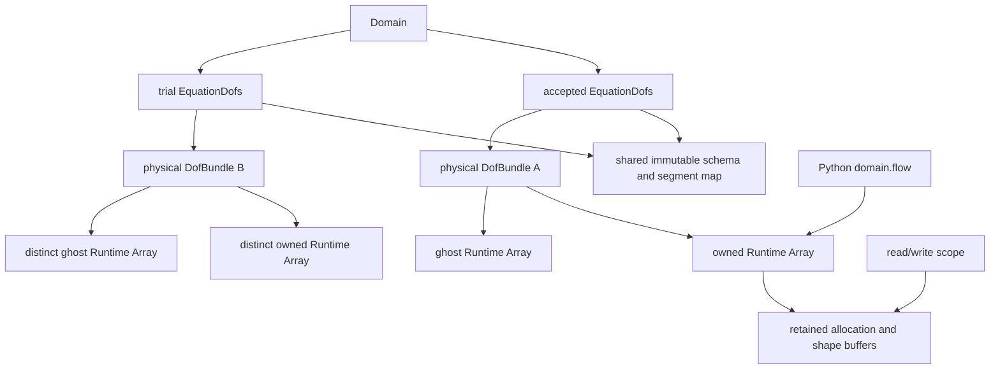

# Cauchy equation state and kernel boundary

`EquationSchema` describes component meaning, logical order, vector triples,
energy convention and physical accumulation. `EquationDofs` binds that schema
to native `Algebra::DofField` allocations. It adds no payload copy or alternate
allocator. DNDS algebra remains independent of the physical equations.



Ordinary C++ copies share physical allocations and the immutable definition.
`Clone()` shares the definition and row space but copies owned values into fresh
physical fields; its ghosts must be refreshed. `RebindCoupled(field)` binds stage
scratch to the same immutable definition, with no value copy. All fields must
have exactly the same `DofSpace` and device. Each binding pins its physical
storage identity and shape generation. Replacing an allocation or changing its
shape invalidates that binding and requires an explicit new one; ordinary value
updates are allowed.

`Domain::Dofs()` exposes the accepted semantic binding read-only. The existing
`State()` physical-bundle access and `Flow()` flow5 field access remain available.
Python `domain.flow` still shares the accepted owned Runtime Array: retaining
that Python handle or a valid leased view retains storage after Domain is gone.
There is no new Python-owned shadow allocation.

## Logical segments and physical layouts

A binding maps each logical block exactly once to a physical field and starting
component. Every physical component must be covered exactly once; overlap,
gaps, duplicate names, invalid vector triples and aliased physical fields reject
at binding time. A logical schema can use either representation:

```text
Logical:       flow5          RANS2        species14
Coupled:       [0..5)         [5..7)       [7..21)  in one field
Separate:      flow field     RANS field   species field
Physical:      AoS / SoA / AoSoA per field, independently
```

Acquire one scope, resolve its block views once, then use the resulting plain
views inside the numerical loop:

```cpp
auto input = state.ReadOwned();
auto output = candidate.WriteOwned();
const auto flow = input.Block("flow").owned;
const auto next = output.Block("flow");
for (DNDS::index iCell = 0; iCell < next.RowCount(); ++iCell)
    for (DNDS::index j = 0; j < next.ComponentNumber(); ++j)
        next[iCell][j] = flow(iCell, j);
```

Block row views retain the parent's element stride. For AoSoA, they also retain
the **full physical parent width**: changing it to the segment width would
incorrectly change the tile pitch. `view.Fixed<5>()` checks a static component
width outside the kernel and returns statically shaped row spans. Plain views
are trivially copyable and device-callable; they retain no ownership themselves.

Each physical array is leased once even when several logical segments occupy
it. If a later reservation fails, earlier unchanged reservations are cancelled.
Holding a writer for one segment therefore reserves the entire physical owned
array, not an unchecked independently writable column slice.

## Access and asynchronous lifetime

Pointwise operations and reductions stay **unsplit and owned-only**. No neighbor
stencil or core/noncore lists are involved. Owned reads and distinct-output
updates can overlap writes to the separate ghost arrays. A direct MPI send still
reads its owned source: do not modify that source until its transfer completes.
Global reductions must also obey the domain communicator's collective order.
The immediate DNDS algebra convenience functions require idle inputs; use their
engine-aware variants for compatible active readers/halo transfers.

`ReadWithGhost()` is an explicit stencil boundary and requires the input halo
to be ready. Scopes retain allocation and row metadata; a copied plain block view
must not outlive its scope. CPU worker launches retain the scope through actual
execution. For asynchronous device use, supply the correct execution context
and attach one enclosing stream-prefix completion through `Complete()`, after
the last use. Cross-stream dependencies remain the caller/engine's obligation;
destroying a host scope alone does not certify device completion. No per-kernel
completion token is required. `CancelUnmodified()` is valid only before any
output value changes.

## Current physical dispatch and explicit limits

`FiniteVolume::BuildWorkspace(EquationDofs&, ...)` and `Evaluate(EquationDofs&,
...)` validate exact semantic schema, native row/storage identity and backend
outside cell loops. `EquationSystem::ResolveKernelProfile()` currently selects
only `CompressiblePerfectGasCPU`; requesting another device fails explicitly,
without host fallback. In checked execution a rank-local schema mismatch is
coordinated before communication. With `implicit.collectiveChecks=false`, the
caller must coordinate failures before other ranks enter dependent collectives.
The raw-field overload remains the trusted compressible stage/scratch adapter.

The Domain frontend uses the semantic binding. Its available physical kernels,
PP, nonlinear reports, checkpoint physical sections and coupled-stage adapter
remain **compressible flow5 only**. `CoupledField()` explicitly refuses split or
permuted physical segments instead of silently flattening them. Generic mock
tests exercise 17/21-component coupled BDF/block solves and separate physical
bindings; those tests are not RANS, species or incompressible implementations.
Future models must supply their flux/transport, physical accumulation (including
zero pressure mass where applicable), pseudo-mass and admissibility actions.
The current identity-accumulation stage adapter is not a general DAE operator.

Focused MPI tests cover all three layouts, tile crossings, empty owners,
direct halo overlap, exact field/segment oracles, rejected bindings and failed
writer reservations, retained lifetimes, explicit device rejection, and exact
typed/raw finite-volume parity. Existing physical, restart and Python tests
continue to qualify the supported flow5 frontend.
