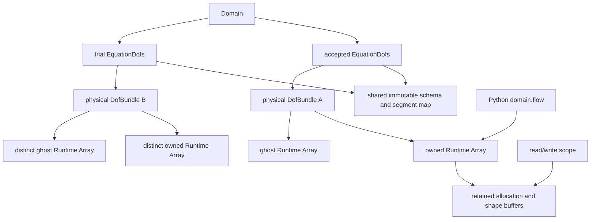
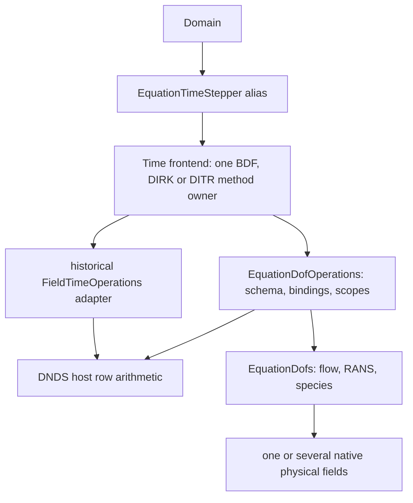
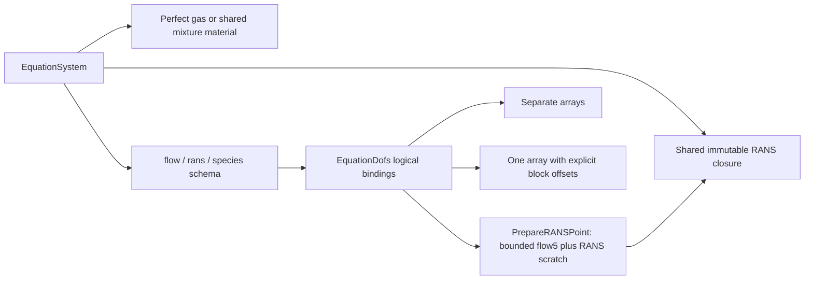

# Cauchy equation state and kernel boundary

`EquationSchema` describes component meaning, logical order, vector triples,
energy convention and physical accumulation. `EquationDofs` binds that schema
to native `Algebra::DofField` allocations. It adds no payload copy or alternate
allocator. DNDS algebra remains independent of the physical equations.



Ordinary C++ copies share physical allocations and the immutable definition.
`Clone()` shares the definition and row space but copies owned values into fresh
physical fields; its ghosts must be refreshed. `RebindCoupled(field)` binds stage
scratch to the same immutable definition, with no value copy. All fields must
have exactly the same `DofSpace` and device. Each binding pins its physical
storage identity and shape generation. Replacing an allocation or changing its
shape invalidates that binding and requires an explicit new one; ordinary value
updates are allowed.

`RebindFields(bundle)` does the same for separate or hybrid storage: physical
field names/order, component widths, device and row space must match, while
individual AoS/SoA/AoSoA layouts may differ. It shares the immutable map and new
field handles without copying or flattening their payload. Physical stage-solve
and Jacobian preparation still need their extended profile adapters; this operation
alone does not remove the current flow5 production restriction.

`Domain::Dofs()` exposes the accepted semantic binding read-only. The existing
`State()` physical-bundle access and `Flow()` flow5 field access remain available.
Python `domain.flow` still shares the accepted owned Runtime Array: retaining
that Python handle or a valid leased view retains storage after Domain is gone.
There is no new Python-owned shadow allocation.

## Logical segments and physical layouts

A binding maps each logical block exactly once to a physical field and starting
component. Every physical component must be covered exactly once; overlap,
gaps, duplicate names, invalid vector triples and aliased physical fields reject
at binding time. A logical schema can use either representation:

```text
Logical:       flow5          RANS2        species14
Coupled:       [0..5)         [5..7)       [7..21)  in one field
Separate:      flow field     RANS field   species field
Physical:      AoS / SoA / AoSoA per field, independently
```

Acquire one scope, resolve its block views once, then use the resulting plain
views inside the numerical loop:

```cpp
auto input = state.ReadOwned();
auto output = candidate.WriteOwned();
const auto flow = input.Block("flow").owned;
const auto next = output.Block("flow");
for (DNDS::index iCell = 0; iCell < next.RowCount(); ++iCell)
    for (DNDS::index j = 0; j < next.ComponentNumber(); ++j)
        next[iCell][j] = flow(iCell, j);
```

Block row views retain the parent's element stride. For AoSoA, they also retain
the **full physical parent width**: changing it to the segment width would
incorrectly change the tile pitch. `view.Fixed<5>()` checks a static component
width outside the kernel and returns statically shaped row spans. Plain views
are trivially copyable and device-callable; they retain no ownership themselves.

These are also the frozen-pointer device views: the host resolves names and
leases, then passes block structs by value to a kernel. Their parent retains
the physical layout kind, full width and pitch, plus each logical block's
offset/width. A flow5 block can therefore be a segment of one21-component array
or a separate five-component array with the same logical indexing. No shared
pointer, string lookup or allocation occurs in device element access. For a
future layout-specific GPU kernel, host dispatch must inspect both the physical
layout and block-to-allocation mapping, then select the appropriate specialized
view/kernel. It must preserve full parent tile pitch when freezing a segment.
An allocation ID is host dispatch/lifetime metadata, not a device indexing input.

At host dispatch, `LocateBlock("flow")` returns `physicalField`,
`firstComponent` and `componentNumber`. Inspect
`PhysicalField(location.physicalField).Owned().Layout()` for the full parent
layout/pitch. This distinguishes, for example, a tiled seven-component flow/RANS
parent plus a separate species array from one coupled parent, without pointer
comparison. Location metadata grants no data-access permission; retain normal
read/write scopes for the chosen kernel. It stays outside device/hot loops.

`ReadOwned(context)`/`ReadWithGhost(context)`/`WriteOwned(context)` accept an
explicit device context; `Complete(Runtime::Completion::Record(context))` can
attach one enclosing native-stream prefix after the final direct launch. Engine
`ExecutionStream::Record()` returns a separate scheduling `StreamEvent`, not
this direct-access completion type. The device-callable view machinery is
present, but EquationDofs currently has CPU mock/layout tests and no dedicated
CUDA launch test. This is not a claim that Cauchy's physical CUDA wrappers or
queued multi-stream scheduling integration are implemented.

Each physical array is leased once even when several logical segments occupy
it. If a later reservation fails, earlier unchanged reservations are cancelled.
Holding a writer for one segment therefore reserves the entire physical owned
array, not an unchecked independently writable column slice.

## Access and asynchronous lifetime

Pointwise operations and reductions stay **unsplit and owned-only**. No neighbor
stencil or core/noncore lists are involved. Owned reads and distinct-output
updates can overlap writes to the separate ghost arrays. A direct MPI send still
reads its owned source: do not modify that source until its transfer completes.
Global reductions must also obey the domain communicator's collective order.
The immediate DNDS algebra convenience functions require idle inputs; use their
engine-aware variants for compatible active readers/halo transfers.

`ReadWithGhost()` is an explicit stencil boundary and requires the input halo
to be ready. Scopes retain allocation and row metadata; a copied plain block view
must not outlive its scope. CPU worker launches retain the scope through actual
execution. For asynchronous device use, supply the correct execution context
and attach one enclosing stream-prefix completion through `Complete()`, after
the last use. Cross-stream dependencies remain the caller/engine's obligation;
destroying a host scope alone does not certify device completion. No per-kernel
completion token is required. `CancelUnmodified()` is valid only before any
output value changes.

## Current physical dispatch and explicit limits

`FiniteVolume::BuildWorkspace(EquationDofs&, ...)` and `Evaluate(EquationDofs&,
...)` validate exact semantic schema, native row/storage identity and backend
outside cell loops. `EquationSystem::ResolveKernelProfile()` distinguishes
perfect-gas and ideal-mixture CPU models; this key alone does not promise every
spatial/time operator exists for that model. FV has the established perfect-gas
adapter and the explicit whole-equation mixture profile described below.
Requesting another device fails explicitly,
without host fallback. In checked execution a rank-local schema mismatch is
coordinated before communication. With `implicit.collectiveChecks=false`, the
caller must coordinate failures before other ranks enter dependent collectives.
The raw-field overload remains the trusted compressible stage/scratch adapter.

The Domain frontend uses the semantic binding. Perfect gas retains its established
path. Configured ideal mixtures use separate flow/species arrays, whole-equation
FV/implicit stages, dynamic reports and full-state publication. Checkpoint/output,
p-FAS, interface packets and explicit/physical-dt PP still require their extended
adapters and reject rather than processing flow5 alone. `CoupledField()` explicitly
refuses split or permuted physical segments instead of silently flattening them. Generic mock
tests exercise 17/21-component coupled BDF/block solves and separate physical
bindings; those tests are not RANS, species or incompressible implementations.
Future models must supply their flux/transport, physical accumulation (including
zero pressure mass where applicable), pseudo-mass and admissibility actions.
The current identity-accumulation stage adapter is not a general DAE operator.

## Whole-state algebra and time stepping

`EquationDofOperations` supplies owned-only CPU Copy/Fill/Scale/Axpy and linear
combination through DNDS's common `ApplyHostRows` arithmetic. It resolves logical
blocks and reserves every source/output lease before numerical writes. Blocks
may have different physical grouping/layouts. Binary output/input allocations
are distinct; Scale is explicitly in-place and an exact self-Copy is a no-op.
An unavailable device backend fails explicitly. These operations do no MPI or
halo work. Their owned scopes can coexist with independent ghost writes.

The time equations are implemented once in `Solver/TimeIntegration/`;
`Solver/StateTimeStepper.hpp` and `Solver/StateDITR.hpp` are forwarding headers, with state ownership/algebra supplied by a small adapter.
Historical `FieldTimeStepper`/`FieldDITR` names select the native single-field
adapter; Cauchy's `EquationTimeStepper`/`EquationDITR` select the full semantic
state. No tableau, BDF ratio, DITR interpolation or integration coefficient is
duplicated or changed.



Cauchy now stores its initial snapshot, implicit stage sources/rates and BDF
history in the logical state. One stage-solve callback receives all components
together. Initial/trial arrays are distinct, callback bindings and owned
input/source generations are checked, and ordinary ghost refresh is allowed.
The checks stay outside numerical loops and use the configured local-error
coordinator; Cauchy's `implicit.collectiveChecks` controls its added agreement
calls. External stage-sequence users complete/discard before the next stage,
retain callback resources and finish CPU work before returning. This is a
synchronous CPU driver, with no implicit accelerator fallback.

`NewVector` allocates fresh uninitialized payload with the same per-field
owned/ghost layout, space and semantic binding. `Clone` additionally copies
owned values. History Commit uses nonthrowing handle swaps after accepted-state
publication; Discard preserves accepted history. Callback exceptions can leave
scratch partial. DITR Begin restores the intermediate means and rate guesses;
Domain resets its intermediate reconstruction before a retry. The flow5 checkpoint keeps its existing `history_flow` representation
through an explicit adapter; extended physical fields use the format-5 block
archive described below.
Layout-independent time equations do not by themselves complete extended
production BC, PP, physical Jacobian assembly or RANS/species validation.

## Equation-state finite volume

`FiniteVolume::BuildEquationWorkspace(state, optionalWorkers)` uses the same
immutable metrics, geometry, face incidences, work partition, basis provider and
CFV plans as the established flow5 workspace. Each physical input field gets
its own reconstruction buffers and halo bindings; logical flow/species views
retain their parent strides and physical offsets. No distributed state is
flattened into a coupled temporary array. Coefficient block widths and physical
offsets are multiplied by the number of nonconstant basis modes. Boundary
values remain small local arrays in the canonical boundary-quadrature order.

```text
EquationDofs (logical flow + species)
  -> physical fields (coupled, split or component-permuted)
  -> per-field mean/coefficient halo + CFV workspace
  -> ready point values/gradients in logical order
  -> actual EOS acoustics / Newtonian-Fourier + species diffusion / chemistry
  -> each logical residual block in the caller's output fields
```

The CPU profile currently supports Rusanov, constant/gradient/variational
reconstruction, two-buffer Jacobi/SOR, componentwise WBAP and conservative
polynomial viscous gradients. A compatible explicit chemistry worker pool is
mandatory for ideal mixtures. Acoustic-only faces, viscous faces and chemical
volume points select subsets of that evaluator's pre-reserved outputs. An
acoustic query does not calculate rates or diffusivities. The request does not
change the evaluator's default policy, acquire a second worker, or allocate
point buffers. Scalar point scratch and gradients are private to one execution
lane; returned property views are consumed before the worker's next point.

Periodic transformations rotate vector values and both indices of vector
gradients, while scalar gradients rotate once. Adiabatic slip/no-slip wall
values preserve density, composition and full internal energy as momentum
changes. Wall kinematics use the same rigid-frame producer as flow5. Chemistry
uses cell volume quadrature and the shared polynomial sampler, following its
optional cache policy. It adds independent mass rates and no full-energy source.

A one-species material has no `species` block. Its empty independent-composition
view may have a null pointer; repair/strict conversion produce the sole full
mass fraction one. Thermodynamics still use the actual material. Chemical
volume sampling is unnecessary, the point source is zero, and its optional
logical flow5 Jacobian is zero. Do not invent a dummy transported component.

The mixture assembly gates include independent nonconstant references. One
integrates species diffusion from direct backend diffusivities and the full
dependent-species correction at face points. Another integrates direct backend
rates with independently generated Cartesian Gauss points and weights. Their
signals distinguish omitted/reversed diffusion and mean-only source sampling.
Layout agreement, periodic conservation and uniform-state fixtures remain
useful additional checks; they do not replace those assembly oracles.

The wrapper posts all physical-field halos before submitting owned-only core
work, waits on the controller thread, then submits dependent work. First VR
core work may overlap both the mean and coefficient exchanges. Ordered SOR
uses the configured core-first logical order; WBAP exchanges after each
descending-degree pass. Input coefficients stay immutable through direct MPI
sends. CPU inline and worker launchers follow the same sequence; return joins
only that lane. Worker resources are retained through exceptional exits too.

The caller serializes each workspace and its bound handles, supplies distinct
output storage, completes external producers before entry, and uses matching
physics/units/numerical controls and the same collective schedule on every rank.
The descriptor agreement proves the field map, numerical schedule controls and
physical scalar parameters, not equality of separately loaded mechanism contents.
Entry preflights reserve every output before
any field transfer. A collective exact descriptor check rejects inconsistent
schema/physical grouping before constructing halo bindings; physical payload
layouts may differ among ranks. Geometry versions, bindings and leases are
checked outside point loops. Ghost updates are allowed; owned means do not
change. Discard scratch after a failed evaluation. With
`implicit.collectiveChecks=false`, the caller handles distributed failures
between phases; entry/binding checks remain coordinated.

This is a functional residual path, not a completed extended production Domain.
It explicitly rejects face fallback, characteristic WBAP, other prepared
Riemann profiles, a distinct unlimited viscous polynomial, and non-wall/non-
extrapolate BC producers until connected. The established flow5 path retains
its existing capabilities. Euler-style thermal/species PP now composes with the
equation-state residual and nonlinear stages; see
[CauchyImplicit.md](CauchyImplicit.md#equation-state-thermal-and-species-pp).
Extended restart and visualization support is described below; frontend adapters
and physical RANS/flame acceptance remain separate work.

## Logical rows in coupled linear algebra

`BeginAuxValues(EquationDofs, outputs, time, workers)` prepares the same optional
`AuxiliaryValues` packet for separate or coupled equation fields. The CPU scope
reserves requested outputs before writing, retains owned input through Core,
then acquires ghost input only for HaloDependent. The caller posts/joins every
physical mean field's canonical halo and coordinates distributed failures.
`PrepareAuxValues` is the consecutive All convenience. Exact schema/backend
checks remain outside point loops; no global-state repacking occurs.

```text
mean halos active -> owned-only Core: derived refresh / means / faces / cells
join all halos   -> HaloDependent: ghost refresh / means / faces / cells
Finish           -> immutable source/output/time publication
```

Both ordinary mean thermodynamics and optional derived bundles are supported.
A mixture uses one explicit matching chemistry worker at a time; no chemistry
rates are requested for these face/mean properties. Pressure, acoustics and
molecular/species diffusion bounds come from the actual EOS/transport provider.
The equation boundary profile covers extrapolation, farfield, constant prescribed
values and adiabatic/isothermal walls, using the same producer as reconstruction
boundary buffers and the equation RHS. Interface packets and nonconstant analytic
profiles still require their extended equation-state adapters.
Wave/pressure statistics and cell spectral sums have the existing definitions;
missing face outputs use private scratch only when a requested reduction needs
it. An unused retained scratch allocation is neither acquired nor written.

`Finish` records the FV owner, every physical source binding and owned/ghost
generation, output storage/shape/value generations, row parts and time.
`ValidateAuxValues` rejects active inputs/outputs as well as stale generations;
a change confined to species invalidates the packet. Abandoned started scopes
fail unfinished numerical outputs. The origin keeps a numeric source alias and
weak FV key. The preparation itself retains plans: keep FV and derived-bundle
owners on the controller through worker joins so final MPI cleanup stays there.

`Physics/EquationFlux.hpp` provides pure physical ALE flux derivatives with
pressure and its directional derivative supplied explicitly by the EOS/energy
producer. Scalar conservative transport uses the same relative normal velocity.
The ideal-mixture primitive chain rule supplies composition/thermal derivatives;
no equivalent-gamma closure is added. These point derivatives are independently
checked by conservative perturbations, including all species columns and moving
grid velocity. The whole-equation physical Jacobian producer uses them with
scalar dissipation; its source and snapshot contracts are described below.

`ReadScope::ComponentLayout()` and `WriteScope::ComponentLayout()` resolve
logical components to physical parents once. The returned
`DNDS::Algebra::DofComponentLayout<T>` owns a small host descriptor table, while
the enclosing access scope retains payload/shape owners and leases. Its borrowed
`DofComponentView<T>` performs ordinary `(row, component)` access and keeps each
parent's complete physical width/pitch. This is neither a storage conversion nor
a distributed payload buffer. Keep both the layout owner and the source scope
alive through use. Copying a plain view does not retain either. A future device
launcher must also place that descriptor table in accessible device memory;
these CPU adapters do not perform an implicit upload.

```text
EquationDofs -> physical Array handles
  Read/WriteScope -> payload + shape leases
  ComponentLayout -> owned host descriptors (one per logical component)
    ComponentView -> borrowed descriptor pointer -> strided parent values
```

`LinearProblemContext::Apply` accepts these logical states as well as native
fields. Both use the same matrix action; the established field path retains
direct Eigen maps, while logical rows gather one dense vector at a time.
`ApplyILU` uses the same prepared symbolic structure and numeric factors, with
three local dense row vectors and no whole-state packing. Input/output may
have different component grouping/layouts, but schema, row space and CPU
placement must agree. Every physical output is reserved before numerical
writes. The low-level `NativeBlockLU::SolveRows` borrows raw views: its caller
must retain descriptors/payload scopes and prove nonaliasing and symbolic
serialization. The checked context wrapper does so and fails partial outputs
if a solve throws.

`Solver::StateGMRES<State, Operations>` owns the existing restarted left-GMRES
mathematics. `FieldGMRES` remains its historical native-field adapter;
`EquationGMRES` uses logical-state algebra. Arnoldi, stopping, true residual,
reorthogonalization and fixed-preconditioner requirements are unchanged.
Operator/preconditioner callbacks finish synchronously, retain their resources,
and coordinate distributed errors and halos. `LocalProducts` computes one
owned-only dot-product batch in logical row/component order; its caller chooses
the communicator/reduction. No implicit transfer occurs in the Krylov class.

Logical two-buffer SGS uses that same matrix context and the shared native
scan arithmetic. `BeginSGS` owns distinct forward/output writers; `Lower`
accepts All or Core then HaloDependent, and `Upper` accepts All or HaloDependent
then Core. Commit with `Finish` only after both scans. Default remote values
are the frozen old input. With explicit middle exchange, publish **every**
forward physical field after complete lower work and before upper work. That
join remains exposed. Core acquires no input ghost lease, so it can execute
while those ghosts are being written. Do not replace field handles/layouts or
change matrix values/order while the scope exists. Abandoning a started scope
fails its unfinished output; it is not a valid partial solution.

Numeric access metadata now retains only the immutable row partition, not a
communication context. `DofSpace::NumericAlias()` and
`EquationDofs::NumericAlias()` share row identity, schema and Array storage
without owning the fields' MPI context. They copy no values and grant no
access by themselves. A numeric alias deliberately cannot provide a
communicator/reduction. The staged SGS scope uses these aliases; its controller
retains communication/transfer owners and releases them on an MPI-permitted
thread. Ordinary read/write scopes also keep only numeric definition metadata.

```text
controller -> matrix / original fields / transfers -> communication context
worker SGS scope -> numeric aliases -> shared Array storage + access leases
                                   -> schema + row partition (no MPI context)
```

The numerical alias changes neither storage identity nor generations. Scopes
remain usable after original field handles disappear; a focused worker test
proves the communication context can already expire on the controller while
numeric row reads remain valid and retire on a worker.

`EquationLinearSolver` uses the same private controller implementation as
`LinearSolver`: SGS, left-GMRES with fixed SGS sweeps or local ILU, true residual
checks, explicit warm guesses and the optional exposed middle SGS exchange.
The prototype prepares every physical field's canonical halo binding; a grouped
exchange posts all fields before Core work and waits before dependent work.
Request slots are allocated at setup and drained by a scoped guard, including
on exceptions. No request-vector allocation is added per application.

All domain ranks construct and call the driver together with agreed controls.
`AgreeEquationBinding` checks exact schema, physical field order/width and block
offsets before the first binding collective. Local row counts and table layouts
may differ. FV workspace setup uses this same check. The binder receives each
native physical field in order, reuses the domain's row mapping, and coordinates
its own failures. Callers keep field handles/layouts and the matrix stable,
release debug views, and retain MPI owners on the controller. Per-kernel
`collectiveChecks=false` is caller-ordered eager execution; setup and solve-entry
checks remain collective. This is synchronous CPU orchestration, not a queued
CUDA implementation.

```text
LinearSolver (one field) ------> shared private linear controller <field ops>
EquationLinearSolver ---------> shared private linear controller <equation ops>
                                  |-- StateGMRES / fixed SGS or local ILU
                                  |-- reusable state + per-field halo bindings
                                  `-- scoped active request slots
LinearProblemContext -----------> matrix action / ordered SGS / local ILU
                                  (numeric kernels, no halo orchestration)
```

The logical driver is exercised by the distributed known-solution matrix fixture,
the actual conservative chemical-reactor Newton test and a coupled physical
mixture matrix. Nonlinear/frontend and checkpoint adapters remain separate. Matrix dimensions
alone do not validate a physical model.
The source/flux producer must supply the matching logical derivative ordering;
physical RANS/species acceptance remains separately gated.

## Whole-equation physical Jacobian

The `EquationDofs` overloads of `BuildLinearProblem`/`PrepareJacobian` use the
same canonical cell-face-cell stencil, conservative node-star core and native
matrix context as flow5. Both scalar-entry and full-block diagonals are
available, with assembled or frozen evaluated off-diagonals. Physical source
and flux producers use logical component locations, independently of physical
field grouping or layout. The established raw-field API remains available.

The integrated convention remains
`A = V*(1/dTau + physicalMass)*I - residualScale*J_R_approx`.
Scalar face dissipation uses the prepared convection-plus-diffusion radius.
Neighbor blocks differentiate the actual EOS physical ALE flux and compose
the periodic transformation on increment columns. Self-periodic incidences
fold into the diagonal. Boundary terms retain Euler's scalar spectral diagonal
approximation. Viscous derivatives use its scalar molecular/species bound,
not differentiation through gradient reconstruction. Full blocks retain the
negative rotation-source derivative; scalar entries use the existing flow5
angular-speed bound. No equivalent gamma is substituted. Roe characteristics
are explicitly unavailable in this whole-equation producer.

Chemical Jacobians preserve Euler's volume integration of derivatives at the
reconstructed source quadrature values. For nonconstant chemistry, pass the
`sourceReconstruction` workspace from a successful current `Evaluate`. Its
mean/coefficient binding, generations and time must match; missing/stale input
fails before matrix writes. The producer reads the RHS's already sampled source
values and weights, uses the explicit chemistry worker and adds the negative
integrated derivative in logical order. Coefficients are frozen for this
approximation; it does not differentiate the reconstruction solve. Constant
reconstruction may omit the workspace and use the equivalent mean/volume term.
The empty independent-species case has no chemical derivative. Changes confined
to coefficients invalidate source sampling even if the mean auxiliaries remain
current. A new RHS attempt invalidates the previous source publication.

```text
PrepareJacobian
  -> leased means + prepared face signals + explicit EOS/chemistry worker
  -> cell pressure derivatives + mass/rotation/source diagonal
  -> assembled blocks directly from logical views
     OR frozen means + pressure derivatives + immutable incidence geometry
        -> evaluated blocks (no EOS, MPI, live state or worker)
```

Assembled filling does not copy the complete mean payload. The evaluated path
copies its required numeric snapshot and reuses immutable geometry; neither
its geometry nor its scalar/array snapshots retain an FV/MPI owner. A worker
may evaluate blocks after the original means change. Component selections
project after periodic transformation, with inactive rows/columns zero and
inactive diagonal one. Fill coefficients before using the numerical context;
diagonal inversion/ILU factorization is explicit. All output writers are
reserved before filling. A late reservation conflict cancels untouched
writers; a later numerical failure poisons incomplete outputs through the
same `CancelUnmodified`/`Fail` contract exposed by block-matrix write scopes.
Callers serialize preparation and input/matrix rebinding and coordinate MPI
failures; the numerical producer itself communicates nothing.

Tests compare this approximation to flow5 on translated/self/rotated periodic
and moving-wall meshes, both diagonal kinds and storage modes. A nonconstant
mixture action is checked against independent frozen-signal residual differences
and solved through GMRES/ILU on separate/permuted fields. Independent Cartesian
Gauss integration with direct backend source derivatives checks the high-order
source diagonal and requires a measurable difference from a mean-only result.

## Chemical source operator

`EvaluateChemicalSource(equation, state, values, worker, jacobian, scale,
temperatureGuess)` is an owned-only, synchronous CPU operator on logical
equation states. It replaces its output with positive source rates per code
volume/time. Flow mass/momentum/full thermochemical energy rows are zero;
independent species receive the existing Cantera rates. The optional matrix
has N*N logical columns per owned row, with column-major dense block indexing,
and stores positive `dS/dU`. An implicit residual subtracts this derivative.
Cell/source-quadrature volume weighting remains the discretization's task.

The point evaluator owns an exclusive worker and optional derivative scratch
outside the cell loop. Its named input/output block views preserve each
parent's AoS/SoA/AoSoA layout and physical component offsets. Allocation/shape,
schema, row-space and alias checks occur before writes. Every output allocation
is reserved before any numerical value changes; an unavailable later output
cancels earlier unchanged reservations. Inputs stay immutable. A failed point
evaluation can leave scratch partial: discard that failed result. No implicit
payload exchange, device fallback or time-advance policy is hidden in this call.

An optional compatible published derived-temperature bundle can be stale; it
only seeds the actual UV inversion. Input ghosts are not read, and an ongoing
write to their separate allocations is allowed. Owned source arrays and the
Jacobian must be distinct from input/output equation storage. The caller
serializes operator/workspace access and moves the worker lease into CPU work
that outlives submission.

The source follows the active Euler repair, temperature-floor, units and
unfiltered-Jacobian conventions described in [shared Physics](Physics.md).
The limited equation-state FV profile above includes this source. The production
Domain connects the extended BC/PP and checkpoint paths. The physical
Jacobian and whole-equation nonlinear stage operator now compose with the logical
linear/time drivers; see [CauchyImplicit.md](CauchyImplicit.md#whole-equation-cpu-nonlinear-adapter).
The single-domain production executable now uses DNDS MPI lifecycle helpers,
the shared segmented CSV writer, and argparse overrides through the existing
resolved-configuration/provenance API. See the [case guide](../../cases/cauchy/README.md)
for override paths, restart and history segment conventions. Python Domain and
Simulation use the same native operators; standalone operator-level Python
coverage remains incomplete. The physical source/implicit-reactor fixtures do not qualify a full
RANS/species spatial solver or the pending NACA/flame studies.

`PreparePrimitiveDerivative` accepts one conservative flow direction and a
strided Ns-1 species direction. Its result is `[d(rho),d(u),d(v),d(w),d(T)]`
plus `d(p)`, using actual EOS cv, full species enthalpies and immutable species
gas constants. Both the kinetic derivative and composition-energy terms are
retained. Full energy may be negative at a positive temperature. This point
entry supports primitive-gradient consumers without a gamma-equivalent
substitution; spatial gradients of RANS/specific scalars use the same shared
`ConservativeSpecificDerivative`. See the equations and ownership requirements
in [shared Physics](Physics.md). The existing flow-only FV gradient signature
continues to reject a mixture, rather than using the perfect-gas formula.

The local `PrepareViscousFlux` kernel now consumes these point derivatives,
actual molecular transport and optional prepared scalar turbulence additions.
It combines shared Newtonian/Fourier traction/work with corrected species and
full-enthalpy diffusion. Its separate raw species views and private fixed-size
worker scratch preserve physical layouts and the property/transport boundary.
Adiabatic and impermeable options are distinct. This is a point-kernel interface;
it does not add a production RANS closure or complete the extended FV profile.

## Mixture point properties and derived refresh

`EquationSystem::FromIdealGasMixture(material, viscous)` constructs an explicit
CPU property model with full thermochemical total energy and named independent
species. Its immutable material comes from [shared Physics](Physics.md).
`EquationPointEvaluator` takes a private worker once per loop/tile, gathers
strided rhoY through `SpeciesInput()`, and evaluates actual EOS pressure,
temperature, acoustics, caloric properties and requested molecular transport.
It owns its worker and shared material lifetime; returned species result views
last until its next point evaluation. `FluxState(flow, properties)` passes those
actual pressure/acoustic values into the common numerical Riemann interface.
It does no equivalent-gamma substitution.

The mixture factory supplies the property/schema interface and equation-state
FV profile above. `EquationSetup::Resolve` loads configured material/scales and
returns immutable equation metadata plus explicit mutable worker capacity.
Domain retains both; its one ordered CPU EOS lane needs one worker even when
the launcher uses several threads. Perfect-gas-only methods such
as `Gas()` and the old flow-only Jacobian/characteristic producer reject a
mixture explicitly. They cannot evaluate missing species through default gamma.

For configuration use `equation.eos="idealGasMixture"`, `equation.mixture` with
`mechanismFile`, optional `phaseName`, and SI `rho0/U0/L0/T0`. Initial constant
input uses `initialPrimitive`, optional positive `initialTemperature`, and
`initialMassFractions`. The current profile selects Rusanov, no face fallback,
componentwise WBAP when enabled, polynomial viscous gradients and optional
`source="chemical"`. Missing kernels are rejected explicitly. The current
configuration/frontend does not infer another numerical profile from defaults.

Domain stepping uses the same EquationTimeStepper for every logical component;
implicit stages use EquationNonlinearSolver and explicit SSPRK uses full-state
updates. Shared/split physical arrays remain unflattened, and publication reserves
all destination fields before any accepted value changes. A species-only retained
view blocks the entire publication. ResidualState returns every residual block;
the historical Residual convenience still returns the flow residual. Observation
has independent reconstruction scratch and restores the accepted warm guess, so
diagnostics do not advance numerical state. Mixture diagnostics report actual EOS
pressure/temperature and full-state residual norms; force integration remains
unconnected. No full spatial-flame or RANS acceptance is implied.

### Primitive initialization and equation boundary values

`EquationPointEvaluator::FromPrimitive([rho,u,v,w,p], rhoY, temperature)` produces
flow5 through the actual material. Zero temperature selects pressure; a positive
temperature overrides it. The result retains full thermochemical internal energy
and all three kinetic-energy components. Input species are conservative Ns-1
values and are not rewritten. Species result views from an earlier evaluator
query expire at this call, just as at `Evaluate`.

`EquationSystem::IndependentMassFractions` resolves named input once at setup.
An omitted last species receives the remainder; an explicitly supplied last
species must close the total to one. Empty input means pure dependent species.
Unknown names, negative values and overfilled compositions fail. Only roundoff
at a closed total is normalized. Perfect gas accepts no species input.

`FiniteVolume::InitializeConstant` composes these producers with logical owned
block writes, supporting coupled, split, permuted and strided fields. It performs
EOS validation before acquiring writers, coordinates local failures across the
mesh communicator, and transforms ground velocity into the initial mesh axes.
It does not exchange ghosts, initialize coefficients or add nonconstant mixture
profiles. The caller joins pending work and releases conflicting views first.

`BoundarySystem(settings, equation)` resolves `massFractions` for farfield or
constant prescribed (`kind="analytic", profile.kind="constant"`) inputs. The
same `BoundaryCondition::FaceValue/Exterior` overloads take an explicit point
evaluator and preallocated Ns-1 scratch. They retain no worker or Array. Validate
the supported producer once with `ValidateEquationProducer` before a point loop;
keep the evaluator exclusive and provide correctly sized ready point inputs.
Copy/gather a mean or reconstructed state into scratch before calling: species
may change with prescribed composition or wall density. No transfer is needed
for these local physical boundary buffers.

Farfield branches use actual interior acoustics and the mesh-relative normal
speed. Subsonic outflow retains interior rho, velocity and composition while
prescribing pressure; subsonic inflow supplies prescribed rho/velocity/composition
with interior pressure. Supersonic inflow/outflow select all prescribed/interior
data. Prescribed velocities use ground axes. Adiabatic reflection preserves full
internal energy and composition while adjusting kinetic energy; an isothermal
face preserves pressure and fractions at wall temperature. The convective wall
exterior retains interior temperature. Polynomial viscous isothermal treatment
uses the established flow5 wall-density/exterior-velocity construction; it
enables Fourier heat conduction and suppresses species diffusion through the
wall. This is the existing wall discretization, not a new boundary penalty.

The approximate equation Jacobian retains Euler's scalar physical-BC diagonal
contribution. This does not introduce an exact boundary derivative.
The extended Domain/restart path uses these same operators. The established flow5
boundary/Jacobian APIs and their larger analytic-profile set remain available.

For an explicit mixture refresh, pass a worker lease:

```cpp
RefreshDerivedFields(state, equation, derived, workers.Acquire(), true);
```

The final flag asks for a no-op when already current. Actual mixture evaluation
requires the worker; disabled/current bundles need no point computation.
Selection of molecular transport/diffusivity occurs before the loop, so a
temperature-only bundle does not ask Cantera for unused diffusion coefficients.
The Newtonian/Fourier diffusion bound includes molecular momentum/heat and all
species diffusion coefficients when requested. Unrequested mixture point
transport outputs are NaN; perfect gas computes its cheap scalar coefficients
directly, and inviscid transport/bounds are explicitly zero.

Publication keys include the loaded material identity, all four reference scales
and the viscous choice (or the perfect-gas coefficients), as well as source
storage/shape/value generations and row-space identity. Row association follows
`DofSpace`; remapping requires the corresponding new space or explicit transfer.
An incompatible model/units publication is never a usable temperature guess.

Refresh reads prior compatible temperatures through its exclusive output write
view before overwriting each row, without holding a conflicting output reader or
allocating a payload snapshot. They seed the existing UV inversion; current
temperature is always solved from new energy and composition. The input fields
remain read-leased and unchanged. A failure invalidates publication even if some
output rows were filled. Owned refresh acquires no ghost input lease and can
run while separate ghost storage is being written. Public stale-temperature
read scopes remain guess-only and do not expose stale pressure/transport fields.

Focused MPI tests cover all three layouts, tile crossings, empty owners,
direct halo overlap, exact field/segment oracles, rejected bindings and failed
writer reservations, retained lifetimes, explicit device rejection, and exact
typed/raw finite-volume parity. Existing physical, restart and Python tests
continue to qualify the supported flow5 frontend.

## Extended equation restart

`Cauchy/IO/EquationArchive` separates storage mapping from model and mesh checks.
It describes logical blocks by name, physical-field ordinal, first component
and width. Each owned physical field is written directly with Runtime Array IO;
there is no forced AoS copy or serialized ghost payload. Reads retain the stored
row shard until the canonical persistent-cell-ID route is available. When
physical grouping matches, that route transfers directly into the destination's
AoS/SoA/AoSoA layout. A different coupled/split grouping uses temporary remapped
fields and scatters logical blocks locally. This conversion belongs to restart,
not numerical kernels. Every component range must cover its parent exactly,
without overlap or holes; matching the total component count is insufficient.

Extended Domains write `cauchy_format=5`. The top-level metadata and mesh
envelope retain the format-4 conventions, with `state_storage` and optional
`reconstruction_storage` descriptors added to `metadata_json`. Native arrays
are named `state_field_0`, `state_field_1`, etc.; optional arrays use
`reconstruction_field_` and `history_field_`. The history uses the mean-state
block map. BDF2's previous state includes every equation block and its previous
dt. `cell_ids`, topology, coordinates, periodic transforms, accepted time/step
and last dt retain their existing meanings. Existing perfect-gas flow5 files
continue to use format 4 and read formats 2 through 4.

The default still omits reconstruction. An explicitly saved compatible guess
restores every block; missing guesses or changed polynomial metadata/widths
cold-start all coefficients at zero. A changed physical layout does not make
the guess incompatible. Derived thermodynamic caches are never persisted.
Loading uses trial buffers and reserves all accepted writes before publishing;
a retained Python/C++ species reader blocks the whole accepted-state commit.
The BDF owner is replaced only after successful publication.

Mixture metadata includes ordered species, energy convention, reference scales,
reference energies and a frozen Cantera description of the loaded model. This
description expands imported thermodynamics, transport and reactions, omits
mutable TPY state and timestamps, and is captured once before worker cloning.
Clones share the original description rather than adding parameter-round-trip
noise to provenance. Strict comparison deliberately does not promise restart
compatibility between different Cantera serialization versions. Filenames or
matching species counts alone cannot authorize a restart with changed chemistry.

`WriteVisualization` uses a separate observation reconstruction, so output
cadence does not overwrite the production warm-start guess. Volume VTKHDF
contains all conservative component names (including transported `rhoY:name`),
plus `p`, `T`, `u`, `v`, `w`, `Mach` and all `Y:name` fractions, including the
dependent species. Derived properties are evaluated once per cell into an
output-only buffer, using the same equation model and explicit worker pool as
the numerical operators. Output is in code units. Physical surface CSV traces
evaluate the limited reconstruction at boundary quadrature points and apply
the equation boundary-value producer; their columns include temperature and
full species fractions. An inadmissible reconstructed trace falls back to its
cell mean before applying the BC, as in the existing flow output path.
Accepted means and the production reconstruction remain unchanged.

## RANS equation descriptor and scalar policy

`EquationSystem::WithRANS` returns a new immutable descriptor with the shared
SA, Wilcox, SST or realizable k-epsilon closure and a named `rans` block between
`flow` and `species`. It requires viscous transport and rejects attaching a
second RANS model. It does not alter the original descriptor or allocate DOFs.
The logical names are `rhoNuTilde`, `rhoK`, `rhoOmega` and `rhoEpsilon`; named
convergence selections use the same schema resolver as flow and species.
The default convergence selection remains density.



`EquationRANS.hpp` contains the scalar policies used when wiring numerical
operators. It gathers conservative values and gradients from logical strided
rows into the shared point representation. It neither allocates a distributed
array nor infers species offsets from the physical storage tail. SA's extra
scratch slot is initialized to zero. CPU AoS/SoA/AoSoA and separate/coupled
bindings use the same entry; no CUDA implementation is claimed.

Scalar reconstruction repair follows Euler: negative two-equation samples
revert **component by component** to their means; SA uses its existing
compile-time reduced-order switch. Update repair follows the common flow5
compression, then applies Euler's exponential scalar rule. Only SA has the
1e-6 repaired-value floor. Final mean repair retains the SA density-proportional
upper bound and the k-omega lower bound based on the far-field conservative
omega value. These policies do not replace thermal/species admissibility.

The no-slip target helper retains zero SA/k, `800*mu/d_mean^2` for rho-omega,
and Euler's cell-mean-k epsilon formula. Epsilon uses reconstructed **interior**
density, including on an isothermal wall. The caller supplies viscosity from
the correct wall/mean-temperature producer, and converts targets to physical
face values or reflected exterior values. Wall searching remains in Geom.

`EvaluateChemicalSource` replaces its complete output: all nonchemical blocks,
including RANS, are zero, as are their Jacobian rows and columns. Callers sum
independent source contributions explicitly. Tests seed a nonzero RANS output
to detect stale values, and verify that inserting the RANS block changes only
the index locations of mixture thermal references and chemical derivatives.

The C++ full-state finite-volume operator now accepts SA without DES. It
requires the mesh's published nodal wall field and samples it with the configured
positive `numerics.wallDistanceFloor` (default `1e-10`). Sources and the positive
implicit destruction diagonal are integrated on cell quadrature; viscous face
fluxes add turbulent stress/heat/species transport and SA diffusion. Aux
diffusion bounds include SA turbulent transport, with no hidden gradient solve.
All physical blocks retain their own Array layouts and halo plans.

SA no-slip quadrature values use zero physical face value and reflected exterior
value, including Euler's compile-time zero-interior wall convention for the
flux. Prescribed boundaries require `ransConservative.rhoNuTilde`; inflow/outflow
uses velocity relative to the moving boundary. Correction preparation refreshes
RANS destruction together with sampled source state; publication cannot pair a
new mean with an old destruction diagonal. Chemical rates and the existing RHS
remain untouched by this refresh.

`InitializeConstant` accepts a complete named conservative RANS map as its last
argument, and initializes flow, RANS and species through their logical blocks.
Boundary input and initialization share `ResolveRANSValues`: missing/unknown
names and inadmissible values fail before writing a local state. It accepts
coupled, reordered and separate physical layouts without flattening them.

The full-state nonlinear correction now applies the shared Euler RANS scalar
rules after common flow compression/final energy repair, even when optional
flow PP is disabled. It uses the final density for SA's upper cap. Old means
must be admissible and corrections finite; exponential repair cannot turn an
infinite negative correction into an accepted finite value. Candidate checks
precede state publication. A repair that changes a masked/frozen scalar fails
without changing the input state.

`numerics.ransState.saUpperLimit` defaults to `1e5`.
`numerics.ransState.omegaLowerFactor` defaults to `.01`; an enabled omega floor
requires a complete named `referenceConservative` map (the prescribed farfield
reference). No boundary or initial state is implicitly chosen for that purpose.
The numerical reference is separate from the immutable shared physical model.

The configured C++ and Python Domain accepts `equation.rans.model="SA"` with
Newtonian/Fourier transport and a complete `initialRANS` map, for example
`{"rhoNuTilde":0.02}`. Perfect gas requires positive molecular viscosity;
mixtures use their material transport. Domain stores flow, RANS and species
in separate arrays, with the selected AoS/SoA/AoSoA layout for each. Python
`fields` and `residual_fields()` expose all named blocks through the same API.

If no nodal wall field is published, Domain asks Geom to build it from the
configured no-slip zones before constructing geometry-dependent operators.
A caller-supplied wall field is retained. Release mesh read views before
Domain construction; wall-field presence must agree across ranks.
Implicit and explicit full-state updates apply the model scalar bounds;
explicit flux-blend and physical-dt PP are still unavailable for this profile.

Restart metadata includes the complete physical RANS model settings and
logical component schema. Readers reject changed closures even if the scalar
names match, while physical array layouts may differ. Optional reconstruction
and BDF history follow the existing full-state checkpoint protocol. Spatial
output includes named RANS scalars and uses RANS-aware boundary states.

This is a configured SA path with focused distributed correctness coverage,
not completion of the matched Euler physical/performance studies. It currently
uses Rusanov, constant or polynomial reconstruction, and no limiter or
non-characteristic WBAP; viscous reconstruction uses polynomial gradients.
Two-equation models remain rejected by finite-volume construction until
gradient-dependent aux preparation and high-order scalar admissibility are
connected and the complete spatial path is tested.
DES and QCR integration remain pending. Existing NS/mixture profiles retain
their behavior.

The shared boundary-point protocol now receives a `RANSBoundaryInput` with
the model, logical scalar offset, a borrowed cell mean and its sampled mean
wall distance. It handles all scalars for inflow and wall reflection. For
Wilcox/SST/realizable k-epsilon walls, the caller reserves transport in the
point evaluator: adiabatic viscosity is evaluated at the cell mean, while
isothermal viscosity uses the physical wall state even when producing a
convective exterior. The exterior retains interior temperature and therefore
cannot supply the isothermal viscosity. Epsilon retains interior reconstructed
density in its target. These point protocols are tested for both perfect gas
and temperature-dependent mixture viscosity, independently of spatial model
activation. The SA zero-interior compile-time wall fix applies only to SA.

`TurbulentNormalFlux` provides Euler's two-equation `2*rhoK/3` isotropic stress
and pressure work at the arithmetic conservative face state. Energy work uses
absolute normal velocity in the mesh-bound frame, including ALE. It is added
outside the Riemann solver, without altering EOS pressure or sound speed.
Its conservative directional derivative supplies the corresponding neighbor
coupling in the approximate Jacobian. Point-level finite-difference checks
cover density, all momenta, energy and both turbulence directions. These tests
do not establish a complete two-equation FV solve: gradient-dependent aux
preparation and high-order scalar admissibility remain activation gates.
