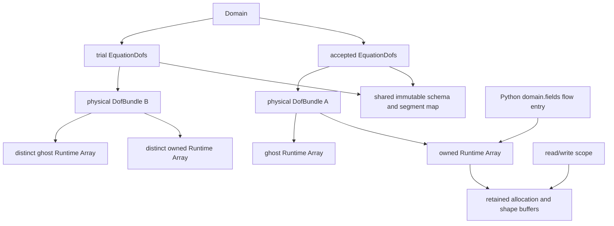
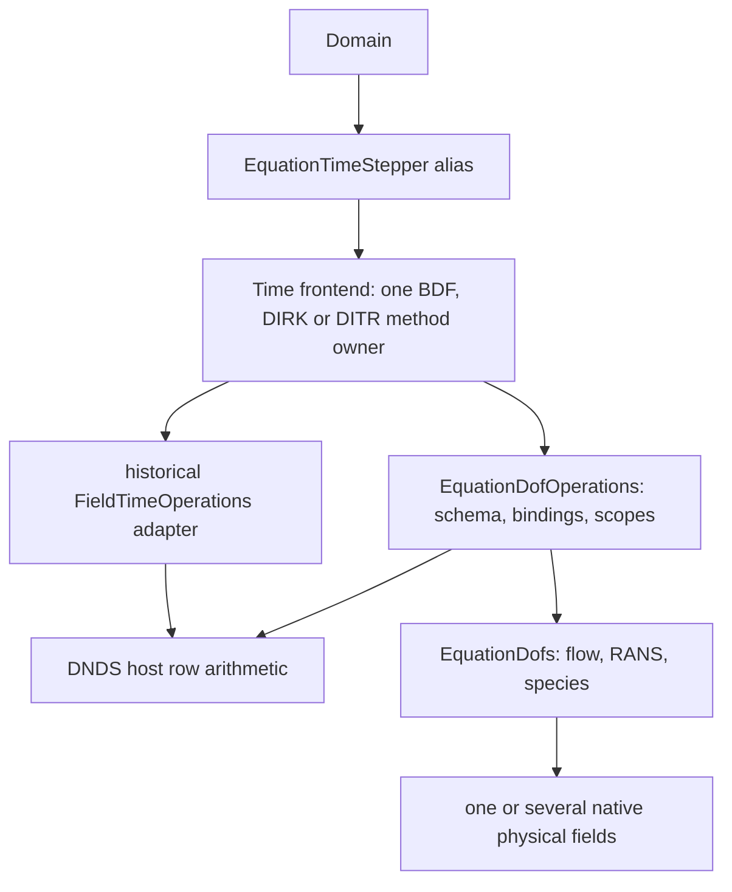
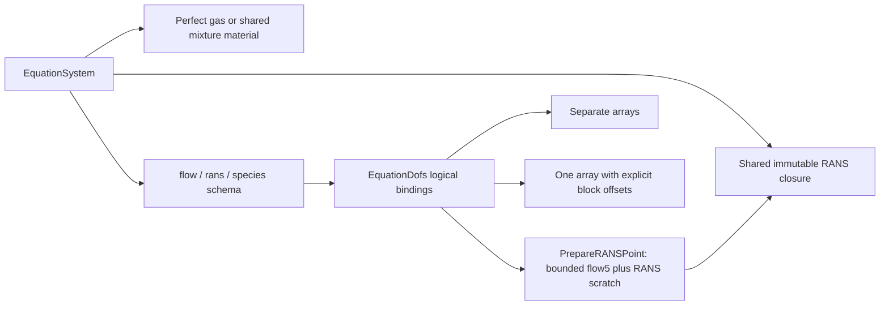

# Cauchy equation state and kernel boundary

`EquationSchema` describes component meaning, logical order, vector triples,
energy convention and physical accumulation. `EquationDofs` binds that schema
to native `Algebra::DofField` allocations. It adds no payload copy or alternate
allocator. DNDS algebra remains independent of the physical equations.

Initial, prescribed boundary and physical reference inputs share the
[state-input conversion facility](CauchyStateInput.md). Unit-system reference
scales and the resolved physical reference state have separate meanings.

The [Python operator guide](../guides/python_cauchy_operators.md) describes shared
logical handles, configured native FV/linear composition, communicator lifetime,
GIL boundaries and caller-owned halo/collective ordering.

## Direct FV and explicit residual phases

Direct FV `gradient` reconstructs from physical conservative gradients with
columns `component*dimension+direction`, using displacement from the volume
barycenter in the parent cell's axes. Its point loop does not query a P1 basis
or consume Taylor coefficients. P0 (`firstOrderConvection`) reads cell means
and uses only the normal jump for face viscosity. **Volume sources still need
and receive physical gradients on P0**; this includes RANS production and its
approximate implicit source derivative. P1 VR continues to use the VR path.
Constant face reconstruction with RANS independently prepares the configured
mean gradients for its volume sources; it does not reconstruct face values or
add those gradients to P0 face viscosity. Thus selecting constant convection
does not silently turn off gradient-dependent production or destruction.

P0 and direct P1 `ReconstructionState` objects alias the managed equation
state and retain no modal value allocation or coefficient halo binding.
Variational reconstruction owns its warm coefficients; limiter/PP output adds
a second finalized allocation only when it must differ. The local
`InspectReconstructionStorage` audit reports actual owned/ghost value bytes in
addition to field/binding counts. `coefficientGhostBytes` is the local receive
payload of one complete coefficient exchange; shared structural metadata and
the independent mean halo are deliberately excluded.

The current limiter/PP and warm-guess compatibility boundary remains explicit:
direct gradients are converted to linear coefficients for those facilities,
then the accepted linear modes are projected once into physical gradients.
`GradientPlan::ExtractLinearGradients` performs that projection without basis
evaluation and supports owned or already exchanged ghost rows. This bridge is
outside the direct RHS loop; it is not a new interpretation of coefficient units.

For flow5, `RHSOperator::ApplyFlux` overwrites integrated flux residuals and
`AddSource` adds owned-cell frame sources. `Apply` invokes the same two blocks.
Raw calls require caller-retained array leases, ready halos, disjoint output,
and initialization before source-add. `RHSReadViews::conservativeGradient`
supplies direct P1 gradients; `viscousConservativeGradient` optionally supplies
distinct unlimited viscous gradients. P0 does not read either face input.

For logical equations, `PrepareReconstruction` prepares means/gradients,
reconstruction/limiting and halos without allocating a dummy residual or doing
flux/source work. `EvaluateFlux` and `AddSource` consume that publication (or a
completed `Evaluate` publication) at the same state, polynomial and time.
They perform no MPI or reconstruction. Sources share the composed RHS's RANS,
chemical and rigid-frame functions. Source-add requires initialized output;
the caller serializes workspace use and coordinates rank-local failures.
Generation checks reject stale preparations. Full `Evaluate` uses the same
numerical blocks and the existing coordinated eager/overlap pipeline.

`BuildFaceFluxBuffer(components)` allocates caller-owned local face output.
Flow5 uses `RHSWriteViews::faceFlux`; logical `EvaluateFlux` accepts its array.
Rows follow `AuxiliaryFaces()`, storing **integrated negative outward flux**
in the local anchor cell's axes, not flux density or per-quadrature values.
Periodic cell accumulation rotates vector components and changes side sign.
Core/dependent calls overwrite selected faces; their face sets can overlap.
There is no implicit inter-rank flux transfer or freshness promise for untouched
rows. Hold output leases through execution and release views before reuse.
The whole-equation kernel can use this output as its accumulation scratch;
the flow5 cell-incidence kernel exports values when requested. Without the
optional output, existing kernel-specific scratch/accumulation remains valid.

Current CPU scope (November 6): configured flow5, SA/Wilcox/SST/realizable-k-epsilon
and optional ideal-mixture chemistry share logical DOF bindings, implicit time
equations, native archives and observation. Perfect-gas extended profiles use the
same flow5 Riemann dispatcher, including Roe_M1; general-mixture preparation
currently supports Rusanov. Extended wave/pressure-stencil producers remain
unavailable, so such flux selections need their explicit supplied scalar inputs
(`riemann.useStencil=false`) or fail at setup. Extended profiles use
polynomial viscosity, component WBAP and Euler-compatible implicit/rec PP;
missing characteristic/LVR/interface adapters
fail explicitly. QCR and the existing SA/SST DES formulas are connected below.
The short flame comparison is a converged discrete sanity run; the NACA pair
is capped and does not establish converged aerodynamics. CUDA remains deferred.
Both coupled chemistry and Euler's physical Strang/CVODE composition have
focused distributed gates and short matched spatial flame checks.
Earlier implementation checkpoints in this document describe their then-current
limits; they do not override the current profile summary or runtime guards.

Extended convection is separate from flow5: `AdvectedScalarFlux` consumes
conservative scalar values, ALE-relative normal velocities and one supplied
nonnegative dissipation speed. Its formula is
`0.5*(vnL*qL + vnR*qR - lambdaScalar*(qR-qL))`. The current preparation uses
Euler's contact-wave magnitude; for Rusanov it explicitly selects the average
absolute normal velocity rather than its acoustic diagnostic magnitude. Pressure,
acoustics and EOS recovery remain outside the scalar and Riemann kernels.



Ordinary C++ copies share physical allocations and the immutable definition.
`Clone()` shares the definition and row space but copies owned values into fresh
physical fields; its ghosts must be refreshed. `RebindCoupled(field)` binds stage
scratch to the same immutable definition, with no value copy. All fields must
have exactly the same `DofSpace` and device. Each binding pins its physical
storage identity and shape generation. Replacing an allocation or changing its
shape invalidates that binding and requires an explicit new one; ordinary value
updates are allowed.

`RebindFields(bundle)` does the same for separate or hybrid storage: physical
field names/order, component widths, device and row space must match, while
individual AoS/SoA/AoSoA layouts may differ. It shares the immutable map and new
field handles without copying or flattening their payload. Physical stage-solve
and Jacobian preparation use their equation-aware adapters; rebinding alone
does not enable a missing numerical/physical profile.

`Domain::Dofs()` is the only accepted-state binding. Its mutable overload is a
coarse debugging/input boundary: release writers before a trial, and release
all views before publication. Python exposes the same physical allocations
through `domain.fields`, keyed by field name. Retaining an entry or a valid
leased view retains storage after Domain is gone; there is no Python-owned
shadow allocation or dedicated flow5 frontend.

## Logical segments and physical layouts

A binding maps each logical block exactly once to a physical field and starting
component. Every physical component must be covered exactly once; overlap,
gaps, duplicate names, invalid vector triples and aliased physical fields reject
at binding time. A logical schema can use either representation:

```text
Logical:       flow5          RANS2        species14
Coupled:       [0..5)         [5..7)       [7..21)  in one field
Separate:      flow field     RANS field   species field
Physical:      AoS / SoA / AoSoA per field, independently
```

Acquire one scope, resolve its block views once, then use the resulting plain
views inside the numerical loop:

```cpp
auto input = state.ReadOwned();
auto output = candidate.WriteOwned();
const auto flow = input.Block("flow").owned;
const auto next = output.Block("flow");
for (DNDS::index iCell = 0; iCell < next.RowCount(); ++iCell)
    for (DNDS::index j = 0; j < next.ComponentNumber(); ++j)
        next[iCell][j] = flow(iCell, j);
```

Block row views retain the parent's element stride. For AoSoA, they also retain
the **full physical parent width**: changing it to the segment width would
incorrectly change the tile pitch. `view.Fixed<5>()` checks a static component
width outside the kernel and returns statically shaped row spans. Plain views
are trivially copyable and device-callable; they retain no ownership themselves.

These are also the frozen-pointer device views: the host resolves names and
leases, then passes block structs by value to a kernel. Their parent retains
the physical layout kind, full width and pitch, plus each logical block's
offset/width. A flow5 block can therefore be a segment of one21-component array
or a separate five-component array with the same logical indexing. No shared
pointer, string lookup or allocation occurs in device element access. For a
future layout-specific GPU kernel, host dispatch must inspect both the physical
layout and block-to-allocation mapping, then select the appropriate specialized
view/kernel. It must preserve full parent tile pitch when freezing a segment.
An allocation ID is host dispatch/lifetime metadata, not a device indexing input.

At host dispatch, `LocateBlock("flow")` returns `physicalField`,
`firstComponent` and `componentNumber`. Inspect
`PhysicalField(location.physicalField).Owned().Layout()` for the full parent
layout/pitch. This distinguishes, for example, a tiled seven-component flow/RANS
parent plus a separate species array from one coupled parent, without pointer
comparison. Location metadata grants no data-access permission; retain normal
read/write scopes for the chosen kernel. It stays outside device/hot loops.

`ReadOwned(context)`/`ReadWithGhost(context)`/`WriteOwned(context)` accept an
explicit device context; `Complete(Runtime::Completion::Record(context))` can
attach one enclosing native-stream prefix after the final direct launch. Engine
`ExecutionStream::Record()` returns a separate scheduling `StreamEvent`, not
this direct-access completion type. The device-callable view machinery is
present, but EquationDofs currently has CPU mock/layout tests and no dedicated
CUDA launch test. This is not a claim that Cauchy's physical CUDA wrappers or
queued multi-stream scheduling integration are implemented.

Each physical array is leased once even when several logical segments occupy
it. If a later reservation fails, earlier unchanged reservations are cancelled.
Holding a writer for one segment therefore reserves the entire physical owned
array, not an unchecked independently writable column slice.

## Access and asynchronous lifetime

Pointwise operations and reductions stay **unsplit and owned-only**. No neighbor
stencil or core/noncore lists are involved. Owned reads and distinct-output
updates can overlap writes to the separate ghost arrays. A direct MPI send still
reads its owned source: do not modify that source until its transfer completes.
Global reductions must also obey the domain communicator's collective order.
The immediate DNDS algebra convenience functions require idle inputs; use their
engine-aware variants for compatible active readers/halo transfers.

`ReadWithGhost()` is an explicit stencil boundary and requires the input halo
to be ready. Scopes retain allocation and row metadata; a copied plain block view
must not outlive its scope. CPU worker launches retain the scope through actual
execution. For asynchronous device use, supply the correct execution context
and attach one enclosing stream-prefix completion through `Complete()`, after
the last use. Cross-stream dependencies remain the caller/engine's obligation;
destroying a host scope alone does not certify device completion. No per-kernel
completion token is required. `CancelUnmodified()` is valid only before any
output value changes.

## Current physical dispatch and explicit limits

`FiniteVolume::BuildWorkspace(EquationDofs&, ...)` and `Evaluate(EquationDofs&,
...)` validate exact semantic schema, native row/storage identity and backend
outside cell loops. `EquationSystem::ResolveKernelProfile()` distinguishes
perfect-gas and ideal-mixture CPU models; this key alone does not promise every
spatial/time operator exists for that model. FV has one schema-driven workspace
and evaluation schedule. A perfect-gas flow5 operator may resolve a fixed-width
leaf kernel, but Domain, time stepping, multigrid, restart, output and Python do
not select a second flow5 frontend.
Requesting another device fails explicitly,
without host fallback. In checked execution a rank-local schema mismatch is
coordinated before communication. FV entry/preparation stages inherit the
metric communication context: with `implicit.collectiveChecks=false`, their
local failures abort before dependent collective/payload work. Successful local
stages add no safety agreement. This applies to whole-equation mean-gradient,
auxiliary, reconstruction and restore stages too; it is not a promise of
recoverable unchecked distributed exceptions.
There is no `Flow5KernelWorkspace`, flow5 evaluation loop, or equation-prefixed
workspace in the native API. Frozen comparisons bind the same `EquationDofs`
and `FiniteVolume::Workspace`, then select a fixed-flow or forced-generic leaf
through `WorkspaceOptions::rhsKernel`; both selections execute the same
`EvaluateImpl` schedule. Fixed-width flow5 code therefore remains an
operator-local optimization rather than a compatibility sub-workspace or a
second solver frontend.

The Domain frontend always uses the semantic binding. Perfect gas may select
established fixed-width arithmetic inside an operator. Configured ideal mixtures
use separate flow/species arrays, whole-equation
FV/implicit stages, dynamic reports and full-state publication. Native checkpoint
and output preserve all logical components; the independent mean trial also
supports whole-equation physical-dt PP. Polynomial FAS preserves all logical
blocks through the shared hierarchy. Extended interface packets and explicit
flux blending still require adapters. Explicit extended stages instead use
uncompressed flow5/species residuals and reject the whole trial when
inadmissible. Separate RANS exponential repair is permitted without rescaling
those components.

CFV reconstruction and limiting are prepared per physical allocation, not per
logical equation block. A combined equation allocation therefore makes one CFV
call; segmented flow/RANS/species allocations make one call per allocation so
each keeps its own layout and halo. Characteristic WBAP uses CFV's ranged face
transform: Cauchy supplies only the physical flow block's local `[first,first+5)`
range and a 5x5 matrix. Components outside that range, including RANS and
species, remain ordinary scalar WBAP channels; no full-state identity matrix is
formed. The same rule supports a permuted flow block in a combined allocation.
`CoupledField()` explicitly
refuses split or permuted physical segments instead of silently flattening them. Generic mock
tests exercise 17/21-component coupled BDF/block solves and separate physical
bindings; those tests are not RANS, species or incompressible implementations.
Future models must supply their flux/transport, physical accumulation (including
zero pressure mass where applicable), pseudo-mass and admissibility actions.
The current identity-accumulation stage adapter is not a general DAE operator.

## Whole-state algebra and time stepping

`EquationDofOperations` supplies owned-only CPU Copy/Fill/Scale/Axpy and linear
combination through DNDS's common `ApplyHostRows` arithmetic. It resolves logical
blocks and reserves every source/output lease before numerical writes. Blocks
may have different physical grouping/layouts. Binary output/input allocations
are distinct; Scale is explicitly in-place and an exact self-Copy is a no-op.
An unavailable device backend fails explicitly. These operations do no MPI or
halo work. Their owned scopes can coexist with independent ghost writes.

The time equations are implemented once in `Solver/TimeIntegration/`;
`Solver/StateTimeStepper.hpp` and `Solver/StateDITR.hpp` are forwarding headers, with state ownership/algebra supplied by a small adapter.
Historical `FieldTimeStepper`/`FieldDITR` names select the native single-field
adapter; Cauchy's `EquationTimeStepper`/`EquationDITR` select the full semantic
state. No tableau, BDF ratio, DITR interpolation or integration coefficient is
duplicated or changed.



Cauchy now stores its initial snapshot, implicit stage sources/rates and BDF
history in the logical state. One stage-solve callback receives all components
together. Initial/trial arrays are distinct, callback bindings and owned
input/source generations are checked, and ordinary ghost refresh is allowed.
The checks stay outside numerical loops and use the configured local-error
coordinator; Cauchy's `implicit.collectiveChecks` controls its added agreement
calls. External stage-sequence users complete/discard before the next stage,
retain callback resources and finish CPU work before returning. This is a
synchronous CPU driver, with no implicit accelerator fallback.

`NewVector` allocates fresh uninitialized payload with the same per-field
owned/ghost layout, space and semantic binding. `Clone` additionally copies
owned values. History Commit uses nonthrowing handle swaps after accepted-state
publication; Discard preserves accepted history. Callback exceptions can leave
scratch partial. At the beginning of each DITR coupled step, the endpoint keeps
the accepted endpoint reconstruction state; the midpoint mean is initialized
from U0 and receives a full copy of that endpoint reconstruction state.
Midpoint and endpoint then advance independently while sharing only serialized
temporary workspace. A rejected attempt restores the accepted endpoint and
repeats this initialization. The flow5 checkpoint keeps its existing `history_flow` representation
through an explicit adapter; extended physical fields use the format-5 block
archive described below.
Layout-independent time equations do not by themselves complete extended
production BC, PP, physical Jacobian assembly or RANS/species validation.

## Equation-state finite volume

`FiniteVolume` owns the canonical immutable metrics, geometry, face incidences,
work partition, basis provider and CFV plans. `BuildReconstructionState(state)`
allocates solver-owned warm coefficients, finalized flux coefficients and their
mean/coefficient halo publications. `BuildWorkspace(state, optionalWorkers)`
allocates only serialized temporary boundary, limiter, sampling and operator
scratch. Each physical input field gets its own scratch adapters; logical flow/species views
retain their parent strides and physical offsets. No distributed state is
flattened into a coupled temporary array. Coefficient block widths and physical
offsets are multiplied by the number of nonconstant basis modes. Boundary
values remain small local arrays in the canonical boundary-quadrature order.

```text
EquationDofs (logical flow + species)
  -> physical fields (coupled, split or component-permuted)
  -> solver-owned ReconstructionState (warm + finalized coefficients + halos)
  -> scratch-only reusable FV/CFV Workspace
  -> ready point values/gradients in logical order
  -> actual EOS acoustics / Newtonian-Fourier + species diffusion / chemistry
  -> each logical residual block in the caller's output fields
```

The CPU profile currently supports Rusanov, constant/gradient/variational
reconstruction, two-buffer Jacobi/SOR, componentwise WBAP and conservative
polynomial viscous gradients. A compatible explicit chemistry worker pool is
mandatory for ideal mixtures. Acoustic-only faces, viscous faces and chemical
volume points select subsets of that evaluator's pre-reserved outputs. An
acoustic query does not calculate rates or diffusivities. The request does not
change the evaluator's default policy, acquire a second worker, or allocate
point buffers. Scalar point scratch and gradients are private to one execution
lane; returned property views are consumed before the worker's next point.

Periodic transformations rotate vector values and both indices of vector
gradients, while scalar gradients rotate once. Adiabatic slip/no-slip wall
values preserve density, composition and full internal energy as momentum
changes. Wall kinematics use the same rigid-frame producer as flow5. Chemistry
uses cell volume quadrature and the shared polynomial sampler, following its
optional cache policy. It adds independent mass rates and no full-energy source.

A one-species material has no `species` block. Its empty independent-composition
view may have a null pointer; repair/strict conversion produce the sole full
mass fraction one. Thermodynamics still use the actual material. Chemical
volume sampling is unnecessary, the point source is zero, and its optional
logical flow5 Jacobian is zero. Do not invent a dummy transported component.

The mixture assembly gates include independent nonconstant references. One
integrates species diffusion from direct backend diffusivities and the full
dependent-species correction at face points. Another integrates direct backend
rates with independently generated Cartesian Gauss points and weights. Their
signals distinguish omitted/reversed diffusion and mean-only source sampling.
Layout agreement, periodic conservation and uniform-state fixtures remain
useful additional checks; they do not replace those assembly oracles.

The wrapper posts all physical-field halos before submitting owned-only core
work, waits on the controller thread, then submits dependent work. First VR
core work may overlap both the mean and coefficient exchanges. Ordered SOR
uses the configured core-first logical order; WBAP exchanges after each
descending-degree pass. Input coefficients stay immutable through direct MPI
sends. CPU inline and worker launchers follow the same sequence; return joins
only that lane. Worker resources are retained through exceptional exits too.

The caller serializes each workspace, retains each reconstruction state for as
long as its numerical state is needed, supplies distinct output storage,
completes external producers before entry, and uses matching
physics/units/numerical controls and the same collective schedule on every rank.
The descriptor agreement proves the field map, numerical schedule controls and
physical scalar parameters, not equality of separately loaded mechanism contents.
Entry preflights reserve every output before
any field transfer. A collective exact descriptor check rejects inconsistent
schema/physical grouping before constructing halo bindings; physical payload
layouts may differ among ranks. Geometry versions, bindings and leases are
checked outside point loops. Ghost updates are allowed; owned means do not
change. Discard scratch after a failed checked evaluation. Local FV stages
inherit the immutable metric communication context. With
`implicit.collectiveChecks=false`, local rejection aborts before unmatched
payload/collective work; successful stages add no safety agreement. Required
schema, grouping and schedule agreement and numerical norms remain collective.
This does not change the separate nonlinear driver's caller-ordered contract.

This is a functional residual path, not a completed extended production Domain.
Face fallback and ranged flow5 characteristic WBAP now use the native equation
workspace for combined or segmented perfect-gas fields. Prepared Riemann
stencils, a distinct unlimited viscous polynomial, LVR, and non-wall/non-
extrapolate BC producers remain on the compatibility path until connected.
Euler-style thermal/species PP now composes with the
equation-state residual and nonlinear stages; see
[CauchyImplicit.md](CauchyImplicit.md#equation-state-thermal-and-species-pp).
Extended restart and visualization support is described below; frontend adapters
and physical RANS/flame acceptance remain separate work.

## Logical rows in coupled linear algebra

### Bounded CPU view specialization

`EquationDofs` remains a dynamic owner. `execution.fieldGrouping` defaults to
`coupled` (one allocation); it may instead select `equationBlocks` (separate
flow/RANS/species allocations), independently of `execution.layout`. Storage grouping never changes
which equations the linear system couples. The same blocked access works for
either grouping:

```cpp
auto read = state.ReadOwned();
auto flow = read.Block<5>("flow").owned; // one width check; static flow5
auto rans = read.Block("rans").owned;   // dynamic extension width
auto species = read.Block("species").owned;
auto tableFlow = flow.AsTable();        // optional: checked AoS projection
for (DNDS::index iCell = 0; iCell < tableFlow.RowCount(); ++iCell)
    ConsumeFlow(tableFlow[iCell]);      // static size 5, component stride 1
```

`AsTable()` rejects SoA/AoSoA; generic code uses the original strided block view.
Its parent retains the **complete** physical width and pitch. A flow5 subrange
inside a six-equation row still advances by the six-equation parent's pitch,
including any padding. Neither projection allocates, copies payloads, changes
metadata, or acquires another lease. Read blocks provide the same static shape
for their separate owned/ghost views. An owned-only scope exposes zero ghost
rows. Retain the originating scope through all actual uses of borrowed views.

Whole-equation kernels use `EquationViewLayout` and
`DispatchCPUEquationViews<Kind,Width>(kernel, layouts...)` from
`State/EquationViews.hpp`. The operator hand-builds its preparation branches;
the helper constructs only the explicitly requested family/width. The default
is generic. `DispatchCPUEquationLayouts` is the bounded CPU prologue used by
whole-equation algebra, products, nonlinear assembly and RHS: when every
operand is one ordered flow5 allocation it selects row-major AoS,
column-major SoA, or tiled AoSoA with compile-time tile 8/16/32. A split
binding, mixed layout, flow4 system or uncommon tile stays on the generic
strided view. This is one numerical kernel and no payload conversion. Static
logical widths 5/6/7 remain optional independently per operator and are enabled
only with correctness/performance evidence. Named row blocks resolve in
preparation; existing SGS/action specializations remain local. Matched timing
gates each optimization.

The numerical loop is a shared template. Its operator chooses whether to use
static width, known AoS indexing, or generic strided access. Explicit view
projections allocate no payloads and preserve physical parent pitch.

```text
EquationDofs (dynamic physical handles + immutable logical bindings)
  Read/WriteScope (allocation/shape owners + leases)
    Block<5>(flow) / Block(rans) / Block(species) (borrowed views)
      CPU prologue: operator-owned layout/width branches
        AoS 5/6/7       -> fixed-width row views
        combined AoS    -> dynamic-width, component stride 1
        combined SoA    -> dynamic-width, one resolved component stride
        AoSoA 8/16/32   -> dynamic-width, compile-time component stride
        mixed/split/uncommon tile -> generic strided block views
          one templated numerical kernel
```

The Runtime Array layer also allows explicitly requested
`FixedRows<N>`/`FixedRows<N,Pitch>`, `ColMajorTable`,
`FixedWidthRows<ColMajorTable,N>` and `TiledColMajorTable<W>` access policies.
These policies specialize access, not ownership. They remain available for
backend-specific kernels. CPU operators choose their own subset of suggested
specializations; shared construction does not instantiate a mandatory matrix.
Checks run at projection/dispatch time. Scalar
bounds assertions follow the ordinary `AccessBoundsChecks` build policy.

Ordinary `view(iCell,j)` and `view[iCell][j]` return references to the original
allocation, including split and strided storage. Row construction/indexing never
packs, synchronizes or produces an Eigen map. Dense numerical algorithms may
explicitly call `Algebra::PackEigenRow`/`UnpackEigenRow` with scratch owned and
sized by that operator before its loops. The packing reference is overwritten
by the next pack into the same scratch. Specialized dense/AoS paths may explicitly
construct `MakeEigenRowMatrices`; this is not an implicit row-view conversion.
User code can likewise request a checked dense adapter or assemble a compatible
Eigen map manually, retaining the original leases and full stride information.

Compile-time inspection is available without constructing a row. Runtime
`ArrayView` exposes `layout_kind`, `is_dynamic`, `row_width`, `row_capacity`,
`row_stride` and `component_stride`; its `RowSpan` exposes width/capacity and
component stride. Only use `layout_kind` as a compile-time guarantee when
`!is_dynamic`. A row span's physical parent layout is intentionally not inferred
from its element stride: SoA and tiled parents can produce equivalent strided
rows. Equation block views forward parent layout/stride traits and retain their
own logical width. Whole-equation views/rows expose `kind`, `row_width`,
`has_single_parent`, `has_static_layout` and `component_stride`. A generic view
keeps unknown traits dynamic even when its runtime binding happens to be AoS.

```cpp
auto row = u[iCell]; // Borrowed, no copy of numerical values.
using Row = decltype(row);
if constexpr (Row::has_single_parent)
{
    auto *p = row.data();
    if constexpr (Row::component_stride == 1)
        value = p[j];
    else
        value = p[j * row.ElementStride()];
}
// For a split view use row.Flow()/RANS()/Species()/Block(iBlock):
// each segment supplies data(), ElementStride(), size() and row-width traits.
```

No single `data()` is supplied for a generic/split whole-equation row: its
components may belong to unrelated allocations. The explicitly combined row
families supply this accessor without inventing a packed representation.
These plain views/rows are trivially copyable and standard-layout, with
device-callable indexing and no owning handles. This is the useful kernel-ABI
contract; default member initializers need not satisfy the stricter historical
C++ POD definition. Their host metadata owners (`EquationViewLayout` and access
scopes) are not kernel arguments. Runtime Array device access still requires
device-accessible payload/shape buffers and retained owners/leases through
execution. Copying a trivially copyable view never uploads its pointed-to data.

For Cauchy CUDA, the chosen direction is dedicated kernels for expected layouts
and physical profiles, not interpretation of a dynamically registered DOF
bundle on device. Host dispatch resolves the CPU registry and passes component
views directly, or a statically composed POD holding inline flow/RANS/species
views with absent segments represented by a type. Kernels may have different
loop mappings/staging for AoS, SoA, tiled or split storage; sharing the CPU
generic blocked-view loop is optional. Keep supported choices bounded and reject
missing kernels explicitly. Flow5 is initial; flow4 is a later incompressible
profile. RANS/species presence, widths and layout choices are explicit dispatch
inputs, not inferred physics from total width. A CUDA compile-only probe of
generic descriptor-based views proves technical device-callability, not adoption
of that interface or automatic GPU registry upload. Solver CUDA implementation
is deferred while the current goal concerns CPU correctness/performance.

### Prepared auxiliary values and logical dense rows

`BeginAuxValues(EquationDofs, outputs, time, workers)` prepares the same optional
`AuxiliaryValues` packet for separate or coupled equation fields. The CPU scope
reserves requested outputs before writing, retains owned input through Core,
then acquires ghost input only for HaloDependent. The caller posts/joins every
physical mean field's canonical halo and coordinates distributed failures.
`PrepareAuxValues` is the consecutive All convenience. Exact schema/backend
checks remain outside point loops; no global-state repacking occurs.

```text
mean halos active -> owned-only Core: derived refresh / means / faces / cells
join all halos   -> HaloDependent: ghost refresh / means / faces / cells
Finish           -> immutable source/output/time publication
```

Both ordinary mean thermodynamics and optional derived bundles are supported.
A mixture uses one explicit matching chemistry worker at a time; no chemistry
rates are requested for these face/mean properties. Pressure, acoustics and
molecular/species diffusion bounds come from the actual EOS/transport provider.
The equation boundary profile covers extrapolation, farfield, constant prescribed
values and adiabatic/isothermal walls, using the same producer as reconstruction
boundary buffers and the equation RHS. Interface packets and nonconstant analytic
profiles still require their extended equation-state adapters.
Wave/pressure statistics and cell spectral sums have the existing definitions;
missing face outputs use private scratch only when a requested reduction needs
it. An unused retained scratch allocation is neither acquired nor written.

`Finish` records the FV owner, every physical source binding and owned/ghost
generation, output storage/shape/value generations, row parts and time.
`ValidateAuxValues` rejects active inputs/outputs as well as stale generations;
a change confined to species invalidates the packet. Abandoned started scopes
fail unfinished numerical outputs. The origin keeps a numeric source alias and
weak FV key. The preparation itself retains plans: keep FV and derived-bundle
owners on the controller through worker joins so final MPI cleanup stays there.

`Physics/EquationFlux.hpp` provides pure physical ALE flux derivatives with
pressure and its directional derivative supplied explicitly by the EOS/energy
producer. Scalar conservative transport uses the same relative normal velocity.
The ideal-mixture primitive chain rule supplies composition/thermal derivatives;
no equivalent-gamma closure is added. These point derivatives are independently
checked by conservative perturbations, including all species columns and moving
grid velocity. The whole-equation physical Jacobian producer uses them with
scalar dissipation; its source and snapshot contracts are described below.

`ReadScope::ComponentLayout()` and `WriteScope::ComponentLayout()` resolve
logical components to physical parents once. The returned
`DNDS::Algebra::DofComponentLayout<T>` owns a small host descriptor table, while
the enclosing access scope retains payload/shape owners and leases. Its borrowed
`DofComponentView<T>` performs ordinary `(row, component)` access and keeps each
parent's complete physical width/pitch. This is neither a storage conversion nor
a distributed payload buffer. Keep both the layout owner and the source scope
alive through use. Copying a plain view does not retain either. A future device
launcher must also place that descriptor table in accessible device memory;
these CPU adapters do not perform an implicit upload.

```text
EquationDofs -> physical Array handles
  Read/WriteScope -> payload + shape leases
  ComponentLayout -> owned host descriptors (one per logical component)
    ComponentView -> borrowed descriptor pointer -> strided parent values
```

`LinearProblemContext::Apply` accepts these logical states as well as native
fields. Both use the same matrix action; the established field path retains
direct Eigen maps, while logical rows gather one dense vector at a time.
`ApplyILU` uses the same prepared symbolic structure and numeric factors, with
three local dense row vectors and no whole-state packing. Input/output may
have different component grouping/layouts, but schema, row space and CPU
placement must agree. Every physical output is reserved before numerical
writes. The low-level `NativeBlockLU::SolveRows` borrows raw views: its caller
must retain descriptors/payload scopes and prove nonaliasing and symbolic
serialization. The checked context wrapper does so and fails partial outputs
if a solve throws.

`Solver::StateGMRES<State, Operations>` owns the existing restarted left-GMRES
mathematics. `FieldGMRES` remains its historical native-field adapter;
`EquationGMRES` uses logical-state algebra. Arnoldi, stopping, true residual,
reorthogonalization and fixed-preconditioner requirements are unchanged.
Operator/preconditioner callbacks finish synchronously, retain their resources,
and coordinate distributed errors and halos. `LocalProducts` computes one
owned-only dot-product batch in logical row/component order; its caller chooses
the communicator/reduction. No implicit transfer occurs in the Krylov class.

Logical two-buffer SGS uses that same matrix context and the shared native
scan arithmetic. `BeginSGS` owns distinct forward/output writers; `Lower`
accepts All or Core then HaloDependent, and `Upper` accepts All or HaloDependent
then Core. Commit with `Finish` only after both scans. Default remote values
are the frozen old input. With explicit middle exchange, publish **every**
forward physical field after complete lower work and before upper work. That
join remains exposed. Core acquires no input ghost lease, so it can execute
while those ghosts are being written. Do not replace field handles/layouts or
change matrix values/order while the scope exists. Abandoning a started scope
fails its unfinished output; it is not a valid partial solution.

Numeric access metadata now retains only the immutable row partition, not a
communication context. `DofSpace::NumericAlias()` and
`EquationDofs::NumericAlias()` share row identity, schema and Array storage
without owning the fields' MPI context. They copy no values and grant no
access by themselves. A numeric alias deliberately cannot provide a
communicator/reduction. The staged SGS scope uses these aliases; its controller
retains communication/transfer owners and releases them on an MPI-permitted
thread. Ordinary read/write scopes also keep only numeric definition metadata.

```text
controller -> matrix / original fields / transfers -> communication context
worker SGS scope -> numeric aliases -> shared Array storage + access leases
                                   -> schema + row partition (no MPI context)
```

The numerical alias changes neither storage identity nor generations. Scopes
remain usable after original field handles disappear; a focused worker test
proves the communication context can already expire on the controller while
numeric row reads remain valid and retire on a worker.

`DofLinearSolver` uses the same private controller implementation as
`LinearSolver`: SGS, left-GMRES with fixed SGS sweeps or local ILU, true residual
checks, explicit warm guesses and the optional exposed middle SGS exchange.
The prototype prepares every physical field's canonical halo binding; a grouped
exchange posts all fields before Core work and waits before dependent work.
Request slots are allocated at setup and drained by a scoped guard, including
on exceptions. No request-vector allocation is added per application.

All domain ranks construct and call the driver together with agreed controls.
`AgreeEquationBinding` checks exact schema, physical field order/width and block
offsets before the first binding collective. Local row counts and table layouts
may differ. FV workspace setup uses this same check. The binder receives each
native physical field in order, reuses the domain's row mapping, and coordinates
its own failures. Callers keep field handles/layouts and the matrix stable,
release debug views, and retain MPI owners on the controller. Per-kernel
`collectiveChecks=false` is caller-ordered eager execution; setup agreement
remains collective, but repeated solve-entry agreement is the caller's duty.
This is synchronous CPU orchestration, not a queued
CUDA implementation.

```text
LinearSolver (one field) ------> shared private linear controller <field ops>
DofLinearSolver ---------> shared private linear controller <equation ops>
                                  |-- StateGMRES / fixed SGS or local ILU
                                  |-- reusable state + per-field halo bindings
                                  `-- scoped active request slots
LinearProblemContext -----------> matrix action / ordered SGS / local ILU
                                  (numeric kernels, no halo orchestration)
```

The logical driver is exercised by the distributed known-solution matrix fixture,
the actual conservative chemical-reactor Newton test and a coupled physical
mixture matrix. Nonlinear/frontend and checkpoint adapters remain separate. Matrix dimensions
alone do not validate a physical model.
The source/flux producer must supply the matching logical derivative ordering;
physical RANS/species acceptance remains separately gated.

## Whole-equation physical Jacobian

The `EquationDofs` overloads of `BuildLinearProblem`/`PrepareJacobian` use the
same canonical cell-face-cell stencil, conservative node-star core and native
matrix context as flow5. Both scalar-entry and full-block diagonals are
available, with assembled or frozen evaluated off-diagonals. Physical source
and flux producers use logical component locations, independently of physical
field grouping or layout. The established raw-field API remains available.

The integrated convention remains
`A = V*(1/dTau + physicalMass)*I - residualScale*J_R_approx`.
Scalar face dissipation uses the prepared convection-plus-diffusion radius.
Neighbor blocks differentiate the actual EOS physical ALE flux and compose
the periodic transformation on increment columns. Self-periodic incidences
fold into the diagonal. Boundary terms retain Euler's scalar spectral diagonal
approximation. Viscous derivatives use its scalar molecular/species bound,
not differentiation through gradient reconstruction. Full blocks retain the
negative rotation-source derivative; scalar entries use the existing flow5
angular-speed bound. No equivalent gamma is substituted. Roe characteristics
are explicitly unavailable in this whole-equation producer.

Approximate source Jacobians use one cell-mean state per owned cell and multiply
the derivative by its cell volume. They do not traverse RHS source quadrature,
even at high reconstruction degree. RANS additionally consumes center physical
gradients from the retained reconstruction; P0 face viscosity does not remove
those source gradients. Chemical derivatives use the explicit chemistry worker
and are inserted with the negative residual-derivative sign in logical order.
The empty independent-species case has no chemical derivative.

For RANS or nonconstant chemistry, pass a `JacobianContext` containing the
solver-owned `ReconstructionState` and the scratch `Workspace` used by current
spatial/correction preparation. Their mean/coefficient binding, generations
and time must match; missing or stale input fails before matrix
writes. This provenance validates the frozen reconstruction inputs, not a
high-order integration policy for the approximate matrix. Constant chemical
reconstruction may omit the workspace and use the equivalent mean/volume term.
A new RHS attempt invalidates the previous source publication. The true RHS
source evaluation keeps its configured quadrature independently; this matrix
does not differentiate the reconstruction solve.

```text
PrepareJacobian
  -> leased means + prepared face signals + explicit EOS/chemistry worker
  -> cell pressure derivatives + mass/rotation/source diagonal
  -> assembled blocks directly from logical views
     OR frozen means + pressure derivatives + immutable incidence geometry
        -> evaluated blocks (no EOS, MPI, live state or worker)
```

Assembled filling does not copy the complete mean payload. The evaluated path
copies its required numeric snapshot and reuses immutable geometry; neither
its geometry nor its scalar/array snapshots retain an FV/MPI owner. A worker
may evaluate blocks after the original means change. Component selections
project after periodic transformation, with inactive rows/columns zero and
inactive diagonal one. Fill coefficients before using the numerical context;
diagonal inversion/ILU factorization is explicit. All output writers are
reserved before filling. A late reservation conflict cancels untouched
writers; a later numerical failure poisons incomplete outputs through the
same `CancelUnmodified`/`Fail` contract exposed by block-matrix write scopes.
Callers serialize preparation and input/matrix rebinding and coordinate MPI
failures; the numerical producer itself communicates nothing.

Tests compare this approximation to flow5 on translated/self/rotated periodic
and moving-wall meshes, both diagonal kinds and storage modes. A nonconstant
mixture action is checked against independent frozen-signal residual differences
and solved through GMRES/ILU on separate/permuted fields. Independent Cartesian
Gauss integration with direct backend source derivatives checks the high-order
source diagonal and requires a measurable difference from a mean-only result.

## Chemical source operator

`EvaluateChemicalSource(equation, state, values, worker, jacobian, scale,
temperatureGuess)` is an owned-only, synchronous CPU operator on logical
equation states. It replaces its output with positive source rates per code
volume/time. Flow mass/momentum/full thermochemical energy rows are zero;
independent species receive the existing Cantera rates. The optional matrix
has N*N logical columns per owned row, with column-major dense block indexing,
and stores positive `dS/dU`. An implicit residual subtracts this derivative.
Cell/source-quadrature volume weighting remains the discretization's task.

The point evaluator owns an exclusive worker and optional derivative scratch
outside the cell loop. Its named input/output block views preserve each
parent's AoS/SoA/AoSoA layout and physical component offsets. Allocation/shape,
schema, row-space and alias checks occur before writes. Every output allocation
is reserved before any numerical value changes; an unavailable later output
cancels earlier unchanged reservations. Inputs stay immutable. A failed point
evaluation can leave scratch partial: discard that failed result. No implicit
payload exchange, device fallback or time-advance policy is hidden in this call.

An optional compatible published derived-temperature bundle can be stale; it
only seeds the actual UV inversion. Input ghosts are not read, and an ongoing
write to their separate allocations is allowed. Owned source arrays and the
Jacobian must be distinct from input/output equation storage. The caller
serializes operator/workspace access and moves the worker lease into CPU work
that outlives submission.

`AdvanceChemicalSource` is the separate constant-volume owned CPU update. It
copies flow5 and all nonchemical blocks exactly, then replaces independent
species through the shared reactor adapter. Input/output states are distinct;
all physical destination writers are reserved before the first copy. Source
halos may be stale or under communication because only owned inputs are read.
Zero duration or source scale gives an exact copy. No exchange, reconstruction
or time history is hidden inside this point operator.

`time.sourceSplitting="strang"` selects Euler's physical composition
`B_S(dt/2) A_F(dt) B_S(dt/2)`; the default is `coupled`. Only configured chemical
domains split. The Domain constructs one source-free spatial profile, also used
by its approximate Jacobians, coarse FAS, physical-dt trial and diagnostics.
It retains the physical mixture/configuration and explicit reactor controls
under `time.reactor`. Source-free diagnostics report transport/RANS/rotation,
matching Euler's split output convention. Steady splitting is rejected.
The source composition is second order; using a higher-order transport tableau
does not increase the Strang splitting order.

The first half-step writes trial from accepted state, then prepares the existing
time-method initial buffer. After the transport method finishes, that same
initial allocation becomes the distinct output of the final source half-step.
No extra full-state source scratch is needed. Reconstruction guesses are
retained, as in Euler. The public method owner resets history before transport
and after successful commit; BDF2 therefore uses its BDF1 startup equation on
each split step. Discard/retry leaves accepted means/history unchanged. All
domains use the same standalone/coordinated stage infrastructure.

A point/backend exception after writing may poison the private source output,
as for other Runtime operators. Accepted state remains untouched, but this is
not an ordinary admissibility/convergence rejection: replace the failed scratch
or reconstruct the Domain before trying again. A smaller dt alone cannot make
a failed allocation usable. The focused discard/retry check covers an otherwise
successful prepared trial, not recovery from a backend failure.

Checkpoint metadata records `source_integration`. A split checkpoint has no
transport BDF history, and a split reader does not import one from another time
policy. Changing source integration on read is a numerical-method choice like
changing BDF to DIRK; validated physical means and compatible polynomials remain
readable. Derived properties stay unpersisted and refresh by normal versions.

The source follows the active Euler repair, temperature-floor, units and
unfiltered-Jacobian conventions described in [shared Physics](Physics.md).
The limited equation-state FV profile above includes this source. The production
Domain connects the extended BC/PP and checkpoint paths. The physical
Jacobian and whole-equation nonlinear stage operator now compose with the logical
linear/time drivers; see [CauchyImplicit.md](CauchyImplicit.md#whole-equation-cpu-nonlinear-adapter).
The production executable now uses DNDS MPI lifecycle helpers,
the shared `DNDS::CsvLog` typed-schema/typed-row segmented CSV writer, and
argparse overrides through the existing resolved-configuration/provenance API.
One `ProgressOutputController` constructs iteration, stage-end and accepted-step
rows and console messages at their safe frontend boundaries. History stores the
current named residual components, not the solver-internal initial/reference
normalization vectors. `output.historyPrecision` controls real-cell precision
and defaults to Euler's compact value of 10; absent fields remain empty cells.
See the [case guide](../../cases/cauchy/README.md)
for override paths, restart and history segment conventions. Python Domain and
Simulation use the same native operators; standalone operator-level Python
coverage remains incomplete. The physical source/implicit-reactor fixtures do not qualify a full
RANS/species spatial solver or the pending NACA/flame studies.

`PreparePrimitiveDerivative` accepts one conservative flow direction and a
strided Ns-1 species direction. Its result is `[d(rho),d(u),d(v),d(w),d(T)]`
plus `d(p)`, using actual EOS cv, full species enthalpies and immutable species
gas constants. Both the kinetic derivative and composition-energy terms are
retained. Full energy may be negative at a positive temperature. This point
entry supports primitive-gradient consumers without a gamma-equivalent
substitution; spatial gradients of RANS/specific scalars use the same shared
`ConservativeSpecificDerivative`. See the equations and ownership requirements
in [shared Physics](Physics.md). The existing flow-only FV gradient signature
continues to reject a mixture, rather than using the perfect-gas formula.

The local `PrepareViscousFlux` kernel now consumes these point derivatives,
actual molecular transport and optional prepared scalar turbulence additions.
It combines shared Newtonian/Fourier traction/work with corrected species and
full-enthalpy diffusion. Its separate raw species views and private fixed-size
worker scratch preserve physical layouts and the property/transport boundary.
Adiabatic and impermeable options are distinct. This is a point-kernel interface;
it does not add a production RANS closure or complete the extended FV profile.

## Mixture point properties and derived refresh

`EquationSystem::FromIdealGasMixture(material, viscous)` constructs an explicit
CPU property model with full thermochemical total energy and named independent
species. Its immutable material comes from [shared Physics](Physics.md).
`EquationPointEvaluator` takes a private worker once per loop/tile, gathers
strided rhoY through `SpeciesInput()`, and evaluates actual EOS pressure,
temperature, acoustics, caloric properties and requested molecular transport.
It owns its worker and shared material lifetime; returned species result views
last until its next point evaluation. `FluxState(flow, properties)` passes those
actual pressure/acoustic values into the common numerical Riemann interface.
It does no equivalent-gamma substitution.

The mixture factory supplies the property/schema interface and equation-state
FV profile above. `EquationSetup::Resolve` loads configured material/scales and
returns immutable equation metadata plus explicit mutable worker capacity.
Domain retains both; its one ordered CPU EOS lane needs one worker even when
the launcher uses several threads. Perfect-gas-only methods such
as `Gas()` and the old flow-only Jacobian/characteristic producer reject a
mixture explicitly. They cannot evaluate missing species through default gamma.

For configuration use `equation.eos="idealGasMixture"`, `equation.mixture` with
`mechanismFile`, optional `phaseName`, and SI `rho0/U0/L0/T0`. Initial constant
input uses `initialPrimitive`, optional positive `initialTemperature`, and
`initialMassFractions`. The current profile selects Rusanov, no face fallback,
componentwise WBAP when enabled, polynomial viscous gradients and optional
`source="chemical"`. Missing kernels are rejected explicitly. The current
configuration/frontend does not infer another numerical profile from defaults.

Domain stepping uses the same EquationTimeStepper for every logical component;
implicit stages use NonlinearSolver and explicit SSPRK uses full-state
updates. Shared/split physical arrays remain unflattened, and publication reserves
all destination fields before any accepted value changes. A species-only retained
view blocks the entire publication. `Domain::Residual()` returns the complete
logical residual state; callers select a physical or logical block explicitly. Observation
has independent reconstruction scratch and restores the accepted warm guess, so
diagnostics do not advance numerical state. Mixture diagnostics report actual EOS
pressure/temperature and full-state residual norms. The equation RHS also
publishes a boundary-quadrature momentum-flux array. `LastBoundaryForce` sums
selected wall zones, then reduces across domain ranks, using the actual
numerical pressure and viscous/RANS traction, in mesh axes. It reads only a
completed observation workspace and rejects use before a successful RHS call.
The sign is pressure times the outward fluid normal minus viscous traction,
matching the flow5 diagnostic. No full spatial-flame or RANS acceptance is implied.

### Primitive initialization and equation boundary values

`EquationPointEvaluator::FromPrimitive([rho,u,v,w,p], rhoY, temperature)` produces
flow5 through the actual material. Zero temperature selects pressure; a positive
temperature overrides it. The result retains full thermochemical internal energy
and all three kinetic-energy components. Input species are conservative Ns-1
values and are not rewritten. Species result views from an earlier evaluator
query expire at this call, just as at `Evaluate`.

`EquationSystem::IndependentMassFractions` resolves named input once at setup.
An omitted last species receives the remainder; an explicitly supplied last
species must close the total to one. Empty input means pure dependent species.
Unknown names, negative values and overfilled compositions fail. Only roundoff
at a closed total is normalized. Perfect gas accepts no species input.

`FiniteVolume::InitializeConstant` composes these producers with logical owned
block writes, supporting coupled, split, permuted and strided fields. It performs
EOS validation before acquiring writers, coordinates local failures across the
mesh communicator, and transforms ground velocity into the initial mesh axes.
It does not exchange ghosts, initialize coefficients or add nonconstant mixture
profiles. The caller joins pending work and releases conflicting views first.

`BoundarySystem(settings, equation)` resolves `massFractions` for farfield or
constant prescribed (`kind="analytic", profile.kind="constant"`) inputs. The
same `BoundaryCondition::FaceValue/Exterior` overloads take an explicit point
evaluator and preallocated Ns-1 scratch. They retain no worker or Array. Validate
the supported producer once with `ValidateEquationProducer` before a point loop;
keep the evaluator exclusive and provide correctly sized ready point inputs.
Copy/gather a mean or reconstructed state into scratch before calling: species
may change with prescribed composition or wall density. No transfer is needed
for these local physical boundary buffers.

Farfield branches use actual interior acoustics and the mesh-relative normal
speed. Subsonic outflow retains interior rho, velocity and composition while
prescribing pressure; subsonic inflow supplies prescribed rho/velocity/composition
with interior pressure. Supersonic inflow/outflow select all prescribed/interior
data. Prescribed velocities use ground axes. Adiabatic reflection preserves full
internal energy and composition while adjusting kinetic energy; an isothermal
face preserves pressure and fractions at wall temperature. The convective wall
exterior retains interior temperature. Polynomial viscous isothermal treatment
uses the established flow5 wall-density/exterior-velocity construction; it
enables Fourier heat conduction and suppresses species diffusion through the
wall. This is the existing wall discretization, not a new boundary penalty.

The approximate equation Jacobian retains Euler's scalar physical-BC diagonal
contribution. This does not introduce an exact boundary derivative.
The extended Domain/restart path uses these same operators. The established flow5
boundary/Jacobian APIs and their larger analytic-profile set remain available.

For an explicit mixture refresh, pass a worker lease:

```cpp
RefreshDerivedFields(state, equation, derived, workers.Acquire(), true);
```

The final flag asks for a no-op when already current. Actual mixture evaluation
requires the worker; disabled/current bundles need no point computation.
Selection of molecular transport/diffusivity occurs before the loop, so a
temperature-only bundle does not ask Cantera for unused diffusion coefficients.
The Newtonian/Fourier diffusion bound includes molecular momentum/heat and all
species diffusion coefficients when requested. Unrequested mixture point
transport outputs are NaN; perfect gas computes its cheap scalar coefficients
directly, and inviscid transport/bounds are explicitly zero.

Publication keys include the loaded material identity, all four reference scales
and the viscous choice (or the perfect-gas coefficients), as well as source
storage/shape/value generations and row-space identity. Row association follows
`DofSpace`; remapping requires the corresponding new space or explicit transfer.
An incompatible model/units publication is never a usable temperature guess.

Refresh reads prior compatible temperatures through its exclusive output write
view before overwriting each row, without holding a conflicting output reader or
allocating a payload snapshot. They seed the existing UV inversion; current
temperature is always solved from new energy and composition. The input fields
remain read-leased and unchanged. A failure invalidates publication even if some
output rows were filled. Owned refresh acquires no ghost input lease and can
run while separate ghost storage is being written. Public stale-temperature
read scopes remain guess-only and do not expose stale pressure/transport fields.

Focused MPI tests cover all three layouts, tile crossings, empty owners,
direct halo overlap, exact field/segment oracles, rejected bindings and failed
writer reservations, retained lifetimes, explicit device rejection, and exact
typed/raw finite-volume parity. Existing physical, restart and Python tests
continue to qualify the supported flow5 frontend.

## Extended equation restart

`Cauchy/IO/StateArchive` separates storage mapping from model and mesh checks.
It describes logical blocks by name, physical-field ordinal, first component
and width. Each owned physical field is written directly with Runtime Array IO;
there is no forced AoS copy or serialized ghost payload. Reads retain the stored
row shard until the canonical persistent-cell-ID route is available. When
physical grouping matches, that route transfers directly into the destination's
AoS/SoA/AoSoA layout. A different coupled/split grouping uses temporary remapped
fields and scatters logical blocks locally. This conversion belongs to restart,
not numerical kernels. Every component range must cover its parent exactly,
without overlap or holes; matching the total component count is insufficient.

Extended Domains write `cauchy_format=5`. The top-level metadata and mesh
envelope retain the format-4 conventions, with `state_storage` and optional
`reconstruction_storage` descriptors added to `metadata_json`. Native arrays
are named `state_field_0`, `state_field_1`, etc.; optional arrays use
`reconstruction_field_` and `history_field_`. The history uses the mean-state
block map. BDF2's previous state includes every equation block and its previous
dt. `cell_ids`, topology, coordinates, periodic transforms, accepted time/step
and last dt retain their existing meanings. Existing perfect-gas flow5 files
continue to use format 4 and read formats 2 through 4.

The default still omits reconstruction. An explicitly saved compatible guess
restores every block; missing guesses or changed polynomial metadata/widths
cold-start all coefficients at zero. A changed physical layout does not make
the guess incompatible. Derived thermodynamic caches are never persisted.
Loading uses trial buffers and reserves all accepted writes before publishing;
a retained Python/C++ species reader blocks the whole accepted-state commit.
The BDF owner is replaced only after successful publication.

Mixture metadata includes ordered species, energy convention, reference scales,
reference energies and a frozen Cantera description of the loaded model. This
description expands imported thermodynamics, transport and reactions, omits
mutable TPY state and timestamps, and is captured once before worker cloning.
Clones share the original description rather than adding parameter-round-trip
noise to provenance. Strict comparison deliberately does not promise restart
compatibility between different Cantera serialization versions. Filenames or
matching species counts alone cannot authorize a restart with changed chemistry.

### Coordinated multi-domain publication

`Simulation::WriteCheckpoint` preserves the existing domain archive for one
full-control domain. For several domains (or a domain on a subset of control
ranks), it writes one native HDF5 child on each domain communicator, then a
small control-communicator HDF5 manifest with `cauchy_simulation_format=1`,
`domains_json`, `accepted_time` and `accepted_step`. Domain entries retain their
configuration order and names. Child paths are relative to the manifest and
use a fresh `.parts/<generation>/domainN.h5` directory. Only after all children
close successfully is the new manifest renamed into place. Rewriting a manifest
therefore does not overwrite the children of its previous generation. This
does not implement crash recovery, fsync durability or automatic generation
garbage collection; copying an archive requires its referenced children too.

Reading separates preparation, reservation and publication:

```text
manifest + each child -> validate metadata/mesh/IDs, remap into trial scratch
                     -> prepare compatible BDF/polynomial history separately
                     -> rebuild rigid-interface packets at the stored time
all domain/rank checks -> reserve all accepted + reconstruction writes
control agreement     -> publish all states/history/clock and accept packets
```

`Domain::CheckpointRead` owns each candidate and its reserved scopes. Its
uncommitted destructor cancels untouched writers. `FiniteVolume` uses the same
`ReconstructionRestore` preparation for immediate restoration and multi-domain
reservation, keeping its schema/finite-value rules in one implementation.
The public reserved handle retains the workspace, source reads and destination
writes; committing consumes it once and executes prevalidated scalar copies.
A held debug/Python reader on a later domain rejects the coordinated restore
before any domain's means, history, warm guess or accepted version changes.
Accepted allocations and `Domain` objects remain the same, preserving aliases.

All control ranks call Simulation I/O with the same arguments/order, including domain
nonmembers. Each rank finishes the global domain order before control-level
error agreement, so a failed earlier domain cannot strand a later overlapping
communicator. The caller serializes mutation and joins outstanding work first.
The C++ and Python frontends share these methods. Several domains have separate
histories and `_domainN` visualization prefixes; timestep selection uses their
minimum and steady termination requires every domain to meet its criterion.

`WriteVisualization` uses a separate observation reconstruction, so output
cadence does not overwrite the production warm-start guess. Volume VTKHDF
contains all conservative component names (including transported `rhoY:name`),
plus `p`, `T`, `u`, `v`, `w`, `Mach` and all `Y:name` fractions, including the
dependent species. Derived properties are evaluated once per cell into an
output-only buffer, using the same equation model and explicit worker pool as
the numerical operators. Output is in code units. Physical surface CSV traces
evaluate the limited reconstruction at boundary quadrature points and apply
the equation boundary-value producer; their columns include temperature and
full species fractions. An inadmissible reconstructed trace falls back to its
cell mean before applying the BC, as in the existing flow output path.
Accepted means and the production reconstruction remain unchanged.

## RANS equation descriptor and scalar policy

`EquationSystem::WithRANS` returns a new immutable descriptor with the shared
SA, Wilcox, SST or realizable k-epsilon closure and a named `rans` block between
`flow` and `species`. It requires viscous transport and rejects attaching a
second RANS model. It does not alter the original descriptor or allocate DOFs.
The logical names are `rhoNuTilde`, `rhoK`, `rhoOmega` and `rhoEpsilon`; named
convergence selections use the same schema resolver as flow and species.
The default convergence selection remains density.



`EquationRANS.hpp` contains the scalar policies used when wiring numerical
operators. It gathers conservative values and gradients from logical strided
rows into the shared point representation. It neither allocates a distributed
array nor infers species offsets from the physical storage tail. SA's extra
scratch slot is initialized to zero. CPU AoS/SoA/AoSoA and separate/coupled
bindings use the same entry; no CUDA implementation is claimed.

Scalar reconstruction repair follows Euler: negative two-equation samples
revert **component by component** to their means; SA uses its existing
compile-time reduced-order switch. Update repair follows the common flow5
compression, then applies Euler's exponential scalar rule. Only SA has the
1e-6 repaired-value floor. Final mean repair retains the SA density-proportional
upper bound and the k-omega lower bound based on the far-field conservative
omega value. These policies do not replace thermal/species admissibility.

The no-slip target helper retains zero SA/k, `800*mu/d_mean^2` for rho-omega,
and Euler's cell-mean-k epsilon formula. Epsilon uses reconstructed **interior**
density, including on an isothermal wall. The caller supplies viscosity from
the correct wall/mean-temperature producer, and converts targets to physical
face values or reflected exterior values. Wall searching remains in Geom.

`EvaluateChemicalSource` replaces its complete output: all nonchemical blocks,
including RANS, are zero, as are their Jacobian rows and columns. Callers sum
independent source contributions explicitly. Tests seed a nonzero RANS output
to detect stale values, and verify that inserting the RANS block changes only
the index locations of mixture thermal references and chemical derivatives.

The C++ full-state finite-volume operator accepts SA, Wilcox k-omega, SST and
realizable k-epsilon, with the existing SA/SST DES formulas. It
requires the mesh's published nodal wall field and samples it with the configured
positive `numerics.wallDistanceFloor` (default `1e-10`). RHS sources are
integrated on cell quadrature. The positive approximate implicit destruction
diagonal instead uses one cell mean, cell volume, mean wall input and current
polynomial gradients sampled at the cell center; viscous face
fluxes add turbulent stress/heat/species transport and model scalar diffusion.
Aux diffusion bounds include turbulent transport. Two-equation viscosity uses
an explicit conservative mean-gradient input, described below.
All physical blocks retain their own Array layouts and halo plans.

SA no-slip quadrature values use zero physical face value and reflected exterior
value, including Euler's compile-time zero-interior wall convention for the
flux. Prescribed boundaries require `ransConservative.rhoNuTilde`; inflow/outflow
uses velocity relative to the moving boundary. Correction preparation refreshes
sampled source-state provenance. Approximate source derivatives are evaluated
from current means and center gradients during Jacobian preparation, so a new
mean cannot consume an old destruction diagonal. Chemical rates and the RHS
remain untouched by correction-only preparation.

`InitializeConstant` accepts a complete named conservative RANS map as its last
argument, and initializes flow, RANS and species through their logical blocks.
Boundary input and initialization share `ResolveRANSValues`: missing/unknown
names and inadmissible values fail before writing a local state. It accepts
coupled, reordered and separate physical layouts without flattening them.

The full-state nonlinear correction now applies the shared Euler RANS scalar
rules after common flow compression/final energy repair, even when optional
flow PP is disabled. It uses the final density for SA's upper cap. Old means
must be admissible and corrections finite; exponential repair cannot turn an
infinite negative correction into an accepted finite value. Candidate checks
precede state publication. A repair that changes a masked/frozen scalar fails
without changing the input state.

`numerics.ransState.saUpperLimit` defaults to `1e5`.
`numerics.ransState.omegaLowerFactor` defaults to `.01`; an enabled omega floor
requires a complete named `referenceConservative` map (the prescribed farfield
reference). No boundary or initial state is implicitly chosen for that purpose.
The numerical reference is separate from the immutable shared physical model.

The configured Domain accepts the four shared RANS models with
Newtonian/Fourier transport and a complete `initialRANS` map, for example
`{"rhoNuTilde":0.02}` for SA, `{"rhoK":0.02,"rhoOmega":0.1}` for Wilcox/SST,
or `{"rhoK":0.02,"rhoEpsilon":0.1}` for realizable k-epsilon. Omega's floor
also requires the explicit numerical reference described above. Perfect gas requires positive molecular viscosity;
mixtures use their material transport. Domain stores flow, RANS and species
in separate arrays, with the selected AoS/SoA/AoSoA layout for each. Python
`fields` and `residual_fields()` expose all named blocks through the same API.

If no nodal wall field is published, Domain asks Geom to build it from the
configured no-slip zones before constructing geometry-dependent operators.
A caller-supplied wall field is retained. Release mesh read views before
Domain construction; wall-field presence must agree across ranks.
Implicit full-state updates apply Euler's model scalar repairs. Explicit
SSPRK3 uses the uncompressed flow5/species update and rejects an inadmissible
stage for whole-step smaller-dt retry. RANS exponential scalar repair and mean
bounds remain separate; no thermal flow5 increment compression is applied.
Explicit flux-blend PP remains unavailable for this profile. Physical-dt PP
uses the separate logical-state mean trial described in
[the positivity policy](CauchyPositivity.md).

Restart metadata includes the complete physical RANS model settings and
logical component schema. Readers reject changed closures even if the scalar
names match, while physical array layouts may differ. Optional reconstruction
and BDF history follow the existing full-state checkpoint protocol. Spatial
output includes named RANS scalars and uses RANS-aware boundary states.
Older configuration/model metadata without `useQCR` means false; semantic
comparison removes that inactive default on both sides. An enabled value
remains a physical model difference. Other model comparisons stay strict.

This is a configured CPU RANS path with focused distributed correctness coverage,
not completion of the matched Euler physical/performance studies. It currently
uses Rusanov, constant or polynomial reconstruction, and no limiter or
non-characteristic WBAP; viscous reconstruction uses polynomial gradients.
Scalar reconstruction fallback is applied independently at boundary, face and
volume points, using the corresponding cell mean. This preserves Euler's
model-specific fallback. Coefficient-level scalar PP and reference-order checks
follow the separate Euler rules documented in [CauchyPositivity.md](CauchyPositivity.md).
`equation.rans.useQCR` optionally applies Euler's shared QCR stress correction
and its energy work (default false). DES sources and destruction diagonals use
an explicit CFV buffer of principal-axis cell extents, including local ghosts,
rather than a unit or volume-length placeholder. The immutable metric owner
invalidates this derived buffer on geometry changes. Building it performs no
new halo exchange. SA retains its existing mode selectors and SST its shielding;
the inherited IDDES wall-normal-spacing limitation remains. These options have
focused constitutive/source checks, not a validated DES flow campaign.
Existing NS/mixture profiles retain their behavior.

The shared boundary-point protocol now receives a `RANSBoundaryInput` with
the model, logical scalar offset, a borrowed cell mean and its sampled mean
wall distance. It handles all scalars for inflow and wall reflection. For
Wilcox/SST/realizable k-epsilon walls, the caller reserves transport in the
point evaluator: adiabatic viscosity is evaluated at the cell mean, while
isothermal viscosity uses the physical wall state even when producing a
convective exterior. The exterior retains interior temperature and therefore
cannot supply the isothermal viscosity. Epsilon retains interior reconstructed
density in its target. These point protocols are tested for both perfect gas
and temperature-dependent mixture viscosity, independently of spatial model
activation. The SA zero-interior compile-time wall fix applies only to SA.

With `USE_FIX_ZERO_SA_NUT_AT_WALL`, the face convection pair uses zero SA on
both sides of a no-slip wall. Viscosity has a distinct input contract inherited
from Euler: retain the original interior conservative SA value for the normal
jump against zero exterior SA. The property/transport face mean stays zero SA.
The retained scalar is point-local scratch; neither the cell mean nor a later
face sees a mutation. Dropping this original interior value removes the wall SA
diffusive flux. A focused cube test checks its magnitude independently of the
volume source and verifies that owned means stay unchanged.

`TurbulentNormalFlux` provides Euler's two-equation `2*rhoK/3` isotropic stress
and pressure work at the arithmetic conservative face state. Energy work uses
absolute normal velocity in the mesh-bound frame, including ALE. It is added
outside the Riemann solver, without altering EOS pressure or sound speed.
Its conservative directional derivative supplies the corresponding neighbor
coupling in the approximate Jacobian. Point-level finite-difference checks
cover density, all momenta, energy and both turbulence directions.

### Explicit mean gradients for auxiliary transport

`BuildMeanGradients(state)` allocates persistent fields and transfer bindings;
it does not evaluate gradients. Each physical DOF allocation has a corresponding
gradient field with columns `component*dimension+direction`. AoS, SoA and tiled
column-major grouping remain intact. CFV's configured Green-Gauss, least-squares
or GGMP plan supplies gradients from means and physical boundary values.
Periodic scalar gradients and vector-gradient tensors rotate at consumption.

The collective `PrepareAuxValues(state, aux, gradients, engine, stream, ...)`
overload orchestrates the following schedule on either an inline or worker CPU
stream; MPI remains on the controller thread:

```text
mean halo  ------------------ wait
             boundary + gradient core
                                 gradient dependent
gradient halo ------------------------------------- wait
                                   auxiliary core
                                                       auxiliary dependent -> publish
```

The unsplit mode uses the same kernels after each exchange. Mean gradients
are separate from reconstruction coefficients and are refreshed for the current
mean state. The low-level `BeginAuxValues`/preparation scope consumes an explicit
`AuxiliaryInputs` bundle and never launches a gradient solve or MPI.
Its core acquires only owned gradient views; the dependent phase acquires ghosts
after their exchange. Boundary generation releases its chemistry worker before
auxiliary preparation acquires one, so a single-worker pool remains valid.

Publication retains state allocation/order/owned versions, mean-halo versions,
gradient allocation/shape/value versions, plan identity and evaluation time.
Caller mutation invalidates the retained input; auxiliary validation also rejects
subsequent gradient changes. Callers must release conflicting leases and serialize
uses of workspace copies. These are local version checks, not a new freshness
allreduce. Transfer preflight and the configured collective error policy remain
responsible for MPI agreement. A current local stamp alone cannot detect an
unannounced mutation on a different rank.

`StableStep` and nonlinear correction preparation use this orchestration for
two-equation models. The quadrature RHS/source still uses reconstructed gradients;
auxiliary mean-gradient preparation does not replace or change those coefficients.

Legacy comparison note: Euler's `EvaluateDt` computes/exchanges `uGradBufNoLim`
but reads the separate `uGradBuf` for turbulent viscosity. This mismatch originated
in `e5b00928cc97` (2025-06-15), “EvaluateDt now does not rely on uRec (for getting
gradient)”, and entered modern history through squash `90490801` (“Initial
Release (#1)”). Cauchy's explicit-current input avoids reproducing that stale
buffer behavior. The legacy implementation is unchanged by this work.
