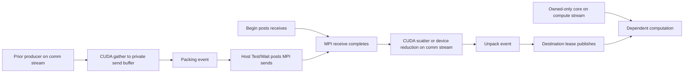

# Explicit device-packed MPI transfers

`TransferTransport::DevicePacked` selects CUDA gather, contiguous device-buffer
MPI, and CUDA scatter/reduction. `Direct` remains the default. This option does
not change the physical layout or row ordering of either Array. It uses the same
RowTransferPlan, PayloadPlan, ElementSchema, binding and operation contracts.

```cpp
auto halo = payload.Bind(owned, ghost, TransferTransport::DevicePacked);
auto transfer = halo.BeginScheduled(comm.Context());
// Owned-only input and a separate output: independent of ghost reception.
SubmitCore(engine, compute, owned, result);
transfer.Wait(); // progresses pack → MPI → unpack on the calling MPI thread
SubmitDependent(engine, compute, owned, ghost, result);
```

For CFV, `resident.BindHalo(field, TransferTransport::DevicePacked)` selects the
same backend. `Begin` uses immediate leases; `BeginScheduled` permits queued
producers on the supplied stream and caller-ordered consumers. Both enqueue
packing and post receives without waiting for packing to finish. All ranks still
participate in access preflight in the same order.



The controller may enqueue core computation immediately after `Begin`. `Test`
advances sends only after the packing event is ready, polls MPI, enqueues
unpacking once, then polls its completion event. It never waits for an unfinished
packing/unpacking event. `Wait` performs the corresponding blocking progression.
`MPIProgress` imports this operation unchanged; its event becomes ready after
actual unpack/reduction and send completion, with errors propagated.

**The caller must progress the operation on an MPI-permitted thread.** Portable
OpenMPI is not a stream-native communication node. Leaving the operation idle
after `Begin` can leave sends unposted; do not wait for dependent workers while
withholding `Test`, `Wait` or `MPIProgress::Poll/Drain`. One main CPU thread is
sufficient for GPU overlap. MPI may internally pack or stage data; this backend
does not promise GPUDirect, background MPI progress or graph capture.

## Storage, schema and lifetime

The binding compiles per-peer row descriptors and described element-field byte
ranges once, uploads that small metadata, and allocates reusable device send and
receive buffers. Capacity scales with selected local logical elements, not the
whole owned Array or global mesh. There is no host payload mirror or `MPI_Pack`
in this backend. Persistent and transient request modes share the same buffers;
one active operation per binding prevents scratch reuse races.

MPI sees a consecutive range of schema extents for each peer, using count plus
the same registered element datatype. Thus arithmetic/POD word types and MPI
conversion remain intact. Gather/scatter copies only described fields; omitted
members, padding and unrequested destination rows remain untouched. Scalar
schema alignment is honored for staging/reduction allocations. The schema is
not replaced with an unrelated byte-record interpretation.

Both endpoints must be on the same CUDA device within each rank, CUDA-aware MPI
must be available, and the element schema must expose described fields. Opaque
MPI descriptors without a portable field description reject explicitly. A peer
currently supports at most `INT_MAX` logical elements; oversized counts and
signed byte-offset overflow reject during binding. Table, ColMajorTable,
TiledColMajorTable, padded and CSR rows are supported, including zero widths and
empty peers. Cross-device/host staging is a separate explicit backend.

Receive collisions still require an explicit reducer. MPI receives separate
contributions in peer order into contiguous device storage, then the registered
device reducer resolves them. Direct overlapping writes are never selected.
The receiver reuses its existing contribution workspace, rather than allocating
a second full reduction payload. Custom reducers retain the usual requirement
to use the supplied stream and read only transmitted fields.

The operation retains the binding, buffers and access reservations even if user
Array/binding handles are reset or destroyed. Source ownership remains until
the sends finish; destination ownership publishes after unpack/reduction.
Conflicting cross-stream uses still require caller-supplied ordering. The eager
runtime does not infer those dependencies. Keep the native communication stream
alive until completion and drain before changing layouts/row identities or
finalizing MPI. See the [caller contract](RuntimeCallerContract.md).

## Validation and assessment

`dnds_test_device_packing` checks persistent/transient permutations across all
uniform formats, CSR/padded/zero rows and empty source ranks, registered
over-aligned PODs with omitted bytes, collision sum/XOR, collective preflight
rollback and retained handles. Its gated communication-stream test requires
`BeginScheduled` to return while packing is pending, completes an independent
owned-only kernel on another stream, and checks destination publication only
after progress/unpack. CTest includes one GPU and two ranks with one GPU each.

The actual VR benchmark accepts optional `direct|packed`. Record communication
and integrated iteration separately from resident numerical kernels. Packing is
explicit rather than an automatic layout-dependent fallback: direct AoS can
already be efficient, while highly fragmented SoA/AoSoA MPI datatypes can be
expensive. Measurements, not the layout name alone, should decide the choice.

The current VR kernels use ordinary FP64 arithmetic. They do not use FP64 tensor
cores; that requires separate small-matrix tiling and numerical validation.
