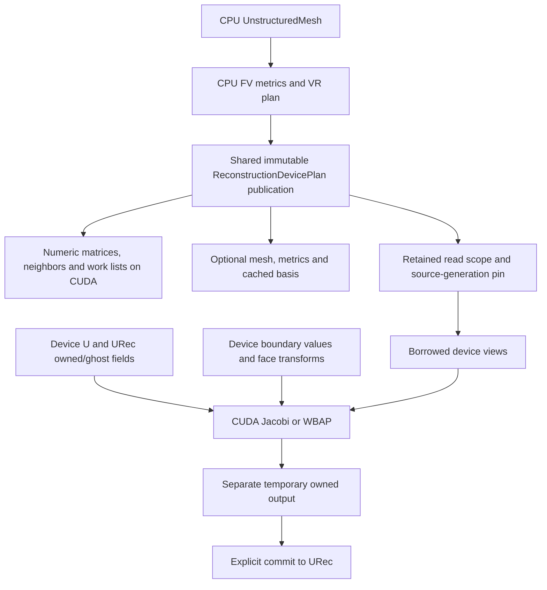

# Resident CUDA reconstruction

`CFV::ReconstructionDevicePlan` is an explicit placement of a CPU-prepared
`VariationalReconstructionPlan`. It provides CUDA Jacobi and order-wise WBAP;
it is not a new numerical owner or a flow solver. CPU preparation, SVD, mesh
mutation, partitioning and spatial search remain on the host.



## Placement and ownership

`Prepare(source, Device::CUDA(i), context, options)` synchronously uploads only
the supported operators' numeric inputs. It validates the selected device and
rejects CPU placement, unavailable CUDA builds and SOR before returning a usable
publication. `options.mesh`, `metrics` and `basis` select additional query data;
basis also needs the metric quadrature offsets. Missing optional capabilities
throw. Mesh data uses the existing `UnstructuredMeshSnapshot`, including its
device-callable view; CFV does not create another topology implementation.

`Buffers()` reports retained numeric capacities, names and placements, including
payload and metadata allocations of the optional mesh snapshot. Shared mesh
allocations are counted once. This is an allocation-capacity manifest, excluding
native allocator bookkeeping/alignment overhead, host authority and separately
created fields/workspaces. `UnstructuredMeshSnapshot::VisitAllocations` supplies
the reusable payload/metadata enumeration also used by mesh-state accounting.

Plan copies share the publication. A read scope pins source geometry generations
and device buffers; its plain view is borrowed and must not outlive that scope.
Queued wrappers retain the scope through actual completion. Preparation's stream
is not retained as an immutable buffer's later access context. Geometry,
topology/distribution or layout changes invalidate the source plan before reuse;
solution changes do not invalidate geometric caches.

## Fields and numerical envelope

`BuildField(prototype)` and `BuildWorkspace(components, prototype, vectorStarts)`
create device fields in Table, ColMajorTable or TiledColMajorTable storage.
The prototype's row count is replaced by actual owned/ghost counts; its logical
width must match the requested field. The internal metric, matrix, boundary,
transform and scratch formats remain unchanged. URec still flattens
`component*NRecDOF()+mode`. There is no implicit layout transpose.

Both operators support prepared 2D/3D degrees1–3, explicit boundary quadrature
values, periodic vector triples and axisymmetric prepared metrics. WBAP accepts
finalized per-face characteristic matrices on a selected component interval and
an optional finite scalar activation array (`indicator >= threshold`). The GPU
does not invoke boundary or characteristic callbacks. Prepare/refresh these
numeric inputs explicitly; CPU and GPU matrices retain the same schema.

WBAP uses six scratch rows per active block, with at most256 blocks, rather than
six matrices per mesh cell. Scratch belongs to the workspace. Concurrent use of
the same workspace on different streams requires an explicit join. No device
allocation occurs in these kernels. This is a correct baseline mapping, not a
claim of optimal occupancy or fastest layout.

SOR/GS, GPU gradients/conversion/sampling/linear actions, tree meshes, CUDA graph
capture and automatic stream-dependency checking are not provided by this API.
CPU-only operators keep their placement checks and reject GPU input. These are
explicit unsupported capabilities, never a hidden CPU fallback.

## Execution and caller responsibilities

The synchronous wrappers construct a CUDA stream, enqueue the operator and
commit, then synchronize and inspect status. Python exposes these wrappers and
the same shared field allocations. Release retained Python write/DLPack aliases
before invoking them; element reads and `numpy()` use Runtime synchronization.

The C++ `...To(engine, stream, ...)` calls enqueue without a host wait per kernel.
They write `workspace.temporary`; call `CommitReconstruction` separately. The
existing eager engine reserves/retains operands, but does **not** prove stream
dependencies. The caller must establish readiness and every conflicting access
edge, including scratch reuse, transform refresh and final destruction. Ordinary
host lease release alone is not proof that another stream can consume data.
Use explicit stream events/joins. See the [Runtime caller contract](RuntimeCallerContract.md).

The safe direct MPI overlap shape is:

```cpp
// All previous producers of coefficients have completed or been joined.
auto transfer = halo.Begin(deviceContext); // owned read, separate ghost write
resident.DoReconstructionIterTo(engine, compute, mean, work.coefficients,
                                work, boundary, ReconstructionRegion::Core);
transfer.Wait(); // CUDA-aware MPI is a host-managed readiness boundary
resident.DoReconstructionIterTo(engine, compute, mean, work.coefficients,
                                work, boundary, ReconstructionRegion::HaloDependent);
resident.CommitReconstruction(engine, compute, work);
engine.Synchronize(); // observation/next MPI producer boundary
resident.CheckStatus(work);
```

Core submissions declare owned-only inputs and pass no ghost pointers to the
kernel. Dependent submissions use the completed owned+ghost pair. The same
pattern applies to WBAP, with coefficient exchange **between every descending
order**. Direct CUDA-aware MPI datatype transfer remains the default, one rank per
device. An explicit [DevicePacked backend](DevicePackedTransfer.md) gathers and
scatters on a communication stream; select it in `BindHalo(field, transport)`. No claim of stream-native or graph-capturable MPI is made.

Invalid indicators set a persistent status word before the pass. That pass and
its commit leave output unchanged, and `CheckStatus` throws after an explicit
completion boundary. Earlier successful queued work is not rolled back. On
recovery, explicitly clear status before a new segment. Launch failures surface
through the engine's completion/drain boundary. Shape, placement, stale-plan and
alias checks stay outside scalar kernel loops even in unchecked builds.

## Validation and measurements

`cfv_test_reconstruction_cuda` compares nonzero CPU/GPU fields across physical
layouts, split core/dependent work, characteristic transforms, rotated periodic
vectors, axisymmetry and degree-three3D with37 components. It also exercises
unsupported SOR, invalid indicators, stale publications and optional query data.
CTest includes one GPU and two ranks with one GPU each. Existing Runtime CUDA
tests cover array indexing, alignment, async release, algebra and interop.

`cfv_benchmark_reconstruction_cuda width degree components repetitions` measures
real wrappers on a connected Cartesian quad mesh. It checks CPU numerical
oracles before timing. Setup/upload are separate from repeated resident Jacobi,
highest-order WBAP, direct communication and integrated split iteration. Jacobi
and WBAP microtimings read a fixed iterate; the integrated timing commits each
iteration. Report these scopes separately. Local CPU timings are not substituted
for matched, allocated-node CPU evidence.

The current CUDA baseline uses up to256 blocks,128 threads per block, and
strides over cells/coefficients. On the sm80 build the compiled Jacobi/WBAP
kernels use117/191 registers per thread, respectively, with zero reported local
memory or stack. This leaves substantial scope for occupancy and view-descriptor
optimization. Kernel resource counts alone do not establish occupancy or speed.
