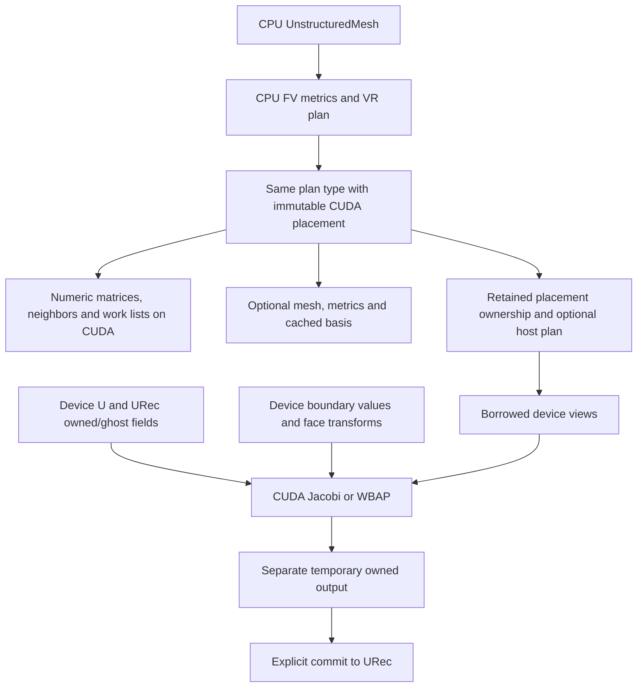

# Backend-resident reconstruction

`CFV::VariationalReconstructionPlan` is the single public reconstruction plan
on host and CUDA. `Place(device, context, options)` attaches an immutable
backend payload and returns the same plan type; `ReconstructionWorkspace` is
likewise the only public workspace type. Cauchy and other callers do not select
between CPU/device plan classes. CPU preparation, SVD, mesh mutation,
partitioning and spatial search remain on the host.



## Placement and ownership

`source.Place(Device::CUDA(i), context, options)` synchronously uploads only
the supported operators' numeric inputs. It validates the selected device and
rejects CPU placement, unavailable CUDA builds and SOR before returning a usable
publication. `options.mesh`, `metrics` and `basis` select additional query data;
basis also needs the metric quadrature offsets. Missing optional capabilities
throw. Mesh data uses the existing `UnstructuredMeshSnapshot`, including its
device-callable view; CFV does not create another topology implementation.

Host-payload retention is explicit. `options.retainHostPayloads=true` is the
default and keeps the CPU plan available for setup queries and diagnostics.
With `false`, the returned placed plan releases the originating reconstruction
and metric arrays after upload. It retains only a stable logical identity,
settings/capabilities and global diagnostics, the distributed row-space,
communication context and halo route, plus the requested device publications.
Build and place mutable boundary values and characteristic transforms while the
host plan is available. A device-only handle can still validate, allocate
coefficients/workspace, bind halos and execute Jacobi/WBAP/commit; host-only
queries such as `Metrics()`, geometry sampling and per-cell inverse diagnostics
fail explicitly. `RetainsHostPayloads()` exposes the resolved choice.

`ResidentBuffers()` reports retained numeric capacities, names and placements, including
payload and metadata allocations of the optional mesh snapshot. Shared mesh
allocations are counted once. This is an allocation-capacity manifest, excluding
native allocator bookkeeping/alignment overhead, host authority and separately
created fields/workspaces. `UnstructuredMeshSnapshot::VisitAllocations` supplies
the reusable payload/metadata enumeration also used by mesh-state accounting.

Plan copies share the publication. Managed operation records retain the logical
plan, placement payload, device buffers and all submitted operands through
actual completion. Kernel views are plain borrows valid only within that
retained operation. Preparation's stream is not retained as an immutable
buffer's later access context. A retained host plan continues to validate its
source geometry generation. A device-only placement is a frozen independent
publication: later host geometry/topology changes do not rewrite it, and callers
must construct a new placement rather than mix it with fields/routes from the
new mesh generation. Solution changes do not invalidate geometric caches.

Device halo-binding validation inherits the source metrics' communication
policy. Payload setup and selected MPI/provider protocols remain explicit.
This only controls host preparation checks; it does not infer CUDA stream
readiness or turn CUDA-aware MPI into a stream-ordered backend.

## Fields and numerical envelope

`BuildWorkspace(components, prototype, vectorStarts)` creates device fields in
Table, ColMajorTable or TiledColMajorTable storage. Other solution fields use
the common metric plan's `BuildField(prototype, device)`; no device-plan-specific
field factory exists.
The prototype's row count is replaced by actual owned/ghost counts; its logical
width must match the requested field. The internal metric, matrix, boundary,
transform and scratch formats remain unchanged. URec still flattens
`component*NRecDOF()+mode`. There is no implicit layout transpose.

Both operators support prepared 2D/3D degrees1–3, explicit boundary quadrature
values, periodic vector triples and axisymmetric prepared metrics. WBAP accepts
finalized per-face characteristic matrices on a selected component interval and
an optional finite scalar activation array (`indicator >= threshold`). The GPU
does not invoke boundary or characteristic callbacks. Prepare/refresh these
numeric inputs explicitly; CPU and GPU matrices retain the same schema.

WBAP uses six scratch rows per active block, with at most256 blocks, rather than
six matrices per mesh cell. Scratch belongs to the workspace. Concurrent use of
the same workspace on different streams requires an explicit join. No device
allocation occurs in these kernels. This is a correct baseline mapping, not a
claim of optimal occupancy or fastest layout.

SOR/GS, GPU gradients/conversion/sampling/linear actions, tree meshes, CUDA graph
capture and automatic stream-dependency checking are not provided by this API.
CPU-only operators keep their placement checks and reject GPU input. These are
explicit unsupported capabilities, never a hidden CPU fallback.

### Explicit FP64 tensor-core Jacobi

The default `ReconstructionDeviceKernel::FP64` remains selectable. Pass
`FP64TensorCore` as the final argument of the synchronous or `...To` Jacobi
wrapper to select the alternative matrix-product implementation. Python exposes
the same enum/default and `SupportsKernel`. Device preparation caches the
capability; unsupported or unknown explicit requests throw before submission.
The initial guard permits datacenter SM80/SM90 with a suitable compiled image;
the validated hardware and shapes are recorded separately.

`DNDS/Algebra/CUDA/FP64Matrix.cuh` provides a small warp-level8x8x4 double-input,
double-accumulator MMA adapter. The CFV kernel stages padded matrix/coefficient
tiles in1KiB per warp, processes four independent cells per block and handles
non-multiple modes/components with zero tails. Mean and boundary terms retain
the FV formula; periodic vector transformations are applied while loading the
neighbor coefficients. Internal Geom/CFV matrix storage and WBAP are unchanged.
This path uses actual FP64 tensor instructions, not TF32/FP32 substitution.
Different summation order is allowed within validated FP64 tolerances; byte
identity is not promised. Padding/staging cost can outweigh MMA gains for small
shapes, so explicit selection does not change the default or promise a speedup.

`FP64TensorCoreShared` assigns one block to a cell and separate warps to
eight-component tiles. It stages the neighbor matrix once for all four warps,
with coalesced component/mode loads into shared storage. Mode counts2/3/5/9/19
and common component counts5/21 have simple static dispatch; other component
counts keep a generic path. The owned/ghost and physical-layout contracts stay
the same. Shared staging does not change the mesh or CFV publication formats.

`FP64TensorCoreAsync` uses the same mapping with two raw shared-memory slots.
It issues eight-byte `cp.async` copies of the next neighbor while processing
the current product. Every consumer waits for its copy group and block barrier;
every slot overwrite follows the previous block-wide reads. No per-call device
allocation, dynamic host pointer or host wait is introduced. Periodic vector
transforms preserve their mathematical input, including triples crossing a tile.
Kernel selection is explicit in C++/Python; keep ordinary FP64 as the default.
The optimization assessment in the independent plan repository records measured
shape/layout winners and losers rather than inferring them from tensor usage.

On the measured local two-A10065536-cell cases, the original tensor mapping
remains best for5 components. Async is the measured choice for21-component
degree-one AoS/column and degree-two column, while ordinary FP64 remains faster
for degree-two21-component AoS/tiled. The degree-one tiled margin is small.
At degree-two21-component column, Jacobi oldtensor/ordinary/async is
3.180/2.391/2.242ms; integrated iteration is3.350/2.610/2.478ms. These are
explicit choices, not a hidden autotuner or universal backend policy.
The final shared/async implementation passes CPU CFV30/30, CUDA4/4 np1/2,
all6 kernel sanitizer checks and rebuilt Python8 tests at np1 and per np2 rank.
Sanitizer API reporting retains the existing external MPI limitation.
Source, binaries and three successive timing controls are recorded in the plan
repository's `experiments/cauchy-preliminary/nccl-fp64/TENSOR_OPTIMIZATION.md`.

## Execution and caller responsibilities

The synchronous wrappers construct a CUDA stream, enqueue the operator and
commit, then synchronize and inspect status. Python exposes these wrappers and
the same shared field allocations. Release retained Python write/DLPack aliases
before invoking them; element reads and `numpy()` use Runtime synchronization.

The C++ `Submit...(engine, stream, ...)` calls enqueue without a host wait per
kernel. They write `workspace.temporary`; call
`SubmitCommitReconstruction` separately. The
existing eager engine reserves/retains operands, but does **not** prove stream
dependencies. The caller must establish readiness and every conflicting access
edge, including scratch reuse, transform refresh and final destruction. Ordinary
host lease release alone is not proof that another stream can consume data.
Use explicit stream events/joins. See the [Runtime caller contract](RuntimeCallerContract.md).

The safe direct MPI overlap shape is:

```cpp
// All previous producers of coefficients have completed or been joined.
auto transfer = halo.Begin(deviceContext); // owned read, separate ghost write
resident.SubmitReconstructionIterTo(engine, compute, mean, coefficients,
                                    work, boundary, ReconstructionRegion::Core);
transfer.Wait(); // CUDA-aware MPI is a host-managed readiness boundary
resident.SubmitReconstructionIterTo(engine, compute, mean, coefficients,
                                    work, boundary, ReconstructionRegion::HaloDependent);
resident.SubmitCommitReconstruction(engine, compute, coefficients, work);
engine.Synchronize(); // observation/next MPI producer boundary
resident.CheckStatus(work);
```

Core submissions declare owned-only inputs and pass no ghost pointers to the
kernel. Dependent submissions use the completed owned+ghost pair. The same
pattern applies to WBAP, with coefficient exchange **between every descending
order**. Direct CUDA-aware MPI datatype transfer remains the default, one rank per
device. An explicit [DevicePacked backend](DevicePackedTransfer.md) gathers and
scatters on a communication stream; select it in `BindHalo(field, transport)`. No claim of stream-native or graph-capturable MPI is made.

`BindHalo(field, transport, options)` also accepts the explicit
[NCCL provider](NCCLTransfer.md). Its `Enqueue(engine, comm)` uses stream events to
connect producer, transfer/unpack and dependent kernels, without an intermediate
host completion wait. The same caller ownership/order rules apply to both
Jacobi choices and WBAP. Graph capture remains deferred.

Invalid indicators set a persistent status word before the pass. That pass and
its commit leave output unchanged, and `CheckStatus` throws after an explicit
completion boundary. Earlier successful queued work is not rolled back. On
recovery, explicitly clear status before a new segment. Launch failures surface
through the engine's completion/drain boundary. Shape, placement, stale-plan and
alias checks stay outside scalar kernel loops even in unchecked builds.

## Validation and measurements

`cfv_test_reconstruction_cuda` compares nonzero CPU/GPU fields across physical
layouts, split core/dependent work, characteristic transforms, rotated periodic
vectors, axisymmetry and degree-three3D with37 components. It also destroys the
host plan behind a device-only publication and then exercises metadata,
device-packed halo, Jacobi, a nonempty characteristic WBAP transform and commit.
The suite further exercises
unsupported SOR, invalid indicators, stale publications and optional query data.
CTest includes one GPU and two ranks with one GPU each. Existing Runtime CUDA
tests cover array indexing, alignment, async release, algebra and interop.

`cfv_benchmark_reconstruction_cuda width degree components repetitions
[direct|packed|nccl] [fp64|tensor]` measures
real wrappers on a connected Cartesian quad mesh. It checks CPU numerical
oracles before timing. Setup/upload are separate from repeated resident Jacobi,
highest-order WBAP, direct communication and integrated split iteration. Jacobi
and WBAP microtimings read a fixed iterate; the integrated timing commits each
iteration. Report these scopes separately. Local CPU timings are not substituted
for matched, allocated-node CPU evidence.

The NCCL integrated timing queues ordered iterations before its final engine
observation; portable MPI retains host progress/observation between iterations.
Report that scheduling difference with communication and operator microtimings.
Only compare actual completed numerical/timing rows. Graph capture is not used.

The current CUDA baseline uses up to256 blocks,128 threads per block, and
strides over cells/coefficients. On the sm80 build the compiled Jacobi/WBAP
kernels use117/191 registers per thread, respectively, with zero reported local
memory or stack. This leaves substantial scope for occupancy and view-descriptor
optimization. Kernel resource counts alone do not establish occupancy or speed.
