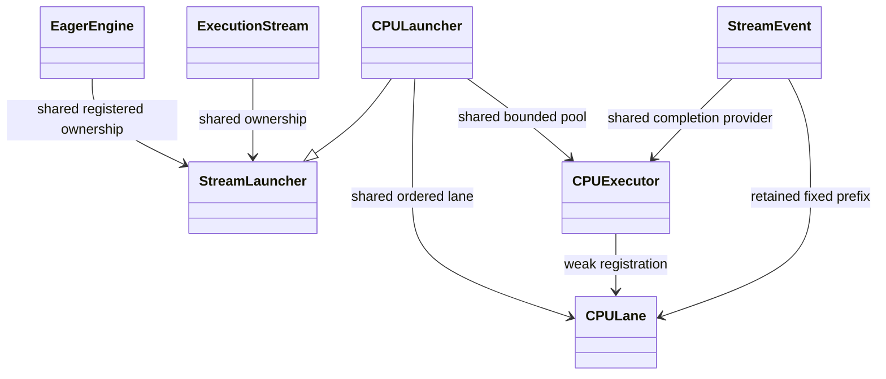
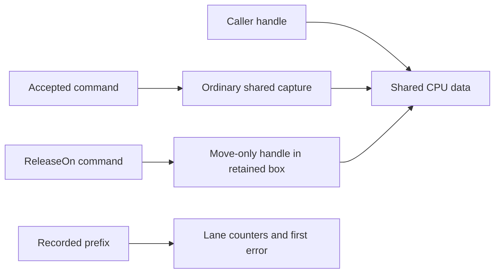
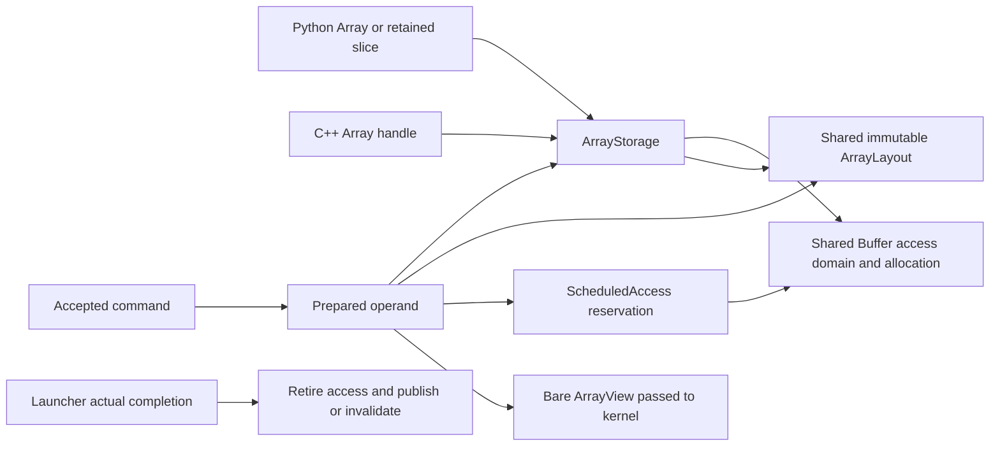

# Eager execution and Array submissions

`DNDS/Runtime/EagerEngine.hpp` provides the common launcher/queue layer.
It includes inline/worker CPU and native CUDA launchers, Array submission
reservations, ordered device allocation/free and Python orchestration. Portable
MPI integration uses the separate [main-thread progress bridge](ArrayTransientMPI.md).
The low-level
Work callback alone does not acquire Array leases or track captured accesses;
use declared operands or a provider integration with the same contract.

## Actual interface

```cpp
namespace R = DNDS::Runtime;
R::EagerEngine engine(2); // Shared CPU worker pool; 0 executes ready work inline.
auto compute = engine.CreateCPUStream();
auto comm = engine.CreateCPUStream();

engine.Submit(compute, [state](R::ExecutionContext) { Update(*state); });
comm.WaitFor(compute.Record());
engine.Submit(comm, [state](R::ExecutionContext) { Consume(*state); });
engine.ReleaseOn(std::move(state), comm);
engine.Synchronize();
```

`Submit` returns void. Ordinary commands have no public completion token.
`Record` captures a fixed submitted prefix; later submissions cannot change
what an existing event means. `WaitFor` enqueues an explicit dependency.
`WaitHost` on an event observes that prefix; `Synchronize` drains every
registered stream and then reports the first error. Dynamic loops and early
exit use ordinary C++; they do not require a prepared schedule.

The backend boundary is `StreamLauncher`, with `Context`, `Submit`, `WaitFor`,
`Record` and `Drain`. The engine uses this interface for every backend.
The optional internal retirement callback receives the execution error (or
null on success), once, after actual completion and before publishing the
prefix as complete. It is not a per-kernel token or native event and must not
throw. Backend submission rejection must occur before accepting the command; errors
from accepted work belong to its completion/drain path. The launcher must
drain required resource uses before reporting a completion error. Imported
event providers must support thread-safe nonblocking readiness checks.

CPU lanes share one bounded pool; a lane is not an OS thread. Same-lane
commands complete in order. A wait that is not ready returns its lane to the
queue and does not block a worker. Operators run outside executor locks.
With zero workers, submitting or observing ready work performs it inline;
polling an imported prefix can progress its inline executor. This compute
launcher does not promise thread affinity for external APIs such as MPI.
Those APIs need a launcher honoring their thread/progress requirements.

Concurrent submitters linearize queue insertion. Ordering between racing
host submissions is otherwise unspecified. Kernel access ordering is the
caller's responsibility in the fully eager mode; the queue adds no dependency
proof or inferred cross-stream joins.

## Ownership and errors





CPU captures remain owned through actual execution and are destroyed before
that command advances its completion counter. `ReleaseOn(std::move(handle),s)`
consumes one handle; other aliases remain owners. Its cleanup command drops
that handle at the chosen stream position. Enqueue rejection restores the
caller's handle. There is no force-free operation or refcount-based guess
that all asynchronous uses have finished.

Failed computation suppresses later computation on that lane. Explicit waits
still apply, even after failure, so cleanup cannot bypass a join with work
on another stream. Cleanup commands execute and all registered streams drain.
An event preceding the failure remains successful. Destruction drains and
does not throw; call Synchronize explicitly to observe errors.

## Array operators and explicit copies

```cpp
#include "DNDS/Runtime/EagerArray.hpp"
#include "DNDS/Runtime/EagerCopy.hpp"

R::SubmitArrays(engine, compute,
    [](R::ExecutionContext context, R::ArrayView<const double> u,
       R::ArrayView<double> rhs) { Evaluate(context, u, rhs); },
    R::Read(u), R::Write(rhs));

auto sourceBytes = rhs.Storage();
auto destinationBytes = result.Storage();
R::CopyAsync(engine, compute, sourceBytes, destinationBytes);
compute.Record().WaitHost();
```

Read/Write/ReadWrite operands retain the shared ArrayStorage and published
metadata. SubmitArrays reserves every declared value access before queue
acceptance, validates placement/type, and supplies borrowed bare views to the
operator. There are no ownership operations or row masks in the hot loop.
Write and ReadWrite both reserve a writer; Write does not prove that a kernel
initializes every entry and does not silently zero its output.

Scheduled accesses are ordering promises. Two pending commands on the same
Array are allowed; the caller orders them through streams/events. The runtime
does not infer dependencies or prove a missing edge in unchecked eager mode.
Immediate reads reject pending writers, and immediate writes reject any
pending access. Observing the relevant prefix retires completed reservations;
no stale CPU/Python view is silently exposed. Immediate read leases and
scheduled readers can coexist. Shape editing remains blocked by retained
storage/metadata pins.

Successful retirement advances the completed value generation for each
declared write. A rejected submission cancels reservations without changing
values or generations. A partial/failed write, or an accepted write skipped
because of a failed predecessor, makes the allocation invalid. Its completed
generation does not advance. Reset/replacement is the recovery operation.

CopyAsync retains both byte ranges, including host buffers used by DMA, and
checks distinct allocation identity, equal size and device compatibility.
It uses the launcher's completion boundary rather than recording an event for
each copy. CPU copies execute in the inline/worker lane. No arbitrary Python
callbacks run on CPU workers.



Resetting a public handle while work is pending creates a new storage;
queued work and older views still address the original one. There is no
second per-allocation kernel-use registry. The existing access domain tracks
immediate and pending readers/writers.

## CUDA launcher

`CUDALauncher` owns a non-default native stream and implements the same
StreamLauncher contract. Native issue is serialized across host submitters;
launch functions run without a queue mutex held. Recursive submission on the
same lane is rejected. Create it with
`engine.CreateStream(std::make_shared<R::CUDALauncher>(ordinal))`.

Submit runs the host launch function and retains its captures and retirement
callback. Record closes that batch with one native event. A fixed prefix
retains prior dependencies, and observing it retires all covered batches.
Completed batches are removed during later submissions/records and Drain.
There is no native event or stream synchronization per ordinary kernel or
copy. NativeEventsRecorded provides a diagnostic counter for this invariant.
Long straight-line sequences retain their pending descriptors until an
explicit observation boundary; iteration-level Record/Drain bounds retention.

CUDA-to-CUDA waits use cudaStreamWaitEvent for a recorded same-device prefix.
CPU launchers can wait on CUDA prefixes through the common event interface.
A CUDA wait on an unfinished non-CUDA provider currently fails explicitly;
the caller must observe that provider on the host before native submission.
Cross-device dependencies and graph capture are not implemented.

Prepare kernels before concurrency tests or capture. CUDA's first-use module
loading can synchronize the context; this test suite calls cudaFuncGetAttributes
before deliberately holding a native stream behind a host gate. The first
unprepared test hung in cuLaunchKernel, while eager module loading and explicit
preloading both resolved it. This follows
[NVIDIA's lazy-loading guidance](https://docs.nvidia.com/cuda/archive/13.2.1/cuda-programming-guide/04-special-topics/lazy-loading.html).

ReleaseOn passes the selected stream to resources supporting ordered release.
Native CUDA resources submit cudaFreeAsync; the final shared decrement may
occur on a different stream from allocation. CPU resources retire after actual
execution. Foreign resources without this capability remain retained through
completion. See [allocation ownership and release](ArrayAllocationLifetime.md)
for the public provider interface, alias rules and conservative RAII fallback.

## Validation and remaining integration

The initial `dnds_runtime_engine` validation snapshot has thirteen behavioral
cases covering inline/worker parity, dynamic early exit, fixed-prefix events,
waiting-lane progress, imported CPU prefixes, temporary ownership and alias
release, cleanup after errors, concurrent host submitters, enqueue rejection,
submission-time reservations and byte copies. The CPU run passed 4316 assertions.

Production-shaped cases include 257 six-equation rows with stride eight,
owned-only random CSR stencil reads while 19 ghost rows have pending writes,
ring work after a join, 97 padded rows copied into CSR, and delayed operand
ownership across handle reset. The five CUDA engine tests passed 2352 assertions
on an A100, including a three-stream fork/join, pinned DMA owners, delayed
completion/publication, fixed prefixes, failure cleanup, concurrent host
submissions, discarded completed history and a prefix surviving the engine.
Compute Sanitizer memcheck reported zero errors for those five tests.
These tests establish functional ordering/lifetime behavior, not an overlap
speedup, multi-GPU capability or native async allocator behavior.

The subsequent memory slice adds provider-aware release and cudaMallocAsync,
with seven CUDA cases passing 3890 assertions and zero memcheck errors; see
[its separate snapshot](../dev/array_async_memory_validation_2026-10-21/).
The [final phase report](../dev/array_runtime_phase_2026-10-21.md) records the
complete native/Python matrices and the MPI sanitizer dependency control.
Optional schedule validation, prepared regions and graph capture are not
implemented by this foundation.

## Python orchestration

Runtime.EagerEngine exposes cpu_stream, cuda_stream, allocate, allocate_like,
copy, release_on and synchronize. ExecutionStream exposes record and wait_for;
StreamEvent exposes ready and wait. Native operators accept the same engine
and stream from C++ bindings. Python callbacks are not placed on worker threads
or inside native CUDA kernels.

```python
engine = R.EagerEngine(host_threads=2)
stream = engine.cuda_stream(0)  # Or cpu_stream().
temporary = engine.allocate_like(stream, prepared)
engine.copy(stream, prepared, temporary)
view = temporary[::3, ::-2]    # Retains storage and metadata, no permanent lease.
stream.record().wait()        # Required before immediate Python observation.
print(view.numpy())
engine.release_on(temporary, stream)
assert temporary.shape == (0, 0)
engine.synchronize()
print(view.numpy())           # View still owns the original allocation.
```

release_on consumes one Python facade's storage and resets that facade to an
empty Array of the same element type/device. Other aliases, slices and POD
references keep the old ArrayStorage. A rejected submission restores the facade.
Queued ownership contains native storage only, so worker retirement does not
require Python's GIL. Metadata buffers follow the same ownership graph.

New variable GPU metadata is prepared during setup; allocate_like shares it.
allocate can create new CPU layouts or GPU tables. Host/Python access rejects
pending scheduled writes instead of silently reading stale values. Once an
explicit completion has been observed, ordinary CUDA element debugging access
uses the existing synchronized host-device copy path.
