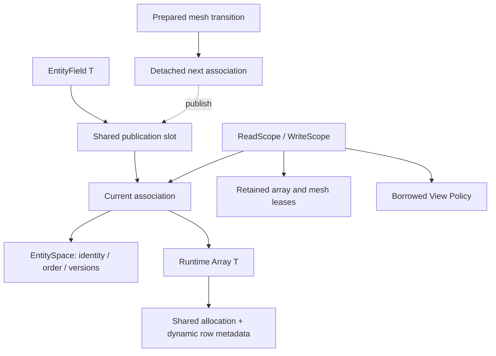

# Entity-associated fields and destination layouts

`Geom::EntityField<T>` associates a generic Runtime Array with an immutable
EntitySpace. It adds checked mesh/domain/kind/order identity and coordinated
migration publication. It does not own a solver's history, equation or schedule.
DNDS numerical algebra and Runtime remain folders in the same DNDS library.



Read/write scopes retain the association they validated. Publishing a replacement
does not invalidate their allocations; new field access uses the new association.
Old halo bindings reject use after field publication. Callers must complete all
asynchronous uses before dropping their scopes; raw kernel views do not own data.

## Select access separately from storage

```cpp
namespace R = DNDS::Runtime;
DNDS::Geom::EntityField<double> field(cells, R::Array<double>(R::RowLayout::Dense(n, 5, 8)));
{
    auto write = field.Write(cells);
    auto view = write.View<R::FixedRows<5, 8>>();
    // Validation/lease acquisition is complete before the numerical loop.
    for (DNDS::index iCell = 0; iCell < view.RowCount(); ++iCell)
        view(iCell, 0) = 1.;
}
```

`View()` is fully dynamic. `View<TableRows>()`, `View<PaddedRows>()`,
`View<CSRRows>()`, `View<FixedRows<N,S>>()` and `View<StaticMaxRows<C>>()`
use the same projection rules as Runtime Array. `View<Policy,true>()` enables
index assertions. Views are directly usable in CUDA code when acquired with a
CUDA context and kept under the scope's completion contract.

Generic ownership does not imply CSR storage or generic indexing in kernels.
Likewise, generic adjacency storage does not remove semantic slot requirements:
a physical FaceCells relation still needs its defined two parent slots, whatever
compatible row layout stores them. Those are adjacency invariants, not Array
template parameters.
Use a table destination for hot fixed-width fields. Projecting a variable layout
to a table may require a uniformity scan at view construction; a real table
avoids that scan. No per-element association/lease check is introduced.

The old `EntityField<T,L>` and `RegisterArray<T,L>` policy parameters are removed.
Migrate L to `scope.View<L>()`; declare a destination layout explicitly if a
physical stride/capacity is required after migration. Existing legacy solver
field types and their APIs are unaffected by this new-field API correction.

## Migration and halo destination layout

The immutable row-transfer plan describes correspondence and received logical
row lengths. `Runtime::TransferLayout` chooses storage independently:

| Choice | Destination |
| --- | --- |
| Default / Compact() | Compact CSR, including uniform or empty results |
| PreserveStorage() | Local source family; table width/stride or padded capacity retained; CSR compacted |
| Table(width,stride) | Dense rows with that logical width and physical stride; every received row must match |
| Padded(capacity) | Variable logical lengths with explicit capacity; every row must fit |

`field.Register(name, layout)` supplies the choice to a detached mesh transition.
`route.Bind(field, space, layout)` supplies the halo destination choice. Generic
`RegisterArray` accepts the same policy as its last argument. No accessor policy
is used to invent a destination width. Physical padding is not transferred.

Destination capacities/strides may differ by rank: they are local storage
choices, not a change in row correspondence or logical values. An incoming row
that cannot fit rejects preparation collectively before payload binding; the
source handle and values remain unchanged. Empty ranks still participate.
Preserving a source table is unsuitable if incoming rows have different widths;
use compact CSR or an adequate padded capacity instead.

`TransferLayout::Apply` is local metadata work. Low-level distributed users must
wrap failures in collective agreement before the next MPI stage. Geom's field
and halo adapters do this with `DNDS::MPI::LocalStage`. This utility preserves
the originating local exception and reports a peer failure on other ranks;
it is not general distributed rollback or recovery from MPI process loss.

## Retained caller contracts

Construction is local setup. Callers constructing conditionally valid fields
before collective work must agree failures, for example with MPI::LocalStage.
Validation checks EntitySpace/map identities, dependency stamps, allocation
identity and shape version; matching row counts alone cannot establish association.

`Read(space, context)` and `Write(space, context)` retain the mesh read lease
through Array access completion. Managed mesh mutation is blocked during that
access. `Complete(event)` seals the scope's view getter; previously acquired
pointers still require the declared-prefix lifetime contract. Default overloads
reuse the construction context, whose borrowed stream must outlive later default
accesses, halo operations and registration. Explicit contexts do not transfer
stream ownership. Custom POD values require an explicit ElementSchema describing
their extent/layout/type; arbitrary semantic compatibility cannot be inferred.

BuildHaloRoute, route.Bind and binding.Begin are collective, including empty
ranks. They check association before communication. Operations retain their mesh
lease until completion. GhostValues returns a sharing Array handle; refresh ghosts
after owned-field changes and finish ghost readers before the next transfer.

Register constructs a local descriptor and defers semantic checks to collectively
guarded detached preparation. Consuming reorder rejects entity-bound fields.
Preparation retains source reads, migrates by exact correspondence, binds fields
to final candidate EntitySpaces, and rebinds inactive registered families too.
Publication swaps states and the mesh handle without allocation under caller
serialization. Retained old scopes keep the unchanged old snapshot. A later
independent mesh publication invalidates associations; it cannot silently rebind
old field descriptors.

UntypedValues deliberately returns a sharing generic Array. Direct writes/raw
pointers and independent lower-level routes bypass the association boundary.
RegisterArray and RegisterField likewise require callers to establish the source
mesh/order correspondence. No Python EntityField binding is introduced in this
phase: Python Runtime Arrays and existing field bridges retain that explicit
untyped contract. Legacy read-only device mesh views are unchanged.

## Algebra and future spatial facilities

`DNDS::Algebra::DofField<T,N>` has a numerical component-count contract. Its N
does not fix Array storage. `Validate()` checks N in the operation prologue,
before SubmitArrays, never inside CPU loops or CUDA kernels. The added check is
constant work per operation (and folds away for the dynamic component case).

Geom will supply spatial matching/search/correspondence and route preparation.
CFV will supply reconstruction/sampling; solver orchestration will own domains
and stages. An EntitySpace-to-DofSpace association bridge belongs at their
boundary, without moving numerical algebra out of DNDS or comparing identity
using row counts alone.
