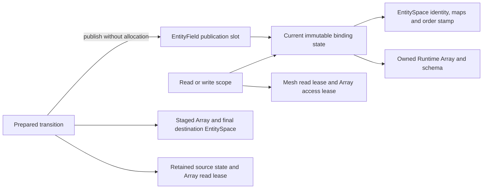

# Entity-bound native fields

`Geom::EntityField<T, Layout>` adds a checked mesh, entity kind and row-order
association to an owned `Runtime::Array`. Matching row counts alone never prove
that association: validation checks EntitySpace and canonical map identities,
dependency stamps, allocation identity and layout version. Construction is local
setup; callers constructing conditionally valid objects before collective work
must agree failures, for example with `FieldTransferDetail::LocalStage`.

`Read(space, context)` and `Write(space, context)` retain the binding state and
mesh read lease through their Array access lease's completion. Managed mesh
mutation is blocked during field access. `Complete(event)` seals the scope's
view getter; previously acquired pointers retain Runtime's declared-prefix
contract. CUDA work uses its actual execution context and completion event.
Default overloads reuse the construction context: its stream is borrowed and
must outlive every later default access, halo operation and registration using
that context. Explicit contexts do not transfer stream ownership. Custom
trivially copyable values require an explicit MPI `ElementSchema` describing
object extent and layout. A supplied type tag checks the C++ value type;
compatibility cannot inspect arbitrary POD semantics.

`BuildHaloRoute(space)`, `route.Bind(field, space)` and `binding.Begin(context)`
are collective boundaries, including empty ranks. Each checks the association
before the next communication phase. A binding remembers the field publication
it was built against: beginning it after field publication fails collectively,
even while the old allocation remains alive. Operations retain their mesh lease
until transfer completion. `GhostValues()` returns a sharing Array handle;
ghosts must be refreshed after owned-field edits. Complete ghost readers before
starting another transfer into that allocation.

`field.Register(name)` builds a local descriptor; semantic validation occurs in
collectively guarded detached preparation. Consuming reorder rejects typed
fields. Detached preparation stages values with the existing exact
correspondence, rebuilds the candidate mesh, publishes its native representation
when preserving a native source, and then binds staged fields to its final
EntitySpaces. Inactive registered families receive the new association too.
Publication swaps field states and the mesh handle without allocation under
caller serialization. Retained old mesh/field scopes keep the unchanged old
snapshot. Repeating `PublishNative` explicitly starts another mesh publication
epoch and invalidates typed bindings; it does not implicitly rebind them.

`UntypedValues(space)` deliberately returns a sharing generic Array. Direct
Array writes, raw pointers and independent lower-level routes bypass the typed
association boundary and remain the caller's responsibility. Generic
`RegisterArray` and `RegisterField` likewise require the caller to establish
source mesh/order correspondence. No Python EntityField binding is introduced:
Python Runtime Arrays and existing field bridges retain that explicit untyped
contract. Legacy read-only device mesh views are unchanged.
