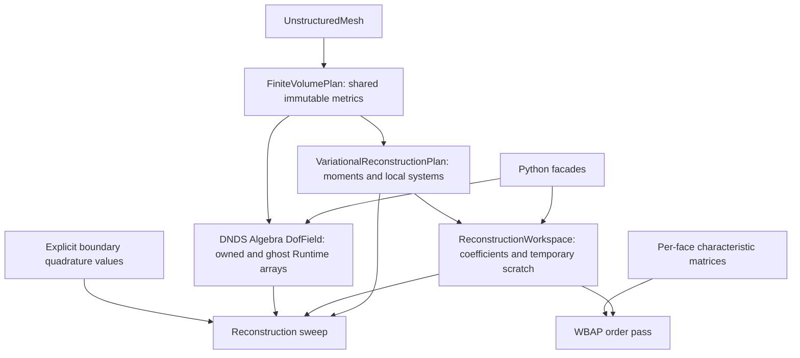
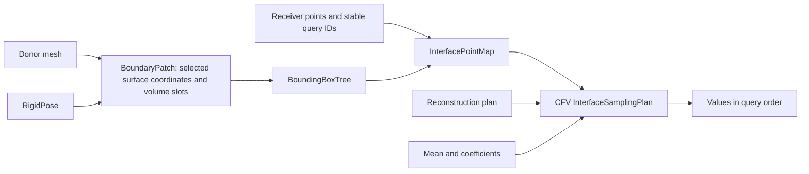

# CPU finite-volume reconstruction and boundary point interfaces

The new `CFV::FiniteVolumePlan` and `CFV::VariationalReconstructionPlan` compose
native Runtime storage, Geom entity identity, prepared metric/matrix buffers,
and explicit numerical operators. They do not wrap the legacy VR owner. The
existing `FiniteVolume` and `VariationalReconstruction<dim>` remain available.
This page describes the implemented CPU envelope, not a complete new flow solver.
The [2026-10-31 next-step decisions](../dev/facilities_next_steps_2026-10-31.md)
record planned extensions; those features are not implied by this implemented API.

## Ownership and responsibilities



Copies of plans retain immutable publications and mesh identity. Copies of
fields/Runtime handles share storage. Python `FVField` is an alias for the
existing DNDS `Runtime.Algebra.DoubleDofField`, not a second algebra implementation.
Its `owned`/`ghost` properties and boundary/transform arrays share the C++
allocations. Retained arrays remain alive after deleting their Python parent.
Array `numpy()` is a snapshot; `assign`, indexing and `read`/`write` obey the
existing Runtime lease contract. Release live views before invoking operators.

Geom owns connectivity, entity identity and halo row mappings; DNDS owns storage,
access and transfer execution; CFV owns reconstruction mathematics; the solver
owns field histories, equations, stage scheduling, stopping and domain coupling.
No solver or CFV dependency is introduced into Geom.

## Supported mathematics

* Cell-centered planar 2D and volumetric 3D unstructured cells, scalar or multiple
  components, polynomial degree 1–3 (formal second through fourth order).
* Legacy monomial ordering, scalar aligned-box scaling, zero-cell-mean basis,
  isotropic variational functional; independent factorial/HQM_OPT/TEST_OPT/manual
  directional weights, none/HQM_SD/SD_Power geometric weights and length controls.
* Explicit relaxed Jacobi and ordered SOR sweeps; order-wise 3WBAP limiting;
  arbitrary physical-point polynomial evaluation.
* Rigid periodic frames, including derivative-tensor and declared vector-block
  rotations; retained original face/cell incidence order.
* Radius-weighted axisymmetric metrics, moments, reconstruction and gradients
  on 2D geometry, with radius=y and no 2*pi factor.

The basis is `phi_j(x)=monomial_j((x-center)/scale)-cell_mean(monomial_j)`.
Stored coefficients have row width `NRecDOF()*components` in **column-major
mode-by-component order**: `row[component*NRecDOF()+mode]`. Cell means are never
modified by reconstruction or limiting. The functional includes derivative
tensor multiplicities and the selected per-order weights. Preparation uses SVD
on every local system and discards modes at or below
`max(svdAbsoluteTolerance, svdTolerance*sigma_max)`. Relative tolerance defaults
to `1e-13`, absolute tolerance to zero. Deficient systems have a minimum-norm
truncated solution; no automatic polynomial-degree reduction is performed.
`GetInverseDiagnostics()` reports global owned-cell filtered/rank-zero counts,
discarded modes, effective-rank histogram and maximum raw condition with its
persistent cell ID (ties choose the smallest ID). `GetCellInverseDiagnostics(iCell)`
reports local effective rank and raw/retained spectral conditions from setup,
without repeating the factorization. Exact zero matrices report rank zero and
infinite conditions. These methods and tolerance controls are exposed in Python.

Anisotropic functionals/bases, LVR penalties, variable per-cell degree and
alternative legacy limiter variants remain deferred. Standalone FV gradients,
explicit conversion, caches and linear operators are described below; they do
not import every legacy `subs2ndOrder` convention automatically. There is no
automatic legacy-config translation or new flow solver in this facility.

### Boundary quadrature protocol

`BuildBoundaryValues(components)` allocates `[NumBoundaryQuadrature(),components]`.
`GetBoundaryQuadrature(i)` gives the owning cell, face, face quadrature index,
physical point and normal. Fill the values before a sweep, refreshing them when
the BC depends on the current nonlinear/reconstruction stage. The numerical
operator reads these arrays and invokes no boundary callback.

The default `boundaryDerivativeWeights={1,1,1,1}` matches legacy's all-order
penalty. Nonzero higher derivative weights impose **homogeneous derivative
targets**; only order zero has nonhomogeneous target values in this API.
`boundaryZoneWeights[zone]` replaces the unsquared per-order multipliers for
one BC zone. `bcWeight` multiplies them before squaring in the functional.
Choose `{1,0,0,0}` when a manufactured polynomial supplies physical values
without homogeneous derivative targets. Tests and benchmarks state that choice
explicitly; the all-order/zone-weight tests compare with the matched legacy
callback. Separate nonhomogeneous-derivative quadrature controls remain deferred.

### Characteristic WBAP protocol

`BuildFaceTransform(first,count)` creates identity forward/inverse matrices for
each local face. Rows contain column-major `count*count` matrices acting on
column vectors in `[first,first+count)`. For a six-component Euler-SA field,
`first=0,count=5` transforms the gas block; SA is limited componentwise.

The equation adapter fills the pair from **cell averages** and calls
`FinalizeFaceTransform`. This checks finite mutual inverses once outside hot
loops. The limiter checks storage identity and version in its prologue. Writing
either matrix, even with identical numbers, requires re-finalization. The
adapter is responsible for refreshing the matrices when its cell-mean state
changes: the limiter does not infer thermodynamics or state freshness.

Legacy `DoLimiterWBAP_3` and `_C` also pass cell averages to their characteristic
callbacks. Euler computes the eigenvectors from the arithmetic mean of those
states, with face-frame momentum rotation and an identity extension for passive
components. Reconstructed states enter the separate smoothness indicator, not
that characteristic mean. The new operator limits all selected cell modes; it
accepts a supplied scalar activation indicator through the out-of-place pass;
constructing a physical smoothness indicator remains the equation adapter's job.

Call the WBAP API in **descending degree**, exchanging the coefficient halo
after **each** order. This is required by the legacy order-wise secondary-map
algorithm; one exchange after all orders changes its distributed result.

## Basis, functional, frame and cache contracts

`Math::TaylorBasis` defines mode/derivative ordering, derivative degree and
rigid-frame pullback in one place. Setup, limiting and sampling use that
definition. With scalar length scaling, the functional contracts each symmetric
derivative tensor with multiplicity `order!/alpha!`. This is its Frobenius norm;
`functional.dirWeightCombPowV=1` is rotationally invariant. Compatibility powers
0/2 are available but are rejected for rotated periodic reconstruction.
Anisotropic tensor metrics remain a separate future policy, not another switch
inside the isotropic basis.

`functional` configures the four directional schemes, three geometric schemes,
their coefficients, scale multiplier and length policy. `HQMWeights` remains a
compatibility shorthand for HQM_OPT + HQM_SD with bias one. `BaryDiff` uses the
mapped barycenter separation (reflected normal separation on an external face).
`MeanAACBB` uses the RMS of the arithmetic mean aligned half-box vectors.
`CellMax` uses the symmetric maximum aligned half-box length; it deliberately
does not import the old inertia-oriented/asymmetric parent-slot formula.
TEST_OPT reuses the geometry-only face-span helper. No anisotropic basis or LVR
penalty is implied by these options.

`cacheDiffBase` retains values and all derivatives on the face quadrature
points used by owned stencils. `GetCachedFaceBasis` provides a diagnostic copy;
unprepared exterior or ghost-only face stencils fail explicitly. The cache is
in Runtime buffers, with basis/config/metric identity retained by the immutable
plan. `AcquireBasisRead().HostView()` exposes borrowed pointer/shape views for
hot loops; retain the scope and use only real parents in owned-cell stencils.
`PolynomialSamplingPlan(plan,cells,points)` snapshots arbitrary query
cell IDs and caches the basis/derivatives there. Both interface samplers use
this cache. Query-array edits do not silently change its meaning; construct a
new cache for new locations. Geometry/order mutations invalidate it through
the metric stamp. `Evaluate(...,derivative)` samples the central derivative-mode
ordinal (0=value, 1..dimension=gradient, higher modes include Hessians). Its
input ghost reads are omitted when all selected cells are owned.

Rigid periodicity transforms both sample locations and derivative tensors during
setup. `BuildWorkspace(components,periodicVectorStarts)` declares sorted disjoint
three-component polar-vector blocks, e.g. `{1}` for `[rho,rhou,rhov,rhow,E]`.
Unlisted components are scalars. Neighbor components are rotated into the output
cell's frame before reconstruction/WBAP; characteristic transformation is a
separate subsequent operation. Three-component vectors work on 2D geometry.
Sampling returns donor-reference components; it does not apply a domain pose or
moving-frame velocity correction. Taylor neighbor coefficient changes are
analytic changes of center/scale/frame, with no SVD truncation in that coordinate
map. Every numerical local reconstruction inverse still uses full SVD.

`ConstructMetrics(mesh,intOrder,true)` selects axisymmetric integration with
`r=y>=0`, `r*dA` volume and `r*ds` face measure, excluding `2*pi`. Moments and
cell averages use the same convention. The integrated unweighted radial moment
supplies the weighted Green-Gauss correction, including cells touching the axis.
No pointwise `1/r` is needed. Negative radii, zero radial cell volume, 3D geometry
or periodic transforms that change radius are errors. Equation source terms and
cylindrical component connections belong to the equation adapter.

## Reconstruction linear-system operators

`ApplyLinearOperator`, `BuildRightHandSide`, `ComputeResidual` and
`ApplyLocalPreconditioner` expose the unscaled system separately from relaxation.
They do not perform halo communication or own a Krylov solver. Refresh input
halos before the stencil operator and supply distinct output arrays. Homogeneous
perturbations use the operator without boundary forcing. Raw A/B/forcing blocks
are retained separately from `Aplus*B`, so choosing a strong SVD cutoff does not
silently replace the original operator with its projected version. The local
preconditioner is the truncated SVD inverse and may be semidefinite when modes
were removed. Its null modes are not restored by iteration.

These interfaces can feed existing GMRES/FGMRES drivers with DNDS field algebra.
Flexible PCG additionally requires a symmetric positive system/subspace and an
admissible positive preconditioner. The default isotropic raw operator passes
bilinear symmetry and positive-form tests, but that is not a universal SPD
certificate for arbitrary weights, boundary penalties, cutoffs or null spaces.
The caller must freeze the plan/linearization and handle compatible nullspace
projection. Ordered SOR and left preconditioning must not be advertised as
symmetric merely because the unscaled functional is symmetric.

## Count, allocate, fill and execute

### Split reconstruction/limiting and scalar activation

`DoReconstructionIterTo(mean,input,workspace,boundary,region)` writes selected
rows of `workspace.temporary`. Jacobi leaves input unchanged. Use `Core` while
input ghosts are being written, then `HaloDependent` after completion, and call
`CommitReconstruction` after both phases. The core entry acquires no input ghost
leases; its work set uses conservative cell–node–cell adjacency. Commit is an
explicit copy into owned coefficients and must wait for old sends to finish.
No regional lease or per-access ownership test is introduced inside cell loops.

For SOR, `workspace.coefficients` is the owned working iterate; `input.Ghost()`
is the frozen remote iterate. Initialize the working iterate from the desired
old iterate yourself. If sends overlap, exchange a **separate snapshot** so SOR
can write the working iterate without modifying live send buffers. `coreFirst`
selects stable core-first SOR order. Split versus unsplit results must use that
same logical order; changing SOR order can change the result.

`DoLimiterWBAP_3OrderTo` reads coefficients and writes selected temporary rows.
Complete both regions against the same input, commit, and exchange before the
next descending polynomial order. Its optional owned scalar indicator activates
cells when `indicator >= threshold`; inactive rows copy input unchanged.
Nonfinite thresholds/indicators are errors. Inactive neighbors still participate
as stencil inputs. Characteristic transforms retain their existing data protocol.

Direct MPI/core overlap tests pass np=1/2/4/8 for Jacobi, each WBAP order and
core-first SOR with a separate snapshot. They also verify early commit rejects
writing an active send input. These are correctness/protocol checks, not measured
speedup evidence; MPI may finish payloads early while leases remain active.

### Standalone second-order FV gradients

`GradientPlan::Prepare(mesh,metrics,method)` prepares Green–Gauss, weighted
least squares or GGMP without constructing a legacy VR object. It counts and
allocates Runtime incidence tables, then fills per-sample gradient weights.
The boundary buffer contains **physical boundary values** at the points exposed
by `GetBoundaryQuadrature`; it never expects reflected ghost states. Output
holds `[component*dimension+direction]` in an ordinary DNDS numerical field.

Least squares uses inverse-distance-squared residual weighting with face
quadrature measure weighting; it factors the weighted design matrix using SVD
rather than forming normal equations. GGMP eliminates the face unknowns from
the corrected Green–Gauss system before SVD inversion. Uncorrected Green–Gauss
does not promise linear exactness on general skew cells. Current tests establish
regular-grid linear exactness for all three methods and sheared-grid exactness
for LS/GGMP. Periodic geometry is mapped into the output cell's frame during
preparation. `Evaluate(...,periodicVectorStarts)` declares nonoverlapping
three-component polar-vector blocks; other components are scalars.
Normal distances determine Green-Gauss face interpolation. Axisymmetric GG/GGMP
also include the integrated radial divergence correction, using integral moments
rather than division by point radius; zero-measure axis faces are valid.

`ConvertToCoefficients` explicitly overwrites a VR field with scaled linear
Taylor modes and zeros the higher modes. Its zero-mean basis preserves the cell
average. The gradient facility remains useful independently of VR. Normal
Runtime read/write leases reject aliases; callers refresh halo/BC producers
before evaluation. Preparation/evaluation currently run on the host.

Preparation first counts face quadrature rows, cell-face incidences and boundary
quadrature rows, allocates dense Runtime tables, then fills them. Face-local
functional blocks are evaluated once and reused by their incident cells. Setup
scratch is proportional to local/ghost cells and faces; no global-entity-sized
scratch is allocated. Bounded small matrices hold polynomial setup algebra.

The operator prologue validates plan/field association, placement, shape,
generations and aliases, then acquires leases and projects table/static row
views. Numerical loops use bare span pointers and Eigen maps; no per-cell
ownership or lease checks occur. Framework workspaces are allocated in advance;
Eigen remains the CPU linear-algebra implementation. This is not a guarantee
about Eigen's internal scratch allocation for arbitrarily wide component blocks.

Future flux kernels can use `auto read=metrics.AcquireRead();` followed by
`auto view=read.HostView();`. The borrowed view exposes cell volumes/centers/
barycenters and face quadrature ranges, points, normals and weighted measures.
Keep `read` alive through the loop. It pins the buffers and blocks mesh mutation;
view access does not reacquire ownership or check generations per element. The
initial pointers are host pointers even though their simple accessors are
device-callable; this does not imply a device metric publication exists yet.

These are synchronous CPU operators. They retain their leases until return.
A future CUDA launcher can consume the same explicit table/offset/BC/transform
contracts; there are **no CUDA VR kernels** or asynchronous CFV launchers in this
implementation. Do not call a CPU operator before its eager-engine producer or
MPI halo is complete. CPU workspaces are private to one concurrent invocation.

```cpp
auto metrics = CFV::FiniteVolumePlan::ConstructMetrics(mesh, 5); // collective
CFV::ReconstructionSettings settings;
auto rec = CFV::VariationalReconstructionPlan::ConstructRecCoeff(metrics, settings);
auto mean = metrics.BuildField(6);
auto work = rec.BuildWorkspace(6);
auto boundary = rec.BuildBoundaryValues(6);
// Fill mean.Owned() and boundary.values through scoped Runtime write leases.
auto meanHalo = metrics.BindHalo(mean);                 // collective, persistent
auto coefficientHalo = metrics.BindHalo(work.coefficients);
meanHalo.Begin().Wait();
for (int iteration = 0; iteration < 20; ++iteration)
{
    coefficientHalo.Begin().Wait();
    rec.DoReconstructionIter(mean, work, boundary);
}
coefficientHalo.Begin().Wait();
for (int order = settings.maxOrder; order >= 1; --order)
{
    rec.DoLimiterWBAP_3Order(work, order); // optional finalized transform argument
    coefficientHalo.Begin().Wait();
}
```

Halo bindings reuse the mesh EntitySpace's canonical row transfer mapping and
native direct MPI datatypes. There is no hidden communication in sweeps,
limiting or sampling. Match collective call order/settings across ranks, drain
operations before MPI finalization, and explicitly refresh halos after writes.
Local setup failures agree across ranks before subsequent communication.
Sampling ghost cells requires already complete geometric closure and fresh
coefficient/mean ghosts. Mesh geometry/topology/distribution/order changes
invalidate plans; rebuild rather than matching fields by equal row counts.

## Geom matching and CFV sampling

The geometry-only projection, immutable surface storage and distributed search
are described in [Surface geometry and location](SurfaceLocation.md). Boundary
interfaces are adapters over that reusable facility; they attach volume-cell
links after geometric donor selection.



`BoundaryPatch::Create` reads selected **owned** boundary elements directly from
the volume mesh. It stores only their coordinates, boundary/face/adjacent-cell
IDs, cell-face slot and persistent boundary ID. No boundary volume copy is made.
`BoundaryStencilPlan::Prepare` accepts a caller `GhostSpec`, evaluates it through
the existing registry/compiled tree, and builds a detached adjacency/ghost
publication. It neither changes the mesh's compute halo nor bypasses the DSL.

The search accepts Line2/Tri3/bilinear Quad4 surfaces, including warped quads. A BVH finds
candidates; element-coordinate projection, reference containment and explicit
gap tolerances decide acceptance. Query order and IDs survive search ordering.
Shared seams use the smallest persistent donor boundary ID. Coincident accepted
interiors are rejected as ambiguous. Uncovered queries, nonfinite coordinates,
duplicate query IDs, degenerate surfaces and nonrigid poses produce errors.
High-order surface geometry and periodic image selection fail explicitly.

`WithPose` returns a new pose sharing selected reference coordinates and their
immutable reference-space BVH. Queries transform into that frame, so rigid
motion needs no local BVH rebuild. Old maps keep their old pose.
A fixed receiver query can change donor element/cell after sliding. For separate
domains, retain each patch independently and construct each directional map
separately; a reverse map is not an inverse or conservative transpose.

`InterfaceSamplingPlan` checks donor entity/order identity and stores donor-local
sample points **after projection onto the donor boundary**, so an allowed
normal offset in the receiver query does not become a polynomial extrapolation
off that boundary. Its output is in query order and **donor physical frame**. The
equation adapter handles vector rotation and moving-frame velocity conversion.
Choosing limited/unlimited values means passing the corresponding coefficient
field. No conservative flux, ALE/GCL, FSI force transfer or flow coupling iteration
is implied by point interpolation.

`InterfacePointMap` remains the local API. `DistributedInterfacePointMap::Match`
is the collective distributed API, with all ranks participating even when a
rank has no queries or selected boundaries. `CoarseBoxes` all-gathers
`coarseBoxesPerRank` (1..10, default one) conservative world-space boxes per
rank, sends queries to candidate geometry
ranks, evaluates exact projections there, returns all proposals and selects on
the query origin. It rejects ambiguous accepted interiors and uses persistent
boundary IDs at seams. Bounds include the reference-tolerance extrapolation
envelope as well as the physical gap, so accepted endpoint projections cannot
be lost before exact matching. Multiple boxes never duplicate a query to the
same rank. `AllGatherBoundary` replicates the selected surface
geometry as an explicit correctness baseline; it does not replicate volume
mesh data or solution fields. Both use fixed integer/floating tables and the
same exact projection kernel, so the baseline independently checks routing,
not the projection mathematics.

Matches distinguish the boundary-geometry rank from the donor-cell rank and
owned donor row. `geometry.donorCell` is in the geometry rank's mesh order;
distributed consumers must use `donorRank`/`donorOwnedCell`. Query IDs are unique
per origin and output order follows the original local query order. Poses do
not change internal mesh coordinates. `ValidateFor(activePatch)` rejects a
retained map when the active immutable patch/pose object changes. Collective
motion/deformation updates require new maps on every rank: rank-local validation
cannot independently discover an unannounced update on another rank.

`DistributedInterfaceSamplingPlan` routes selected query points to the actual
donor-cell owners once, then evaluates their reference-frame polynomials and
returns values to the receivers through the reversed canonical row route.
Allocate a `DistributedSamplingWorkspace` with `BuildWorkspace(components)`.
`Evaluate` provides synchronous collective evaluation/return; alternatively
`EvaluateDonors` and `BindResult` separate compute from a reusable persistent
result binding. Concurrent bindings sharing a route context use distinct `tag`
arguments; the default tag zero is for non-overlapping bindings. The workspace
is private to one active evaluation. Callers
finish producers, release conflicting Python views, retain all handles through
completion and arrange halo readiness under the polynomial evaluator's contract.
Drain/rebuild result bindings after changing output storage or query/donor order.
Field halos and interface sample routes are separate mappings. There is still
no fluid-domain orchestrator, conservative flux or moving-mesh flow solver.

## Validation and reproducible performance

`cfv_test_fv_facility` compares each sweep with legacy VR, independently recovers
polynomials from quadrature cell means, compares six-component characteristic
WBAP, exercises periodic triangles/quads and SOR/Jacobi, empty ranks, stale
plans, invalid shapes and SVD minimum-norm solutions for deficient systems.
`geom_test_boundary_interface` checks geometric positions, seams, gap failures,
3D triangles/quads, relative sliding, ambiguous interiors, immutable old maps
and explicit DSL stencil publication. `geom_test_distributed_boundary_interface`
uses generated Cartesian boundary meshes and independent ownership/ID/point
oracles at np=1/2/4/8, including empty ranks, seams, sliding across rank ownership,
different geometry/cell owners and agreement with replicated-boundary matching.
`cfv_test_distributed_interface_sampling` checks two manufactured polynomials,
owner-dependent values, moving poses, query ordering and persistent result
transfer updates at np=1/2/4/8. Python tests exercise shared ownership,
DNDS algebra reuse, two domain identities and the sampling chain.

`cfv_benchmark_fv_facility` takes `mesh dim degree sweeps trials periodicLength`.
Both methods run on the **same mesh instance** with the same five-component
means, BC functional and halo schedule. It reports max-rank metric setup,
coefficient setup, per-sweep time including halos, one WBAP application, and
checks coefficient agreement. Alternate order per trial; use OMP=1 and a single
exclusive node for comparisons. The evidence ledger records the actual runs.
