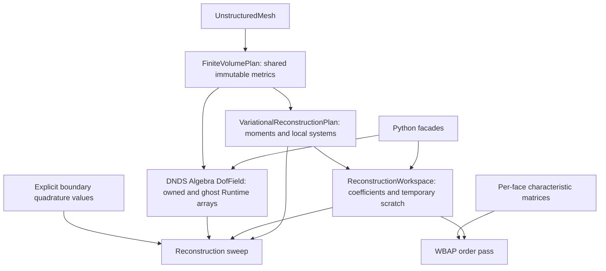
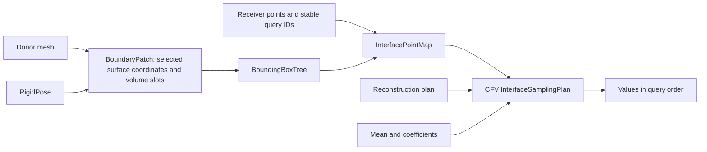

# CPU finite-volume reconstruction and boundary point interfaces

The new `CFV::FiniteVolumePlan` and `CFV::VariationalReconstructionPlan` compose
native Runtime storage, Geom entity identity, prepared metric/matrix buffers,
and explicit numerical operators. They do not wrap the legacy VR owner. The
existing `FiniteVolume` and `VariationalReconstruction<dim>` remain available.
This page describes the implemented CPU envelope, not a complete new flow solver.
The [2026-10-31 next-step decisions](../dev/facilities_next_steps_2026-10-31.md)
record planned extensions; those features are not implied by this implemented API.

## Ownership and responsibilities



Copies of plans retain immutable publications and mesh identity. Copies of
fields/Runtime handles share storage. Python `FVField` is an alias for the
existing DNDS `Runtime.Algebra.DoubleDofField`, not a second algebra implementation.
Its `owned`/`ghost` properties and boundary/transform arrays share the C++
allocations. Retained arrays remain alive after deleting their Python parent.
Array `numpy()` is a snapshot; `assign`, indexing and `read`/`write` obey the
existing Runtime lease contract. Release live views before invoking operators.

Geom owns connectivity, entity identity and halo row mappings; DNDS owns storage,
access and transfer execution; CFV owns reconstruction mathematics; the solver
owns field histories, equations, stage scheduling, stopping and domain coupling.
No solver or CFV dependency is introduced into Geom.

## Supported mathematics

* Cell-centered planar 2D and volumetric 3D unstructured cells, scalar or multiple
  components, polynomial degree 1–3 (formal second through fourth order).
* Legacy monomial ordering, scalar aligned-box scaling, zero-cell-mean basis,
  isotropic variational functional, factorial or HQM weights.
* Explicit relaxed Jacobi and ordered SOR sweeps; order-wise 3WBAP limiting;
  arbitrary physical-point polynomial evaluation.
* Translational periodic frames; retained original face/cell incidence order.

The basis is `phi_j(x)=monomial_j((x-center)/scale)-cell_mean(monomial_j)`.
Stored coefficients have row width `NRecDOF()*components` in **column-major
mode-by-component order**: `row[component*NRecDOF()+mode]`. Cell means are never
modified by reconstruction or limiting. The functional includes derivative
tensor multiplicities and the selected per-order weights. Preparation checks
the local system's numerical rank before inverting it; a deficient stencil is
an explicit error, not an automatic lower-degree fallback.

Rotated periodic state/derivative transforms, anisotropic/GG penalties,
axisymmetric integration, variable per-cell degree, alternative legacy limiter
variants and special `subs2ndOrder` formulas are not implemented here. Degree-one
VR provides the current second-order path. There is no automatic legacy-config
translation or claim that every old VR option is supported.

### Boundary quadrature protocol

`BuildBoundaryValues(components)` allocates `[NumBoundaryQuadrature(),components]`.
`GetBoundaryQuadrature(i)` gives the owning cell, face, face quadrature index,
physical point and normal. Fill the values before a sweep, refreshing them when
the BC depends on the current nonlinear/reconstruction stage. The numerical
operator reads these arrays and invokes no boundary callback.

The default `boundaryDerivativeWeights={1,0,0,0}` imposes the supplied Dirichlet
values. Nonzero higher derivative weights impose **homogeneous derivative
targets**; there are no derivative target arrays in this first API. Legacy
`ConstructBaseAndWeight()` defaults to weighting all derivative orders. Numerical
comparisons therefore explicitly configure its callback to `order==0 ? 1 : 0`.
Do not compare the two default BC functionals as if they were identical.

### Characteristic WBAP protocol

`BuildFaceTransform(first,count)` creates identity forward/inverse matrices for
each local face. Rows contain column-major `count*count` matrices acting on
column vectors in `[first,first+count)`. For a six-component Euler-SA field,
`first=0,count=5` transforms the gas block; SA is limited componentwise.

The equation adapter fills the pair from **cell averages** and calls
`FinalizeFaceTransform`. This checks finite mutual inverses once outside hot
loops. The limiter checks storage identity and version in its prologue. Writing
either matrix, even with identical numbers, requires re-finalization. The
adapter is responsible for refreshing the matrices when its cell-mean state
changes: the limiter does not infer thermodynamics or state freshness.

Legacy `DoLimiterWBAP_3` and `_C` also pass cell averages to their characteristic
callbacks. Euler computes the eigenvectors from the arithmetic mean of those
states, with face-frame momentum rotation and an identity extension for passive
components. Reconstructed states enter the separate smoothness indicator, not
that characteristic mean. The new operator limits all selected cell modes; it
does not yet implement a smoothness-indicator activation mask.

Call the WBAP API in **descending degree**, exchanging the coefficient halo
after **each** order. This is required by the legacy order-wise secondary-map
algorithm; one exchange after all orders changes its distributed result.

## Count, allocate, fill and execute

Preparation first counts face quadrature rows, cell-face incidences and boundary
quadrature rows, allocates dense Runtime tables, then fills them. Face-local
functional blocks are evaluated once and reused by their incident cells. Setup
scratch is proportional to local/ghost cells and faces; no global-entity-sized
scratch is allocated. Bounded small matrices hold polynomial setup algebra.

The operator prologue validates plan/field association, placement, shape,
generations and aliases, then acquires leases and projects table/static row
views. Numerical loops use bare span pointers and Eigen maps; no per-cell
ownership or lease checks occur. Framework workspaces are allocated in advance;
Eigen remains the CPU linear-algebra implementation. This is not a guarantee
about Eigen's internal scratch allocation for arbitrarily wide component blocks.

Future flux kernels can use `auto read=metrics.AcquireRead();` followed by
`auto view=read.HostView();`. The borrowed view exposes cell volumes/centers/
barycenters and face quadrature ranges, points, normals and weighted measures.
Keep `read` alive through the loop. It pins the buffers and blocks mesh mutation;
view access does not reacquire ownership or check generations per element. The
initial pointers are host pointers even though their simple accessors are
device-callable; this does not imply a device metric publication exists yet.

These are synchronous CPU operators. They retain their leases until return.
A future CUDA launcher can consume the same explicit table/offset/BC/transform
contracts; there are **no CUDA VR kernels** or asynchronous CFV launchers in this
implementation. Do not call a CPU operator before its eager-engine producer or
MPI halo is complete. CPU workspaces are private to one concurrent invocation.

```cpp
auto metrics = CFV::FiniteVolumePlan::ConstructMetrics(mesh, 5); // collective
CFV::ReconstructionSettings settings;
auto rec = CFV::VariationalReconstructionPlan::ConstructRecCoeff(metrics, settings);
auto mean = metrics.BuildField(6);
auto work = rec.BuildWorkspace(6);
auto boundary = rec.BuildBoundaryValues(6);
// Fill mean.Owned() and boundary.values through scoped Runtime write leases.
auto meanHalo = metrics.BindHalo(mean);                 // collective, persistent
auto coefficientHalo = metrics.BindHalo(work.coefficients);
meanHalo.Begin().Wait();
for (int iteration = 0; iteration < 20; ++iteration)
{
    coefficientHalo.Begin().Wait();
    rec.DoReconstructionIter(mean, work, boundary);
}
coefficientHalo.Begin().Wait();
for (int order = settings.maxOrder; order >= 1; --order)
{
    rec.DoLimiterWBAP_3Order(work, order); // optional finalized transform argument
    coefficientHalo.Begin().Wait();
}
```

Halo bindings reuse the mesh EntitySpace's canonical row transfer mapping and
native direct MPI datatypes. There is no hidden communication in sweeps,
limiting or sampling. Match collective call order/settings across ranks, drain
operations before MPI finalization, and explicitly refresh halos after writes.
Local setup failures agree across ranks before subsequent communication.
Sampling ghost cells requires already complete geometric closure and fresh
coefficient/mean ghosts. Mesh geometry/topology/distribution/order changes
invalidate plans; rebuild rather than matching fields by equal row counts.

## Geom matching and CFV sampling



`BoundaryPatch::Create` reads selected **owned** boundary elements directly from
the volume mesh. It stores only their coordinates, boundary/face/adjacent-cell
IDs, cell-face slot and persistent boundary ID. No boundary volume copy is made.
`BoundaryStencilPlan::Prepare` accepts a caller `GhostSpec`, evaluates it through
the existing registry/compiled tree, and builds a detached adjacency/ghost
publication. It neither changes the mesh's compute halo nor bypasses the DSL.

The initial search accepts Line2/Tri3/Quad4 surfaces on one rank. A BVH finds
candidates; element-coordinate projection, reference containment and explicit
gap tolerances decide acceptance. Query order and IDs survive search ordering.
Shared seams use the smallest persistent donor boundary ID. Coincident accepted
interiors are rejected as ambiguous. Uncovered queries, nonfinite coordinates,
duplicate query IDs, degenerate surfaces and nonrigid poses produce errors.
High-order surface geometry and periodic image selection fail explicitly.

`WithPose` returns a new patch/index sharing the selected reference coordinates.
It rebuilds the index (no incremental refit claim). Old maps keep their old pose.
A fixed receiver query can change donor element/cell after sliding. For separate
domains, retain each patch independently and construct each directional map
separately; a reverse map is not an inverse or conservative transpose.

`InterfaceSamplingPlan` checks donor entity/order identity and stores donor-local
sample points. Its output is in query order and **donor physical frame**. The
equation adapter handles vector rotation and moving-frame velocity conversion.
Choosing limited/unlimited values means passing the corresponding coefficient
field. No conservative flux, ALE/GCL, FSI force transfer or flow coupling iteration
is implied by point interpolation.

Distributed matching explicitly fails when the mesh communicator has more than
one rank. The later backend must route query batches to candidate owners and
evaluate/sample there, preserving query IDs and using Runtime row/payload
transfers. It must not gather the global surface. Existing single-domain field
halos and per-interface query transport remain distinct mappings.

## Validation and reproducible performance

`cfv_test_fv_facility` compares each sweep with legacy VR, independently recovers
polynomials from quadrature cell means, compares six-component characteristic
WBAP, exercises periodic triangles/quads and SOR/Jacobi, empty ranks, stale
plans, invalid shapes and collectively rejected deficient systems.
`geom_test_boundary_interface` checks geometric positions, seams, gap failures,
3D triangles/quads, relative sliding, ambiguous interiors, immutable old maps
and explicit DSL stencil publication. Python tests exercise shared ownership,
DNDS algebra reuse, two domain identities and the sampling chain.

`cfv_benchmark_fv_facility` takes `mesh dim degree sweeps trials periodicLength`.
Both methods run on the **same mesh instance** with the same five-component
means, BC functional and halo schedule. It reports max-rank metric setup,
coefficient setup, per-sweep time including halos, one WBAP application, and
checks coefficient agreement. Alternate order per trial; use OMP=1 and a single
exclusive node for comparisons. The evidence ledger records the actual runs.
