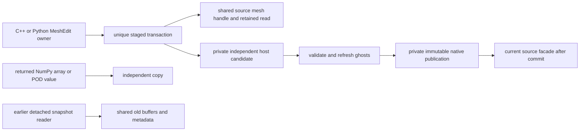

# Managed staged mesh edits

`MeshEdit::Begin(shared_mesh, ghostLayers)` and Python `mesh.edit(ghost_layers=1)`
collectively stage the current authority in independent host storage. Native mode
reads its published snapshot, even if raw compatibility arrays have since changed.
The staging clone must reproduce every entity's owned/ghost extent and exact
local-to-global order; otherwise begin rejects it. This initial implementation
requires the existing detached transition inventory (volume mesh, primary original
IDs, no elevated-prefix or parent/extraction policy). Staging is a setup operation,
with full reconstruction/copy cost, never an operator hot path.
Legacy inverse setup rows still in global numbering are reconstructed by the
clone; they are not advertised as an available local query group by the edit.

Only owned coordinates, cell `ElemInfo`, and `CellCells` neighbor ordering are
editable. Coordinate and metadata getters return independent values; Python
coordinate/neighbor arrays are explicitly copies. Setters copy values into the
stage. No writable pointer to either the candidate or current authority escapes.
Changing an escaped copy after commit cannot mutate the published mesh.



The edit uniquely owns its candidate; its source handle and read owner retain
shared source allocations. Returned values own separate storage. Commit prepares
the new publication before replacing the facade's shared native owner. Retained
detached snapshots keep their old allocations; a live facade read blocks commit.

`commit()` is explicit and collective. Context exit and destruction discard an
uncommitted stage. Commit validates finite coordinates, unchanged cell element
type, and the exact neighbor-row multiset including unavailable/boundary sentinels.
Neighbor ordering supports permutations only; changing connectivity, row shape,
face incidence, periodic bits, or other relation families is unsupported. This
restriction preserves cross-relation topology consistency. Coordinates and POD
companions refresh from owners to ghosts; adjacency order refresh converts through
global IDs so remote local numbering is never copied as if it were local.

Commit captures independent private native storage and publishes on the same mesh
handle, preserving domain identity and unchanged native canonical map identity.
Coordinate edits record Geometry/Values/Allocation and remove captured wall-distance
data, which must be rebuilt for the new geometry. Cell metadata records
Topology/Interface/Values/Allocation conservatively; neighbor ordering records
Layout/Allocation. Initial legacy-to-native publication also records Layout.
Periodic geometry metadata remains fixed: a general coordinate edit does not
transform its periodic frame. Legacy `TransformCoords`/`transform_coordinates`,
`SetPeriodicGeometry`, `ApplyGeometryTransform` and boundary rectification require
legacy workspace mode and reject native authority before touching its detached
workspace. Native coordinate edits use this staged API; a native periodic-frame
transform is not implemented. Explicitly selecting `UseLegacyWorkspace` selects
that workspace's values; it does not export the current native state.

The stage retains its source owner/read lease until final commit preflight.
Additional managed readers can coexist during staging, but block publication.
Validation failure leaves the scope open for correction or abort; a final
publication conflict closes it without changing the source. The publication
containers are prepared before the writer; a postcommit stamp-binding failure
marks the source failed. Raw legacy writes remain an explicit compatibility escape
and are not intercepted by this API. Orchestration and setter use are serialized.

```python
with mesh.edit() as edit:
    point = edit.coord(0)       # independent writable copy
    point[0] += 0.1
    edit.set_coord(0, point)    # owned row; explicit copy into the stage
    info = edit.cell_info(0)
    info.zone = 4
    edit.set_cell_info(0, info)
    edit.commit()              # collective; release other read scopes first
```
