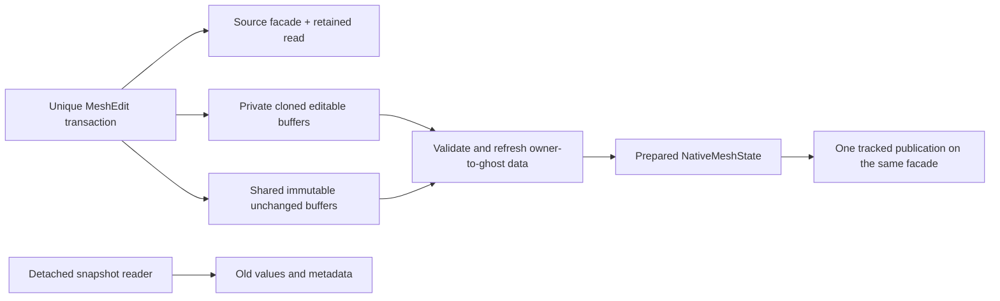

# Managed staged mesh edits

`MeshEdit::Begin(shared_mesh, ghostLayers)` and Python
`mesh.edit(ghost_layers=1)` collectively stage an existing native publication.
The stage clones coordinates, cell metadata and editable CellCells rows; other
topology, companions, identity and provenance remain retained native data. No
legacy candidate, global topology staging, or mode conversion is involved.
Owned/ghost order and canonical maps remain unchanged.

Only owned coordinates, cell `ElemInfo`, and CellCells neighbor ordering are
editable. Getters return independent values; Python coordinate/neighbor arrays
are copies. Setters copy into the stage. No writable pointer to current mesh
storage escapes. Modifying a returned copy after commit cannot alter the mesh.



`commit()` is explicit and collective. Context exit/destruction discards an
uncommitted stage. Commit requires finite coordinates, unchanged cell element
type, and the exact original neighbor multiset including unavailable/absence
sentinels. Neighbor changes are permutations only; changing connectivity, row
shape, face slots or periodic incidence bits is unsupported. Ghost refresh
converts adjacency through globals, never copies another rank's local numbers.

The precise legacy-spelling CellCells descriptor follows the edited fixed slot;
independent native mathematical neighbor variants keep their own definitions
and values. Sharing an old allocation does not make two different descriptors
semantically interchangeable.

Coordinate edits preserve identity/maps, publish Geometry/Values/Allocation,
and remove wall vectors for rebuilding. Cell metadata conservatively affects
Topology/Interface/Values/Allocation; neighbor permutations affect
Layout/Allocation. Coordinate setters leave periodic frames fixed. For coherent
frame changes use `apply_geometry_transform` or
`apply_affine_geometry_transform`; arbitrary `transform_coordinates` callbacks accept nonperiodic meshes only and
invalidate wall vectors. General affine changes also invalidate wall vectors;
proper rotation/positive scale can transform them coherently.

The stage retains its source read until final preflight. Other readers can
coexist during staging but block commit. Validation failure leaves the edit
available for correction/abort; a final publication conflict closes it without
changing the source. Release shared rows, aliases and additional scopes before
commit. Setup/setter orchestration is serialized; callbacks must not recursively
mutate the source or enter MPI collectives.

```python
with mesh.edit() as edit:
    if mesh.NumNode():
        point = edit.coord(0)   # detached writable copy; owned row
        point[0] += 0.1
        edit.set_coord(0, point)
    if mesh.NumCell():
        info = edit.cell_info(0)  # detached ElemInfo
        info.zone = 4
        edit.set_cell_info(0, info)
    edit.commit()              # collective; release other retained reads first
```

For rank-local permutations, redistribution or family reconstruction, use native
transitions and their field transfer maps. For a full independent read-only
checkpoint of current query values, retain a detached snapshot. Neither API
makes a stale external field compatible merely because its extents still match.
