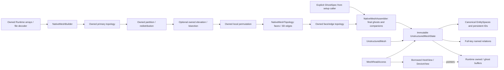
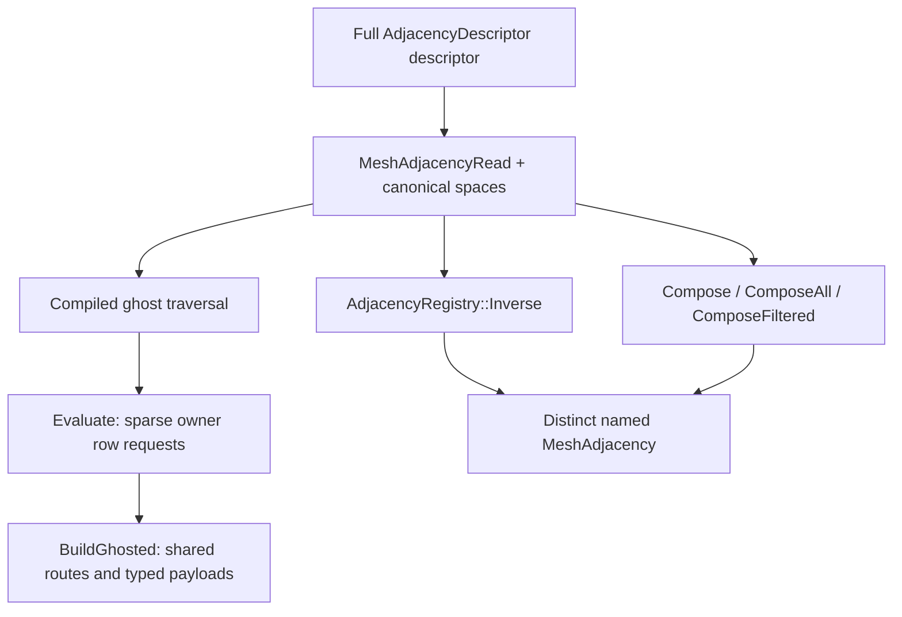

# Native mesh connectivity and ghost closure {#mesh_connectivity}

`UnstructuredMesh` owns a published `UnstructuredMeshState`
(`NativeMeshState` remains a source alias). Mesh values, topology and
row metadata live in Runtime Arrays; the facade has no legacy construction
workspace. Readonly compatibility spellings such as `cell2node` resolve native
rows. They are not mutable adjacency arrays.

## Ownership and setup

**Construction correction, 2026-10-28:** primary and face/edge builders now
produce owned topology; finalization belongs to the assembler and takes an
explicit GhostSpec. Owned ingress, partition, local permutation and refinement
operations are available. The [semantic audit](../dev/mesh_construction_semantics_2026-10-28.md)
and [fixture/purpose ledger](../dev/mesh_connectivity_test_port_2026-10-28.md)
record regression coverage and the explicit legacy periodic-frame exception.



`NativeMeshBuilder` consumes sibling owned Cell, Node and Boundary spaces,
global-index cell/boundary node cones, coordinates and typed companions. It
returns `NativeOwnedMeshData`, not a finalized mesh state. Primary denotes the
node/cell topology; owned versus ghost is a separate distinction applying to
all families, including generated faces and edges.
`NativeMeshAssembler::CaptureOwned` exports native owned rows in global
numbering; `Build` executes the supplied GhostSpec, routes payloads and creates
local-index compute data. Neither needs a legacy mesh candidate.

## Construction, closure and finalization

| Operation | Inputs | Outputs and effects |
| --- | --- | --- |
| Owned primary construction | Owned CellNodes/BoundaryNodes in current global numbering, metadata and coordinates | Inverse node supports, cell neighbors, physical boundary incidence, IDs and owned arrays. Temporary remote support may be fetched. No final ghost state. |
| Owned face/edge construction | Authoritative owned global cones and companions | Owned generated families, parent/subentity relations, physical face slots, periodic companions and IDs. Construction closure is independent of compute ghosts. |
| Owned partition/permutation | Authoritative owned global cones and companions | Exact temporary facial graph, placement/permutation maps and transferred owned payload. No intermediate mesh state or persistent Face family for the graph. |
| Owned elevation/bisection | Authoritative owned primary arrays | New namespace, owned higher/lower-order topology and durable source-ID ancestry. Shared spans/coordinates are fetched sparsely as construction inputs. |
| Traversal compilation | Declarative GhostSpec paths | Validated prefix forest, collect flags, node/parent IDs and breadth-first lists. No adjacency lookup or MPI. |
| Traversal evaluation | Compiled paths and registered distributed relations | Required ghost-ID sets per family. Reads local rows and fetches remote intermediate rows as scratch. Does not construct per-source composed adjacency. |
| Ghost materialization | Selected ghost IDs and registered owned payloads | Owned/appended maps, shared routes and fetched rows/companions. Detached storage. |
| Final assembly | Owned topology and explicit GhostSpec | A validated mesh state with local-index compute views. |
| Live publication | Completed state and coordinated mutation boundary | Installs the state and advances versions after successful construction. |

`ConstructNativeMesh` is a completed-primary-operation frontend for a caller
requesting a state immediately. It constructs owned data and finalizes once.
A pipeline still needing partition, permutation or face construction must keep
owned data and assemble at its end; using that completed frontend as an
intermediate would reintroduce premature assembly. `PrepareNativeMeshTopology`
is a completed operation on an existing publication; the underlying
`NativeMeshTopology::Build` consumes and returns owned data.

For an entire construction pipeline use `ReadNativeCGNSOwned` or
`ReadNativeOpenFOAMOwned`, `NativeMeshPreparation::PartitionOwned`, optional
`NativeMeshRefinement::{ElevateOwned,BisectOwned}`,
`NativeMeshTransition::ReorderOwnedCells`, then `NativeMeshTopology::Build`.
All intermediate EntitySpaces are owned-only; global relation entries may refer
to another rank. Partition and permutation use exact temporary face incidence
without creating a persistent Face family. The assembler is the first stage
that creates the final compute ghosts and publishes a read state. Local cell
partition ranges travel in `NativeOwnedMeshData::localPartitionStarts` and are
installed at final assembly; redistribution resets them.

The completed C++ read helper retains owned data through partition/refinement
before returning its requested readable mesh. `PrepareMesh` similarly captures
owned data once, permutes, constructs faces and assembles once. Separate calls
to completed-state APIs are separate operations: the Python debugging interface
can request a readable intermediate mesh, but that is not an owned construction
stage or a prerequisite for the native builders. Native and compatible archive
decoders also expose owned-only reads; legacy-primary import calls the owned
builder directly. File loading with repartition keeps that owned result through
redistribution before its one final assembly. The completed partition API keeps
any required face completion owned as well, while retaining original external
field source associations.

Temporary construction closure provides algorithm inputs. Final compute closure
promises which rows applications can dereference after finalization. They share
sparse routing machinery, but temporary fetched rows do not automatically become
canonical mesh ghosts. Primary construction inverts CellNodes/BoundaryNodes,
fetches inverse support for referenced remote nodes, composes neighbors and
containment, and resolves physical boundary sides. Face construction obtains
Cell→Node→Cell support and complete parent cones from authoritative owned rows;
it cannot rely on an earlier solver ghost ring being sufficient.

Construction closure also runs a compiled GhostSpec. When a complete owned
Cell2Cell adjacency is available, the registry traverses that precomputed
composition; otherwise it traverses Cell2Node and authoritative Node2Cell
support (building the inverse if absent). The complete-graph recipe explicitly
collects owned cells' nodes as well as neighbor cells' nodes, so isolated cells
retain their remote node cones. It does not use a separate hand-written ghost
discovery loop. `BuildGhosted(discovery, payloads)` can materialize only the
Cell2Node adjacency needed by construction while preserving all discovered
entity mappings. Traversal supports remain registered and validated. The
default overload still publishes every registered adjacency; an explicit empty
payload list builds mappings only. Selection must agree across ranks.

Specializations are allowed inside the DSL, tree evaluator, adjacency and
EntityGhostMapping facilities. Those facilities remain responsible for
semantics, leases, numbering and routing; a consumer must not substitute its own
unchecked storage walk or transfer policy for them to improve timing.

## GhostSpec is a coverage contract

Each GhostChain names an anchor family, a sequence of full adjacency descriptors,
and the family to collect. Each root starts with this rank's owned entities of
its anchor family. Intermediate entities may belong to any rank; ownership
determines routing, not topology or path membership.

Only the exact endpoint of each input chain is a collection endpoint. It may be
a leaf or may have children contributed by another chain. Evaluation keeps a
separate reached set for every compiled node and expands a child only from that
node's own parent state; sibling frontiers are never merged for propagation.
Endpoint sets of the same entity kind are sorted and unioned only at the final
result. A node can therefore both contribute to the result and feed descendant
branches without changing either role.

An implementation may discard owned targets immediately at a terminal node:
they cannot enter the ghost result and have no descendants to seed. It must
retain them at every node with children, including a node that also collects.
This avoids sorting large local incidence expansions without changing any
branch frontier used for propagation.

```text
owned Bnd --Bnd2Node--> Node --Node2Bnd--> Bnd [collect remote IDs]
```

This is not equivalent to separate Bnd→Node and owned-Node→Bnd requests.
Reached nodes do not join another root's seeds. Compilation merges shared
anchor/hop prefixes, not all positions having the same entity kind. It does not
invent continuations from other registered relations. The boundary default also
requests Bnd→Node→Bnd→Node for the new boundary cones. Final sets union the
collected endpoint results; temporary intermediate fetches need not all
survive. The default cumulative ring policy is expressed explicitly as one
chain per depth from one through `cellLayers`; a single deep chain requests
only its terminal depth.

The assembler accepts the recipe explicitly. Defaults are selected by setup
frontends, not recreated inside assembly. Preserve the declarative policy
through reorder/redistribution and explicitly extend it for requested topology.
Recompile against current definitions; old pointers, local row numbers and MPI
bindings are not a recipe. All ranks must supply matching path semantics and
invoke collective stages in the same order. Missing required relations and
invalid paths are errors, agreed collectively before the next communication.

The exact assembler never edits its supplied recipe. The completed-operation
helper `AssembleNativeMesh(..., 0)` preserves a retained policy, selecting a
one-ring default only if none exists. A positive explicit depth replaces standard
Cell2Cell prefixes with explicit endpoint chains for every depth from one
through the requested value. If no Cell2Cell-rooted cell chain exists, it adds
cumulative cell and cell-node chains while retaining other custom paths. This
allows a restart/preparation request to change cell depth without dropping
boundary or named traversals. All ranks agree on this option even when it would
not otherwise change the resulting tree.

## Composition versus distributed traversal

`Compose(AB, BC)` returns one adjacency row per owned A. Its current local
interface requires the necessary BC rows to be available and throws if a row is
missing; it does not fetch them automatically. `ComposeAll` selects candidates
containing every intermediate incidence. Custom/exact filters retain full
named/versioned semantics.

`Evaluate(tree)` discovers unions of reachable entities and automatically
fetches remote intermediate rows along the declared paths. It does not retain
separate final neighbor rows per starting entity. A correct ghost set therefore
does not establish that a composed relation was constructed. An AdjacencyDescriptor
descriptor alone is not a materialized adjacency array.

Final ghost publication constructs one immutable `EntityGhostMapping` per
source entity space. It records the source owned/ghost order and reusable
`RowTransferPlan`, not adjacency semantics or a route tree. `BuildGhosted`
resolves descriptor aliases only after those mappings exist. Its O(1) payload
identity includes source/target kinds, global/local state, exact owned
view/layout and the `EntityGhostMapping` identity. Across ranks, each descriptor
must agree on the same earlier descriptor ordinal through the adaptive optional
integer agreement helper. A match shares the completed owned+ghost payload;
the descriptors, spaces and mappings remain distinct objects. Input ghost rows
are not reused. Descriptor ordinals are local to one `BuildGhosted` call and
are recomputed from the current sorted registry.

## Semantic validation requirements

The default setup policy matches legacy coverage: the configured cell ring,
the connected owned-boundary ring, and optionally complete owned-node stars.
It does not include every boundary incident to every reached cell's nodes. Such
a broader request must be an explicit chain; it can otherwise add a second
boundary ring and conceal the coverage contract in inflated ghost sets.

Periodic `Adj::Bnd2Cell` follows the legacy owning-cell/self convention; an
external nonperiodic boundary keeps an absent second slot. The distinct
`Adj::Bnd2CellCoupled` definition stores the physical owning/partner slots. The
physical-frame containment relation remains a separate sorted-set definition.
An operator requiring local partner cells requests the coupled traversal in
its GhostSpec rather than relying on registration to fetch more ghosts.

Owned-node stars provide all incident cell/boundary candidates and their node
cones. A node-centered algorithm needing additional faces/edges must declare
those traversals too; the cell-centered default does not promise every face of
every remote incident cell. Inverses have sorted entity-set semantics. Recover
multiple periodic occurrences from each parent's ordered cone and image bits,
rather than interpreting one support entry as one physical occurrence.

Independently derive expected per-rank reachability from authoritative global
topology, then compare IDs and local dereferenceability after construction,
topology completion, permutation and redistribution. Include remotely owned
intermediate nodes and empty ranks. Periodic node images and physical face slots
are part of the answer; canonical node equality alone is insufficient.

Periodic cell-to-face flags are relative to the generated face owner's stored
node frame. Ownership exchange must transfer that transform together with the
face ID. A peer's local first-parent frame may differ, so its provisional XOR
cannot be retained after installing the owner's face ID. The frozen legacy
interpolation exchanged only ID triplets and produced two inconsistent flags
on the two-rank periodic 32-cube probe. Native interpolation exchanges the owner
transform as a fourth word; tests compare the complete image-labeled face at
each parent slot, including remotely owned faces. The semantic audit records
this legacy defect explicitly rather than reporting byte identity.

Owned geometry/numerical comparisons exclude duplicate ghost storage and cannot
prove local coverage. Explain count differences with exact expected sets and
the recipe. Preserve legacy test purposes and independent oracles rather than
weakening assertions to reproduce a passing case count.

Cell-node cones always have local coordinates. The builder's `cellLayers`
controls cell rings; `completeNodeStar` includes all cells and boundaries
incident to owned nodes. Empty ranks participate. Native topology rebuilds
shared-parent support from authoritative owned cones before interpolating faces
or edges, so incomplete incoming ghosts cannot create duplicate entities.

## Relation identity and the setup DSL

An `AdjacencyDescriptor` is a full semantic key: source/target families, path, selection,
self policy, ordering, periodic policy and named/versioned definition. Endpoint
pairs alone do not identify a relation. Direct FaceCells, FaceNodes followed by
NodeCells with any-node selection, and all-node containment can coexist.



`AdjacencyRegistry` supplies native inverse, composition, interpolation and
sparse ghost evaluation. `MeshConnectivity` retains compatibility spellings for
the setup mathematics, forwarding to this native implementation. It does not
own mesh storage. `RegisterMesh` uses the explicitly requested native groups;
additional full-key relations can be registered with retained read access.

Inverse always has its own descriptor and sorted-set semantics; it does not
silently become a physical fixed-slot relation. `Compose` selects a union,
`ComposeAll` requires all intermediate incidences, and custom selection requires
an explicit stable definition. Callers must supply the needed intermediate
support rows; composition does not invent missing support.

Registration retains immutable relation reads. Repeated traversal shares native
global payloads or caches one local-to-global conversion per relation, rather
than recreating every owned row at each hop. Serialize operations on a registry.

Topological relations preserve element slots, orientation, periodic companions
and permitted absence. `SortedUnique` requires strictly increasing **decoded
global** targets, even when their local indices are not numerically sorted.
Named variants never overwrite a fixed solver-facing slot merely because their
endpoints match. Hash IDs accelerate lookup; full signatures establish identity
and collective agreement.

## Local compute, detached conversion

Published compute relations stay local. There are no `adjPrimaryState` group
variables or in-place `AdjGlobal2Local*` / `AdjLocal2Global*` mesh operations.
For setup inspection or independent transformation, convert a detached relation:

```cpp
auto relation = mesh->ReadAdjacency(Adj::Cell2Node);
auto global = MeshAdjacency::Convert(relation, Adj_PointToGlobal);
auto local = MeshAdjacency::Convert(global.Read(), Adj_PointToLocal);
// The source publication and its generations have not changed.
```

`MeshAdjacencyRead` retains its values, row metadata and source/target
association. Conversion preserves row shape and slots; it uses the explicit
canonical target space rather than guessing a map from endpoints. See
[the conversion contract](../dev/geom_native_index_conversion.md).

An EntitySpace describes current owned rows followed by ghosts. Current globals
are rank-offset addresses. Persistent `(namespace, kind, ID)` identity is
separate and is never used as an adjacency subscript. Maps must be refreshed
when numbering changes; equal counts do not prove the same order.

## Closure and sentinels

`NumCell()` counts owned cells; `NumCellProc()` includes ghosts. An entry in a
local relation can still be an explicitly encoded unavailable global
(`-1-global`) in outer support. `UnInitIndex` is a distinct permitted absence,
such as the second cell on an exterior face. Check both cases before indexing.

Owned-cell face stencils provide their required face/node/cell closure.
`allFaceCellsLocal=true`, together with facial requirements, additionally
requires adjacent cells on every captured face to be local, apart from exterior
absence. Do not infer this stronger promise from ordinary `CellFlux()`.

Inverse node support and outer ghost rows may require wider closure than an
operator requested. Ghost construction stores local/requested/served rows and
rank metadata, not global-sized lookup vectors. Reader-only serial input and
explicit wall/smoothing surface datasets are separate scaling limits.

## Physical faces, edges and periodicity

Physical FaceCells has two ordered incidence slots. A self-periodic face may
contain the same cell twice in different slots; a mathematical inverse retains
one unique cell. Use the actual cell-to-face slot with `CellIsFaceBack` and
`CellFaceOther` to distinguish these occurrences.

Periodic node-image bits belong to ordered incidences, not just canonical nodes.
Preserve them with node/face/edge slots and use the captured periodic transforms
for physical coordinates. Shared high-order faces must agree on every node ID,
including midside nodes; geometric coincidence alone is insufficient.

Faces are available in 2D and 3D; distinct edge construction is 3D. Boundary
entities retain zone labels separately from physical faces. Boundary extraction
creates a new lower-dimensional native mesh with durable source-ID ancestry.

## Callers and field transfers

`MeshAuditOptions` controls per-publication diagnostics separately from
`MeshReadRequirements`. Both `persistentIdentity` and `closure` default to true.
The identity switch controls duplicate-ID audits and owner/ghost-ID comparisons.
The closure switch controls the diagnostic owned CellFaces-to-FaceCells
reciprocity pass. It does not disable required ghost construction, local
dereference validation, shape/type/index/sentinel checks, periodic side-bit
validation, higher-order node matching, or collective schedule agreement.

Disabling an audit is an explicit caller assertion that the immutable producer
has established that invariant. It can admit duplicate IDs or inconsistent
incidence, so it is not an alternative validity test. The effective policy is
retained by a state and propagated through capture, assembly, transitions,
geometry replacement, topology construction and derivation. Fresh
`NativeMeshBuildOptions::audit` defaults to full when unset; derivation inherits
the source policy when unset, or honors an explicitly supplied override. Archive
decoding starts with full audits; audit settings are not checkpoint metadata.

At a checkpoint, `state.Audit()` collectively reruns full identity and incidence
audits of that exact immutable publication without rebuilding, reordering or
changing its retained policy. `state.Audit(options)` selects diagnostic passes
explicitly. All ranks must supply matching flags, including empty ranks.

Construction, ghost evaluation and publication are setup collectives. All ranks
use the same communicator, options, relation signatures and call order, including
empty ranks. Keep communicators alive and complete asynchronous producers before
host setup. A callback must not enter collectives or mutate the source.

`NativeMeshTransition` carries full-family row transfers and the exact input
`sourceSpaces`. Validate fields against those descriptors before applying a
transfer; topology completion can add families with an intermediate source
space. `PreparedMeshTransition` stages mesh and registered field changes as one
publication. Raw buffer size is not a field-association proof.

A plain view or row span is borrowed. Retain its access owner until all CPU,
worker and GPU use completes; join all consuming streams before declaring
completion. Readonly Python rows retain their leases after a scope closes.
Tracked publication rejects active facade readers. See [MeshFacade](MeshFacade.md),
[publication](NativeMeshPublication.md), and [managed edits](ManagedMeshEdit.md).

This page describes current contracts. Historical `AdjPairTracked`,
`AdjIndexInfo`, mutable SerialRW ingress and legacy global/local build chains
belong to migration records, not the current construction API. Test definitions
and documentation do not establish a successful runtime validation gate.
