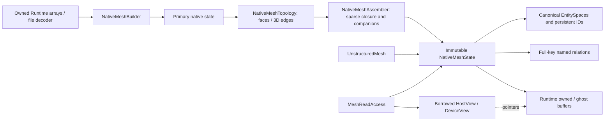
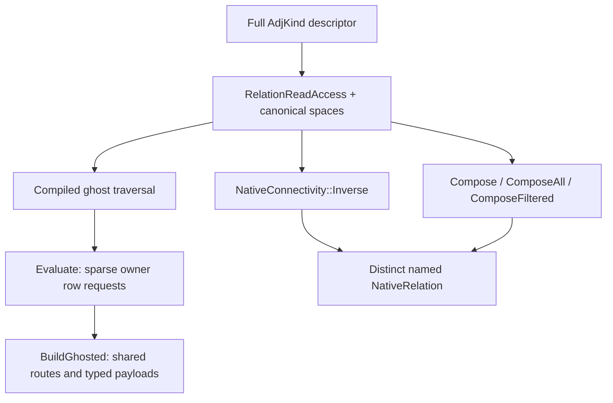

# Native mesh connectivity and ghost closure {#mesh_connectivity}

`UnstructuredMesh` owns a published `NativeMeshState`. Mesh values, topology and
row metadata live in Runtime Arrays; the facade has no legacy construction
workspace. Readonly compatibility spellings such as `cell2node` resolve native
rows. They are not mutable adjacency arrays.

## Ownership and setup



`NativeMeshBuilder` consumes sibling owned Cell, Node and Boundary spaces,
global-index cell/boundary node cones, coordinates and typed companions.
`NativeMeshAssembler::CaptureOwned` exports native owned rows in global
numbering; `Build` discovers requested closure, routes payloads and publishes
local-index compute data. Neither needs a legacy mesh candidate.

Cell-node cones always have local coordinates. The builder's `cellLayers`
controls cell rings; `completeNodeStar` includes all cells and boundaries
incident to owned nodes. Empty ranks participate. Native topology rebuilds
shared-parent support from authoritative owned cones before interpolating faces
or edges, so incomplete incoming ghosts cannot create duplicate entities.

## Relation identity and the setup DSL

An `AdjKind` is a full semantic key: source/target families, path, selection,
self policy, ordering, periodic policy and named/versioned definition. Endpoint
pairs alone do not identify a relation. Direct FaceCells, FaceNodes followed by
NodeCells with any-node selection, and all-node containment can coexist.



`NativeConnectivity` supplies native inverse, composition, interpolation and
sparse ghost evaluation. `MeshConnectivity` retains compatibility spellings for
the setup mathematics, forwarding to this native implementation. It does not
own mesh storage. `RegisterMesh` uses the explicitly requested native groups;
additional full-key relations can be registered with retained read access.

Inverse always has its own descriptor and sorted-set semantics; it does not
silently become a physical fixed-slot relation. `Compose` selects a union,
`ComposeAll` requires all intermediate incidences, and custom selection requires
an explicit stable definition. Callers must supply the needed intermediate
support rows; composition does not invent missing support.

Registration retains immutable relation reads. Repeated traversal shares native
global payloads or caches one local-to-global conversion per relation, rather
than recreating every owned row at each hop. Serialize operations on a registry.

Topological relations preserve element slots, orientation, periodic companions
and permitted absence. `SortedUnique` requires strictly increasing **decoded
global** targets, even when their local indices are not numerically sorted.
Named variants never overwrite a fixed solver-facing slot merely because their
endpoints match. Hash IDs accelerate lookup; full signatures establish identity
and collective agreement.

## Local compute, detached conversion

Published compute relations stay local. There are no `adjPrimaryState` group
variables or in-place `AdjGlobal2Local*` / `AdjLocal2Global*` mesh operations.
For setup inspection or independent transformation, convert a detached relation:

```cpp
auto relation = mesh->ReadNativeRelation(Adj::Cell2Node);
auto global = NativeRelation::Convert(relation, Adj_PointToGlobal);
auto local = NativeRelation::Convert(global.Read(), Adj_PointToLocal);
// The source publication and its generations have not changed.
```

`RelationReadAccess` retains its values, row metadata and source/target
association. Conversion preserves row shape and slots; it uses the explicit
canonical target space rather than guessing a map from endpoints. See
[the conversion contract](../dev/geom_native_index_conversion.md).

An EntitySpace describes current owned rows followed by ghosts. Current globals
are rank-offset addresses. Persistent `(namespace, kind, ID)` identity is
separate and is never used as an adjacency subscript. Maps must be refreshed
when numbering changes; equal counts do not prove the same order.

## Closure and sentinels

`NumCell()` counts owned cells; `NumCellProc()` includes ghosts. An entry in a
local relation can still be an explicitly encoded unavailable global
(`-1-global`) in outer support. `UnInitIndex` is a distinct permitted absence,
such as the second cell on an exterior face. Check both cases before indexing.

Owned-cell face stencils provide their required face/node/cell closure.
`allFaceCellsLocal=true`, together with facial requirements, additionally
requires adjacent cells on every captured face to be local, apart from exterior
absence. Do not infer this stronger promise from ordinary `CellFlux()`.

Inverse node support and outer ghost rows may require wider closure than an
operator requested. Ghost construction stores local/requested/served rows and
rank metadata, not global-sized lookup vectors. Reader-only serial input and
explicit wall/smoothing surface datasets are separate scaling limits.

## Physical faces, edges and periodicity

Physical FaceCells has two ordered incidence slots. A self-periodic face may
contain the same cell twice in different slots; a mathematical inverse retains
one unique cell. Use the actual cell-to-face slot with `CellIsFaceBack` and
`CellFaceOther` to distinguish these occurrences.

Periodic node-image bits belong to ordered incidences, not just canonical nodes.
Preserve them with node/face/edge slots and use the captured periodic transforms
for physical coordinates. Shared high-order faces must agree on every node ID,
including midside nodes; geometric coincidence alone is insufficient.

Faces are available in 2D and 3D; distinct edge construction is 3D. Boundary
entities retain zone labels separately from physical faces. Boundary extraction
creates a new lower-dimensional native mesh with durable source-ID ancestry.

## Callers and field transfers

Construction, ghost evaluation and publication are setup collectives. All ranks
use the same communicator, options, relation signatures and call order, including
empty ranks. Keep communicators alive and complete asynchronous producers before
host setup. A callback must not enter collectives or mutate the source.

`NativeMeshTransition` carries full-family row transfers and the exact input
`sourceSpaces`. Validate fields against those descriptors before applying a
transfer; topology completion can add families with an intermediate source
space. `PreparedMeshTransition` stages mesh and registered field changes as one
publication. Raw buffer size is not a field-association proof.

A plain view or row span is borrowed. Retain its access owner until all CPU,
worker and GPU use completes; join all consuming streams before declaring
completion. Readonly Python rows retain their leases after a scope closes.
Tracked publication rejects active facade readers. See [MeshFacade](MeshFacade.md),
[publication](NativeMeshPublication.md), and [managed edits](ManagedMeshEdit.md).

This page describes current contracts. Historical `AdjPairTracked`,
`AdjIndexInfo`, mutable SerialRW ingress and legacy global/local build chains
belong to migration records, not the current construction API. Test definitions
and documentation do not establish a successful runtime validation gate.
