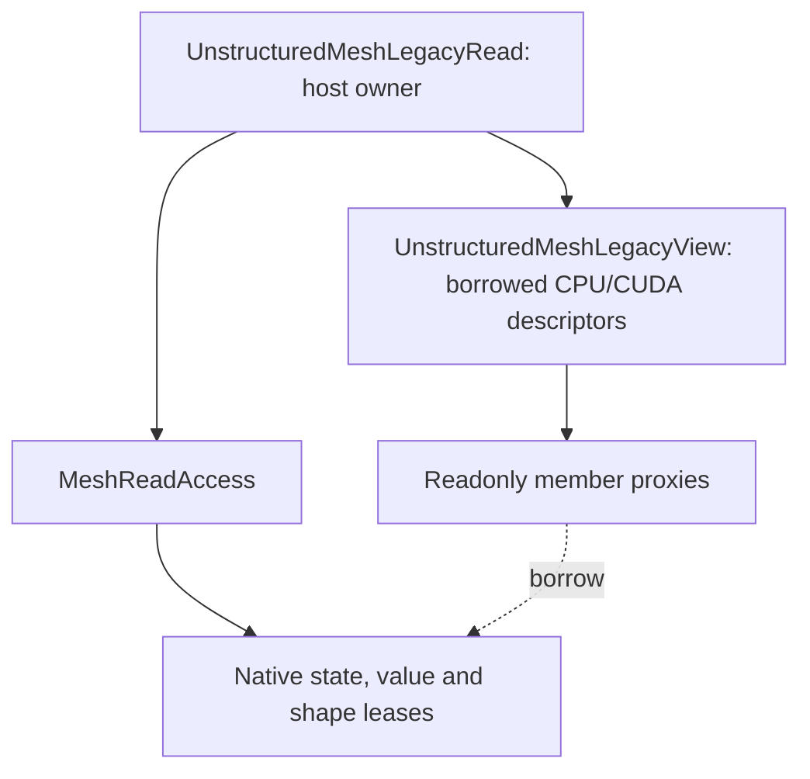

# Scoped native mesh queries

`UnstructuredMesh` owns a `NativeMeshState` backed entirely by Runtime Arrays.
Construction, partitioning, ghost closure, edits and output use native data.
The facade preserves semantic query names and readonly compatibility spellings;
there is no mutable legacy setup workspace or publication mode switch.

## Acquire once per operator

```cpp
auto access = mesh->AcquireRead(Geom::MeshReadRequirements::CellFlux());
auto view = access.HostView();
for (DNDS::index cell = 0; cell < view.NumCell(); ++cell)
    for (DNDS::rowsize slot = 0; slot < view.CellFaces(cell).size(); ++slot)
    {
        auto face = view.CellFaces(cell)[slot];
        auto other = view.CellFaceOther(cell, face, slot);
        // Check absence/unavailable encoding before indexing another cell.
    }
```

`Primary()` requests cell/node/boundary fields. `CellFlux()` additionally requests
faces and cell-to-face connectivity. Explicit flags request inverse support,
edges, ordered face-neighbor cells or wall vectors. Acquisition checks prepared
availability and closure; it does not construct missing data. Unrequested groups
are hidden, even when the native publication contains them. Use `HasRelation`
for optional queries.

The scope retains Runtime values, published row offsets/lengths, allocation read
leases and a mesh version read lease. Facade acquisition also strongly retains
the native state owner so metadata survives placement-state replacement.
Canonical associations and row/companion invariants are established at native
publication. Repeated acquisition reuses them without legacy conversion or a
full topology scan. The plain view owns no allocation, shared pointer or lock;
its element access performs no lease lookup inside numerical loops.

## Legacy read spelling without legacy storage

`MeshReadAccess::LegacyHostView()` and `LegacyDeviceView()` expose a borrowed
`UnstructuredMeshLegacyView`. Its `cell2face`, `face2cell`, coordinates, metadata
and periodic-bit members are readonly proxies over the same native buffers. They
support the historical `[]`, `(row,column)`, `RowSize`, `Size`, and owned/ghost
`father`/`son` read spellings. There is no mutable Array, transformer, implicit
conversion to `ArrayAdjacencyPair&`, or legacy mesh construction behind them.
The view copies descriptors, not payload or row-offset buffers.

The normal C++ Euler/CFV operator acquires its scope internally, once in its
prologue. Borrow the compatibility view there to keep numerical bodies close to
their original source:

```cpp
auto meshRead = this->mesh->AcquireRead(requirements);
const auto meshLegacy = meshRead.LegacyHostView();
const auto *mesh = &meshLegacy;
ValidateMeshDependencies();
for (auto face : mesh->cell2face[cell])
    /* existing numerical body */;
```

Host-only setup, partition metadata and field-index bridging still use the owning
`this->mesh`. Dependency checks, corrected face-slot semantics and other numerical
fixes remain explicit. Semantic queries (`CellFaces`, `FaceCells`, etc.) also
remain supported on the compatibility view.



`UnstructuredMesh::AcquireLegacyRead(requirements, context)` is a convenience
owner over that same contract. Its `HostView()`/`DeviceView()` and host `operator->`
check acquisition/sealing state. Bind the plain view once before hot loops or
worker submission. Every copied view, proxy, row or Eigen map borrows the owner;
it must not escape the owner's completed lifetime. `Complete` must join every
consuming stream, and sealing forbids obtaining another view. CPU workers retain
the owner until execution returns. No lease acquisition happens in a GPU thread.

EulerP's host argument keeps `this_v` alive while its plain device view uses these
same proxies. Its normal launches currently use the default stream, and destroying
the mesh read scope records/waits on that acquisition stream even with
`serializeCUDAExecution=false`. Foreign-stream callers must supply the existing
explicit join/completion ordering; copying a POD view is not lifetime retention.

Optional/unrequested groups report `isBuilt()==false`; requested empty groups
remain distinguishable. Owned and ghost rows stay separate allocations.
Sentinels, ordered slots and periodic occurrence bits are preserved exactly.

## Local indices and partial closure

Owned entities precede ghosts. `NumCell` counts owned rows; `NumCellProc` includes
both. Cell/face node cones require local coordinates. Faces needed by owned
cells and owned faces provide their required adjacent cells, apart from an
external second-cell sentinel.

`allFaceCellsLocal=true` additionally requests usable adjacent cells on every
captured face. Ordinary `CellFlux()` has the narrower owned-cell stencil
contract. Outer support and inverse rows can contain negative encoded unavailable
globals (`-1-global`). `UnInitIndex` is a distinct permitted absence. A local
relation state does not make every entry a valid subscript.

Periodic geometry uses incidence-slot bits and captured frames. Pass the actual
cell-to-face slot to `CellIsFaceBack` / `CellFaceOther`: a self-periodic face can
have the same cell in both parent slots. Preserve topological slot order.
Persistent IDs are separate from current rank-offset globals and local indices.

## Host and CUDA placement

`PlaceNative(device, context)` prepares a persistent immutable placement before
operator acquisition. Requesting an unprepared device fails; read acquisition
never uploads data implicitly. `HostView()` rejects a CUDA scope and
`DeviceView()` rejects a host scope. Both use the same plain query type.

`MeshQueryCoords` provides inline-capacity coordinate matrices in kernels;
resizing its logical width allocates nothing. The dynamic `tSmallCoords`
compatibility output is host-only. Query connectivity and coordinates are readonly.

Python `mesh.place_native(ordinal)` accepts `-1` for the current CUDA device.
`mesh.to_device("CUDA")` is a native-placement alias for that current device;
`mesh.to_host()` checks the resident host state, not a device-write download.
Detached snapshots have independent `.to_device(ordinal)` / `.to_host()` copies.
See [NativeMeshSnapshot](NativeMeshSnapshot.md).

## Lifetime and completion

Keep the access owner until every use of its view/spans finishes. Deleting the
parent mesh does not release buffers retained by the scope. Copying a plain view
or C++ span retains nothing. A worker closure must retain the owner, not just
its raw view. Keep MPI communicators and execution contexts alive as required.

Moving a scope invalidates view acquisition from the moved-from object.
`Complete` seals further acquisitions and attaches an execution completion;
`Wait` seals if needed and waits for that declared prefix. Completion must cover
all consumers, including work joined from other streams. Leases persist until
scope destruction even after waiting. Do not submit new work or host accesses
through previously copied raw views after sealing. Validity and eager submission alone do not establish cross-stream
ordering; explicitly record/wait dependencies.

Python scopes close on context exit. Shared readonly rows, NumPy slices and
compatibility pair aliases retain their owner after close and block tracked
mutation until released. Bulk coordinate methods return independent immutable
snapshots. POD read handles are immutable; use their explicit snapshot/copy when
editing. No writable managed mesh Tensor or DLPack export is supplied. Existing
solver-field Array/ArrayPair/Torch bridges remain separate APIs with their own
access, placement and completion obligations.

## Mutation, setup and fields

Tracked facade mutations reject active readers collectively. `MeshEdit` stages
supported owned coordinate, cell-metadata and neighbor-order edits over native
buffers. Geometry transforms prepare replacement coordinates. Proper rotation/positive
scale transforms periodic frames and wall vectors coherently; general affine
transforms update frames and invalidate wall vectors. Arbitrary coordinate
callbacks accept nonperiodic meshes only, run on owners, exchange ghosts and
invalidate wall vectors. Release retained
rows first; callbacks must not mutate the source or enter collectives.

`PrepareNativeTopology` and `ReorderLocalCells` support in-place setup. Detached
native transitions retain the source and return family transfers with exact
input `sourceSpaces`; use these for registered fields. A setup-only replacement
or in-place reorder does not transfer arbitrary external fields automatically.
`ObtainLocalFactFillOrdering` is pure auxiliary setup, permitted under retained
readers without changing mesh generations. Read scopes pin the state acquired;
retain that scope or an explicit shared state owner for metadata references
across cache/placement-handle replacement. A later borrowed facade lookup is not
the same captured state.

EntitySpace descriptors retain canonical distribution metadata, not a mutation
lock. Mapping calls detect stale numbering. The supported real legacy-field
indexing bridge clones maps into the mutable field transformer; callers retain
sizing, attachment, MPI datatype/request setup and rebuild responsibility after
numbering changes. No mutable mesh transformer is exported.

## Finite-volume and reconstruction dependencies

Metrics, bases and coefficients have separate topology/geometry/distribution/
layout stamps. Operators validate them once before numerical loops. Auxiliary
interface/value publication does not gratuitously invalidate geometry metrics;
wall-anisotropic bases also require prepared immutable wall vectors in the
matching native epoch.

After geometry changes or cell reorder, rebuild `ConstructMetrics`, then
`ConstructBaseAndWeight`, then `ConstructRecCoeff`. Each invalidates its own and
downstream dependencies before work and publishes only on success. Rebinding a
mesh or parsing reconstruction settings also requires rebuilding.

Standalone granular `FiniteVolume` construction ends with `FinalizeMetrics()`
(`finalize_metrics()` in Python). Every required cell/face stage must succeed in
the same build epoch; matching extents cannot republish stale values.
`SetCellAtrBasic` starts a fresh build; high-level `ConstructMetrics` finalizes
automatically. Granular getters do not certify an operator-ready metric bundle.

Legacy Euler solution checkpoints associate rows by numeric persistent Cell IDs;
they do not validate mesh namespaces. The caller must choose a checkpoint for
the same physical mesh. Equal IDs in unrelated meshes do not establish that
association. A full native mesh archive preserves its own namespace and topology,
but does not add a namespace check to the legacy solution checkpoint format.

See [native construction](NativeMesh.md), [publication](NativeMeshPublication.md),
[managed edits](ManagedMeshEdit.md) and [connectivity](MeshConnectivity.md).
Historical reports describe their recorded checkpoints; this API page does not
claim any unrecorded runtime or solver-equivalence result.
