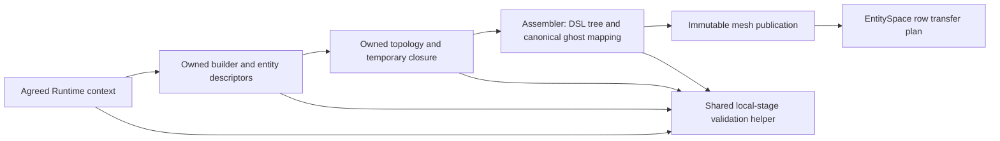

# Mesh preparation communication policy

Native owned construction accepts an optional, collectively agreed Runtime
communication context. Existing callers keep collective safety preflight enabled.
This policy controls safety-only agreement, independently of mesh identity,
topology, audit selection, indexing and physical storage layout.

```cpp
auto communication = std::make_shared<DNDS::Runtime::CommunicationContext>(mpi.comm, false);
DNDS::Geom::NativeMeshBuildOptions options;
options.communication = communication;
auto owned = DNDS::Geom::NativeMeshBuilder::Build(std::move(input), options);
owned = DNDS::Geom::NativeMeshTopology::Build(std::move(owned), mpi);
auto specification = DNDS::Geom::DefaultNativeMeshGhostSpec(owned, 1, true);
auto state = DNDS::Geom::NativeMeshAssembler::Build(mpi, std::move(owned), specification);
```

Construction binds all input entity descriptors to that context. A null option
inherits the input cell descriptor's context; an absent descriptor context means
enabled compatibility behavior. `EntitySpace::WithCommunication(context)` returns
a descriptor sharing the exact numbering maps, identity and generation stamps.
It changes neither existing descriptors nor `SameOrder`. Siblings, ghost-map
replacements, interpolated entity families and final publications inherit the
selected context. A retained old descriptor remains usable under its old policy.
The complete-state topology frontends inherit that policy too, including their
mutation-availability preflight. `CheckCollectiveMutationAvailable(bool)` now
names and respects its safety-mode argument; its default remains enabled. It
does not acquire mutation ownership: the caller still serializes submission and
publication. Local version/access checks remain active in either mode.
Do not change context choices rank-locally or during active work; all ranks must
select the matching context at a drained, coordinated setup boundary.



Owned records carry the context for checks before their descriptor inventory is
validated. Keep that field and every descriptor on the same policy; topology,
assembly, publication and registry registration reject mixed policies. Public
setup boundaries agree the actual selected mode before optional local stages.
Registries freeze that agreement for their collective lifetime. This protects
against selecting different already-valid on/off contexts on different ranks.

`LocalStage` still executes local checks. Enabled mode agrees failures and
preserves the originating local exception; disabled mode performs no successful
safety reduction and aborts on local failure before peers can strand in payload
work. Off mode does not provide recoverable distributed rollback. Required
ownership decisions, schedule/schema checks, sparse discovery, alias/reuse
agreement, row counts and numerical reductions remain. Full identity/closure
audits still execute when requested; this switch does not disable their content.

`EntitySpace::BuildRowTransferPlan()` inherits its descriptor's context. The
overload accepting an explicit congruent context remains available. Binding and
request ownership, direct MPI datatypes and explicit payload namespaces keep
their existing contracts; attaching a context does not create a transfer.

CGNS/OpenFOAM native ingress accepts the context through
`NativeMeshBuildOptions::communication`. The owned read/derive helpers also
accept it as their final argument. Partition, local permutation, distributed
row correspondence and elevation/bisection preserve it through the final
publication. Cauchy's default CGNS loader constructs that context from
`implicit.collectiveChecks`; custom mesh factories still supply their own mesh
preparation policy. Supplying an already built mesh does not retroactively
change the communication that created it.

`EntityField` routes inherit the entity descriptor's policy, including its
binding-generation validation before each start. Standalone `RegisterArray`
and `RegisterField` accept an explicit communication context: an Array has no
intrinsic mesh policy. Null retains enabled compatibility behavior. EntityField
registration supplies its context automatically. Retain registered handles
until preparation/publication finishes, join producers and release conflicting
access scopes before invoking a transition. Off mode does not relax ownership.

Python `read_native_cgns` and `read_native_cgns_with_names` expose the same
default-on policy as `collective_preflight`. Topology/refinement wrappers inherit
the publication policy; descriptor rebinding and inspection remain available.
All ranks must select the same mode. Disabled-mode input failures abort rather
than becoming recoverable Python exceptions.

This remains a staged E1 implementation. Archive/serializer error coordination,
bare entity-space creation, legacy compatibility decoders and other cold
preparation entry points require separate classification and propagation;
they must not be counted as safety-free merely because final halos inherit
the context. Required file, schema and payload protocols remain enabled.

`geom_test_mesh_preflight` compares on/off topology and direct halo payloads,
including empty owners and a self-periodic mesh. PMPI counts prove four repeated
local stages and three repeated halo starts use zero safety reductions in off
mode. Required setup reductions are retained, so complete setup is not expected
to have zero MPI reductions. The test also checks immutable descriptor rebinding
and mutation preflight, and rejects inconsistent context selection before
optional preparation begins.

The owned-CGNS fixture additionally exercises reader-only ingress, partition,
elevation, bisection, a permuted ID-valued companion, local reorder and final
assembly with both policies. Final connectivity is identical. An EntityField
halo start has two safety reductions in enabled mode and zero when disabled;
its received values are checked against global row IDs. A small Cauchy default
loader fixture verifies the config reaches mesh families and metrics, then
compares a completed physical step bit-for-bit across policies.
