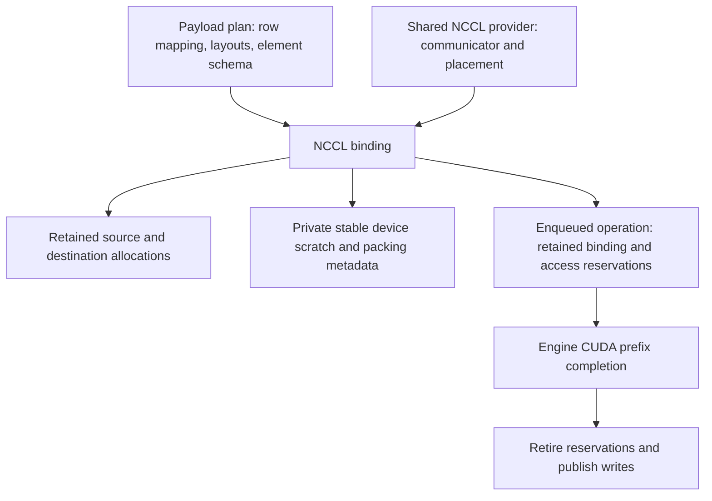

# Stream-ordered NCCL transfers

`Runtime::NCCLTransferProvider` is an optional CUDA payload backend. The existing
MPI row/payload plans remain the setup/control plane. NCCL bindings carry the
prepared payload on a CUDA stream without per-exchange MPI calls or application
host waits between pack, communication and unpack. One rank uses one GPU.
NCCL may internally use host shared memory and CPU proxy threads on PCIe systems;
this does not promise NVLink, GPUDirect RDMA or a particular overlap speedup.

## Build and selection

`DNDS_USE_NCCL` defaults to ON when CUDA is enabled and OFF for a CPU build.
Use `-DDNDS_USE_NCCL=OFF` to explicitly opt out of a CUDA build's NCCL dependency.
Configure `DNDS_USE_CUDA=ON` and optionally `NCCL_ROOT` pointing to a directory
containing `include/nccl.h` and `lib/libnccl.so`. A versioned
`libnccl.so.2` is accepted. Existing CPU and CUDA-without-NCCL builds keep working.
As with other CMake options, an existing cached NCCL choice remains in force.
`NCCLTransferProvider::Available()` reports build capability; `Create` validates
the runtime placement. Explicit unsupported requests throw, without MPI fallback.

`Create(sharedCommunicationContext, device)` retains that exact bootstrap/control
owner without MPI duplication. The raw `MPI_Comm` overload retains its historical
isolated-namespace behavior. Dispose the last provider/context owner on the
creating controller thread before MPI finalization.

No Torch link or automatic package installation is required. An existing NCCL distribution,
including a separately installed NVIDIA wheel, can supply the library. It is not
copied into DNDSR. The installed local Python library retains the configured
NCCL runtime directory in its RPATH; deployments must provide that compatible
runtime or an equivalent loader path.

```cpp
auto provider = Runtime::NCCLTransferProvider::Create(mpi.comm, device);
Runtime::TransferOptions options;
options.provider = provider;
auto coefficients = resident.BuildCoefficients(components);
auto halo = resident.BindHalo(coefficients,
                             Runtime::TransferTransport::DevicePacked, options);
```

`Direct` requires a contiguous payload span per peer at each endpoint and a fully
described contiguous schema. `DevicePacked` supports prepared table/column/tiled,
padded and CSR selections through device gather/scatter. HostPacked, opaque
schemas, overlapping receive rows and reductions are explicitly unsupported in
this provider. NCCL does not consume MPI derived datatypes. Registered POD
packing uses the schema extent and described fields; receiver padding and omitted
fields remain untouched. Null `options.provider` preserves the MPI defaults.
Do not combine a provider with an MPI context/tag.
`TransferMode` selects the MPI request policy; NCCL has no persistent MPI
requests, and both mode values use the same prepared stream protocol.

## Ownership and ordering



Binding allocates/uploads its private scratch and packing metadata once. Enqueue
does not resize or allocate device scratch. Bindings can share a row mapping,
but their mutable scratch is private. A binding pins the old allocations after
an Array handle is reset; rebuild after changing the intended storage, physical
layout or semantic row order. Routing epoch dependencies are checked locally.

The caller owns every producer/consumer edge. A typical split iteration is:

```cpp
comm.WaitFor(compute.Record()); // last owned producer/previous ghost consumer
halo.Enqueue(engine, comm);    // pack -> NCCL -> unpack, in this stream
resident.SubmitReconstructionIterTo(engine, compute, mean, coefficients,
                                    work, boundary, ReconstructionRegion::Core);
compute.WaitFor(comm.Record()); // logical ghost values ready after unpack
resident.SubmitReconstructionIterTo(engine, compute, mean, coefficients,
                                    work, boundary, ReconstructionRegion::HaloDependent);
resident.SubmitCommitReconstruction(engine, compute, coefficients, work);
// Further correctly ordered iterations may be queued before observation.
engine.Synchronize();
provider->CheckAsyncError();
```

Core work reads owned inputs only; the transfer writes separate ghost storage.
The engine retains scheduled source/destination/scratch access until actual GPU
completion. Pending writes still reject immediate host-visible access. Later
scheduled accesses may be queued with the appropriate stream/event order; no
CPU-visible lease retirement is required between those submissions. The current
unchecked eager engine does not detect missing edges, including reuse of private
scratch from another stream. Order repeated uses of one binding, or use separate
bindings/workspaces for independent lanes. Keep native streams alive through use.

All ranks prepare matching plans and issue consistent per-peer NCCL call order;
there are no MPI-style tags. Different shared-provider bindings also share that
ordering obligation. Use a separate provider/communicator for independent lanes.
Do not mix unrelated compute streams inside one NCCL group: that can synchronize
the streams. Only the provider's communication stream is used by its group.

`Begin(context)` retains immediate leases and requires CPU-visible access to be
available. `BeginScheduled(context)` allows caller-ordered pending GPU producers.
Both return an operation with explicit `Test`/`Wait` and destruction that drains
it. For a segment with no intermediate host completion wait, use
`Enqueue(engine, stream)` and stream `Record`/`WaitFor`. Ordinary MPI rejects
`Enqueue`; its existing portable host-progress bridge remains necessary.

## Errors and limits

Binding validates policy, schema, layout and communicator compatibility
collectively during setup. Hot NCCL submission has no MPI collective preflight.
Bootstrap identity is checked as well: congruent MPI groups alone do not prove
that ranks selected the same NCCL communicator.
Rank-local stale epochs, lease errors or mismatched application submission order
cannot be recovered by a collaborative solver: abort without draining potentially
unmatched peer work. Coordinated validation tests may catch before submission.
The optional scheduled-access checker validates declared local dependencies;
it cannot prove that remote ranks submit matching NCCL calls.

`Enqueue` registers a controller-side binding/provider owner before launch.
Runtime progress polls asynchronous NCCL errors while work is pending, then drops
that owner only after numerical retirement. A CPU worker may observe the CUDA
prefix without performing final MPI/NCCL disposal. This adds no per-kernel event
or host completion wait. `Close`/`Synchronize` progress these records alongside
managed MPI and streams; external handles may be dropped after submission.
An asynchronous transport failure takes a terminal abort path rather than
waiting on a possibly stalled prefix. Remote schedule omissions that NCCL does
not diagnose remain caller errors.

`CheckAsyncError()` and `Abort()` remain manual-provider facilities. Raw `Begin`
callers must retain and retire their operations and observe provider errors.
Failed accesses are poisoned rather than published as successful values. Solver
exception handlers abort; no exception-based distributed recovery is provided.

Static peer/count descriptors and prepared buffers leave a future capture path,
but graph capture, graph pools and capture validation are not implemented by
this API. Changing device numerical values is different from changing a bound
layout or message count. Rebind shape changes outside active transfers. Dynamic
host inputs must use retained buffers and an explicitly ordered copy; a temporary
host pointer is not a safe asynchronous source.

## Validation

`dnds_test_nccl_transfer` exercises exact row order, physical layouts, queued
producer/transfer/consumer epochs, CSR/empty ownership, registered POD fields,
capability/collision/abort errors, and a warmed gated transfer with independent
core completion. A deliberately omitted producer edge demonstrates stale epoch
transfer in unchecked mode without causing an actual concurrent data race.
The CFV CUDA suite has NCCL and combined NCCL/FP64-MMA modes;
Python tests cover retained array/slice ownership and the public provider API.
See the [execution record](../dev/nccl_fp64_2026-11-01.md) for completed runs and
sanitizer/performance limits.

References: [NCCL point-to-point](https://docs.nvidia.com/deeplearning/nccl/user-guide/docs/usage/p2p.html)
and [NCCL stream semantics](https://docs.nvidia.com/deeplearning/nccl/user-guide/docs/usage/streams.html).
