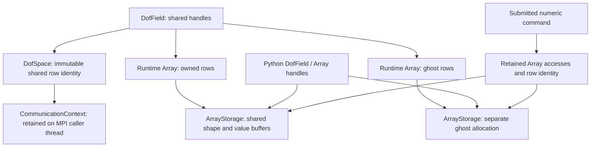

# Native DOF algebra

`DNDS::Algebra` provides numerical operators over composed Runtime Arrays. It
does not depend on Geom or a fluid solver. Legacy Array/DOF APIs remain separate.

## Reserved scratch

`DofScratchPool` reserves CPU `DofBundle` payloads, preserving every physical
field's owned and ghost layout. Each candidate is ghost-capable. `Reserve`
allocates; `Prepare` binds an explicit level/row-space alias and its actual halo
mapping once; `Acquire` chooses a deterministic prepared descriptor with no
allocation of payloads, datatype compilation, MPI or rank-local free-list choice.
Equal shape is not evidence of equal row order: the caller proves the semantic
association and supplies the correct mapping for each prepared level.

Owned-only and communicating are borrow requirements, not separate allocation
classes. An owned-only borrow cannot start an exchange through the pool API.
A communicating borrow exposes its saved per-field transfers; those still need
matching calls on all ranks. Dirty acquisition leaves values unspecified and
advances owned generations; zero acquisition explicitly fills owned values.
Neither mode promises fresh ghosts. Bindings and allocation identities remain
stable, and storage generations are never reset.

The controller serializes setup, borrowing and return. Sharing field aliases is
allowed only during their borrow; do not rebind them or retain them for later
use. CPU kernels and exchanges must complete before return. Explicit `Release`
rejects active views/transfers while retaining the borrow; an invalid RAII return
is fatal. The initial facility does not implement deferred asynchronous returns.
`RetainedBytes` and `PeakBorrows` report payload bytes and simultaneous slots,
excluding metadata. Reconstruction scratch belongs to a separate pool family.

`DofSpace` is an immutable description of one prepared owned/ghost row ordering.
Fields share the same space handle to assert that corresponding rows mean the
same thing. Equal local counts or communicator membership are insufficient.
Independent spaces require an explicit transfer or association outside algebra.
A distributed space retains a `Runtime::CommunicationContext`; its construction
is collective. Keep this space alive on an MPI-permitted caller thread through
global operations. Numeric command captures retain immutable row identity without
transferring MPI communicator destruction to a worker or device callback.

`DofField<T, Components>` composes separate owned and ghost Runtime Arrays.
Supported value types are `float` and `double`. `Components` can be a compile-time
width or `Runtime::DynamicExtent`; the latter requires a constructor width.
Both arrays use fixed-width table layouts, including a physical stride larger
than the logical width. Variable-row padded/CSR layouts are rejected. Ghost
values are exposed for application-managed halo exchange, never consumed by the
operators below. Copying a field shares its Array handles; numerical `Copy`
writes existing destination values and allocates no hidden history.

The Array handle itself erases row policies. A statically sized `DofField<T, N>`
therefore revalidates its logical component width on import and at every algebra
entry point, including after replacement of its owned/ghost handles. Equal
owned and ghost widths alone do not satisfy a different compile-time `N`.
This is a constant-time operation-prologue check: `Detail::Check`/`Pair` call
`Validate` before `SubmitArrays`. Neither the CPU `Apply` loop nor the CUDA
`PointwiseKernel` calls it. The loops, stores and kernel parameter layout are
unchanged; very small operations still pay the host-side validation overhead.

```cpp
namespace A = DNDS::Algebra;
namespace R = DNDS::Runtime;
auto communication = std::make_shared<R::CommunicationContext>(mpi.comm);
A::DofSpace space(communication, localCells, ghostCells);
A::DofField<double, 7> x(space, 7, 10), residual(space);
A::Fill(x, 0.);                  // synchronous convenience on x's device
R::EagerEngine engine(2);
auto stream = engine.CreateCPUStream();
A::Fill(engine, stream, residual, 1.);
A::Axpy(engine, stream, x, 0.25, residual);
double localDot = A::DotLocal(engine, stream, x, residual).Get();
double globalNorm = A::NormGlobal(engine, stream, residual);
engine.Synchronize();
```

`Fill`, `Copy`, `Scale`, `Axpy(out, alpha, input)` and
`LinearCombination(out, alpha, x, beta, y)` touch logical owned entries only.
Ghost values and row capacity padding remain unchanged. Shapes, widths, scalar
types, placement and shared distribution are validated at the boundary. Exact
aliases with the same layout are supported, including all operands sharing one
field; partial overlapping output/input ranges are rejected. Imported storage
must obey Runtime's import-once/controller rules. No implicit device transfer is
performed. Immediate convenience overloads resolve the field's device, using an
inline CPU stream or an owned CUDA stream, and drain it before returning. Hot
paths should use an explicit engine/stream to avoid repeated stream creation and
synchronization. Immediate convenience is a serialized caller boundary: every accessed owned allocation must
be idle, including no active leases or pending scheduled accesses. Complete the
producer prefix before using it. Global immediate checks participate in collective
error agreement; one rank's pending access cannot strand its peers.



The diagram shows possible shared ownership, not numerical operator scope:
algebra uses owned rows only. Host/device kernel views are borrowed plain
descriptors under retained accesses. They add no shared-pointer traversal inside
the numerical loop. Python and C++ handles observe the same values and access
controller; releasing a Python wrapper does not invalidate retained native work.

The engine/stream overloads reserve and retain all accessed Arrays through
completion using `SubmitArrays`. Commands do not infer cross-stream dependencies:
record the producer prefix and call `consumer.WaitFor(producer.Record())` before
reading its result. Successful submission and `IsValid()` do not prove ordering.
Do not retain kernel views beyond their submitted command. Observe errors through
result `Get()`, stream events or `engine.Synchronize()` before publishing values.

`DotLocal` and Euclidean `NormLocal` return `ScalarResult` in scheduled form.
`ComponentSumLocal`, `ComponentMinLocal` and `ComponentMaxLocal` return
`ComponentResult`. `Get()` explicitly waits the submitted prefix and returns host
results. CUDA reductions copy only the scalar/component result after completion;
they do not stage the input field. Empty local sums/dots/norms are zero; empty
component minima/maxima are positive/negative infinity. Reductions accumulate in
double precision. Floating results are not partition-invariant bitwise; extrema
use `fmin`/`fmax` semantics and ignore isolated NaNs.

Global variants first obtain the local result on the calling thread, collectively
agree that each local operation succeeded, and then perform the MPI reduction.
Component count, scalar width and reduction kind must agree on all ranks. Global
functions are collective and require matching calls, including empty ranks. MPI
is never invoked by a numeric worker or CUDA kernel. Follow MPI's initialized
thread level and Runtime's explicit synchronization contract.

The initial CUDA pointwise backend supports both value types and arbitrary
positive component widths. Its reductions use deterministic sequential row sums
per component (a dot is one scalar lane), without atomics or input-sized scratch.
This establishes the numerical/lifetime contract; it is not a tuned parallel
reduction implementation. No arbitrary POD, integer, mixed-device or cross-domain
product arithmetic is implied. Product spaces can later compose independent
fields and their local reduction results before explicit MPI aggregation.

Python exposes `DNDSR.DNDS.Runtime.Algebra`. `DofField(space, components, dtype,
stride, device)` selects float32/float64. The `owned` and `ghost` properties return
Runtime Arrays sharing the native allocation and layout; their NumPy snapshots
remain copies. `FloatDofField`/`DoubleDofField` also accept a space and existing
typed Runtime owned/ghost arrays. Lowercase operation names mirror C++; scheduled
operations use `_async`, and pending reduction handles expose `get()`.
Global reductions also accept an explicit engine and stream on CPU or CUDA;
they finish the local reduction and MPI aggregation before returning.

Validation on 2026-10-27 used fresh CPU and CUDA builds. All four Python
extensions (DNDS, Geom, CFV and EulerP) were rebuilt and installed before normal
package imports; extension paths, ELF build IDs and `Runtime.cuda_enabled` were
checked for each profile. Public named arguments and caller-contract docstrings
were checked through the installed modules.

- Native CPU algebra passed at MPI sizes 1, 2, 4 and 8 in both build profiles.
  The tests include a manufactured seven-component diagonal Krylov solve,
  mismatched-operation and one-rank invalid/pending-access collective errors,
  retries, explicit cross-stream joins, aliasing and retained operands.
- Native CUDA float/double tests passed 77,940 assertions, including nonuniform
  negative component reductions, empty identities and a compile-time six-column
  field. Compute Sanitizer memcheck reported zero errors.
- Python algebra and mesh-facade tests passed at MPI sizes 1, 2 and 4 in the CPU
  profile (24 passed and three CUDA-only skips per rank), and MPI sizes 1 and 2
  in the CUDA profile (27 passed per rank). CUDA runs assigned one distinct GPU
  per local rank, verified before import. They include direct device-to-result
  global dot/norm and component sum/min/max reductions.

These checks establish behavior and lifetime contracts, not performance claims.
GPU MPI sizes above two were not run on this two-GPU machine; larger MPI sizes
used CPU fields. The CUDA reduction implementation remains the functional
baseline described above.

Uniform DOF fields also accept an explicit physical RowLayout prototype. Python
`DoubleDofField(space, prototype, device)` / `FloatDofField(...)` allocate AoS,
column-major or tiled tables; owned and ghost pitches are derived separately.
The existing `(space, owned, ghost)` constructor shares all supported uniform
physical tables. Async algebra traverses logical components, leaves ghosts and
physical padding untouched, and retains the same caller-supplied stream ordering.

## Explicit CPU halo publication

`DNDS/Algebra/DofHalo.hpp` provides `DofHalo<T, Epoch>` over a DofField and an
immutable owned-to-ghost RowTransferPlan. Epoch defaults to uint64_t; a caller
may use an equality-comparable step/trial/stage tuple instead. This companion
uses the ordinary direct PayloadPlan/TransferBinding path and retains the
field's physical AoS/SoA/AoSoA layout. It does not add a packing buffer.

```cpp
Algebra::DofHalo<> halo(u, rowRoute); // Collective setup, persistent binding.
auto operation = halo.Begin(exchangeEpoch, engine, cpuStream);
// Independent core work reads u.Owned(); it cannot see the active ghost writer.
operation.Wait();
halo.RequireCurrent(u, exchangeEpoch); // Local check before dependent reads.
```

Explicit successful Wait/Test records source/ghost versions, bound storage,
shape/row-space identity, route dependencies and the caller epoch. Destroying
an unobserved operation drains it but publishes no freshness record. Copied
companion handles share the record. Owned writes, external ghost writes,
rebindings and shape/mapping changes invalidate it. This is a prologue check;
ordinary access leases still protect the subsequent reads and hot loops.

The caller agrees epoch meaning and exchange order across ranks, serializes the
companion on an MPI-permitted controller, and retains the context until before
MPI finalization. A checked CPU stream waits for its producer prefix;
caller-ordered eager mode requires CPU producers already complete. Begin's
extra diagnostic collective defaults off. Binding validity is folded into the
selected MPI transfer preflight even with that diagnostic disabled; this adds
no reduction. Default collective validation rejects before requests. Explicit
`TransferOptions::preflight=TransferPreflight::AbortOnFailure` checks locally
and aborts MPI on failure, with no recoverable rejection. CUDA is explicitly unsupported here until stream-ready receipt
semantics are provided. Destruction may drain MPI; do not retire these owners
on arbitrary worker/device callbacks.

Every Begin exchanges conservatively. An unchanged local owned version alone
cannot detect a remote-only source update or justify an independent skip.
With an explicit collective-mutation and common-scheduling contract, callers
may reuse a completed publication using local RequireCurrent checks: every
rank checks its own recorded version, not equality of version numbers across
ranks. The exchange-or-reuse decision must be common. Changed owned values
normally request a refresh; only requesting reuse of stale data is an error.
The initial Cauchy pipeline still exchanges conservatively. No extra freshness
Allreduce is required for an already agreed schedule.
RequireCurrent checks the requested epoch in addition to versions. The record
certifies the completed transfer, not an independent assertion that all remote
producers chose the right physical stage. Solver orchestration supplies that
association. Outputs of numerical operations continue to guarantee owned values
only; no output halo exchange is implicit.

## Queued local product scratch

`Algebra::LocalProductWorkspace` reserves scalar result slots and bounded tree
scratch for weighted dot products and finiteness checks. It has no communicator
or halo policy. `SubmitProduct` computes `sum((x*inverseScale)*(y*inverseScale))`
over logical owned entries, including noncompact table strides. The inverse
scales are immutable during queued use; changing them is an explicit setup
boundary. Identical scales reuse the resident buffer.

All operands and scratch are retained by the eager record. Reused partials
require one ordered lane or explicit dependencies between lanes. CPU uses
canonical row/component summation; CUDA uses deterministic two-level trees,
without floating-point atomics. The results need not be bitwise equal across
backends. `SubmitFinite` uses a logical AND and reports true on empty ranks.
`ReadResults` is an explicit host observation after the caller drains the lane;
only the small result buffer is copied. Numerical MPI reductions remain the
caller's responsibility. Plan 61 integration/tests are source-only pending
the grouped Phase C validation.
