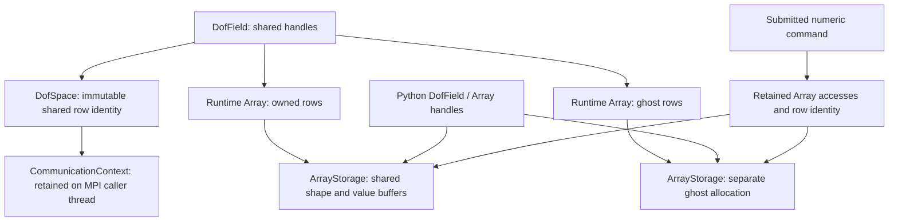

# Native DOF algebra

`DNDS::Algebra` provides numerical operators over composed Runtime Arrays. It
does not depend on Geom or a fluid solver. Legacy Array/DOF APIs remain separate.

`DofSpace` is an immutable description of one prepared owned/ghost row ordering.
Fields share the same space handle to assert that corresponding rows mean the
same thing. Equal local counts or communicator membership are insufficient.
Independent spaces require an explicit transfer or association outside algebra.
A distributed space retains a `Runtime::CommunicationContext`; its construction
is collective. Keep this space alive on an MPI-permitted caller thread through
global operations. Numeric command captures retain immutable row identity without
transferring MPI communicator destruction to a worker or device callback.

`DofField<T, Components>` composes separate owned and ghost Runtime Arrays.
Supported value types are `float` and `double`. `Components` can be a compile-time
width or `Runtime::DynamicExtent`; the latter requires a constructor width.
Both arrays use fixed-width table layouts, including a physical stride larger
than the logical width. Variable-row padded/CSR layouts are rejected. Ghost
values are exposed for application-managed halo exchange, never consumed by the
operators below. Copying a field shares its Array handles; numerical `Copy`
writes existing destination values and allocates no hidden history.

```cpp
namespace A = DNDS::Algebra;
namespace R = DNDS::Runtime;
auto communication = std::make_shared<R::CommunicationContext>(mpi.comm);
A::DofSpace space(communication, localCells, ghostCells);
A::DofField<double, 7> x(space, 7, 10), residual(space);
A::Fill(x, 0.);                  // immediate CPU convenience
R::EagerEngine engine(2);
auto stream = engine.CreateCPUStream();
A::Fill(engine, stream, residual, 1.);
A::Axpy(engine, stream, x, 0.25, residual);
double localDot = A::DotLocal(engine, stream, x, residual).Get();
double globalNorm = A::NormGlobal(engine, stream, residual);
engine.Synchronize();
```

`Fill`, `Copy`, `Scale`, `Axpy(out, alpha, input)` and
`LinearCombination(out, alpha, x, beta, y)` touch logical owned entries only.
Ghost values and row capacity padding remain unchanged. Shapes, widths, scalar
types, placement and shared distribution are validated at the boundary. Exact
aliases with the same layout are supported, including all operands sharing one
field; partial overlapping output/input ranges are rejected. Imported storage
must obey Runtime's import-once/controller rules. No implicit device transfer is
performed. Immediate convenience overloads use the same inline CPU engine and
reject CUDA fields; CUDA work uses an explicit engine and CUDA stream. Immediate
convenience is a serialized caller boundary: every accessed owned allocation must
be idle, including no active leases or pending scheduled accesses. Complete the
producer prefix before using it. Global immediate checks participate in collective
error agreement; one rank's pending access cannot strand its peers.



The diagram shows possible shared ownership, not numerical operator scope:
algebra uses owned rows only. Host/device kernel views are borrowed plain
descriptors under retained accesses. They add no shared-pointer traversal inside
the numerical loop. Python and C++ handles observe the same values and access
controller; releasing a Python wrapper does not invalidate retained native work.

The engine/stream overloads reserve and retain all accessed Arrays through
completion using `SubmitArrays`. Commands do not infer cross-stream dependencies:
record the producer prefix and call `consumer.WaitFor(producer.Record())` before
reading its result. Successful submission and `IsValid()` do not prove ordering.
Do not retain kernel views beyond their submitted command. Observe errors through
result `Get()`, stream events or `engine.Synchronize()` before publishing values.

`DotLocal` and Euclidean `NormLocal` return `ScalarResult` in scheduled form.
`ComponentSumLocal`, `ComponentMinLocal` and `ComponentMaxLocal` return
`ComponentResult`. `Get()` explicitly waits the submitted prefix and returns host
results. CUDA reductions copy only the scalar/component result after completion;
they do not stage the input field. Empty local sums/dots/norms are zero; empty
component minima/maxima are positive/negative infinity. Reductions accumulate in
double precision. Floating results are not partition-invariant bitwise; extrema
use `fmin`/`fmax` semantics and ignore isolated NaNs.

Global variants first obtain the local result on the calling thread, collectively
agree that each local operation succeeded, and then perform the MPI reduction.
Component count, scalar width and reduction kind must agree on all ranks. Global
functions are collective and require matching calls, including empty ranks. MPI
is never invoked by a numeric worker or CUDA kernel. Follow MPI's initialized
thread level and Runtime's explicit synchronization contract.

The initial CUDA pointwise backend supports both value types and arbitrary
positive component widths. Its reductions use deterministic sequential row sums
per component (a dot is one scalar lane), without atomics or input-sized scratch.
This establishes the numerical/lifetime contract; it is not a tuned parallel
reduction implementation. No arbitrary POD, integer, mixed-device or cross-domain
product arithmetic is implied. Product spaces can later compose independent
fields and their local reduction results before explicit MPI aggregation.

Python exposes `DNDSR.DNDS.Runtime.Algebra`. `DofField(space, components, dtype,
stride, device)` selects float32/float64. The `owned` and `ghost` properties return
Runtime Arrays sharing the native allocation and layout; their NumPy snapshots
remain copies. `FloatDofField`/`DoubleDofField` also accept a space and existing
typed Runtime owned/ghost arrays. Lowercase operation names mirror C++; scheduled
operations use `_async`, and pending reduction handles expose `get()`.
Global reductions also accept an explicit engine and stream on CPU or CUDA;
they finish the local reduction and MPI aggregation before returning.

Validation on 2026-10-27 used fresh CPU and CUDA builds. All four Python
extensions (DNDS, Geom, CFV and EulerP) were rebuilt and installed before normal
package imports; extension paths, ELF build IDs and `Runtime.cuda_enabled` were
checked for each profile. Public named arguments and caller-contract docstrings
were checked through the installed modules.

- Native CPU algebra passed at MPI sizes 1, 2, 4 and 8 in both build profiles.
  The tests include a manufactured seven-component diagonal Krylov solve,
  mismatched-operation and one-rank invalid/pending-access collective errors,
  retries, explicit cross-stream joins, aliasing and retained operands.
- Native CUDA float/double tests passed 77,940 assertions, including nonuniform
  negative component reductions, empty identities and a compile-time six-column
  field. Compute Sanitizer memcheck reported zero errors.
- Python algebra and mesh-facade tests passed at MPI sizes 1, 2 and 4 in the CPU
  profile (24 passed and three CUDA-only skips per rank), and MPI sizes 1 and 2
  in the CUDA profile (27 passed per rank). CUDA runs assigned one distinct GPU
  per local rank, verified before import. They include direct device-to-result
  global dot/norm and component sum/min/max reductions.

These checks establish behavior and lifetime contracts, not performance claims.
GPU MPI sizes above two were not run on this two-GPU machine; larger MPI sizes
used CPU fields. The CUDA reduction implementation remains the functional
baseline described above.
