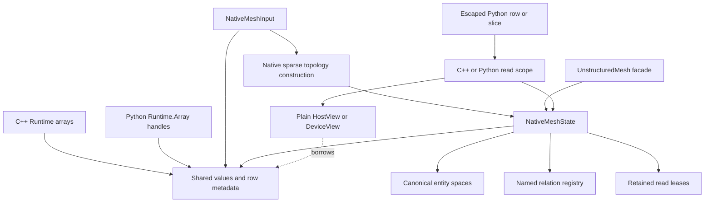
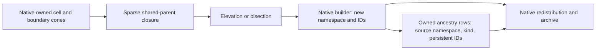
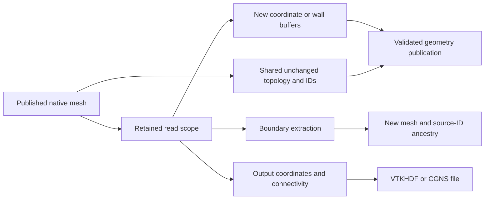

# Native mesh construction and access

`NativeMeshBuilder` builds primary unstructured topology directly from
`Runtime::Array` storage. `UnstructuredMesh::FromNative` wraps the result in the
existing public mesh facade. Neither operation constructs a legacy mesh array.
Current construction, ownership, setup and output are native-only. The migration history and validation ledger are tracked in
[the Geom work ledger](../dev/geom_native_migration_2026-10-25.md).

## Ownership and publication



Publication adopts existing coordinate and metadata buffers and retains read
leases. A caller can keep its original Array handle, but cannot write through
that alias while the publication or an escaped read still owns the allocation.
Replacing an Array handle does not retarget a mesh or an escaped row. A plain
C++ view does not own storage: retain its `MeshReadAccess` until all host, worker and device uses complete, and attach completion that joins every consuming GPU stream.

Entity spaces describe the current owned/appended row order. Their global
indices are rank-offset addresses, separate from persistent entity IDs.
Replacing a descriptor handle shares its controller; it does not invalidate the
old descriptor. Actual mesh changes use the mutation/publication contract.

Persistent identity is the tuple `(mesh namespace, entity kind, ID)`. Publication
checks owned-ID uniqueness using distributed hash buckets and verifies ghost IDs
against owners. Each kind has a next-ID high-water mark that survives transitions;
deleting an entity must not lower it. New construction generates one collective
UUID unless a saved namespace is supplied. Native archive persistence for this
metadata is included in native archives.

Ordinary topology refresh preserves unchanged Face/Edge IDs through sparse
full-key matching. Keys use the element type, all persistent node/image
occurrences, vertex roles and edge incidences under one periodic frame; hashes
only route exact-key comparisons. New keys allocate above the previous
high-water mark. Explicit destroy/reconstruct floors deliberately assign fresh
IDs. Refresh remaps named source/target rows and ancestry; it rejects added or
removed keys when an arbitrary retained definition cannot be inferred safely.
Sorted set variants are re-sorted after renumbering; physical slot aliases are
regenerated with their current orientation. No persistent ID is an array index.

## Native construction

`NativeMeshInput` contains sibling owned-only Cell, Node and Boundary spaces,
owned coordinates, element metadata, and cell/boundary node cones in global
numbering. Optional persistent-ID columns must match the owned row counts.
Coordinates have three components even for two-dimensional geometry.

```cpp
NativeMeshBuildOptions options;
options.cellLayers = 2;
options.completeNodeStar = true;
auto state = NativeMeshBuilder::Build(std::move(input), options);
auto mesh = UnstructuredMesh::FromNative(mpi, state);
auto access = mesh->AcquireRead(state->Requirements());
auto view = access.HostView();
// Borrow view inside loops; keep access alive until all uses finish.
```

Construction is collective. Every rank, including empty ranks, must use the same
communicator, options and schedule. Do not invoke setup concurrently on the same
MPI communication context. Finish asynchronous producers before passing input
arrays to the host builder. Recoverable local input errors are agreed before
subsequent communication. Invalid communicator participation itself is a caller
error and cannot be repaired by an MPI collective on a different communicator.

The builder obtains inverse support rows at their owners, constructs distinct
neighbor/containment relations, discovers requested ghosts, and exchanges typed
companions through shared entity routes. Storage is proportional to local rows,
requested/served rows and rank metadata. It never indexes a local vector by the
global entity count or the magnitude of a persistent ID.

`completeNodeStar` includes every cell and boundary incident to an owned node,
including when none is owned locally. Without that option, outer support rows
may contain explicit unavailable global references. Cell node cones always have
complete local coordinates. This is topology support; node-centered control
volumes are not implemented by this constructor.

The primary builder accepts nonperiodic meshes and already canonical periodic
input with explicit ordered cell/boundary node-image bits and rank-agreed rigid
transforms. Repeated canonical node IDs are valid only in distinct images.
Every external boundary must be an exact element face contained in exactly one cell. Unsupported
input is rejected; it is not converted through a legacy mesh.

`NativeMeshTopology::Build` constructs faces and (in 3D) edges using the native
interpolation DSL. It first reconstructs parent closure from authoritative owned
CellNodes, so incomplete incoming neighbor ghosts cannot produce duplicate faces.
Physical FaceCells retains two ordered slots and an absent-cell sentinel. The
mathematical inverse is a separate sorted-set relation. Shared high-order faces
must agree on all node IDs, including midside nodes; geometrically coincident
nodes with different identities do not silently become a conforming face.
`Build` rejects a target family that already exists; facade/native preparation retains existing families. Explicit transition destruction/reconstruction uses generated-ID floors so removed IDs are not reused; external family fields require the transition policy rather than a setup-only rebuild. Periodic interpolation compares exact
node-image patterns modulo a uniform frame change, including repeated node IDs.
Physical faces retain both parent occurrences even for a one-cell self face;
the named mathematical inverse retains unique cells. Periodic boundary pairs
must supply complementary main/donor labels, matched to exact element-face
occurrences in their physical frames. Generated face/edge companions preserve
those frames through native transitions and archives. The primary Runtime-array
builder still requires canonical identities; its Python low-level wrapper exposes
nonperiodic direct input only. The CGNS frontend additionally supports explicit
periodic geometry options and matching main/donor boundary labels.

`ReadNativeCGNS` calls the common CGNS parser on one explicit reader rank, then
distributes native rows and builds sparse topology. Its reader-only serial scratch
is distinct from distributed ghost construction. `UnstructuredMeshSerialRW` no longer performs ingestion: it is an output adapter. Native import supports
multi-zone and mixed-element conventions. Explicit periodic import canonicalizes
all ordered node occurrences, including high-order slots, using the shared native
pairing algorithm. Matching is bijective within the absolute tolerance and
validates exact image reconstruction. Original-node fixed points and CGNS
GridConnectivity Periodic properties are rejected explicitly. Node ID high-water
marks reserve pruned donor IDs; no implicit geometry-only pairing is enabled.

`ReadNativeOpenFOAM` uses the existing OpenFOAM STL parser/converter and distributes Runtime rows through the common serial-ingress helper. Serial input scratch belongs only to the reader; it is not distributed ghost storage. Even distribution is the ordinary policy; ReaderOwned ingress enables the single-active-rank RB partition path.

## New meshes and ancestry

`NativeMeshRefinement::Elevate` adds O2 nodes using exact shared vertex-span
identity and the established mean-coordinate rule. `Bisect` uses the existing
element subdivision mathematics, including the O2 tetrahedron diagonal choice.
They build a new mesh namespace with fresh IDs, without modifying the source.
Both preserve periodic occurrence labels. Elevation computes physical span means
and returns them to their common canonical image; bisection uses the physical
coordinates for tetrahedron variant selection. Boundary extraction selects
external boundaries, skips periodic seams, retains tangential node images, and
compacts used canonical nodes on their source owners. No curved-boundary
projection or conservative solution interpolation is implied. Native smoothing
is staged separately; see the development migration record.



Optional `NativeMeshProvenance` is immutable owned-row metadata. Each destination
family names a source kind and stores dense or CSR source persistent-ID rows.
Zero, one or multiple parents are permitted; repeated references are preserved.
Inherited nodes record their source node ID; elevated nodes record all defining
span nodes; split cells/boundaries record their parent ID. Values are payload,
never current source-row indices and never remapped during redistribution.
The source object need not remain alive. These rows are retained, transferred and
serialized alongside the mesh, including when different ranks use different
valid storage layouts. Newly constructed face/edge families can omit ancestry
when the construction has no source entity of that kind.

## Relation identity

A relation key records endpoints, traversal path, selection, self inclusion,
ordering, periodic policy, and a named/versioned definition. It also records its
construction provenance. Full keys are compared across MPI ranks; a descriptor
hash alone never establishes equality.

Direct Face-to-Cell incidence, Face-to-Node-to-Cell union, all-node containment,
and exact incidence matching can coexist. An exact/custom matcher needs an
explicit definition; a lambda address does not identify its semantics.
`SortedUnique` means strictly increasing decoded global targets, even when the
local owned/ghost numbering has a different order. Topological incidence rows
preserve their ordered slots and permitted boundary sentinels.

`NativeMeshState::Relation(key)` is a retained host setup query. Its named
registry is independent of fixed solver-facing slots; extra named variants are
not silently substituted into those slots. The fixed `UnstructuredMeshView`
continues to provide CUDA-callable direct row access. Native setup headers use Runtime arrays and explicit entity spaces. `MeshConnectivity` retains forwarding names for native mathematics, not a second storage backend. Live compute data remain local; `NativeRelation::Convert` creates detached global/local data without changing the source publication.

## Python

`Geom.build_native_mesh` accepts the same shared Runtime arrays: float64
coordinates, int64 connectivity and IDs, and `Geom.ElemInfo` metadata arrays.
The binding validates types collectively before creating entity spaces. It does
not instantiate a new Python Array class for every C++ fixed width.

```python
mesh = Geom.build_native_mesh(
    mpi, 2, coordinates, cell_nodes, cell_info, boundary_nodes, boundary_info,
    complete_node_star=True,
)
with mesh.acquire_read(inverse=True) as read:
    cell_nodes_view = read.cell_nodes(0) if read.counts["cell"][0] else None
# The escaped readonly NumPy row retains its scope, values and row metadata.
```

Python setters on POD elements update array values through the Runtime access
contract before publication. A retrieved POD value is a copy; write it back to
the Array to persist changes. Published mesh read views are readonly. The native
constructor tests exercise alias protection and escaped rows after both the
mesh and original input handles are released.

Python also exposes `read_native_cgns`, `with_native_topology`,
`elevate_native_mesh` and `bisect_native_mesh`. These are collective construction
operations returning a new facade; they preserve the source. The optional
`native_mesh_provenance(mesh)` result contains `source_namespace`, `source_kinds`
and `source_ids`. Each ancestry Runtime.Array shares the C++ allocation and
privately retains the owner publication, so retaining just that array after
deleting the mesh/dictionary keeps both its data and write protection alive.
It does not retain the source mesh named by the ancestry IDs.

## Migration and validation boundaries

`NativeMeshAssembler::CaptureOwned` retains native values and extracts only owned
topology in global numbering. `Build` uses those owned arrays to discover sparse
closure, exchange companions and publish local views. Native transition and
archive restart share this assembly; neither requires a legacy mesh candidate.

`WriteNativeMeshArchive` / `ReadNativeMeshArchive` preserve every published entity
family, fixed and named relation, periodic transform/bit companion, coordinates,
wall vectors, element metadata and persistent identity. They use Runtime Array
I/O through the existing Serializer. Only owned rows are saved. Matching reads
restore saved rank partitions; even reads take a contiguous partition per family
and support a different MPI rank count. Arbitrary overlapping/permuted read
windows are rejected because topology globals require exhaustive rank-ordered
ownership. Follow restart with a native transition for other placement policies.

Python exposes `mesh.write_native_archive(serializer, name)` and
`Geom.UnstructuredMesh.read_native_archive(mpi, serializer, name, partition,
ghost_layers)`. Every rank participates, including empty ranks. Per-rank JSON
supports matching reads only. Finish async producers before writing and keep
serializer mode/path/call order consistent. POD archives use the Runtime
homogeneous-ABI codec; external solver fields remain separate checkpoints.

The explicit legacy-primary decoder preserves stored original IDs and creates a
new namespace because the old format has none. It rejects duplicate stored IDs.
Historical periodic elevation could assign new node IDs starting at the pruned
canonical count, overlapping retained original IDs above that count. Such old
derived archives require an explicit repair policy before import; the native
decoder does not silently renumber them. For example, a periodic 10-by-10 grid
can retain original IDs through 108 after pruning to 100 canonical nodes, while
the old elevation starts new IDs at 100. Native derivation uses persistent
high-water marks and does not create that overlap.

`NativeMeshTransition` remaps topology through sparse owner requests and moves
rows, IDs and companions through native transfer plans. Persistent IDs are
payload, never inputs to adjacency renumbering. Read scopes over the old mesh
remain attached to the old allocations. `PreparedMeshTransition` stages field
changes and validates source attachments again before publishing the bundle.

`MeshEdit` stages native coordinates, cell metadata and permitted neighbor-order
changes directly over native buffers. Unchanged data remains shared; old read
scopes keep their original values. Coordinate edits invalidate derived wall
vectors. Named mathematical neighbor sets remain independent of an ordered fixed
neighbor row. Order inspection (`IsO1`/`IsO2`) reads the public native facade,
including on empty ranks.

## Geometry, boundary meshes and output

`ExtractBoundary` constructs a detached native mesh from the source boundary
elements, preserving physical face-node order when faces are available. Used
nodes stay on their original owners and are compacted through sparse requests.
Two-dimensional volumes produce one-dimensional boundary meshes with line cells;
point boundaries and a line-cell facial topology are not synthesized. Extraction
uses a new namespace and records Node-to-Node and Cell-to-Boundary persistent-ID
ancestry. It does not require the source to remain alive.

The `ConstructBndMesh` compatibility operation also fills current-row parent
caches for existing output consumers. Those caches describe that particular
source/destination pair and require serialized setup; durable ancestry remains
the portable correspondence. A destination must satisfy the native setup installer contract; no second geometry workspace is retained.



Native proper rotation/positive-scale transforms update coordinates, periodic frames and wall vectors coherently. General orientation-preserving affine transforms update coordinates and frames but invalidate wall vectors; conjugated periodic rotations must remain rigid. Arbitrary coordinate callbacks accept nonperiodic meshes only and run on node owners,
then exchange ghosts and invalidate wall vectors. Boundary rectification reduces
selected-node masks back to owners before refreshing ghosts. Callback failures
are agreed across ranks before publication. These native operations are
collective; callbacks must not enter collectives or mutate the source. Python `transform_coordinates` is a collective point-copy callback, not the removed writable bulk `TransformCoords` export. Callback or validation failure preserves the published source. Use the validated rigid/affine operations for periodic frame changes; general point callbacks reject periodic meshes.

`BuildNodeWallDist` preserves the established geometric search/integration mathematics using native queries. Its result is a node-bound owned/ghost vector pair;
publishing it shares the coordinate allocation and preserves its geometry epoch.
The existing nearest-wall search still gathers the wall triangle coordinates.
That replicated surface-search scratch is a separate limitation from sparse
mesh ghost construction, which never allocates by the global entity count.

`NativeMeshOutput` holds only output buffers and maps periodic image points back
to their source point-field rows. Distributed VTKHDF output uses the supplied
congruent output communicator for preparation and writing, including from a host
worker. It validates publication/distribution/periodic metadata before entering
different communication schedules. It does not build a temporary legacy mesh.
The CGNS writer reads native scoped queries and produces
local mixed-element payloads without changing adjacency numbering. Empty ranks
use CGNS's null-buffer protocol. Globally empty or periodic CGNS output is
explicitly rejected. CGNS operations are host-serialized: the library retains
process-global MPI state, so each parallel writer selects its communicator and
restores the self communicator afterward; local serial readers also select self.

Production reader orchestration, refinement, smoothing, boundary extraction and output consume native state. Existing output entry points use native output buffers; SerialRW is output-only and retains solver-field routing. The LocalRBF, GlobalRBF and Elasticity smoothers preserve their established mathematics; the distinct deprecated V1Old method rejects explicitly rather than silently selecting another algorithm. Some smoothing datasets and nearest-wall surface scratch remain replicated, so sparse mesh closure is not a scalability claim for those algorithms.

Python `read_mesh` and EulerP select native construction. `native=False` rejects before input I/O. Removed mesh APIs include publication/workspace switches, mutable topology producer chains, `SetPeriodicGeometry`, and writable bulk `TransformCoords`. Readonly legacy-spelling pair properties retain native scopes; generic solver-field Array/ArrayPair and Torch contracts remain available independently. `acquire_read` exposes only requested groups, even when additional topology exists. Auxiliary fill-order setup is pure and permitted under retained readers without changing mesh generations; read scopes pin their acquired state across cache/placement-handle replacement.

The full native archive is the authoritative mesh restart format. Old primary-wire import is a one-way Runtime decoder, not another backend. CPU, worker, MPI, Python and CUDA evidence belongs to the current validation ledger; API availability alone is not a runtime or numerical-equivalence claim.
