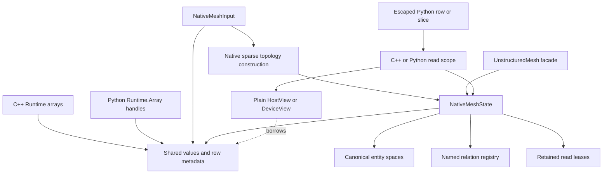
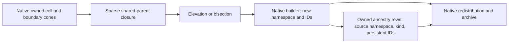

# Native mesh construction and access

`NativeMeshBuilder` builds primary unstructured topology directly from
`Runtime::Array` storage. `UnstructuredMesh::FromNative` wraps the result in the
existing public mesh facade. Neither operation constructs a legacy mesh array.
The ongoing migration is tracked in
[the Geom work ledger](../dev/geom_native_migration_2026-10-25.md).

## Ownership and publication



Publication adopts existing coordinate and metadata buffers and retains read
leases. A caller can keep its original Array handle, but cannot write through
that alias while the publication or an escaped read still owns the allocation.
Replacing an Array handle does not retarget a mesh or an escaped row. A plain
C++ view does not own storage: retain its `MeshReadAccess` through all CPU uses
or attach a completion that joins every GPU stream using it.

Entity spaces describe the current owned/appended row order. Their global
indices are rank-offset addresses, separate from persistent entity IDs.
Replacing a descriptor handle shares its controller; it does not invalidate the
old descriptor. Actual mesh changes use the mutation/publication contract.

Persistent identity is the tuple `(mesh namespace, entity kind, ID)`. Publication
checks owned-ID uniqueness using distributed hash buckets and verifies ghost IDs
against owners. Each kind has a next-ID high-water mark that survives transitions;
deleting an entity must not lower it. New construction generates one collective
UUID unless a saved namespace is supplied. Native archive persistence for this
metadata is included in native archives.

## Native construction

`NativeMeshInput` contains sibling owned-only Cell, Node and Boundary spaces,
owned coordinates, element metadata, and cell/boundary node cones in global
numbering. Optional persistent-ID columns must match the owned row counts.
Coordinates have three components even for two-dimensional geometry.

```cpp
NativeMeshBuildOptions options;
options.cellLayers = 2;
options.completeNodeStar = true;
auto state = NativeMeshBuilder::Build(std::move(input), options);
auto mesh = UnstructuredMesh::FromNative(mpi, state);
auto access = mesh->AcquireRead(state->Requirements());
auto view = access.HostView();
// Borrow view inside loops; keep access alive until all uses finish.
```

Construction is collective. Every rank, including empty ranks, must use the same
communicator, options and schedule. Do not invoke setup concurrently on the same
MPI communication context. Finish asynchronous producers before passing input
arrays to the host builder. Recoverable local input errors are agreed before
subsequent communication. Invalid communicator participation itself is a caller
error and cannot be repaired by an MPI collective on a different communicator.

The builder obtains inverse support rows at their owners, constructs distinct
neighbor/containment relations, discovers requested ghosts, and exchanges typed
companions through shared entity routes. Storage is proportional to local rows,
requested/served rows and rank metadata. It never indexes a local vector by the
global entity count or the magnitude of a persistent ID.

`completeNodeStar` includes every cell and boundary incident to an owned node,
including when none is owned locally. Without that option, outer support rows
may contain explicit unavailable global references. Cell node cones always have
complete local coordinates. This is topology support; node-centered control
volumes are not implemented by this constructor.

The primary builder currently accepts nonperiodic meshes. Every external
boundary must be an exact element face contained in exactly one cell. Unsupported
input is rejected; it is not converted through a legacy mesh.

`NativeMeshTopology::Build` constructs faces and (in 3D) edges using the native
interpolation DSL. It first reconstructs parent closure from authoritative owned
CellNodes, so incomplete incoming neighbor ghosts cannot produce duplicate faces.
Physical FaceCells retains two ordered slots and an absent-cell sentinel. The
mathematical inverse is a separate sorted-set relation. Shared high-order faces
must agree on all node IDs, including midside nodes; geometrically coincident
nodes with different identities do not silently become a conforming face.
Building a requested family that already exists is rejected. ID-preserving
destruction/reconstruction and periodic primary construction remain open.

`ReadNativeCGNS` calls the common CGNS parser on one explicit reader rank, then
distributes native rows and builds sparse topology. Its reader-only serial scratch
is distinct from distributed ghost construction. The old local serial reader
uses the same parser and explicitly copies into its compatibility workspace;
that local API has not acquired an implicit MPI collective. Native import supports
multi-zone and mixed-element conventions, but does not infer periodic pairing.

## New meshes and ancestry

`NativeMeshRefinement::Elevate` adds O2 nodes using exact shared vertex-span
identity and the established mean-coordinate rule. `Bisect` uses the existing
element subdivision mathematics, including the O2 tetrahedron diagonal choice.
They build a new mesh namespace with fresh IDs, without modifying the source.
Both currently reject periodic input. No curved-boundary projection, smoothing,
or conservative solution interpolation is implied.



Optional `NativeMeshProvenance` is immutable owned-row metadata. Each destination
family names a source kind and stores dense or CSR source persistent-ID rows.
Zero, one or multiple parents are permitted; repeated references are preserved.
Inherited nodes record their source node ID; elevated nodes record all defining
span nodes; split cells/boundaries record their parent ID. Values are payload,
never current source-row indices and never remapped during redistribution.
The source object need not remain alive. These rows are retained, transferred and
serialized alongside the mesh, including when different ranks use different
valid storage layouts. Newly constructed face/edge families can omit ancestry
when the construction has no source entity of that kind.

## Relation identity

A relation key records endpoints, traversal path, selection, self inclusion,
ordering, periodic policy, and a named/versioned definition. It also records its
construction provenance. Full keys are compared across MPI ranks; a descriptor
hash alone never establishes equality.

Direct Face-to-Cell incidence, Face-to-Node-to-Cell union, all-node containment,
and exact incidence matching can coexist. An exact/custom matcher needs an
explicit definition; a lambda address does not identify its semantics.
`SortedUnique` means strictly increasing decoded global targets, even when the
local owned/ghost numbering has a different order. Topological incidence rows
preserve their ordered slots and permitted boundary sentinels.

`NativeMeshState::Relation(key)` is a retained host setup query. Its named
registry is independent of fixed solver-facing slots; extra named variants are
not silently substituted into those slots. The fixed `UnstructuredMeshView`
continues to provide CUDA-callable direct row access. Native setup headers do
not include legacy Array/ArrayTransformer definitions; legacy constructors are
provided by the explicit `RelationAccessLegacy.hpp` adapter.

## Python

`Geom.build_native_mesh` accepts the same shared Runtime arrays: float64
coordinates, int64 connectivity and IDs, and `Geom.ElemInfo` metadata arrays.
The binding validates types collectively before creating entity spaces. It does
not instantiate a new Python Array class for every C++ fixed width.

```python
mesh = Geom.build_native_mesh(
    mpi, 2, coordinates, cell_nodes, cell_info, boundary_nodes, boundary_info,
    complete_node_star=True,
)
with mesh.acquire_read(inverse=True) as read:
    cell_nodes_view = read.cell_nodes(0)
# The escaped readonly NumPy row retains its scope, values and row metadata.
```

Python setters on POD elements update array values through the Runtime access
contract before publication. A retrieved POD value is a copy; write it back to
the Array to persist changes. Published mesh read views are readonly. The native
constructor tests exercise alias protection and escaped rows after both the
mesh and original input handles are released.

Python also exposes `read_native_cgns`, `with_native_topology`,
`elevate_native_mesh` and `bisect_native_mesh`. These are collective construction
operations returning a new facade; they preserve the source. The optional
`native_mesh_provenance(mesh)` result contains `source_namespace`, `source_kinds`
and `source_ids`. Each ancestry Runtime.Array shares the C++ allocation and
privately retains the owner publication, so retaining just that array after
deleting the mesh/dictionary keeps both its data and write protection alive.
It does not retain the source mesh named by the ancestry IDs.

## Migration and validation boundaries

`NativeMeshAssembler::CaptureOwned` retains native values and extracts only owned
topology in global numbering. `Build` uses those owned arrays to discover sparse
closure, exchange companions and publish local views. Native transition and
archive restart share this assembly; neither requires a legacy mesh candidate.

`WriteNativeMeshArchive` / `ReadNativeMeshArchive` preserve every published entity
family, fixed and named relation, periodic transform/bit companion, coordinates,
wall vectors, element metadata and persistent identity. They use Runtime Array
I/O through the existing Serializer. Only owned rows are saved. Matching reads
restore saved rank partitions; even reads take a contiguous partition per family
and support a different MPI rank count. Arbitrary overlapping/permuted read
windows are rejected because topology globals require exhaustive rank-ordered
ownership. Follow restart with a native transition for other placement policies.

Python exposes `mesh.write_native_archive(serializer, name)` and
`Geom.UnstructuredMesh.read_native_archive(mpi, serializer, name, partition,
ghost_layers)`. Every rank participates, including empty ranks. Per-rank JSON
supports matching reads only. Finish async producers before writing and keep
serializer mode/path/call order consistent. POD archives use the Runtime
homogeneous-ABI codec; external solver fields remain separate checkpoints.

`NativeMeshTransition` remaps topology through sparse owner requests and moves
rows, IDs and companions through native transfer plans. Persistent IDs are
payload, never inputs to adjacency renumbering. Read scopes over the old mesh
remain attached to the old allocations. `PreparedMeshTransition` stages field
changes and validates source attachments again before publishing the bundle.

`MeshEdit` stages native coordinates, cell metadata and permitted neighbor-order
changes directly over native buffers. Unchanged data remains shared; old read
scopes keep their original values. Coordinate edits invalidate derived wall
vectors. Named mathematical neighbor sets remain independent of an ordered fixed
neighbor row. Order inspection (`IsO1`/`IsO2`) reads the public native facade,
including on empty ranks.

Remaining native transition/workflow limitations are explicit: periodic primary
construction, boundary extraction, topology destruction and output-cache rebuilding
need their native builders. Production legacy orchestration, wall-distance and
some geometry/output workflows still require migration. Passing the native
construction/refinement/archive path is not evidence that every legacy Geom path
has already been replaced. CPU, worker, MPI, Python and CUDA evidence is recorded
separately in the work ledger.
