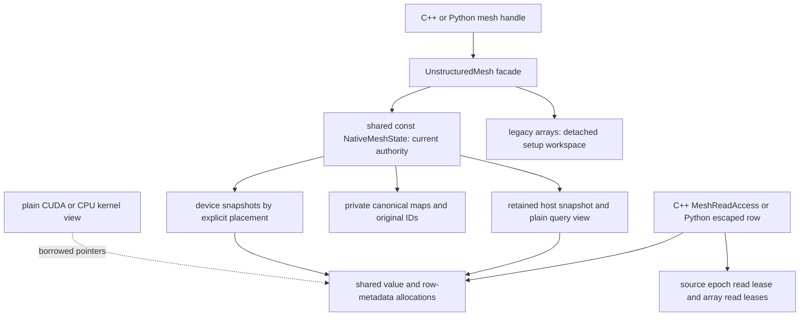

# Explicit native mesh publication

The default `UnstructuredMesh` mode retains its legacy setup behavior and
conservative managed acquisition checks. `PublishNative(requirements)` is an
explicit collective transition: it validates the legacy workspace uncached,
copies selected topology/geometry into private native Arrays, clones canonical
entity maps, and publishes one immutable native query state. This is the
authority for managed reads until another transition.

The facade is the single current-publication owner. Snapshot allocations are
shared, immutable during publication, and retained independently by readers.
The plain kernel view owns nothing; its access owner must outlive every using
stream or join those streams through its completion. Python escaped readonly
rows retain that owner, including row metadata. Backend placement does not
change mathematical mesh identity or make a missing stream dependency valid.

`AcquireRead`, semantic borrowed row/geometry helpers, `Num*`, and `Entities`
then resolve the same native publication. Repeated reads retain the existing
native allocations and metadata; they perform no CSR conversion, topology scan,
or value copy. Canonical entity descriptors are validated once at publication.
Repeated descriptors preserve map identity and `SameOrder`. Exporting indexing
to a mutable legacy field transformer copies map metadata, preventing that
compatibility escape from altering the private canonical maps.

Public legacy arrays remain a detached edit workspace in this explicit mode.
Raw changes there do not alter published queries. `NativeMeshSnapshot::Capture`
captures the current managed state; `ImportLegacyWorkspace` explicitly validates
and copies the raw workspace even when a native publication exists. Failed
imports leave the current publication intact. This separation is intentional;
there is no automatic detection of arbitrary raw writes.

`UseLegacyWorkspace()` invalidates all publication dependencies and explicitly
selects the detached workspace's values; it does not export current native data.
Managed legacy mutation methods reject native authority. They require this
explicit selection and never silently discard a publication. For current-state
edits use `MeshEdit`; a detached setup clone can also export the current authority.
Mode changes use `Change::All` because detached raw workspace
edits may involve any component. In-place managed native read scopes retain the
source version lease and block these transitions until released. Independently
captured detached snapshots remain valid after source changes.

`PlaceNative(device, context)` explicitly creates a persistent device placement.
Acquisition on an unprepared placement fails; no upload occurs in the read path.
The publication owns a persistent native host read scope for plain borrowed
semantic helpers. Such helpers require an outer `AcquireRead` owner or a
serialized setup phase, and do not acquire locks or leases inside numerical
loops. Optional relation helpers reject groups absent from the publication.
Shallow mesh copies share the version tracker; after either copy mutates, an
older sibling publication is rejected by its next `AcquireRead` boundary.
Borrowed helpers alone do not validate that boundary. Named numbering helpers
use published entity maps, and packed node/periodic-bit helpers use native rows.
Generic arbitrary-pair numbering and `ObtainLocalFactFillOrdering` require the
explicit legacy workspace. `ObtainSymmetricSymbolicFactorization` reads published
semantic neighbor/partition data and validates its supplied symbolic structure.
The legacy `to_device`, `to_host`, and `deviceView` entry points also reject
native mode; use `PlaceNative` and `AcquireRead` for the published authority.

This establishes native ownership and query publication. Legacy reconstruction,
ghost construction, distribution mutation, and serializers still use the
explicit workspace path. It does not claim that those algorithms have already
been rewritten as native Array row builders or native ghost pipelines. Passive
cross-mesh legacy algorithms must reject native sources until their input path
uses semantic queries or an explicit workspace export.
