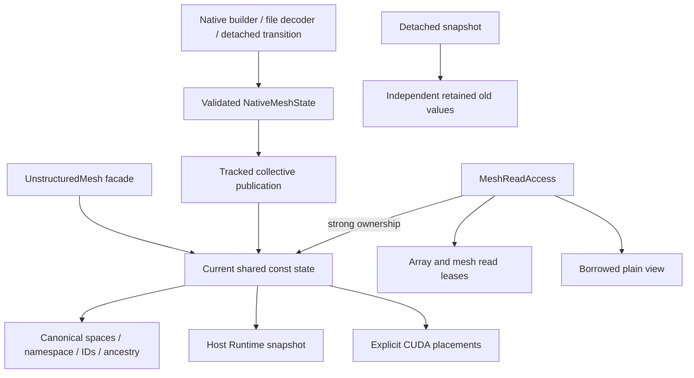

# Native mesh ownership and publication

`UnstructuredMesh` is a facade over `shared_ptr<const NativeMeshState>`.
Topology, geometry and typed companions are Runtime Arrays with immutable
published values and row metadata. There is no legacy mesh workspace,
`PublishNative`, `ImportLegacyWorkspace`, or `UseLegacyWorkspace` mode switch.

`FromNative` adopts a validated state into a new facade. Construction may share
input Array allocations while retaining read leases that block writes through
aliases. Replacing an external Array handle cannot retarget the publication.
`ReplaceNativeForSetup` stages a replacement for an empty or already native
facade, validates dimension/communicator/metadata and active-reader constraints,
then publishes `Change::All`. It changes mesh identity/order associations and
invalidates dependent fields, routes and caches; it is not a field transfer.

Current queries (`AcquireRead`, semantic borrowed helpers, `Num*`, `Entities`)
resolve the same publication. Canonical spaces and full relation signatures are
validated at setup. Repeated reads retain buffers and metadata without scanning
or converting topology. The read owner also strongly retains native metadata,
including when placement preparation replaces the facade's state handle.

## Reads, placement and mutation

`AcquireRead(requirements, context)` exposes only requested prepared groups.
Unrequested optional groups are hidden even if present in the publication.
Missing requested groups fail; acquisition never builds them. The plain view is
borrowed and performs no lease acquisition in numerical loops. Borrowed facade
helpers require an outer scope or serialized setup and do not independently
validate every access boundary.

`PlaceNative(device, context)` prepares persistent immutable device storage.
Unprepared-device acquisition fails. Python `place_native(ordinal)` supports
`-1` for the current CUDA device; `to_device("CUDA")` selects that current device.
`to_host()` validates the resident host publication, because kernels cannot
mutate native mesh values. Detached snapshot copies have their own placement
API. Placement does not change geometric identity or replace stream ordering.

Retain read owners until all host/worker/device uses finish. Completion must join
every consuming stream. `Complete`/`Wait` seal new queries but leases persist
until destruction. Python shared rows retain those leases after context exit.
Tracked mutation rejects active readers collectively. Detached snapshot readers
keep old values without blocking a later source publication.

Geometry/edit/setup operations prepare all fallible data before publication.
Validation failures preserve the source; callers must still obey collective
participation and serialize orchestration. `ObtainLocalFactFillOrdering` is
pure auxiliary native setup: it may run under retained readers and does not
bump geometry or layout generations. Existing scopes retain the state acquired;
use their HostView or an explicit shared current-state capture for references
that must survive cache/placement-handle replacement. Mathematical changes use tracked geometry operations,
`MeshEdit`, or mesh-plus-field transitions, not raw buffer writes.

## Fields and compatibility names

Persistent identity is `(namespace, kind, ID)`; rank-offset globals describe
current addressing. EntitySpace descriptors retain immutable canonical maps but
do not lock the mesh. Numbering changes stale their mapping operations. The
legacy-field indexing bridge copies map metadata into supported real field
transformers, keeping those mutable maps separate from canonical mesh maps.
Callers rebuild field requests and dependencies after ordering changes.

Readonly Python spellings such as `coords`, `cell2node`, `cellElemInfo`, and their
`father`/`son` parts are retained native read aliases. They expose no mutable
mesh Array or transformer. Numeric rows are readonly; POD metadata is a readonly
handle with an explicit detached `snapshot()`. Solver-field Array/ArrayPair and
Torch interfaces remain independent and retain their existing contracts.

## Restart and output

The full native archive preserves all published families, full named relation
keys, companions, periodic metadata, IDs, namespace/high-water marks and ancestry.
It saves owned rows and reconstructs sparse ghost closure. Matching reads retain
saved partitions; explicit even-split loading can change MPI size before a
native graph partition. Per-rank JSON requires matching rank partitions.

The old primary-wire schema has a one-way native decoder. It has no mesh
namespace and cannot preserve auxiliary-family field numbering; imported IDs
are checked and a fresh namespace is created. It never reconstructs a legacy
mesh workspace. Primary snapshot export is an interoperability format, not a
full native checkpoint.

`UnstructuredMeshSerialRW` is output-only. `BuildSerialOut` builds a
`NativeMeshSerialOutput` adapter for existing solver-field output; it does not
clone legacy geometry or change live adjacency numbering. Native output buffers
and CGNS/VTKHDF writers consume scoped native data. These contracts describe the
implementation, not a claim of completed numerical or runtime validation.
