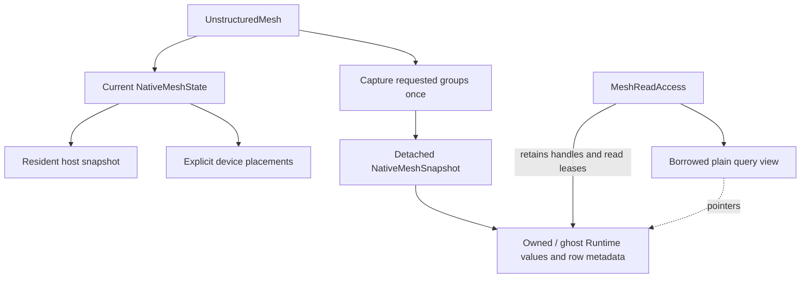

# Detached native mesh query storage

`NativeMeshSnapshot` is immutable Runtime-backed query storage. The current
`NativeMeshState` uses snapshots for its host and explicit device placements;
`NativeMeshSnapshot::Capture(mesh, requirements)` additionally copies requested
current native data into a detached snapshot. No legacy storage bridge is used.

Repeated `AcquireRead()` retains existing values and published row metadata; it
does not recopy payloads or rebuild topology. A detached snapshot's later reads
remain valid after source replacement or destruction. `SourceStamp()` records
provenance and may become stale without invalidating snapshot storage. Neither
immutability nor a valid allocation proves compatibility with a newly ordered
solver field; check its entity-space association separately.

`To(device, context)` creates an independent placement and completes its copies
before returning. A native facade instead retains prepared placements through
`PlaceNative`. Acquisition on an unprepared device fails rather than uploading
inside an operator. Backend placement preserves mathematical identity.

Capture includes only requested relation groups and companions. `HasRelation`
advertises availability; stronger closure such as `allFaceCellsLocal` is checked
at acquisition, not constructed by the snapshot. A detached query snapshot is
not a full restart archive or a mutable mesh export: named setup relations,
identity and ancestry are managed by `NativeMeshState` and the full archive.

A scope retains allocation controllers and metadata; facade acquisition also
retains its native state owner, including across placement clones. A plain view
or escaped C++ span owns nothing. Keep the scope through worker execution and
all GPU uses; join consuming streams before attaching completion. `Complete`
seals further view acquisition; `Wait` waits for the declared prefix. Neither
releases leases before scope destruction. Keep required MPI communicators alive.

Python exposes `mesh.snapshot(faces=True)` and
`with snapshot.acquire_read() as read:`. Shared readonly rows/slices retain their
scope after either Python parent is deleted. Bulk coordinate helpers return
independent immutable copies. `snapshot.to_device(ordinal)` returns another
placement; `device_snapshot.to_host()` returns a host debug copy. CPU indexing
of a CUDA placement is rejected, and no CUDA pointer is exported as NumPy.
`source_current` reports provenance only. There is no writable managed mesh
Tensor/DLPack export.
