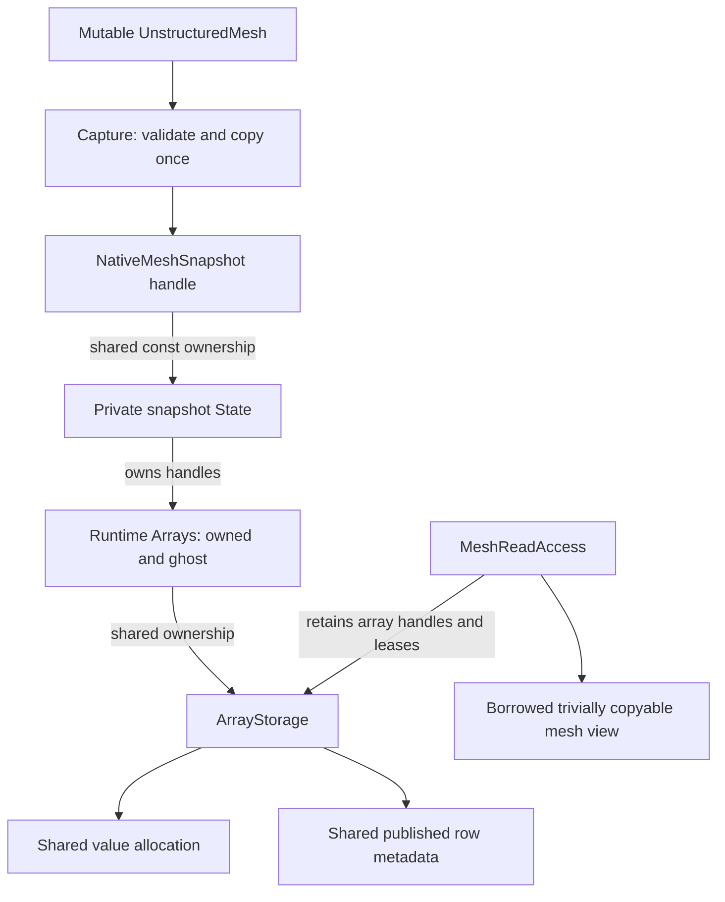

# Detached native mesh query storage

`NativeMeshSnapshot` is immutable query storage built from a validated
`UnstructuredMesh` read scope. It is an intermediate native backend, not a
replacement for the mesh's current construction and redistribution storage.
Capture copies values and publishes independent Runtime row metadata once.
Repeated `AcquireRead()` calls retain that storage and acquire leases; they do
not scan topology, convert CSR metadata or transfer values again.

The source mesh is needed only during `Capture`. Its later mutation or deletion
does not affect the detached snapshot. `SourceStamp()` records provenance: it
can become stale while the snapshot's own read scope remains valid. Do not use
provenance validity as the snapshot's memory-lifetime test. Conversely, using an
old snapshot with a newly ordered solver field still requires an explicit
entity-order check; immutable storage does not prove field association.

`To(device, context)` creates a new placement once and completes its transfers
before returning. The resulting snapshot may supply many CPU or CUDA read
scopes. Keep each scope alive through actual worker or device completion, and
join all streams before attaching its completion. The plain view itself owns
nothing. A scope can outlive both its parent snapshot handle and source mesh.

Only requested relation groups are captured. `HasRelation` advertises the
available groups, and `allFaceCellsLocal` may request stronger closure during
capture. All values, element information and incidence companions use the same
split and ordering as the source acquisition. There is no mutable array export
from this snapshot and no implicit publication back to the source mesh.

The native snapshot and legacy bridge run the same `UnstructuredMeshView`
queries. Dedicated tests check repeated reads reuse addresses, independent
value/shape lifetime, source permutation, moved-from rejection, and CUDA parity.
Validation results belong in the current Geom validation record; the presence
of these tests alone is not evidence of a successful run.

Python exposes the same detached ownership through `mesh.snapshot(faces=True)`.
Use `with snapshot.acquire_read() as read:` for CPU indexing and readonly NumPy
rows. A returned row or slice retains its storage and metadata after both Python
handles are deleted. `snapshot.to_device(ordinal)` returns an independent CUDA
placement; `device_snapshot.to_host()` synchronizes and returns a CPU debug
snapshot. CPU indexing of a CUDA placement is rejected explicitly. The boolean
`source_current` reports provenance only; a false value does not invalidate
the immutable snapshot. No CUDA view is exported as a host NumPy pointer.
