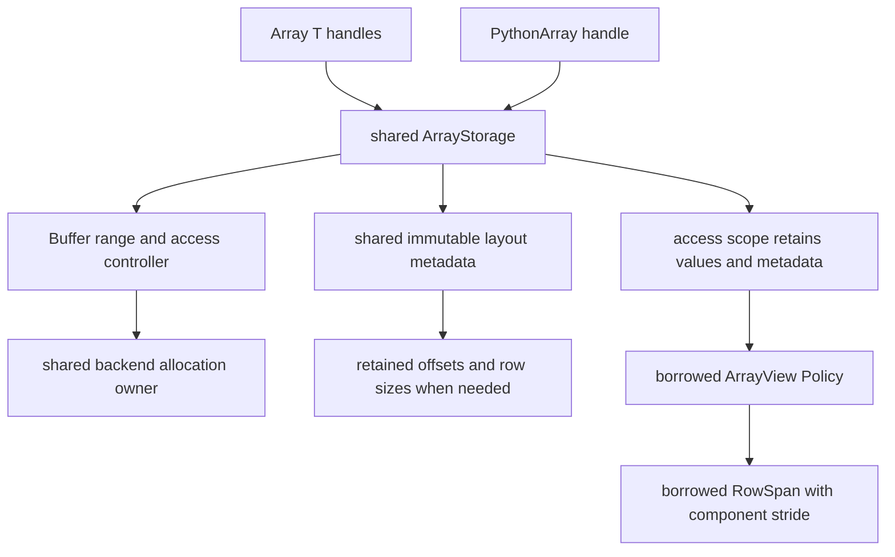

# Physical Runtime Array layouts and borrowed access

`Runtime::Array<T>` owns a shared, type-erased `ArrayStorage`; it is not
instantiated for every width, tile size or physical format. The optional legacy
second alias argument does not constrain the allocation. A policy is selected
when acquiring a view, and validated before the hot loop.



The access scope owns the lifetime. Copying a plain view or row does not extend
it. Device views contain only device-callable indexing and plain descriptors;
no shared ownership, mutex or allocation lookup is performed per element.

## Uniform physical formats

For logical row `i`, component `j`, width `C`, row count `N`:

| Format | Offset in elements | Physical extent | Component stride |
|---|---|---|---|
| `RowLayout::Dense(N,C,P)` | `i*P+j` | `N*P` | 1 |
| `RowLayout::ColMajor(N,C,options)` | `i+j*P` | `C*P` | P |
| `RowLayout::TiledColMajor(N,C,W)` | `(i/W)*C*W+(i%W)+j*W` | `ceil(N/W)*C*W` | W |

Column-major padding chooses `P=RoundUp(N+extraRows,rowPaddingMultiple)`;
zero rows normally allocate zero payload. `ColMajorWithPitch` imports an actual
pitch. Tiled tails are allocated but are not logical rows. Padding is never a
component or a DOF; loops traverse logical rows and row sizes.

Padded variable rows and CSR keep their existing formats. They are not ragged
SoA. `Stride()` is a physical format parameter (AoS row capacity, SoA plane
pitch or AoSoA tile size); generic code must not interpret it as an AoS row
stride. Use `ElementOffset` for storage adapters and `view(i,j)`/`view[i][j]`
for numerical element access.

```cpp
using namespace DNDS::Runtime;
Array<double> u(RowLayout::ColMajor(nCell, 5, {32, 1}));
auto write = u.Write();
auto rows = write.View<ColMajorTable>(); // placement/shape policy check once
for (DNDS::index iCell = 0; iCell < rows.RowCount(); ++iCell)
    rows[iCell][0] = 1.0;
```

`FixedWidthRows<ColMajorTable,5>` fixes logical width while retaining a dynamic
plane pitch. `TiledColMajorTable<32>` fixes the component stride. `TableRows`
retains a compile-time component stride of1; its existing `FixedRows<N>` and
static-capacity variants retain their AoS indexing. A projection that would
misrepresent physical placement fails before access. `UniformTableRows` accepts
any uniform physical format; `RowLayout` is the fully generic policy including
CSR and padded rows.

## Dense adapters and alignment

`DNDS/Algebra/EigenView.hpp` constructs borrowed column-major matrices from each
logical row. The adapter validates host placement and matrix capacity once and
passes the actual component stride to Eigen. This is not a payload copy or a
new numerical owner. Keep the originating lease while using a matrix map.
Raw row pointers are reserved for these centralized dense/interop/backend
adapters; ordinary numerical loops use stride-aware indexing.

An `AllocationOptions{alignmentBytes}` request controls the allocation base,
independently of table padding. A nonzero value must be a power of two. The
native CPU provider uses matching aligned allocation/deallocation; the native
CUDA provider retains the true allocation base when exposing an aligned
interior payload address. Imported pointers must already meet their advertised
type/alignment contract. Custom providers either honor the request or fail.
Row/column starts are aligned only when both the base and the physical pitch in
bytes meet the required alignment. Default Eigen maps are explicitly unaligned.

## Bounds and execution

Element assertions are a compile-time policy. `View<Policy,true>()` is checked;
`View<Policy,false>()` removes bounds checks. The configured default is controlled
by `DNDS_RUNTIME_ARRAY_BOUNDS_CHECKS`; structural/placement/lease validation is
never removed by that switch. Unchecked callers prove stencil bounds and stream
ordering. The view carries no cross-stream dependency ledger.

## Communication, archives and Python

A RowTransferPlan still describes logical rows. PayloadPlan emits MPI datatype
blocks at actual element offsets in row-major logical wire order, merging
adjacent blocks. Direct MPI remains the default, with explicit HostPacked as an
alternative. Strided receive collisions are broken into scalar contributions
in the normal receiver reduction workspace, preserving the custom-POD element
operator contract. Preserving transfer layout recomputes owned/ghost pitches
for their separate row counts; it does not copy a large owned pitch into a tiny
halo unnecessarily.

Native host archive version4 is selected when any writer has a column/tiled
table. All writers then have uniform logical widths. Each component has a byte
dataset `values_j`; rank-local physical descriptors record family, pitch/tile
and padding options. Matching-rank reads restore those descriptors. Repartitioned
reads use dense logical rows by default or an explicit requested physical policy.
AoS/CSR/padded writes retain version3. Old row-major byte datasets can be read
into strided tables through direct regular file selections, without a payload
transpose buffer. Per-rank legacy compressed JSON requires its original read
layout followed by an explicit conversion; native JSON byte arrays support the
direct pattern. The one element schema and root byte-order flag remain shared
by arithmetic/POD I/O and MPI/Python. Device archives still reject until a direct
backend is provided.

Python element, row snapshot, assignment and retained slices use actual logical
offsets. `numpy()` is an explicit logical2D copy. Numeric DLPack export exposes
logical2D `(N,C)` with strides `(1,pitch)` for column tables, or physical3D
`(ceil(N/W),C,W)` with strides `(C*W,W,1)` for tiled tables. Tiled tail values are
visible in this physical export; the logical row count remains on `array.layout`.
No general2D affine view is fabricated across tile boundaries. Exported tensors
retain the same storage/controller and exclusive write lease until the last
foreign alias dies. Import retains the existing strict contiguous1D/2D contract;
other foreign strides/shapes fail explicitly rather than guessing capacity or
logical tiled tail length.

`ConvertLayout` is an explicit setup/interop operation. It allocates the final
destination once, copies logical values and preserves source aliases. Repeated
solver operations use layout-aware native kernels rather than this potentially
fine-grained copy path.
