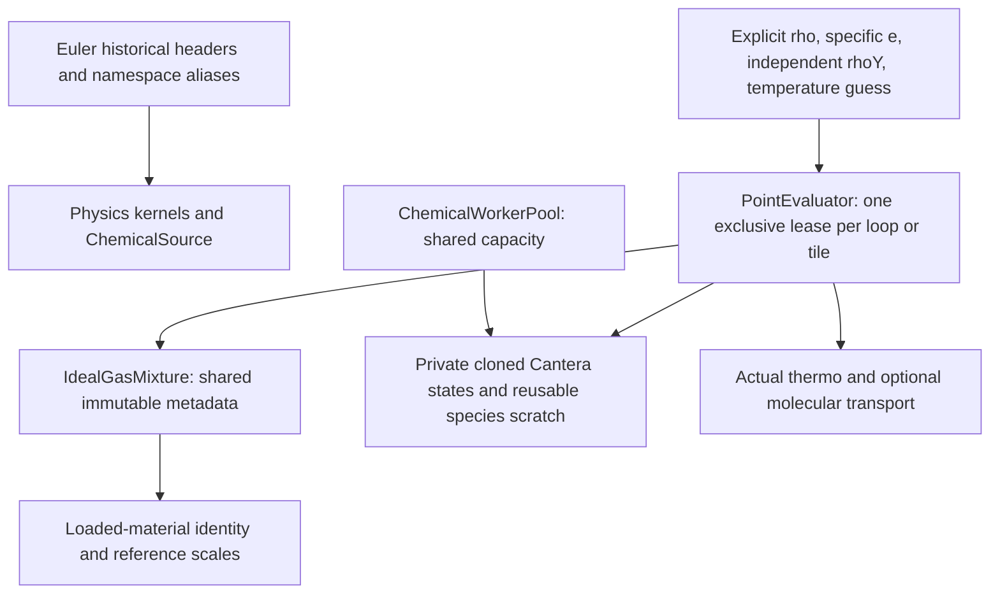

# Shared physical properties and CPU chemistry workers

`DNDS::Physics` owns thermodynamic, transport, chemical and RANS mathematics.
It has no mesh, CFV, time-stepping, communicator or solver owner. Its compiled
`physics`/`physics_shared` targets depend on DNDS, fmt and the existing optional
Cantera dependency. Cantera headers remain private to `ChemicalSource.cpp`.
This extraction introduces no new external library or chemistry algorithm.
When Cantera is enabled, its shared library and SONAME links accompany the
Python package's external libraries. The Cauchy loader preloads Physics in
dependency order; it does not rely on the external build tree's library path.



## Source and compatibility boundaries

| Source | Responsibility |
| --- | --- |
| `Physics/ReferenceScales.hpp` | SI reference values and code-unit conversion factors |
| `Physics/StateInput` | Euler-compatible input tags and component-aware unit conversion; no missing-state fallback |
| `Physics/Chemistry/ChemicalSource` | Existing PIMPL backend, property queries, UV solve, rates/Jacobians and reactors |
| `Physics/Chemistry/ChemicalWorker` | Exclusive worker contexts and bounded reusable species buffers |
| `Physics/Chemistry/SpeciesAdmissibility.hpp` | Euler-compatible transported mean-species repair on strided rows |
| `Physics/Thermodynamics/IdealGasMixture` | Immutable material descriptor and solver-independent code-scaled point evaluation |
| `Physics/Thermodynamics/ConservativeConversion.hpp` | EOS-independent velocity/internal-energy conversion and conservative directional kinematics |
| `Physics/Thermodynamics/IdealMixtureGradient.hpp` | Exact ideal-mixture temperature chain rule |
| `Physics/Transport/MixtureAveragedDiffusion.hpp` | Conservative species-flux correction and full-enthalpy energy diffusion |
| `Physics/Transport/NewtonianFourier.hpp` | Pure three-component Stokes stress, viscous work and Fourier normal heat flux |
| `Physics/RANS/RANSModels.hpp` | Existing SA, Wilcox, SST and realizable k-epsilon constitutive/source kernels |
| `Physics/RANS/Model.hpp` | CPU point adapter selecting those kernels, with conservative gradients, model settings and positive implicit destruction diagonals |

`Euler/Chemistry/ChemicalSource.hpp` and `Euler/RANS_ke.hpp` forward to the
canonical definitions and retain `Euler::Chemistry` and `Euler::RANS` aliases.
They define no second class or implementation. The historical
`euler_library_chemical` build target links the shared implementation; its old
translation unit contains no duplicated backend symbols. This preserves source
compatibility, not the binary ABI of previously compiled Euler namespace symbols.
Rebuild existing clients after the namespace move.

Euler's model-trait/configuration adapter stays in
`Euler/Physics/PhysicsProperties.hpp`. It delegates shared scale, gradient and
diffusion mathematics. Its gamma-equivalent calculation remains an Euler
compatibility calculation; new numerical Riemann interfaces receive actual
pressure, sound speed and enthalpy. The existing Euler thread-ID pool policy
is retained for compatibility. New worker callers use explicit leases instead.

The SA source accepts an explicit optional frame-vorticity correction. Its
historical signature forwards with no correction, preserving the enabled
absolute-velocity convention. This removes a dormant relative-velocity branch
that referred to undeclared evaluator settings inside the old math header;
frame policy now belongs to its caller, without a Geom dependency.

### RANS point adapter and wall samples

`Physics::RANS::Model` selects SA, Wilcox k-omega, Menter SST or realizable
k-epsilon once at setup. Its fixed point scratch contains flow5 and up to two
RANS conservative components, plus their three-direction gradients. This is
point-local scratch, not a prescription for physical DOF allocations. Callers
gather from logical blocks; neither species offsets nor Array layout enter the
constitutive kernels. The adapter owns no mesh, MPI context or EOS worker.

`Transport` returns turbulent viscosity, conductivity (`cp*mu_t/Pr_t`) and
species diffusivity (`mu_t/(rho*Sc_t)`). `DiffusionFlux` converts conservative
RANS gradients to specific-variable gradients with the same shared chain rule
as the thermodynamic layer; it never treats an energy gradient as temperature.
`Source` returns the existing production/destruction model. In contrast,
`ImplicitSourceDiagonal` returns Euler's **positive approximate destruction
diagonal**, suitable for addition to the implicit matrix. It is not a full
Jacobian or a finite-difference derivative of the entire nonlinear source.
SA viscosity and diffusion formulas now have shared functions called by Euler
as well, including the compile-time negative-SA convention.

The caller must provide finite, admissible point values, positive molecular
viscosity/density/wall distance/cell length, a unit normal, common code units
and a consistent Cartesian frame. Validate batches outside hot loops. The
adapter does not clip solution values, apply wall BCs, infer reference scales,
or silently fall back from a missing device implementation.

`Cauchy::WallDistanceSamples` consumes Geom's completed nodal wall field. It
interpolates **scalar nodal norms** with P1/P2 shape functions at cell and face
quadrature points, using the existing shared reference shape cache. It does
not interpolate vectors and then take their norm. CSR sample buffers are
allocated before filling, cover only local/ghost entities and perform no MPI.
Its explicit nonnegative floor clips higher-order undershoot; the default is
zero, so a source caller requiring strictly positive distance must choose a
positive floor. Cell means use Euler's arithmetic quadrature-mean convention.
`AcquireRead` pins the mesh and buffers and checks geometry/wall-publication
versions before exposing plain CPU views. A wall rebuild invalidates samples
even when coordinates have not changed. No separate Cauchy wall search exists.

These are integration foundations, **not completed Cauchy RANS support**.
The equation schema/configuration, spatial transport/source assembly, wall
states, approximate matrix contributions and model-specific admissibility
still need connection before a RANS profile may be enabled. Euler's DES
length uses an inertia-aligned bounding box; the isotropic native FV scale
must not silently replace it. QCR, eigenvalue and reconstruction/source-order
options remain explicit integration work, as tracked in the plan51 ledger.

## Ownership and use

```cpp
Physics::Chemistry::ChemicalSource prototype(mechanism, phase, U0, rho0);
Physics::Thermodynamics::IdealGasMixture material(prototype, {rho0, U0, L0, T0});
Physics::Chemistry::ChemicalWorkerPool workers(prototype, workerCount);
auto evaluator = material.Borrow(workers.Acquire(), {true, true, true});
auto rhoY = evaluator.SpeciesInput();
// In the loop: gather independent rhoY into this scratch if input is strided.
auto point = evaluator.FromRhoE(rho, specificInternalEnergy, rhoY, temperatureGuess);
```

Copies of the material share immutable metadata. Copies of the pool share its
fixed worker capacity. `Acquire()` is thread-safe, reserves one private context,
and fails immediately when exhausted. The move-only lease returns its slot
exactly once. Acquisition happens outside a point loop, without OpenMP thread-ID
lookup. Point evaluators retain the metadata and lease, so they remain valid
after the public material/pool/prototype handles are destroyed.

The loaded-material identity is an opaque shared in-process token. Deep clones
share it; independently loading an identical filename produces a different
identity. This rejects accidental worker/model mismatches without reading
mechanism files or comparing species in hot loops. It is not a persistent
restart fingerprint. Restart model/schema/reference-scale metadata still needs
the solver's serialization contract.

The caller serializes each lease/evaluator. Do not retain a raw backend/scratch
reference beyond its lease, replace a leased backend, or concurrently clone a
backend being evaluated. Move the lease/evaluator into CPU worker jobs that
outlive submission. Its lifetime follows actual CPU execution. No implicit
global synchronization or accelerator fallback is added.

`MixturePoint` owns its scalar properties. Species fractions, diffusivities and
enthalpies are borrowed views into reusable worker buffers: copy needed values
before the next point evaluation or lease destruction. Disabled species outputs
are empty and disabled scalar transport outputs are NaN. Ordinary property
evaluation performs no wrapper-owned per-point allocation; Cantera retains
control of its internal caches. Optional source derivatives allocate their
point matrix once at evaluator construction. The existing ChemicalSource
Jacobian backend still owns some per-query derivative scratch; this is not an
allocation-free chemistry performance claim. It is a CPU backend. This is
separate from the frozen device-callable
EquationDofs views described in [Cauchy state](CauchyState.md).

## Physical conventions

ChemicalSource's general queries take SI values. Its explicitly documented
base-energy and conservative-Jacobian helpers retain their original code-unit
conventions. `IdealGasMixture` converts all public inputs and outputs to/from
`ReferenceScales`, checking U0/rho0 agreement at construction.

The material is explicitly ideal gas with variable caloric coefficients. It
does not claim nonideal EOS derivatives. Input `e` is full specific internal
energy after subtracting the caller's kinetic energy. Formation-energy mixtures
can have negative full internal energy at positive temperature. The separate
base-energy function is linear in raw transported rhoY and supports Euler's
existing thermal-bound bookkeeping; never subtract it from full species
enthalpy in diffusion.

`SpecificInternalEnergies(T, worker)` prepares full ideal-gas e_k(T) coefficients
in code units for an affine minimum-temperature bound. A compatible worker is
consumed at setup; returned values own their storage. Cached backend-reference
coefficients are also available without a property query. They are parameters
for Cauchy's thermal policy, not a new EOS or a pressure/gamma approximation.

Property evaluation repairs a temporary composition as Euler does. It does not
modify conservative inputs, transported fractions or their derivatives. The
transport correction uses raw composition and ensures the full species mass
flux sums to zero. The stored viscous convention is `F_total=F_inviscid-F_viscous`,
so species and enthalpy contributions are `-J_k` and `-sum(h_k J_k)`.

The optional temperature guess is passed to the actual UV inversion. It can be
stale; the returned temperature is solved for current energy/composition. An
invalid or missing guess uses the backend's existing initialization. These
point methods can serve explicit derived-field refresh and fused quadrature
work. Cauchy's `EquationPointEvaluator` and explicit mixture derived refresh
now use them, including material/scale publication keys and actual stale
temperature warm starts; see [Cauchy state](CauchyState.md). The production
Domain still needs extended BC/PP/checkpoint integration. The equation-state FV,
physical Jacobian and nonlinear/linear stage operators now use these point
facilities, as described in [CauchyImplicit.md](CauchyImplicit.md#whole-equation-cpu-nonlinear-adapter).
These point facilities do not by themselves implement a RANS/species solver or change current flow5
frontend dispatch.

## Conservative chemical point source

`MixturePropertyRequest::chemicalSource` and `sourceJacobian` are independent of
transport selection. `FromConservative(rho, rhoE, momentum3, rhoY, Tguess)` adds
code-scaled independent-species mass rates and optional positive `dS/dU` to the
point result. The derivative has Ns-1 rows, with explicit point columns
`[rho,rhou,rhov,rhow,rhoE,rhoY0,...,rhoY(Ns-2)]`; it is not an index into a solver
array. Returned source views share the evaluator's ordinary borrowed lifetime.
`FromRhoE`, `FromRhoT` and `FromRhoP` remain property-only queries: their arguments
do not provide a complete conservative linearization point.

The wrapper uses the existing backend's ideal-mixture UV solve and conservative
rate derivative. It scales molar rates by molecular weight and
`1/ReferenceScales::SourceRate()`. Only independent species receive sources;
density, momentum and full thermochemical total energy have no chemical source.
Heat release therefore changes temperature at constant energy through changing
composition, rather than adding an enthalpy source a second time.

As in Euler, a temporary composition is repaired, and source temperature is
floored at the mechanism's base temperature; pressure is recomputed at that
floor. The implicit derivative is the existing approximation at that point,
not a derivative through repair/clipping. No spectrum filter is applied,
matching the active Euler contributor's `kDebugEigenFilter=0` branch. Nonfinite
rates or derivatives fail explicitly in the new caller. Euler's historical
contributor, including its dormant diagnostic/filter branches, is unchanged.

`Cauchy/Physics/EquationSource` supplies the owned-array adapter. It maps this
point convention into the named logical flow/species blocks and optional dense
logical block-Jacobian rows, without inferring offsets from physical grouping.
See [Cauchy state](CauchyState.md) for reservation, failure and integration scope.

## Focused validation

`euler_test_shared_physics` checks fused properties and nontrivial reference
scales against the Euler adapter, actual cold/warm UV recovery including
negative thermochemical energy, independent concurrent workers, retained
lifetime and one material-mismatch guard. Existing Euler chemistry, UV,
property/gradient/diffusion, reactor and RANS tests remain independent numerical
oracles. The reactive evaluator tests exercise the compiled legacy consumer.
RANS testing also compares an explicit frame-vorticity correction with the
equivalent corrected velocity gradient. These gates do not qualify new Cauchy
physical profiles or CUDA execution.

The low-level chemistry fixtures now live in `test/cpp/Physics/test_ChemicalSource.cpp`
and directly include the canonical Physics header. Their five test bodies and
purposes are preserved; the historical `euler_test_source_chemical` target and
`euler_source_chemical` CTest name remain for existing runners. Euler's
`test_PhysicsProperties.cpp` remains an adapter/integration test, including the
reactive heat-conduction gradient check. Cauchy's equation-source fixture adds
Euler contributor parity, conservative finite differences, distributed physical
layout checks and an actual homogeneous implicit-reactor comparison.

## Primitive values and gradients

For mixtures, use actual EOS properties, with full thermochemical internal
energy. Primitive rho/T or rho/p construction goes through `FromRhoT` or
`FromRhoP`, then `ConservativeTotalEnergyDensity` adds kinetic energy. In the
other direction, `ConservativeVelocity` and `ConservativeSpecificInternalEnergy`
prepare the UV query. A TP input first obtains rho from the EOS. The existing
Euler value-conversion/IO adapter retains its historical signatures and policies;
its equivalent-gamma compatibility representation is not a Cauchy conversion API.

Given conservative directional derivatives, the shared kinematic helper forms

```text
d(rho*e) = d(rho*E) - velocity . d(momentum) + |velocity|^2/2 * d(rho)
d(Y_k)  = [d(rho*Y_k) - Y_k*d(rho)] / rho
```

The dependent last species is included through energy differences:

```text
d(T) = [d(rho*e) - e*d(rho)
        - sum_{k<Ns-1}(e_k-e_last)*[d(rho*Y_k)-Y_k*d(rho)]] / (rho*cv)
d(p) = R*T*d(rho) + rho*R*d(T)
       + T*sum_{k<Ns-1}(R_k-R_last)*[d(rho*Y_k)-Y_k*d(rho)]
e_k = h_k - R_k*T
```

These are `IdealMixtureTemperatureDerivative` and
`IdealMixturePressureDerivative`, with code-scaled full species energies and
gas constants. Omitting the composition term or treating gamma-equivalent as
constant is incorrect in a reacting flame. The actual chemical source Jacobian,
including conservative T/p chain rules, remains canonical in
`Physics/Chemistry/ChemicalSource.cpp`; the Euler wrapper only supplies its
legacy model layout, scaling/sign and source-integration policy.

Cauchy's pure `PreparePrimitiveDerivative` consumes ready point properties and
strided raw species derivatives. It returns derivatives of rho/velocity/T plus
pressure. Request full species enthalpies when constructing a mixture point
evaluator; immutable code-scaled species gas constants accompany the point.
No species derivative buffer or property refresh is hidden in the chain rule.
The caller retains the worker/material, supplies the matching state/point and
valid derivative extent, and consumes borrowed views before the next point.
Repair/clipping derivatives are not silently substituted for the raw transported
gradients. The current mixture FV profile still fails explicitly until its full
spatial/BC/implicit integration is connected.

## Constitutive normal-flux composition

`NewtonianFourierNormalFlux` receives velocity, velocity/temperature gradients,
normal and ready effective viscosity/conductivity. It computes traction and
viscous-work/heat energy flux, without EOS or closure selection, allocation,
communication or normal normalization. The kernel is device-callable; using it
does not establish a complete Cauchy CUDA path. Existing perfect-gas Cauchy
viscous flux delegates this same mathematics.

`Cauchy/Physics/EquationTransport.hpp` composes the shared constitutive kernel,
actual mixture primitive derivatives and the existing conservative diffusion
correction. It takes raw transported rhoY/gradients separately from repaired
property composition. The dependent last-species gradient is minus the
independent sum; full species enthalpies contribute to energy diffusion. For
`F_total=F_convective-F_viscous`, the stored independent species fluxes are
`-J_k` and the energy contribution is `-sum(h_k*J_k)`.

`EquationTransportScratch` owns two full-species temporary vectors allocated
once per CPU worker/tile. The caller serializes/reuses it and retains its
point evaluator. `EquationTransportOptions` can add explicitly prepared scalar
turbulent viscosity, conductivity and diffusivity. These inputs do not select
or implement an SA/SST closure, isotropic turbulent stress or QCR correction.
Adiabatic mode suppresses conduction; impermeable mode suppresses species and
its enthalpy flux. Neither discards viscous stress/work.

```text
ready EOS/transport point + raw conservative gradients
       |                              |
primitive T/velocity chain rule     raw Y / grad(Y)
       |                              |
Newtonian/Fourier stress/work     Fick + zero-net-mass correction
       |                              |
       +---------- full-enthalpy viscous flux ----------+
```

The caller validates model/backend, dimensions, effective coefficients and
nonaliasing, supplies all requested transport/enthalpy point outputs, and keeps
scratch private through actual CPU execution. The point function is local and
has no mesh, quadrature weighting, persistent cache, transfer or time history.
Production extended FV reconstruction/BC/PP/linear wiring remains separate.
