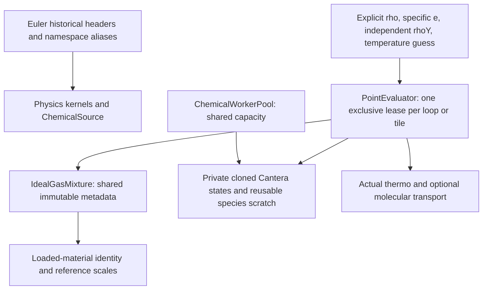

# Shared physical properties and CPU chemistry workers

`DNDS::Physics` owns thermodynamic, transport, chemical and RANS mathematics.
It has no mesh, CFV, time-stepping, communicator or solver owner. Its compiled
`physics`/`physics_shared` targets depend on DNDS, fmt and the existing optional
Cantera dependency. Cantera headers remain private to `ChemicalSource.cpp`.
This extraction introduces no new external library or chemistry algorithm.



## Source and compatibility boundaries

| Source | Responsibility |
| --- | --- |
| `Physics/ReferenceScales.hpp` | SI reference values and code-unit conversion factors |
| `Physics/Chemistry/ChemicalSource` | Existing PIMPL backend, property queries, UV solve, rates/Jacobians and reactors |
| `Physics/Chemistry/ChemicalWorker` | Exclusive worker contexts and bounded reusable species buffers |
| `Physics/Thermodynamics/IdealGasMixture` | Immutable material descriptor and solver-independent code-scaled point evaluation |
| `Physics/Thermodynamics/IdealMixtureGradient.hpp` | Exact ideal-mixture temperature chain rule |
| `Physics/Transport/MixtureAveragedDiffusion.hpp` | Conservative species-flux correction and full-enthalpy energy diffusion |
| `Physics/RANS/RANSModels.hpp` | Existing SA, Wilcox, SST and realizable k-epsilon constitutive/source kernels |

`Euler/Chemistry/ChemicalSource.hpp` and `Euler/RANS_ke.hpp` forward to the
canonical definitions and retain `Euler::Chemistry` and `Euler::RANS` aliases.
They define no second class or implementation. The historical
`euler_library_chemical` build target links the shared implementation; its old
translation unit contains no duplicated backend symbols. This preserves source
compatibility, not the binary ABI of previously compiled Euler namespace symbols.
Rebuild existing clients after the namespace move.

Euler's model-trait/configuration adapter stays in
`Euler/Physics/PhysicsProperties.hpp`. It delegates shared scale, gradient and
diffusion mathematics. Its gamma-equivalent calculation remains an Euler
compatibility calculation; new numerical Riemann interfaces receive actual
pressure, sound speed and enthalpy. The existing Euler thread-ID pool policy
is retained for compatibility. New worker callers use explicit leases instead.

The SA source accepts an explicit optional frame-vorticity correction. Its
historical signature forwards with no correction, preserving the enabled
absolute-velocity convention. This removes a dormant relative-velocity branch
that referred to undeclared evaluator settings inside the old math header;
frame policy now belongs to its caller, without a Geom dependency.

## Ownership and use

```cpp
Physics::Chemistry::ChemicalSource prototype(mechanism, phase, U0, rho0);
Physics::Thermodynamics::IdealGasMixture material(prototype, {rho0, U0, L0, T0});
Physics::Chemistry::ChemicalWorkerPool workers(prototype, workerCount);
auto evaluator = material.Borrow(workers.Acquire(), {true, true, true});
auto rhoY = evaluator.SpeciesInput();
// In the loop: gather independent rhoY into this scratch if input is strided.
auto point = evaluator.FromRhoE(rho, specificInternalEnergy, rhoY, temperatureGuess);
```

Copies of the material share immutable metadata. Copies of the pool share its
fixed worker capacity. `Acquire()` is thread-safe, reserves one private context,
and fails immediately when exhausted. The move-only lease returns its slot
exactly once. Acquisition happens outside a point loop, without OpenMP thread-ID
lookup. Point evaluators retain the metadata and lease, so they remain valid
after the public material/pool/prototype handles are destroyed.

The loaded-material identity is an opaque shared in-process token. Deep clones
share it; independently loading an identical filename produces a different
identity. This rejects accidental worker/model mismatches without reading
mechanism files or comparing species in hot loops. It is not a persistent
restart fingerprint. Restart model/schema/reference-scale metadata still needs
the solver's serialization contract.

The caller serializes each lease/evaluator. Do not retain a raw backend/scratch
reference beyond its lease, replace a leased backend, or concurrently clone a
backend being evaluated. Move the lease/evaluator into CPU worker jobs that
outlive submission. Its lifetime follows actual CPU execution. No implicit
global synchronization or accelerator fallback is added.

`MixturePoint` owns its scalar properties. Species fractions, diffusivities and
enthalpies are borrowed views into reusable worker buffers: copy needed values
before the next point evaluation or lease destruction. Disabled species outputs
are empty and disabled scalar transport outputs are NaN. The evaluator performs
no wrapper-owned per-point allocation; Cantera retains control of its internal
caches. It is a CPU backend. This is separate from the frozen device-callable
EquationDofs views described in [Cauchy state](CauchyState.md).

## Physical conventions

ChemicalSource's general queries take SI values. Its explicitly documented
base-energy and conservative-Jacobian helpers retain their original code-unit
conventions. `IdealGasMixture` converts all public inputs and outputs to/from
`ReferenceScales`, checking U0/rho0 agreement at construction.

The material is explicitly ideal gas with variable caloric coefficients. It
does not claim nonideal EOS derivatives. Input `e` is full specific internal
energy after subtracting the caller's kinetic energy. Formation-energy mixtures
can have negative full internal energy at positive temperature. The separate
base-energy function is linear in raw transported rhoY and supports Euler's
existing thermal-bound bookkeeping; never subtract it from full species
enthalpy in diffusion.

Property evaluation repairs a temporary composition as Euler does. It does not
modify conservative inputs, transported fractions or their derivatives. The
transport correction uses raw composition and ensures the full species mass
flux sums to zero. The stored viscous convention is `F_total=F_inviscid-F_viscous`,
so species and enthalpy contributions are `-J_k` and `-sum(h_k J_k)`.

The optional temperature guess is passed to the actual UV inversion. It can be
stale; the returned temperature is solved for current energy/composition. An
invalid or missing guess uses the backend's existing initialization. These
point methods can serve explicit derived-field refresh and fused quadrature
work. Connecting them to Cauchy's extended profiles/publication keys is a
separate integration step; merely adding this module does not implement a
RANS/species solver or change current flow5 dispatch.

## Focused validation

`euler_test_shared_physics` checks fused properties and nontrivial reference
scales against the Euler adapter, actual cold/warm UV recovery including
negative thermochemical energy, independent concurrent workers, retained
lifetime and one material-mismatch guard. Existing Euler chemistry, UV,
property/gradient/diffusion, reactor and RANS tests remain independent numerical
oracles. The reactive evaluator tests exercise the compiled legacy consumer.
RANS testing also compares an explicit frame-vorticity correction with the
equivalent corrected velocity gradient. These gates do not qualify new Cauchy
physical profiles or CUDA execution.
