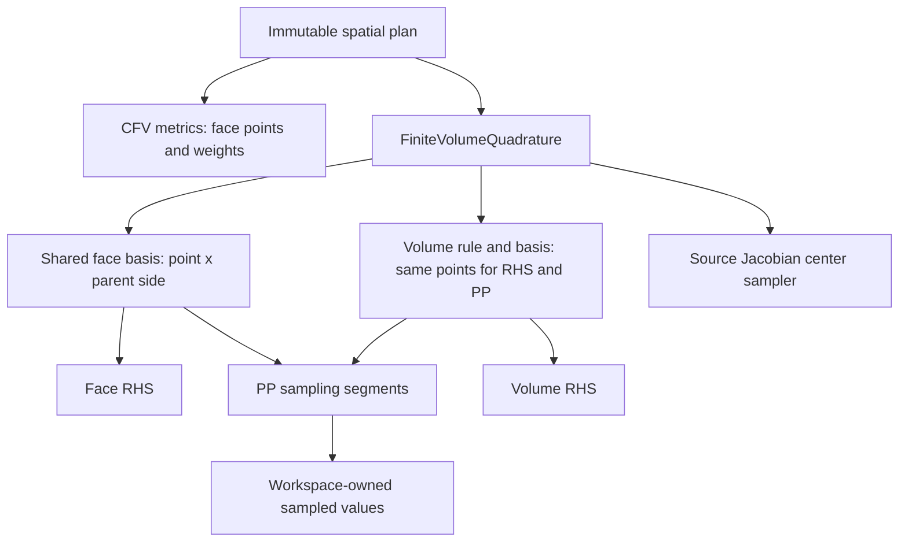

# Shared FV quadrature and polynomial basis

Cauchy's immutable `FiniteVolume::Data` publishes a `FiniteVolumeQuadrature`
alongside its CFV metrics. Face RHS and PP use the **same face basis allocation**.
Volume-source RHS and PP use the **same volume basis allocation**. Interior PP
always follows the RHS/source integration rule, even with no active source;
there is no separate PP quadrature control or maximum-order interior grid.
Without an active source, the volume sampler retains a value-only cache.
Source Jacobian center samples remain a separate point set.

## Identity, ordering and lifetime

`PolynomialSamplingPlan::FromSharedBasis` takes explicit query cells/points and
a query-to-basis-row map. Cauchy uses `2 * faceQuadraturePoint + parentSide`.
The basis is evaluated in that parent's coordinate frame, including periodic
transforms. Equal coordinates alone never establish identity. Volume sharing
uses the same source quadrature rule and its cell-major row order.

PP orders each cell's samples as incident face points, then the RHS volume
rule. `WithOutputRows` maps each segment into that
combined output without copying basis values. Setup covers each output exactly
once. A segment validates its unique destinations; its operator writes only
those rows. Submit segments on the same stream: whole-array write leases remain
appropriate, and a consumer queues after the last segment. CPU worker and CUDA
operations retain maps, basis allocations, input/output storage and mesh access
through completion. Caller-held temporary sampler handles may be destroyed.

Copies of sampler and spatial-plan handles share Runtime storage. Workspaces
and output observers allocate their own mutable samples, gradients and limiter
scratch. `SamplingPlacementMemo` is scoped to placement of one publication and
seeded with the already-placed face basis. It preserves aliases on the device,
then releases its host-source handles. It is not a global registry. Its seed
contract requires an unchanged, equivalent destination copy; source generations
and layouts are checked when reused. Geometry/topology changes invalidate the
plans rather than silently repopulating caches.
An exposed shared basis handle is read-only by contract. Sampling records its
value, shape and mutation-intent generations and rejects an aliased write before
submission. Runtime read access then pins the accepted inputs through execution.

## Independent VR setup and cache policy

VR matrix preparation evaluates its full derivative tensors in temporary CPU
scratch. A separate face-cache pass runs after those writers and scratch are
released; it computes only the requested derivative order. No VR matrix assembly
depends on the hot-path cache. Both paths share Taylor definitions, moments,
normalization and periodic-frame conventions.

`cacheDiffBase=false` retains no numerical basis payload. Direct evaluation
retains point positions, cell normalization and moments. With caching enabled,
the default `cacheDiffBaseOrder=1` stores value and first derivatives; volume
sampling without a gradient consumer stores values only. Derivatives outside
partial cache coverage are evaluated directly. `WithDerivativeOrder` narrows a consumer's query contract and releases
direct metadata when the cache completely covers it. Cauchy source/RANS center
sampling requests only its needed derivatives, while standalone arbitrary-point
sampling retains the more general contract. Cache-off PP/source/RHS point
evaluation shares the placed moments and normalization geometry.

`TaylorPointEvaluation` computes normalized coordinates, coordinate
powers and inverse-scale powers once per point; modes and derivatives reuse
that context, and equation components reuse the resulting basis. This may
change floating-point roundoff relative to repeated division, not the polynomial
or quadrature definitions.

The common evaluator is the default because five or more equation components
reuse each point's polynomial basis. A fused multidimensional Horner contraction
is a possible future RHS specialization, not a replacement for this common
facility; compare its register/arithmetic cost before adopting it.

Allocation names distinguish `CFV/quadrature/face/basis`,
`Cauchy/quadrature/volume/*`, `source-jacobian-center/*`, and `pp-face/*`.
A name is an alias, not another allocation; memory reports
must deduplicate identities. Arbitrary interface queries keep independent
samplers when their moving points differ from these prepared sets.

Quadrature degree is a supported-rule choice independent of reconstruction
degree; the former `intOrder >= maxOrder + 1` guard is removed. This does not
claim that every quadrature exactly integrates every variational functional
term. Setup keeps its SVD pseudoinverse and diagnostics. The common hot-path
rule does not force VR to retain its full-derivative matrix-assembly scratch.

The retired `positivityVolumePoints` option is no longer a configuration member
or schema field. Old checkpoint metadata that explicitly selects that active
policy remains a compatibility difference; it is not silently reinterpreted as
the new point rule. Non-PP restarts can discard inactive historical PP controls.

## Validation scope

Plan 61-1's corrected rule passed the grouped CPU/CUDA gates: full Cauchy FV,
physics and configuration suites at np1/np2; Runtime Array; Taylor evaluation;
CFV completion; CUDA reconstruction, domain, RHS, source and positivity. The
periodic shared-bank tests cover P3 with order-3 quadrature, independently
evaluated derivatives, scattered outputs, temporary-handle destruction and
aliased-mutation rejection. Source-enabled tests verify exactly one volume
bank; source-free tests verify the same rule's point count at orders 3 and 5.
The full numerical/memory record is maintained in the separate plan repository
under `docs/61-1-shared-quadrature-status.md`, with source/binary/input hashes.
