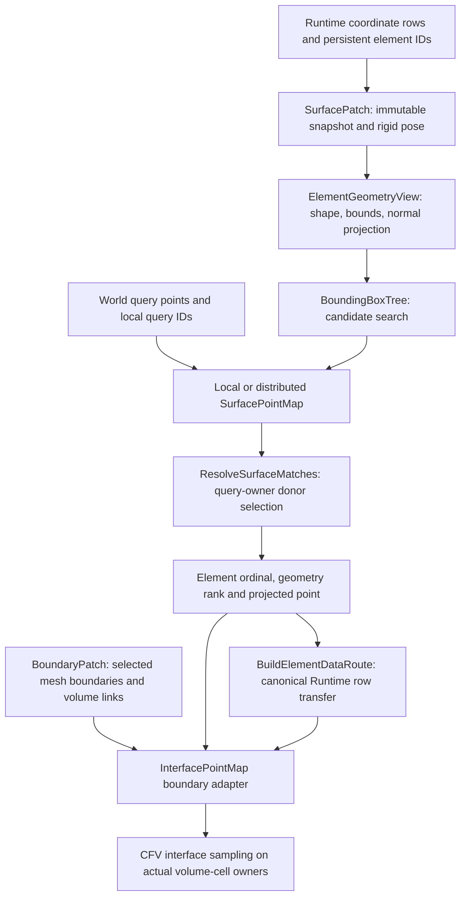
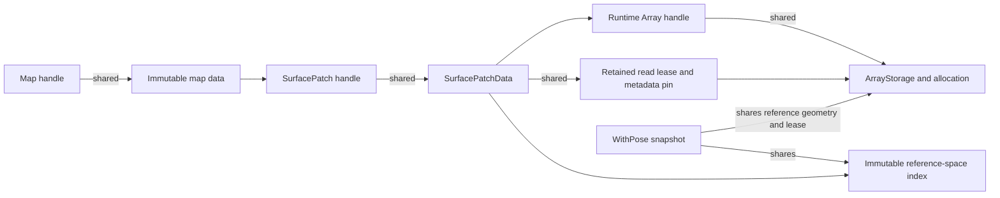

# Surface geometry, location and boundary adapters

Surface location is a Geom facility independent of a volume mesh, sliding motion,
CFV and equations. A boundary adapter adds the volume-cell links needed by CFV.



## Responsibilities and ownership

`Spatial/ElementGeometry.hpp` provides a **borrowed** `ElementGeometryView` over
column-major `[3,node]` coordinates. It implements shape evaluation, Jacobian,
reference containment, conservative bounds and normal projection. It owns no
memory and knows nothing about MPI or mesh entity numbering. Retain its source
buffer and access lease through use.

`Spatial/SurfacePointMap.hpp` provides `SurfacePatch`, `SurfacePointMap` and
`DistributedSurfacePointMap`. `SurfacePatch::Create` shares a host Runtime array:
one row per element, storing successive `(x,y,z)` node triples. Table, padded and
CSR storage are accepted through generic row access. Mixed element types can
therefore share one CSR coordinate array. The snapshot retains both storage and
a read lease; writes through another handle fail while the snapshot survives.
This freeze is intentional. To change coordinates, build a new snapshot with a
different allocation, or release all old snapshots/maps before writing.
Runtime leases cannot intercept writes through a foreign raw pointer or external
tensor API; imported allocations must also remain immutable outside Runtime.

`WithPose` shares reference coordinates, the read lease and the reference-space
BVH. Queries transform into that frame; rigid motion needs no local BVH rebuild.
Only coarse advertised world-space boxes need updating. Mesh coordinates stay
untouched. Maps retain their own
snapshot, so replacing a caller's patch handle cannot invalidate its allocation.
`ValidateFor(activePatch)` compares snapshot identity, including pose identity;
it rejects reuse with a new snapshot even if its numeric coordinates agree.



`Interface/BoundaryInterface.hpp` retains the existing boundary API. Its
`BoundaryPatch` collects selected owned boundary geometry and adjacent volume
links from a prepared mesh. `SurfaceGeometry()` returns the detached geometry
snapshot. Matching delegates to the generic locator, then attaches volume links
through the selected-element data route. The search packets contain no volume
cell rows, boundary tags, equations or solution values. The mesh adapter retains
its mesh generation checks independently of the detached surface snapshot.

## Geometry and projection contract

The implemented family is `Line2`, `Tri3` and **bilinear `Quad4`**, including a
warped nonplanar quad. A warped Quad4 is curved geometry without adding a
higher-order nodal element. Line3, Tri6 and Quad9 fail explicitly; they need their
own conservative bounds and projection validation.

`ElementGeometryView::Project` solves the unconstrained normal projection in
reference coordinates, then checks reference containment and physical gap.
It returns an explicit `PointProjectionStatus`: success, degeneracy, failure to
converge, outside reference element or excessive gap. Nonfinite caller inputs
and invalid settings throw. Triangle/quad normals follow the element's node
orientation. A 3D line has no unique normal, so its normal is zero.

This is not a clamped closest-point operation: an outside projection is rejected
rather than moved onto an edge or vertex. Nor does the local iterative solve
certify the global nearest point on a folded or arbitrary nonconvex surface.
Initial validation checks finite coordinates and nonzero Jacobians at corners
and center, not absence of every possible quad fold. Supply valid surface
elements and use explicit gap/reference tolerances appropriate to the mesh.

Bounds use the convex hull of the supported shape functions' nodes, with a
conservative reference-tolerance envelope. `SpatialBox` provides containment,
box intersection and point distance. These are broad-phase operations, not
element/element intersection tests.

`SurfacePointMatch` separates frames and indices:

| Member | Meaning |
| --- | --- |
| `queryId` | Caller-provided ID, unique per query origin |
| `element`, `geometryRank` | Selected row in the geometry owner's patch |
| `elementId` | Persistent ID; distributed callers supply globally unique IDs |
| `reference` | Element parameter coordinates |
| `projectedPoint`, `normal` | World coordinates after rigid placement |
| `surfacePoint` | Physical donor reference coordinates before placement |
| `distance` | Physical query-to-projection gap |

The MPI-free local map reports `geometryRank=0`; use the distributed map when
the result needs communicator rank semantics.

CFV evaluates the polynomial at `surfacePoint`, not at the unprojected query.
The equation adapter is responsible for rotating vector/tensor components or
converting moving-frame quantities. This point interpolation implies no
conservative flux or force/displacement adjoint relation.

## Distributed pipeline and public payload route

All ranks call `DistributedSurfacePointMap::Match` collectively in the same
order, with matching settings/mode, including empty owners and empty query
ranks. Rank-local input failures agree before the next payload collective.
The caller retains the MPI communicator through all derived operations.

1. `CoarseBoxes` advertises one to ten world-space boxes per rank. Element box
   centers are sorted along the rank patch's longest axis, split into equal-count
   groups, and enclosed separately. This is a flat spatial grouping akin to
   shallow BVH leaves, not a surface-area optimized partition or a guarantee of
   minimum overlap. A query is sent at most once to each candidate rank.
2. Candidate ranks use a local `BoundingBoxTree`, then exact element projection,
   containment and gap tests. They return all accepted proposals.
3. `ResolveSurfaceMatches` on the query origin selects among the nearest
   proposals. Equivalent seams use the smallest persistent element ID; competing
   near-equal-distance interiors are rejected as ambiguous. This is arbitration
   (dispute resolution), not a reduction of sampled field values.
4. `BuildElementDataRoute()` collectively prepares a reusable `RowTransferPlan`
   from geometry-owner selected element rows into original query order. Bind
   any compatible Runtime payload/schema. Boundary adapters use this to fetch
   volume-cell links **after** geometry has selected the donor.

`AllGatherSurface` replicates the selected surface as a correctness baseline and
uses the same projection/arbitration kernels. It independently checks routing,
not the projector. Sparse fan-out/replies and selected payloads use canonical
Runtime direct transfers. The boundary adapter's link fetch is transient setup;
CFV can retain a persistent result binding for repeated sampling.

Motion, deformation or repartition requires a new map on all ranks. Validation
cannot discover an unannounced remote update. Concurrent bindings sharing a
communication context require distinct tags; the default tag zero assumes no
overlap. The locator does not schedule solver exchanges or computation.

## Dependencies and focused validation

`BoundingBoxTree` is an immutable CPU interface with two selectable backends:
`BoundingBoxBackend::CGAL` (default) and `BoundingBoxBackend::Native` (the
retained flat tree). Both own their box data, return input ordinals and apply
the same inclusive squared point/box distance predicate. Callback order is
unspecified. Construction validates boxes; queries validate finite inputs and
nonnegative gap. The synchronous callback is borrowed, not retained, and needs
no output allocation. Copies share the fully built immutable index, supporting
concurrent const queries. Callback exceptions propagate without changing it.

CGAL's template types occur only in `Spatial/BoundingBoxTree.cpp`. Its public
traits splitting functor selects the largest **centroid spread**, with input
ordinal tie breaks; it does not use the undocumented `custom_build` shortcut.
The CGAL tree is built eagerly, so queries perform no lazy construction. Box
primitives reference an owned vector that outlives the tree. The native tree
retains its original longest-enclosing-axis median split and flat traversal.
Backend dispatch happens once per query; both use a nonowning callback thunk.

CGAL uses an outward-rounded query cuboid, followed by the exact same Euclidean
box-gap filter used by native. The cuboid envelope also accounts for floating
squared-distance underflow at tiny gaps. Zero-thickness point/line/planar boxes
are valid. Invalid sentinel/NaN/inverted boxes and unknown backends throw at
construction. A box hit remains only a candidate, not element containment.

Select the backend when constructing a tree or patch, or explicitly build a
new patch index with `WithBackend`. Existing maps keep their original snapshot;
changing the active backend/index requires rebuilding correspondence maps.
`WithPose` preserves the selected backend and shares the reference index.
Selection is local to the patch: MPI ranks may select different backends while
retaining identical geometric acceptance, settings and collective order.

```cpp
BoundingBoxTree index(boxes, BoundingBoxBackend::CGAL);
index.Query(point, gap, [&](DNDS::index iBox) { /* exact element test */ });
auto patch = BoundaryPatch::Create(mesh, boundaries, {}, BoundingBoxBackend::Native);
auto cgalPatch = patch.WithBackend(BoundingBoxBackend::CGAL);
```

```python
patch = Geom.BoundaryPatch.Create(mesh, boundaries,
                                 backend=Geom.BoundingBoxBackend.Native)
patch = patch.WithBackend(Geom.BoundingBoxBackend.CGAL)
```

The opt-in `geom_benchmark_bounding_box_tree` measures the **production compiled
wrappers**, alongside inlined controls with matching ownership/splitting. Run
`... 1048576 1000000 5 pair` for native-wrapper, CGAL-wrapper, native-inline and
CGAL-inline comparisons. Without `pair` it also exercises default CGAL queries,
custom Euclidean predicates and centroid-native controls. Timings include public
validation, backend dispatch and callback costs. They exclude exact element
projection and MPI and therefore do not claim whole matching speedup.

The 2026-10-31 actual-wrapper study records400 trials at4k/65k/262k/1M boxes,
five distributions and five repeats. At1M boxes/queries, median CGAL/native
query ratios are0.877 (wavy surface),0.839 (shell),0.841 (regular volume),0.478
(anisotropic) and1.086 (clustered). Retained heap is120 vs144 MiB. Native remains
useful for clustered workloads. Wrapper/control query differences are small
relative to those workload effects; a4k regular-volume control shows about6%
native wrapper overhead. Runs are pinned/single-threaded on a shared host,
with candidate oracles and order rotation, not an exclusive performance claim.

No new dependency is introduced: CGAL already supplies other Geom utilities.
Triangle/segment nearest-point or ray searches may use separate typed trees;
replacing a warped Quad4 by triangles changes its surface. Future volume-cell
location can reuse this candidate index with its own containment/reference-map
kernel. A device index can preserve those semantics without exposing CGAL to
device code. This CPU implementation does not claim CUDA execution or refit.

`geom_test_surface_point_map` uses independent analytic Line2/Tri3 projections
and a warped quad `z=1+0.25*a*b`. It checks normals, element coordinates, gap,
stationarity, rejection statuses, bounds, shared-storage freeze/lifetime, rigid
poses, mixed CSR geometry and geometry-only distributed element-data transfer.
Both routing modes are compared to the analytic oracle and each other.

`cfv_test_distributed_interface_sampling` adds warped Hex8 top surfaces with
boundary ownership shifted from volume-cell ownership. Offset queries must
project onto the curved boundary before sampling a normal-varying manufactured
linear polynomial. The expected point and sampled value do not depend on the
map's output. It exercises two placements, both routing modes, unsorted query
IDs and independent geometry/cell ranks. Existing line-interface tests retain
empty-rank, seam, ambiguity and repeated-binding coverage. These tests are
registered at np=1/2/4/8; this is focused coverage, not certification of every
element/motion/routing combination or a coupled sliding-flow solver.

`geom_test_bounding_box_tree` independently compares both backends with exhaustive
box scans on randomized/thin/repeated/degenerate and tiny-distance fixtures. It
checks invalid inputs, temporary input lifetime, shared copies, concurrent const
queries and callback exceptions. Surface and distributed CFV fixtures select
both backends with both routing modes. Distributed line-interface tests retain
empty ranks and seam arbitration under both trees. Python selects both backends
through the public patch interface. Exact validation results and measured
wrapper performance are recorded in the plan repo's BVH evidence directory.
