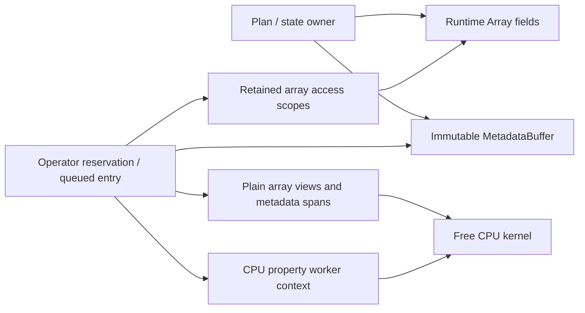

# Runtime, algebra, legacy storage and unstructured mesh sources

## Cauchy owner-qualified implementation units

Cauchy public headers retain their paths and namespaces. Implementation units
with no standalone header use `<owning-header>_<responsibility>.cpp`, so a file
name identifies the public owner whose private definitions it emits. Examples
are `FiniteVolume_Evaluation.cpp`, `LinearProblem_ILU.cpp`,
`Domain_ImplicitStep.cpp` and `Simulation_Checkpoint.cpp`. This is a source-path
and CMake-list cleanup: it creates no second facade, compatibility header or
compiled symbol spelling. Binding entry points retain their conventional
`_bind.cpp`/`pybind11.cpp` names.

The exact private-TU renames are in [source_paths.json](source_paths.json).
`FiniteVolume.cpp` now owns immutable plan/metric construction and small public
queries only. Reconstruction publication, workspace construction, evaluation,
boundary binding, flux/source facades and diagnostics are separate
owner-qualified units. Declaration-only internal headers share the private
workspace and reconstruction-state shapes without duplicating ownership.

CPU kernel packages have their own declarations and definitions. For example,
`CPU/FiniteVolumeBoundaryKernels.hpp/.cpp` declares/implements free boundary
arithmetic, while `FiniteVolume_Boundary.cpp` acquires field and geometry leases,
prepares views, selects the physical producer, and calls the kernel. Likewise,
`Interface/CPU/InterfaceSamplingKernels` and `InterfacePacketKernels` handle
query placement and receiver packet arithmetic; `InterfaceCoupling.cpp` owns
matching, transfers and publication. CFV owns the free donor/basis evaluation
kernels called by these adapters. `Implicit/CPU/LinearProblemKernels_Diagonal.cpp`
implements the declarations in `LinearProblemKernels.hpp`.

Generic/fixed RHS, auxiliary, gradient, positivity, limited-VR and source
packages now expose free CPU entries. `FiniteVolume_<Role>.cpp` retains the
corresponding workspace/access/publication members. The same separation covers
Jacobian preparation and evaluated blocks, Apply/Jacobi/SGS, ILU matrix filling,
nonlinear PP/defect arithmetic, pMG projections/norms, explicit stage updates,
chemistry advancement and derived-property refresh. Linear specialization and
instantiation occur in `CPU/LinearBlockKernels_*.cpp`; its `_Impl.hpp` is private
to that package. Generic LU factorization and shared ODE/DOF arithmetic remain
in their existing Solver/DNDS owners.

Kernel operands distinguish equation/basis-sized metadata from entity fields.
Component offsets, vector starts and small descriptor tables use immutable
backend-aware `Runtime::MetadataBuffer` publications and `DNDS::SpanView`
capsules. Cells, faces, incidences, quadrature records, row maps and region
selections use local `Runtime::Array` and their ordinary access scopes, even
when setup publishes them as immutable rank-local data. The enclosing operation
retains owners and leases through execution. Kernels receive views and plain
parameters; they do not acquire leases, communicate, schedule or publish.

`MetadataBuffer::CopyTo` explicitly publishes the same bytes on a backend and
completes setup transfer before exposing them. It does not relocate pointers
inside metadata records. Nested array/block views must be prepared for the
selected backend before uploading a descriptor table. CPU property workers are
explicit execution contexts, acquired outside the numerical kernel. A missing
device producer remains an explicit capability failure.

### Numerical storage and retained access

| Data | Authoritative storage | Execution operand |
|---|---|---|
| FV quadrature/incidence records, offsets, core/dependent lists, PP displacements | `FiniteVolumeStencilStorage` Runtime arrays | `FiniteVolumeStencilView` under one retained read access |
| Boundary trace geometry and receiver quadrature/face-center layout | Local Runtime arrays | Fixed-width array views |
| Linear columns/order/core lists and ILU source-slot mapping | `LinearPatternStorage` Runtime arrays | `LinearPatternView` |
| Evaluated Jacobian mean/EOS/radius snapshots and face contributions | Runtime arrays; two-level CSR for cell/block/incidence geometry | Frozen row views retained once by the evaluator |
| Equation block/column descriptors, vector starts, active components and thermal species reference values | Immutable `MetadataBuffer` | `SpanView<const T>` |
| Equation-sized reduction results and point scratch | Per-call CPU scratch | Mutable spans or local dense views |
| Chemistry workers, boundary producers, communicator/stream owners | Explicit CPU/context owners | Explicit property context or orchestration-only handle |

Setup may use temporary vectors to count, order and fill canonical fields. It
does not keep a second vector copy after publication. Public diagnostic list
accessors return copies; repeated numerical access uses a retained read scope.
Vectors containing Arrays, access leases, service objects or configuration
recipes are ownership/control containers, not numeric field storage.

The allocation is retained by the operation and its scopes, not by the borrowed
kernel view. A CPU worker reservation must survive execution. A future GPU
submission must retain operands through its ordered completion/retirement,
not merely until the launch wrapper returns. Metadata upload alone does not
make CPU physics producers or nested host views device-capable. This source
extraction prepares the boundary; it does not claim Cauchy CUDA execution.

`OffDiagonalReadAccess::View()` is a low-level borrowed numerical descriptor.
Its evaluated variant points to an immutable evaluator retained by the access
scope; its assembled variant borrows block storage. Neither variant owns MPI
or reads live solution state. This avoids transporting a lease-owning context
into CPU kernels while preserving the assembled/direct-evaluated dispatch.

## Cauchy preliminary source cleanup

The current canonical relocation list is [source_paths.json](source_paths.json).
Module roots `DNDS/`, `Geom/` and `CFV/` now contain only their CMake files.
Implementation headers live with their responsibility; all in-repository
includes use those canonical paths. This stage changes includes/source lists,
not public namespaces, storage formats or numerical algorithms.

Historical includes live in the explicit `Compat/Include` overlay of each
module. `dnds_compat_headers` is an INTERFACE include target, not a compiled
library. `DNDS_ENABLE_LEGACY_INCLUDES=ON` exposes that overlay to existing
project targets; switch it off to check canonical-only consumers. External
users can opt in by linking the compatibility header target or adding those
include roots. Old names keep the same class definitions and access contracts.

| Group | Canonical responsibility |
|---|---|
| DNDS `Core`, `Memory`, `Math`, `IO`, `Diagnostics`, `Config`, `Support/PCH` | Types/errors, ownership helpers, numerical utilities, output/profiling and configuration |
| Runtime `Storage`, `Array`, `Execution`, `Communication`, `Interop` | Allocation/schema, layout/access, eager scheduling, transfer/progress and language bridges |
| DNDS `Algebra`, `Legacy`, `Compat` | Native numerical DOFs, historical storage/numerics and explicit bridges |
| Geom `Elements`, `Quadratures`, `Periodic`, `Math` | Previously root-level element, rule, frame and numerical helpers |
| Geom existing mesh/access/connectivity/transition/spatial folders | Unchanged native mesh authority and algorithms |
| CFV `Plans`, `Prepare`, `Detail`, `Operators`, `Math` | Native compositional frontend and its numerical implementation |
| CFV `Legacy` | Historical owners/settings/instantiations and compatibility benchmarks |

The historical FV benchmark remains available to Python, but its translation
units are part of the binding target rather than mandatory core CFV library
sources. The legacy class namespaces and Python spellings are preserved.
The earlier relocation description below records the preceding phase; its TSV
is historical where superseded by the JSON manifest.

The infrastructure finish phase separates implementation responsibilities without
changing numerical behavior or promoting Runtime symbols into the root DNDS
namespace. The exact relocation manifest is
[source_path_map.tsv](source_path_map.tsv); paths in that file are repository
relative. The [symbol map](source_symbol_map.tsv) records renamed types and
namespace spellings. Old public include paths remain compatibility forwarding
headers. The state/snapshot primary-type rename requires rebuilding C++ clients;
the aliases preserve source compatibility, not the old compiled ABI.

## DNDS boundaries

| Directory | Responsibility | C++ API |
| --- | --- | --- |
| `src/DNDS/Runtime` | Shared arrays, row layouts, placement, access leases and communication | `DNDS::Runtime::*` |
| `src/DNDS/Algebra` | Composed native DOF ownership and numerical operators | Explicit native algebra API |
| `src/DNDS/Legacy` | Old Array/ParArray, ArrayPair, ArrayTransformer, redistribution, derived arrays and DOF operations | `DNDS::Legacy::*` and identical historical `DNDS::*` names |
| `src/DNDS/Legacy/ArrayDerived` | Legacy adjacency and Eigen row adapters | Existing `DNDS::*` names |
| `src/DNDS/Compat/LegacyArrayBridge.hpp` | Explicit shared-allocation bridge between the two storage contracts | `DNDS::Runtime` bridge functions |

`DNDS::Array` continues to mean the legacy class. New code names
`DNDS::Runtime::Array` explicitly. This phase does not introduce a competing
`DNDS::Array` alias or change the shared-handle semantics of Runtime arrays.
The old `DNDS/Array.hpp`, `ArrayTransformer.hpp`, `ArrayPair.hpp`, derived-array
headers and DOF headers forward to the implementation under `DNDS/Legacy`.
`ParArray` is defined by `ArrayTransformer.hpp`; it has no separate historical
header to move.

Legacy bindings, their width-specific instantiations and their generator travel
with the legacy implementation. CMake enumerates the actual translation units,
including CUDA instantiations and Python binding specializations. The legacy
host/device-vector primitive also lives under `Legacy`; old serializer and
device-helper clients retain its original include path through a forwarder.
The serializer still depends on that Legacy vector plumbing; this relocation
does not claim an independent serializer storage implementation.
Shared support stays outside Legacy where its dependencies permit: index maps
are in MPI, low-level providers in Device/Runtime, and PCH files in Support/PCH.
The old PermutationTransfer implementation depends on the old ArrayPair and
Transformer, so it belongs in Legacy until replaced by a native implementation.

## Unstructured mesh responsibilities

| Canonical directory | Responsibility |
| --- | --- |
| `Geom/Unstructured` | Public mesh owner, immutable state and snapshot, builder and preparation entry points |
| `Geom/Access` | Query/read leases, entity spaces/fields and relation access |
| `Geom/Connectivity` | Incidence operations, topology construction and sparse closure |
| `Geom/Transition` | Detached transitions/assembly, reorder plans and coordinated publication |
| `Geom/Geometry` | Geometry editing, wall distance and smoothing |
| `Geom/Spatial` | Mesh-independent element geometry, switchable CPU box indexes and local/distributed point-to-surface location |
| `Geom/Interface` | Selected mesh-boundary geometry, volume links and stencil adapters over Spatial/Connectivity |
| `Geom/Refinement` | Elevation, refinement and boundary extraction |
| `Geom/IO` | Native archive, CGNS/OpenFOAM import and output |
| `Geom/Compat` | Legacy read/device views, field-index adapters and legacy archive/serial operations |

`UnstructuredMeshState` is the immutable query/storage authority and
`UnstructuredMeshSnapshot` is a detached retained placement. Their old names
`NativeMeshState` and `NativeMeshSnapshot` remain source aliases in
`Geom/Unstructured/UnstructuredMeshFwd.hpp`; they introduce no second storage
authority. `UnstructuredMesh` and `MeshReadAccess` retain their names. The
remaining Native-prefixed service classes keep their existing names in this
mechanical phase; enduring service names are a separate reviewed API cleanup.

The Python snapshot class is named `UnstructuredMeshSnapshot` and the historical
`NativeMeshSnapshot` module attribute aliases that same class. Existing Python
mesh/read APIs retain their behavior.

Spatial search transports generic element records and query/proposal tables;
it does not know volume-cell numbering or equations. Interface adapters attach
volume links after geometric donor selection through the locator's canonical
Runtime element-data route. CFV then samples on the actual cell owners. CGAL
types are private to `Spatial/BoundingBoxTree.cpp`; the public index/element
interfaces and mesh storage do not depend on CGAL primitives. See
[surface geometry and location](SurfaceLocation.md) for ownership, frames,
backend selection, collective and callback contracts.

Canonical `Geom/Access/MeshAccess.hpp` exposes the native read/query API without
defining the legacy mesh read owner. That owner lives in
`Geom/Compat/LegacyMeshRead.hpp`; `LegacyFieldBridge` lives in its own Compat
header. Old `Geom/Mesh/MeshAccess.hpp` and `EntitySpace.hpp` forwarders preserve
their historical transitive compatibility definitions. The public mesh facade
still includes explicit compatibility types used by existing solver/output APIs.
The native-only compile smoke checks that direct canonical Access/State includes
do not define legacy `DNDS::Array`; it does not claim that the entire Geom facade
or serializer is independent of all legacy plumbing.

## Shared Physics extraction

`src/Physics` is a solver-independent module. Chemistry implementation and RANS
math now live under `Physics/Chemistry` and `Physics/RANS`; old Euler include
paths forward and namespace aliases preserve source names. Euler-specific
configuration/model-trait conversions remain in its existing adapter. Shared
thermodynamic/transport helpers have no mesh/CFV dependency. See the
[Physics ownership and units contract](Physics.md), including the distinction
between source compatibility and rebuilding compiled namespace symbols.

## Cauchy ownership and implementation partitions

Cauchy has one equation-state FV path. Its renamed interfaces have no
pre-Plan60 forwarding aliases. `EquationSystem` owns equation metadata and
physical model selection; `EquationDofs::RequireSchema` validates concrete
array bindings. Neither role substitutes for the other's validation.

| Owner | Responsibility |
| --- | --- |
| `Physics/PointProperties`, `PhysicalFlux`, `ViscousFlux` | Point thermodynamics, conservative derivatives and flux arithmetic; no mesh scheduling |
| `Physics/PhysicsResources` | Setup-only equation and chemistry worker capacity; retained by the domain |
| `Physics/ThermalAdmissibility` | Thermal constraints and prepared admissibility policies; actual field updates remain operator kernels |
| `Physics/RANSPoint`, `RANSFlux` | Bounded point gathering and turbulent flux arithmetic |
| `State/RANSState` | Named conservative scalar input and mean/increment repairs |
| `Discretization/RANSReconstruction` | Reconstruction-only scalar limiting and point fallback |
| `Boundary/CPU/RANSWallKernels` | RANS wall target arithmetic |
| `Operators/Source/ChemicalSource` and its `CPU/` kernels | Source-array access/submission and chemistry row arithmetic, respectively |
| `Input/StateInput`, `InitialField`, `FlowProfile` | Configured state conversions and initial/analytic producers |

The binding registrar calls state, linear, nonlinear and FV registration units
in that order; this preserves Python default-argument type registration. Shared
binding holders retain native resources and introduce no second solver loop.
`SimulationConfig.cpp` resolves input layers, `_Validation.cpp` checks resolved
settings/capabilities and `_Schema.cpp` emits the canonical input schema.

Checkpoint domain methods are partitioned into write, read, internal-state read
and reserve/commit units. `IO/CheckpointMetadata` owns compatibility normalization
and exact mesh-envelope comparisons; `StateArchive` still owns scientific field
serialization and persistent-ID redistribution. The split does not change
checkpoint payloads, strengths or commit ordering.

These source partitions use existing compile evidence. No post-split compile
speedup is claimed; further compile profiling is outside the frozen Plan60 scope.

## Compatibility and validation

Forwarding headers introduce no second class definition or storage authority.
Include both old and canonical headers in the same translation unit to check
source compatibility. Native-only access headers should not acquire legacy mesh
arrays through a compatibility adapter. The implementation move itself changes
only resolved include paths; symbol spelling changes are recorded separately.

The path manifest and explicit source lists support checks that every relocated
translation unit is compiled once, every forwarder resolves, generators retain
their relative output directory, and no draft file was moved. A successful
header/source audit does not replace rebuilding CPU/CUDA consumers and installing
the rebuilt Python extensions before Python tests.
