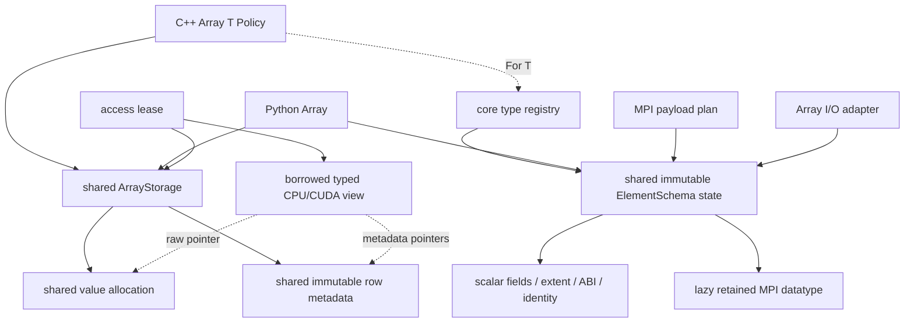

# Native Array I/O, shared schemas and static access

Implementation checkpoint on `codex/refactor-dnds-array-geom`, after progress
commit `7424be0f`. This follow-up introduces no dependency.
The [validation manifest](array_native_io_static_access_validation_2026-10-26/manifest.json)
records exact source/binary hashes, commands, results and initial failures.

## Access and ownership

Five policies distinguish table, fixed table, padded, static-capacity padded
and CSR access at compile time. The policy reaches immediate leases, eager
operands/launchers, host/CUDA views, pair views and row spans. Unchecked kernels
use constexpr indexing decisions and bare pointers; shape validation occurs
when adopting/preparing a typed layout. Python remains one dynamic class.

```cpp
namespace R = DNDS::Runtime;
using RuntimeTable = R::Array<double, R::TableRows>;
using FixedTable   = R::Array<double, R::FixedRows<5>>;
using Padded       = R::Array<double, R::PaddedRows>;
using StaticPadded = R::Array<double, R::StaticMaxRows<20>>;
using CSR          = R::Array<double, R::CSRRows>;
// FixedRows<5,8> additionally supplies a compile-time physical stride.
```

`decltype(view[row])::row_width` / `row_capacity` retain static shape where
present. `DynamicView()` supports old concrete dynamic-view kernel signatures.
Template deduction on a dynamic-view function template may need that explicit
conversion. Raw views own nothing; their enclosing lease must remain retained
through actual CPU/GPU use. No numerical Eigen/ND map layer is added.



The registry is implemented once in the core library. POD registration is
independent of Python/MPI initialization; MPI datatype creation is deferred
until communication. Python class codecs attach to that same record rather
than defining another wire schema. Primitive names and custom stable IDs are
separate from optional diagnostic C++ names. NumPy field offsets, packed records,
subarrays and escaped member paths are checked. Unsupported numeric word codecs
are rejected explicitly; opaque byte records remain byte records.

Physical `FaceCells()` and `BoundaryCells()` return static two-slot spans.
Publication normalizes CSR/padded incidence metadata once while sharing values
and access controllers, including ghosts with different physical strides.
Named one-cell containment relations retain their distinct arity. Legacy member
syntax remains a dynamic compatibility read facade.

## Serialization

The native v3 adapter uses H5 memory selections or JSON's required document
representation directly from/to the retained allocation. There is no legacy
Array or whole-payload packing allocation. Source/final pointer identity is
tested. Metadata scratch is O(local rows + ranks); dense files save width and
omit row offsets, including entirely empty dense files. Reads dynamically check
logical widths/capacities instead of matching static C++ signatures, then fill
the selected final table/padded/CSR allocation.

One file-root endian flag controls scalar-word reversal in the final read
buffer. Registered POD offsets/counts determine the words; object padding is
preserved. The native structural definition/extent must agree. This supports
endian conversion for that representation, not arbitrary ABI relocation or
schema evolution. Tests use independently encoded opposite-endian fixtures,
not an actual big-endian machine.

Device storage is rejected before payload I/O until a direct backend exists,
as requested. Explicit caller-side host checkpoint copies are tested. Existing
v2 H5/plain JSON/compressed JSON reads remain supported; compressed payloads
stream into final rows. Their old endian/empty-width limits remain. Explicit
historical schema labels are accepted only for v2 reads; application field and
history metadata is separate from the element descriptor in v3.

The audit corrected subtree copies during JSON path listing, malformed CSR
endpoint/extent/count acceptance, one-rank partition failure handling, same-size
NumPy schema mismatches, unsupported word codecs, packed-record alignment and
flattened-name collisions. Bad-input tests require rejection before payload
fill and demonstrate a valid retry.

## Validation

- C++ CPU/MPI: 45/45 primary registrations plus 4/4 archive regressions, covering
  Runtime/serializer, mesh facade, real overlap, mesh/field checkpoint, Euler
  evaluator and all-family periodic/wall archives at 1/2/4/8 ranks.
- C++ CUDA: 6/6 registrations, including static/eager access, normalized mesh
  views, two-GPU direct MPI overlap/entity fields and CFV device reconstruction.
  Native I/O/device-rejection tests additionally pass with two ranks/two GPUs.
- Python CPU: MPI1 has 157 pass/44 skip; MPI2/4/8 have 158 pass/43 skip per rank.
- Python CUDA: MPI1 has 200 pass/1 skip; MPI2 has 201 pass per rank. Includes
  cross-language POD/MPI/I/O, mock solvers, migration/restart, Torch/DLPack and
  EulerP CPU/GPU numerical parity. One rank is mapped to each GPU.
- Eight production ELF IDs match each selected build profile after mandatory
  rebuild/install; separate bridge module IDs are recorded. Final installation
  is the CUDA profile. New static/eager CUDA suites pass Compute Sanitizer:
  two cases, 227 assertions, zero reported errors. This is not a blanket
  sanitizer-clean claim for all solver/external-library paths.

Earlier compile/test-fixture and launcher failures are retained in the evidence.
The first GPU Python launcher selected distinct GPUs but omitted the UUID marker
required by the mock test; the final matrix uses the repository launcher.
The final binding rerun also encountered GPU 0 memory exhaustion from another
process. A retry maps rank 0 to GPU 1 and rank 1 to GPU 0, with the full two-rank
suite passing. The successful two-rank command uses `--maxfail=1`; all tests
ran. One rank reported a pytest temporary-directory cleanup warning. The opaque
byte-field fixture additionally verifies tracked POD writes, MPI and both I/O
backends; its initial detached-snapshot assignment mistake is retained too.
