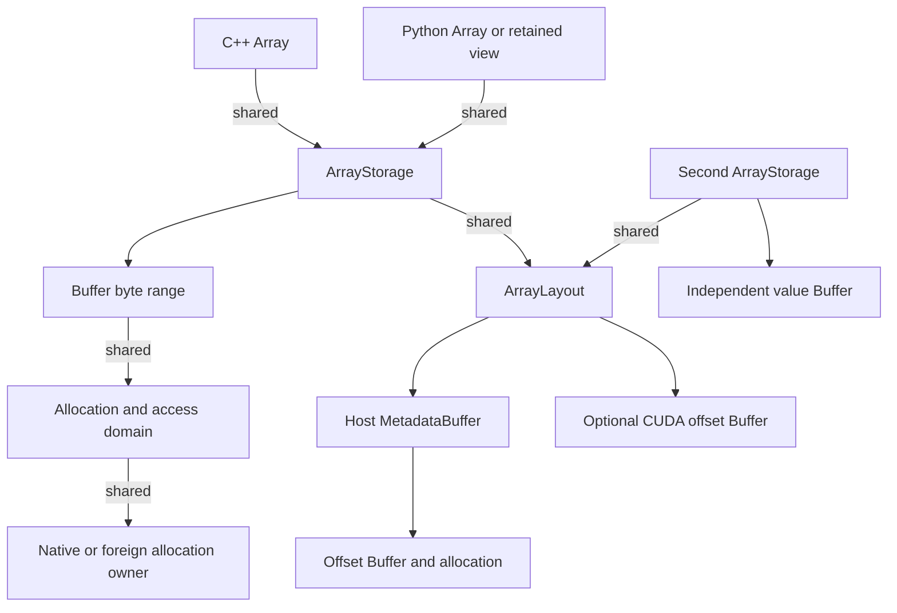

# Runtime follow-up implementation and validation

Baseline: `eb71d55191cd00d58e7c977d52ee1c125b9253cf`, committed and pushed to
`codex/refactor-dnds-array-geom`. Worktree:
`/home/harry/projects/DNDSR-array-geom`. This follow-up remains uncommitted.
The standalone plan's documents 14 and 15 define the full active goal.
Geom integration is optional; legacy compatibility and production-shaped
runtime tests are mandatory. No additional commit/push is authorized yet.

## Current slice: allocation ownership and metadata buffers

`Allocation::Import` retains a shared owner, capacity, placement and write
permission. `Buffer::FromAllocation` and `Subspan` check byte ranges and retain
the same allocation/access domain. Its version and conflict checks cover the
whole allocation, including overlapping ranges. Typed Array import checks
alignment and exact shape/byte size. Existing native allocation and allocator
policies remain available.

```cpp
auto values = std::make_shared<std::vector<double>>(53 * 8);
auto token = std::shared_ptr<void>(values, values->data());
auto allocation = DNDS::Runtime::Allocation::Import(token, values->size() * sizeof(double));
auto buffer = DNDS::Runtime::Buffer::FromAllocation(allocation, 0, allocation.Bytes());
auto state = DNDS::Runtime::Array<double, DNDS::Runtime::FixedRows<7>>::FromStorage(
    DNDS::Runtime::RowLayout::Dense(53, 7, 8), buffer);
```

Import once for each foreign allocation and derive aliases from the returned
handle. The caller guarantees declared capacity/placement, completed producer
work and no untracked external mutation or relocation. Separate imports of
the same pointer cannot automatically discover one another. A Python owner
adapter must arrange GIL-safe destruction; the runtime owner token itself is
language-neutral. No Torch dependency or Torch-specific adapter is added.

CPU row offsets are held in `MetadataBuffer<size_t>` with an ordinary Buffer
allocation and read access. RowLayout copies share these immutable offsets.
Separate fields can use `ArrayStorage::WithValues` to share the complete
metadata, including CUDA offsets, while owning independent values. Borrowed
kernel views still contain bare pointers; metadata ownership adds no check
or reference count operation inside element loops.



## Executed validation for the ownership/metadata subset

New native CPU tests cover six-equation states with eight-element row stride,
imported overlapping ranges, read-only access, overflow/alignment rejection,
exactly-once owner release and 97 heterogeneous CSR rows sharing metadata.
They passed the native CPU runtime/Array targets.

Additional passing tests cover a seven-equation MPI permutation with
different source/receive strides and guard regions; imported CUDA storage
with kernels on a non-default stream; and Python retained slices of foreign
storage. The existing runtime-exchange tests were also rebuilt and rerun
because Buffer's representation changed.

Both profiles rebuilt all four production Python modules and the separate
bridge extension, then installed the Python component before testing. Tests
used Open MPI 5.0.9, GCC 13.3, Python 3.12, and CUDA 13.2 (architecture 80).
`OMP_NUM_THREADS=2`; CUDA selected physical A100 GPU 1 with
`CUDA_VISIBLE_DEVICES=1`. Every CUDA MPI rank used logical device 0.

| Check | Result | Evidence |
|---|---|---|
| CPU runtime, Array, row transfer, I/O, Geom reorder | 14/14 CTest entries; np=1,2,4,8 | [Log](array_runtime_followup_validation_2026-10-21/cpu-ctest.txt) |
| CPU runtime exchange compatibility | 4/4 CTest entries; np=1,2,4,8 | [Log](array_runtime_followup_validation_2026-10-21/cpu-exchange.txt) |
| CUDA same matrix plus device kernels | 19/19 CTest entries | [Log](array_runtime_followup_validation_2026-10-21/cuda-ctest.txt) |
| CPU Python runtime and bridge | 26 passed, 14 CUDA-only skips per rank; np=1,2,4 | [np1](array_runtime_followup_validation_2026-10-21/cpu-python-np1.txt), [np2](array_runtime_followup_validation_2026-10-21/cpu-python-np2.txt), [np4](array_runtime_followup_validation_2026-10-21/cpu-python-np4.txt) |
| CUDA Python runtime and bridge | 40 passed, zero skips per rank; np=1,2,4 | [np1](array_runtime_followup_validation_2026-10-21/cuda-python-np1.txt), [np2](array_runtime_followup_validation_2026-10-21/cuda-python-np2.txt), [np4](array_runtime_followup_validation_2026-10-21/cuda-python-np4.txt) |
| Python DNDS/Geom compatibility | CPU 44 passed/21 skipped; CUDA 55 passed/10 skipped | [CPU](array_runtime_followup_validation_2026-10-21/cpu-regression.txt), [CUDA](array_runtime_followup_validation_2026-10-21/cuda-regression.txt) |

The broad Python compatibility runs omit `--with-mpi`; their MPI cases skip
and execute in the separate rank matrix. The [source snapshot](array_runtime_followup_validation_2026-10-21/source.json)
identifies the revised files tested against the committed baseline. Logs are
cleaned of ANSI escapes and MPI's embedded NUL banner byte. Native CUDA
execution is tested; no multi-GPU/multi-node transport or throughput result
is claimed. In particular, the existing transport fallback is distinct from
proving CUDA-aware MPI support on a deployment.

Reproduce using the bridge report's build/install procedure, adding
`dnds_test_runtime` and `dnds_test_runtime_exchange` to the targets. Run CTest
with `-R '^(dnds_runtime$|dnds_runtime_array$|dnds_runtime_cuda$|dnds_runtime_(exchange|row_transfer|array_io)|geom_mesh_reorder)'`.
The Python commands and per-profile install ordering remain the same.

## Row-editing slice (CPU and CUDA matrix complete)

The next slice adds table/padded/CSR layout kinds, buffered logical row sizes,
CUDA padded views, a move-only CPU RowBuilder and exclusive Array editing.
Distinct rows can be resized/filled in parallel before one Commit. Detached
drafts preserve old snapshots; unique exclusive edits block sharing/access and
reuse padded/table values in place. Abandoned exclusive edits invalidate the
shape. Published metadata is replaced as an immutable snapshot on Commit;
mutable construction sizes use one exclusive Buffer lease. See the
[row-editing API and ownership guide](../architecture/ArrayRowEditing.md).

Array layout queries now return owning snapshots. Device metadata Buffers are
private, with read-only native views and identity inspection. Python reuses
the same dynamic element facade and POD codecs for row construction. The
offsets/sizes properties return independent lists, including the previously
uncovered offsets conversion after the MetadataBuffer change.

Native editor and padded CUDA kernel tests passed intermediate checks. The
final CPU profile passed 19 CTest entries (including MPI np=1,2,4,8), 32
runtime/bridge/editor Python tests per process at np=1,2,4 (15 CUDA-only
skips), and 50 DNDS/Geom Python tests (22 skips). See the
[CPU CTest log](array_row_editing_validation_2026-10-21/cpu-ctest.txt),
[Python np4 log](array_row_editing_validation_2026-10-21/cpu-python-np4.txt),
[regression log](array_row_editing_validation_2026-10-21/cpu-regression.txt),
and [source snapshot](array_row_editing_validation_2026-10-21/source.json).
The final CUDA profile passed 21 CTest entries (also including the independent
E1 CPU launcher test), 47 runtime/bridge/editor Python tests per process at
np=1,2,4 with no skips, and 62 DNDS/Geom Python tests with 10 skips. See the
[CUDA CTest log](array_row_editing_validation_2026-10-21/cuda-ctest.txt),
[Python np4 log](array_row_editing_validation_2026-10-21/cuda-python-np4.txt),
and [regression log](array_row_editing_validation_2026-10-21/cuda-regression.txt).

The first Python run found a pybind overload ambiguity: a one-element shape
initializer selected the array/handle conversion instead of allocating an
independent row snapshot. Supplying an explicit shape vector fixed numeric
builder assignment and snapshot ownership; the final CPU runs above include
that fix. No failed run is counted as passing evidence.

The first CUDA Python bridge run exposed mixed compiled layouts: native-owned
arrays reported incorrect row shapes and a later test crashed. Recompiling
both bridge translation units against the final headers resolved it, followed
by the complete passing matrix above. This is consistent with a header edit
overlapping the earlier compilation; a newer object timestamp alone did not
establish a matching ABI. Subsequent source-edit and build phases are separated.

The common eager queue/launcher source and tests are recorded separately below;
they are not included in the row-editing source snapshot.

## Eager execution and pending Array access

The CPU launcher, typed operand declarations, byte copies and submission-time
reservations now have passing native tests. The CPU suite includes 13 engine
cases / 4316 assertions; the CUDA build runs the same cases with 4315 assertions
(the CPU-only unsupported-CUDA assertion is omitted). Both also pass their
existing focused runtime tests. CUDA adds five native engine cases / 2352
assertions and zero Compute Sanitizer memcheck errors.

The tests cover production row counts/strides, random CSR stencils over owned
rows during pending ghost writes, padded-to-CSR operators, pinned host DMA,
two independent GPU readers joined before release, delayed ownership and
publication, concurrent host submitters, failed/skipped writes and removal of
completed prefix history. Ordinary Submit returns void; native event counts
advance only at explicit Record boundaries. See the
[API/ownership guide](../architecture/EagerExecution.md) and
[eager validation evidence](array_eager_validation_2026-10-21/source.json).

The first GPU gate test hung during CUDA lazy kernel loading in cuLaunchKernel.
The test now explicitly preloads its kernels before holding the device stream;
the same case also passed under eager module loading. No timeout or failed run
is counted as passing evidence. This is functional validation on physical GPU 1,
not an overlap speed measurement.

That eager snapshot predates native async allocation/free and MPI/Python
integration. The earlier Python results apply only to their recorded R1/R2
sources. Subsequent slices and their evidence are recorded below.

## Subsequent implementation and current validation

The [native memory slice](array_async_memory_validation_2026-10-21/source.json)
adds public AllocationResource providers, cudaMallocAsync initialization and
cudaFreeAsync on the explicit final-release stream. Its seven CUDA engine
cases passed 3890 assertions with zero Compute Sanitizer memcheck errors.
Alias releases, metadata ownership and construction-failure cleanup are included.

Transient/persistent request policies, shared contexts and matched tags,
known-route input, private dynamic CSR publication and a main-thread MPI/eager
bridge are implemented. The first native MPI matrix passed eight CTest entries
at np=1,2,4,8. The first complete CPU Python matrix passed 48 tests per process
at np=1,2,4 (21 CUDA-only skips), and 66 DNDS/Geom regression tests (28 skips).
The [final phase report](array_runtime_phase_2026-10-21.md) records the completed
58-entry CPU and 64-entry CUDA CTest matrices, all Python rank matrices and
the additional sanitizer dependency investigation. CUDA Python passed 69
tests per process at np=1,2,4 with zero skips, plus 84 DNDS/Geom regression
tests with 10 MPI-specific skips.

Imported foreign allocation readiness remains a caller contract. Automatic
schedule proofs, graph capture, multi-device execution and multi-node transport
performance remain outside this phase. Geom integration is optional.
