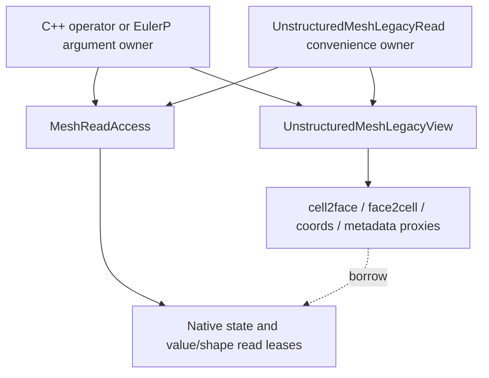

# Native-backed legacy mesh reads: consumer churn reduction

The comparison base is `03891f8b5869017de355468d93294e3eb25f0feb`, the
shared ancestor with `dev/harry`. The pre-change refactor checkpoint is
`1841a2e206770c3bc9f309a1f536309cc2f667ec`. Validation captured the uncommitted
follow-up over that checkpoint. Publication stays on the isolated refactor branch;
it does not merge or replace the ordinary DNDSR checkout.

## Implementation

`MeshLegacyView.hpp` supplies readonly member proxies over native owned/ghost
buffers and row metadata. `UnstructuredMeshLegacyView` also inherits the semantic
query interface, so geometry/periodic helpers have one implementation. Scalar
access returns const references, coordinate rows return const Eigen maps, and
adjacency rows return const spans. Dot/arrow `father` and `son` access and
`bnd2faceV` first-column access cover the required legacy read surface.

The view is trivially copyable and directly CUDA-callable. Proxies contain no
shared pointers, allocation owners or pointers back into the view object. Copies
therefore borrow the same native allocations and remain valid through relocation
to a device descriptor. Descriptor copies do not copy payloads or offsets.
The semantic view plus compatibility descriptors increase view metadata size;
CUDA test kernels receive descriptor pointers rather than relying on a small
by-value kernel-parameter limit.

`MeshReadAccess::LegacyHostView/LegacyDeviceView` preserves the existing backend,
move and seal validation. `UnstructuredMeshLegacyRead` owns the same access scope;
`UnstructuredMesh::AcquireLegacyRead` is its convenience factory. Its checked
host arrow access is for convenience; numerical implementations bind a plain view
once in the prologue, then read raw proxy descriptors in loops.

## Consumer changes

Existing CFV/Euler read scopes remain inside C++ operator implementations.
Prologues bind `LegacyHostView()` and a local `mesh` pointer, restoring the
original numerical-loop spellings. Host MPI, partition auxiliaries and field
indexing use the real owning `this->mesh` explicitly. Persistent callbacks keep
their owning mesh captures; small unscoped semantic helpers are retained.

EulerP keeps its cached placements, source lease, snapshot and `meshRead` owner.
Its plain finite-volume device view now uses the compatibility mesh view; common
kernel bodies recover the old read syntax. All six computational entry paths
construct owning `this_v` arguments. Current CUDA launches use the default
stream, matching acquisition; destruction records/waits for that prefix even
when `serializeCUDAExecution=false`. Host output has its own retained scope.

Dependency stamps, metric-stage finalization, wall-distance epoch checks,
EntitySpace field bridges, face-slot/sentinel guards, restart fixes and EulerP's
HY total-speed correction are retained. Mutable Array access, mesh transformers,
resizing and exact `ArrayAdjacencyPair&` emulation are deliberately absent.

## Caller contract

Raw views, proxies, row spans and Eigen maps do not retain allocations. Keep the
owner until CPU work returns or every GPU use completes. Completion must join
all consuming streams; sealing forbids new views. Copying a view does not record
foreign-stream use. Unrequested groups are hidden; requested empty groups remain
distinguishable through `isBuilt`. Negative unavailable references and absence
sentinels are preserved and must be checked before dereferencing another entity.

## Validation and measured reduction

The [evidence directory](geom_legacy_read_validation_2026-10-26/README.md) records
the final source hashes, build commands, test logs and installed library IDs.
The [per-file review table](geom_legacy_read_validation_2026-10-26/consumer-diff.md)
and JSON retain both ordinary and whitespace-insensitive counts for the tested
snapshot. The [publication table](geom_legacy_read_validation_2026-10-26/publication-consumer-diff.md)
records the final formatted source and breaks down the remaining file buckets.

| Consumer scope | Before changed lines | After changed lines | Reduction |
|---|---:|---:|---:|
| C++ CFV/Euler/EulerP | 2,377 | 1,489 | 37.4% |
| All 28 consumer source files, including Python/apps | 3,030 | 2,142 | 29.3% |
| Same 28 files, ignoring whitespace | 2,824 | 2,092 | 25.9% |

These are additions plus deletions relative to the shared base, not a claim
that 888 executable statements were removed. They exclude Geom support, tests
and documentation. The compatibility header is 146 lines, with another 33 added
lines and one replaced include for access-owner/factory integration.

Required publication formatting adds 146 whitespace-only changed lines in EulerP
declarations/comments. The published consumer total is therefore 2,288 changed
lines (24.5% below the original 3,030), and the C++ subtotal is 1,635 (31.2% below
2,377). The whitespace-insensitive count remains 2,092. The Clang raw-token audit
preserves literal/token spelling across all five formatted source paths; the
original runtime source hashes remain separately recorded.

All 38 selected CPU CTest registrations pass, covering CFV/Euler and mesh facade,
pipeline and communication/compute overlap gates. All four ordinary CUDA gates
pass, including direct two-GPU MPI overlap and entity-field transfer. New facade
cases check exact independent legacy-reference rows, const scalar/POD/coordinate
types, native pointer identity, requested-empty versus hidden groups, separate
ghost rows and sentinels, moved-owner lifetime, mutation rejection, backend/seal
errors, and actual GPU member-access kernels under retained completion scopes.

CPU Python passes 46 tests plus three documented skips per rank at MPI 1/2/4/8.
CUDA Python passes 48 plus one documented skip per rank at MPI 1/2, one rank per
physical GPU. The new test compares the complete native EulerP GPU RHS pipeline
against its CPU reference on 1,024 periodic cells. Both profiles build and install
all four bindings and verify eight extension/shared-library IDs; the final
installed profile is the tested CUDA build. Explicit byte copies after the
mandatory CMake install prevent cross-profile timestamp shortcuts from keeping
an older installed binary.

The source audit also preserves acquisition, dependency, field-bridge,
metric-stage and wall-distance-epoch marker counts in 12 consumer files. This
text audit supplements the runtime gates; it is not a semantic proof by itself.
The initial CUDA compile rejected an extended empty lambda nested in a template
with local callback types; a device-callable empty functor replaces it. The
original failed compile log is retained separately from successful rebuilds and
runtime results. No further source edits followed those tested builds.

This work adds no claim of graph capture, GPU topology mutation or foreign-stream
race detection. No new full sanitizer run is claimed; the earlier external
CUB/RDC and MPI/CUDA-finalization sanitizer limitations remain separate. Raw
borrowed views retain their explicit caller lifetime and index-validity contract.
