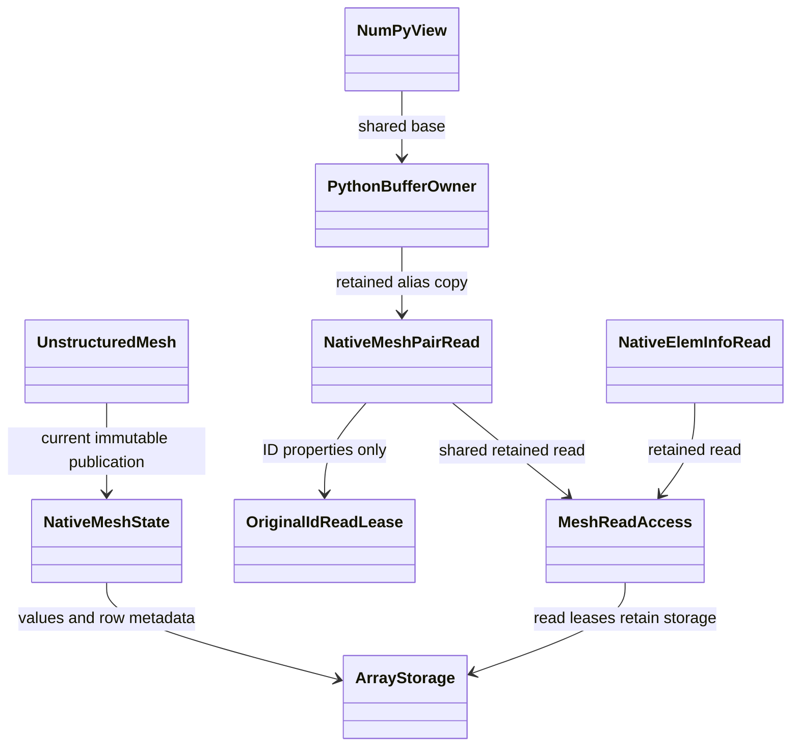

# Retained Python mesh pair views

Native `UnstructuredMesh` properties expose a small read facade over Runtime
buffers. No legacy mesh payload is allocated to implement these properties.
`coords`, connectivity pairs, element metadata and historical ID pairs support
`Size()`, `RowSize(row)`, row access, `(row, column)` access, and `father`/`son`
owned/ghost portions. The names preserve existing read-side usage; native
mutation uses named mesh operations or `mesh.edit()`.



All row and whole-buffer views are readonly, including NumPy slices and
`np.asarray` conversions. Their buffer exporter retains the allocation, row
metadata and semantic mesh read lease. Deleting the original Python mesh or pair
handle does not invalidate an escaped view. Retaining a view prevents conflicting
mesh publication; delete all aliases before a collective mutation. Every rank
must participate in a collective edit/reorder, even ranks with no owned entities.

`pair.father.data()` and `pair.son.data()` return flat zero-copy buffers when the
selected rows have uniform width and contiguous values. Ragged or padded
noncontiguous rows require row access or an explicit caller-created snapshot.
Combined owned/ghost `.data()` rejects separate allocations even if their
addresses happen to be adjacent. Historical ID arrays are one combined allocation
and permit a combined buffer. Empty portions return readonly zero-size buffers.
No implicit concatenation, staging or GPU download occurs through these host
properties. Explicit mesh device placement and retained device reads are separate.

Element metadata rows return `NativeElemInfoRead`. Its `zone`, `type` and
`getElemType()` are readonly. `snapshot()` creates a detached `ElemInfo`, suitable
for passing to an edit; changing this detached value cannot modify mesh storage.

```python
info = mesh.cellElemInfo[0].snapshot()
info.zone = new_zone
# Release retained readonly mesh aliases before commit on every rank.
with mesh.edit() as edit:
    edit.set_cell_info(0, info)
    edit.commit()
```

Edits require native authority and stage independent candidate arrays. Commit
validates coordinates and metadata, preserves the neighbor multiset for
neighbor-order edits, refreshes ghosts and publishes one new generation. Scope
exit without commit discards changes. During migration, explicitly legacy-built
meshes still expose their old properties and must be imported/published before
editing; this temporary branch is not the final native-only construction design.

`test/Geom/test_native_pair_views.py` checks semantic relation agreement, owned and
ghost indexing, ID/coordinate buffers, readonly metadata, escaped view lifetimes
and mutation exclusion. `test_mesh_edit.py` now builds native storage directly
while retaining the previous rollback and failure-detection purposes.
