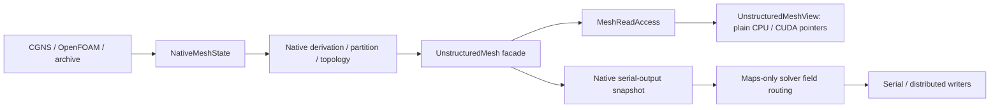

# Native solver setup and retained CFV reads

Euler initialization now imports directly into Runtime arrays, applies requested
elevation/bisection, partitions, prepares topology and constructs the public
`UnstructuredMesh` facade. Its legacy geometry array members remain empty.
CGNS, supported OpenFOAM Hex8 input and compatible archives use the same native
preparation. Matching-partition archive reads preserve saved ownership; direct
partition reads redistribute through native transitions.

Solver fields and metric arrays retain their existing storage. Serial output
gathers geometry only to the writer, and borrows corresponding maps for the
solver's separately owned output fields. Boundary extraction maps its source
boundary IDs back to current volume boundary rows. Output descriptors are
rebuilt after setup smoothing/transforms and before field bindings are created.
Later mesh replacement still requires rebuilding solver fields, metrics and
output bindings; equal row counts do not prove an association.

The native `PrintData` path supports volume and boundary data, serial and
distributed VTU/Tecplot, and parallel VTKHDF. Native output remains synchronous
because its setup includes collective work on the source communicator. The
existing ASCII precision setting still controls decimal loss; tests requesting
round-trip precision explicitly select 17 digits.

`FiniteVolume::AcquireDeviceRead<B>()` returns a host-owned scope retaining the
mesh read lease, allocations and metadata. `View()` returns a trivially copyable
view for a CPU loop or CUDA kernel; its embedded mesh view is independent of
legacy mesh storage. Acquisition validates placement, mesh dependencies and the
metric publication. Reacquiring a view after metric rebuild fails for an old
scope, even when the mesh epoch is unchanged.

The caller must retain `FiniteVolume` and leave its metric arrays unchanged
through all uses. A raw view does not own anything. For CUDA, explicitly call
`mesh.PlaceNative(device, context)` before acquisition; acquisition does not
allocate a placement. Retain the scope through completion or provide a
completion joining every using stream. Wait before moving metric arrays back
to the host. Raw copied views cannot detect subsequent misuse inside a kernel.

This is an incremental migration. Python defaults and pair-property adapters,
and removal of legacy Geom construction/edit fallback, remain separate closure
work. The old DNDS Array and solver field interfaces remain supported.
