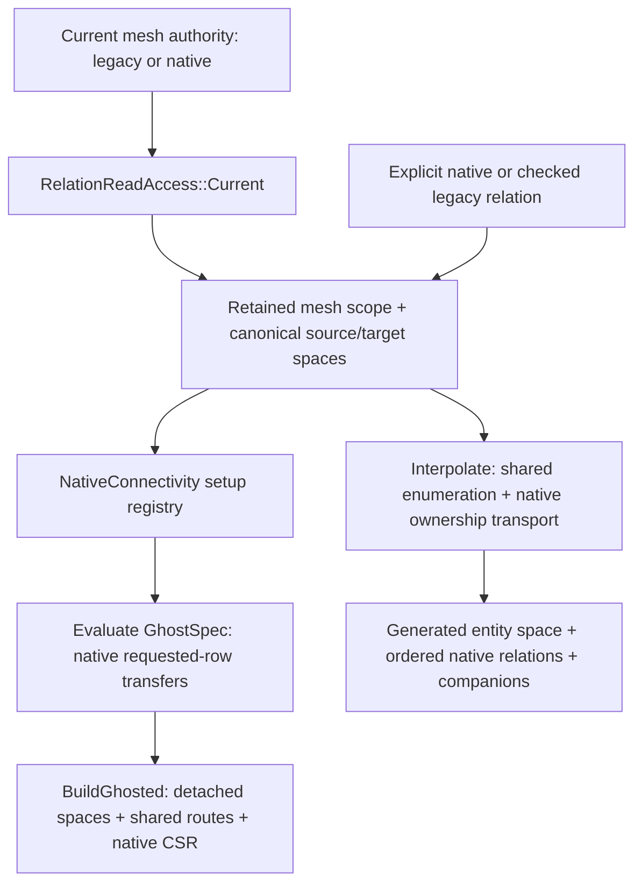

# Storage-neutral relation setup increment, 2026-10-24

`RelationReadAccess` retains explicit source and target `EntitySpace`
descriptors, their version-controller read leases, and host Array value/layout
read leases. Native inputs are not copied into a legacy adjacency. Legacy
inputs share the existing host allocation/controller and require source global
mapping identity plus local-target mapping identity. Native relation metadata
is bound explicitly by `NativeRelation`; `Read(source,target)` rejects another
domain/order even when dimensions agree. Raw native constructor association is
the caller's setup contract; no algorithm can discover a false declaration
from coincidentally equal array lengths.

Reader state is explicit global or local. `UnInitIndex` means absent. A local
negative `-1-global` encoding means an existing global target unavailable in
the retained local target mapping; it is not an absent boundary incidence.
Global sparse input accepts off-rank targets without requiring target ghosts.
Global input rejects local negative encodings, and local encodings that claim
a target is unavailable despite its presence in the supplied mapping are
rejected. Row slots and repeated incidences are retained by the reader.

`MeshConnectivity` now overloads `Inverse`, `Compose` and `ComposeFiltered`
for these readers and returns owned native CSR `NativeRelation` output built
through `Runtime::RowBuilder`. Composition calls extracted shared row mathematics
in `ConnectivityRows`, counts incidences, applies the existing shared-count/match
predicate and sorts output. Native inverse separately deduplicates and sorts
support rows with the same incidence meaning. Empty rows remain explicit CSR rows.

Distributed native inverse routes `(target-owned row, source-global ID)`
contributions to each target's owning rank. One native CSR batch per peer keeps
setup routing bounded by communicating peers; `MPI_Alltoall` exchanges presence
only. `RowTransferPlan::Known` and `DestinationLayout` discover the transfer and
row widths; `PayloadPlan` sends native `index` values with transient direct MPI.
No full topology allgather or legacy reverse-push/scratch adjacency is used.
Ranks with no owned sources or targets still participate. Received contribution
IDs are checked collectively before sorted unique support rows are published.

`RelationGhostRoute(sourceSpace)` explicitly creates an entity-bound collective
route. Copies retain shared native route state. `relation.WithGhostRows(route)`
requires the same source domain/order and global relation entries, discovers
native CSR ghost widths, and performs a transient direct transfer. It returns a
retained owned/ghost relation without changing the original owned relation. Local
index payloads are rejected because their target indices would need translation
into the receiving rank's target map; explicitly publish global entries first.
Wrong entity kinds/domains and stale source orders are rejected collectively.

Native composition is noncollective and requires every referenced intermediate
row to be available in its retained reader. The intermediate source/target
entity order must match exactly. `removeSelf` additionally requires equal
initial and final entity orders, rather than comparing coincidentally equal
numbers from different entity families.

`NativeConnectivity` completes the CPU setup boundary for interpolation and
GhostSpec traversal. The legacy `MeshConnectivity` variant API remains an explicit
compatibility implementation; it is not the native builder. Local interpolation
enumeration/deduplication is shared through `ConnectivityRows::EnumerateSubEntities`.
The new distributed path writes ordered CSR relations, element information and
periodic companions through detached `RowBuilder` commits. It uses the existing
ownership callback and direct native owner messages, including owner-frame PBI.
No native input is converted into an ArrayPair for these operations.

`RelationReadAccess::Current(mesh, kind, requirements)` acquires one current-authority
scope and its canonical EntitySpaces. The scope-plus-descriptors constructor is
private, preventing a caller from attaching mesh A's values to equally sized mesh B
metadata. `RegisterMesh(mesh, requirements)` registers the available relation groups
through one retained scope. Both paths use the published native authority when
present and retain its storage. Sealed or moved underlying scopes reject subsequent
reader access. Raw copied query views still do not extend an owner's lifetime.

`Evaluate` follows the compiled BFS forest, including its cumulative same-kind
collection semantics. Every hop fetches requested owned rows from their owners with
`RowTransferPlan`, native CSR width discovery and transient direct `PayloadPlan`.
Only requested rows move; there is no topology allgather. Empty ranks participate.
Ghost publication compares the complete sorted relation schedule across ranks,
including the intermediary for same-level relations. Direct relations ignore that
field consistently with `AdjKind` equality. Distinct node/face neighbor relations
therefore cannot accidentally share a schedule or exchange each other's rows.
`BuildGhosted` constructs all destination maps before payload routes and returns
one shared `RelationGhostRoute` per entity family. It publishes global entries,
so a missing target ghost remains explicitly resolvable by global ID and is never
silently dereferenced. The caller must request all needed boundary-node and optional
relation closure before publishing a complete compute mesh. A standalone discovery
result is not a proof of compute closure.

Ghosted descriptors retain their source identity, numbering and version dependency;
a tracked source layout/distribution change invalidates them. A newly interpolated
entity family has its own retained version controller and numbering maps. Its node
and parent relation targets still depend on the input entity descriptors. The
returned `NativeInterpolation` retains owned and ghost parent rows, parent slot
ordering, first-owner entity node order, repeated self-periodic incidences,
`entityElemInfo`, and optional node/parent PBI arrays. PBI is frame metadata, never
an index: extraction is slot-parallel, matching compares sorted `(node, bits)` pairs,
and the parent-to-owner transform is a uniform XOR. Owner messages carry the owner
frame; appended parent rows and their PBI are completed through a shared native
source route. Ordered companion transfer uses `RelationGhostRoute::TransferRows`
with explicit source order and `ElementSchema`; custom structs must supply their
actual wire type. Initial topology construction remains on CPU.

The existing full-mesh import and detached transition rebuild still use validated
legacy setup workspaces as compatibility adapters before explicit native publication.
They must not be described as native topology builders. Prepared transitions now
preserve source authority: a native source publishes its rebuilt candidate as native
before binding typed destination fields; a legacy source remains legacy. The
post-redistribution CUDA overlap fixture conditionally publishes only when its
destination is not already native, then executes the native device query.

`test_NativeConnectivity.cpp` adds independent ordered edge expectations, periodic
self-face/PBI checks, empty-owner ranks, cumulative multilayer ring reachability,
legacy traversal parity, current native authority after deliberate detached workspace
corruption, and real IV10 periodic physical-node/frame checks across ownership and
ghost transfers. Syntax checks passed for the new source/test and legacy interpolation
test. Build/MPI/runtime evidence is recorded by parent integration, not implied by
this source-level audit.

New `test_RelationAccess.cpp` covers native/legacy inverse parity, deterministic
sorted support, repeated and empty input rows, distributed sparse targets,
explicit native intermediate ghost transfer before composition, exact self
filtering, absent versus unavailable entries, wrong entity identity/map order,
and mesh mutation exclusion while a reader is retained. Native inverse tests add
independent transpose expectations, owner-routed sparse contributions, duplicate
incidences, zero-owned source/target ranks, collectively rejected malformed input,
and reusable typed ghost-route domain/order/staleness checks. Initial syntax checks
passed for new source and test in
`geom_validation_2026-10-24/relation-access-syntax.txt`; build/MPI validation
is owned by parent orchestration and must be reported separately.
